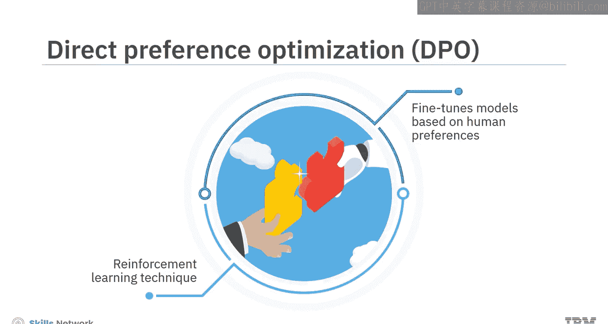
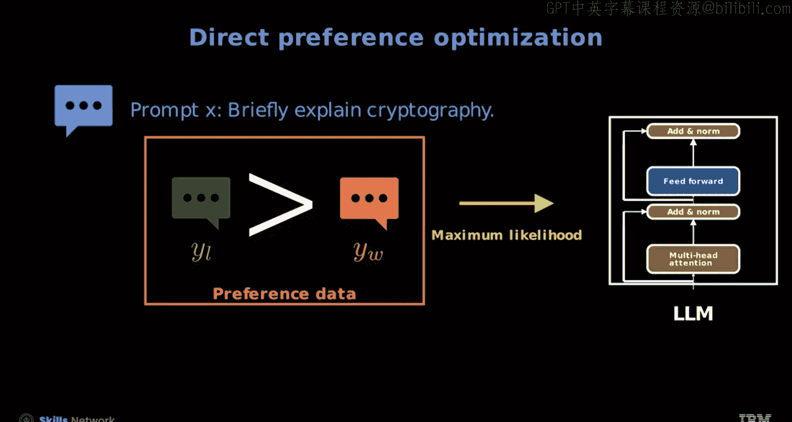
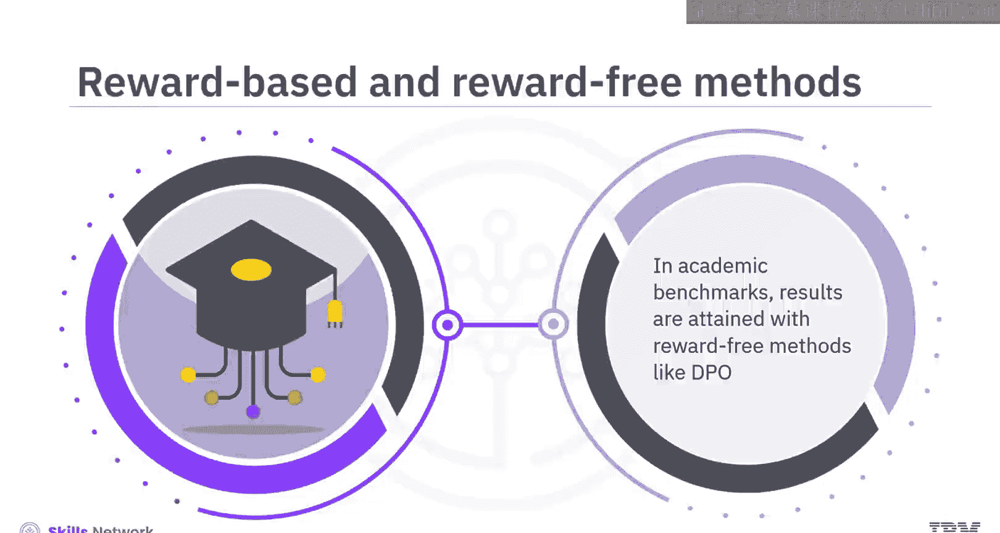
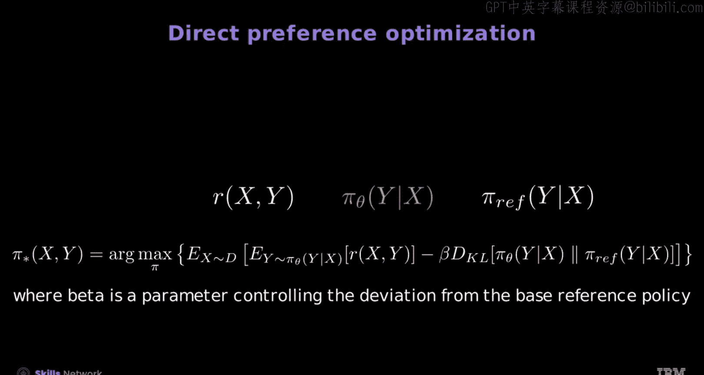
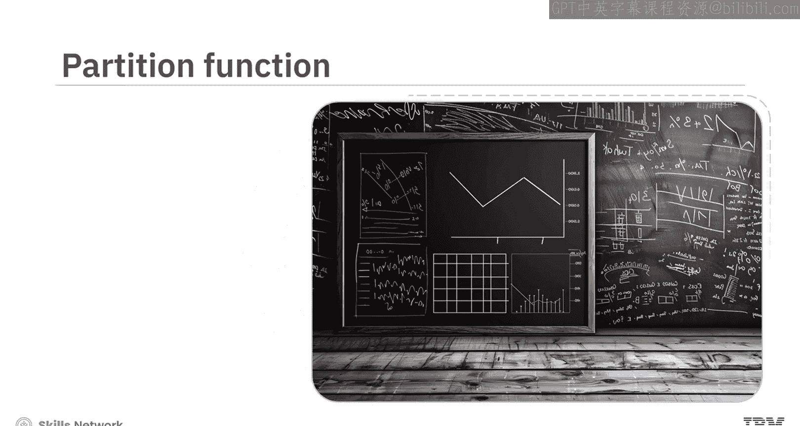
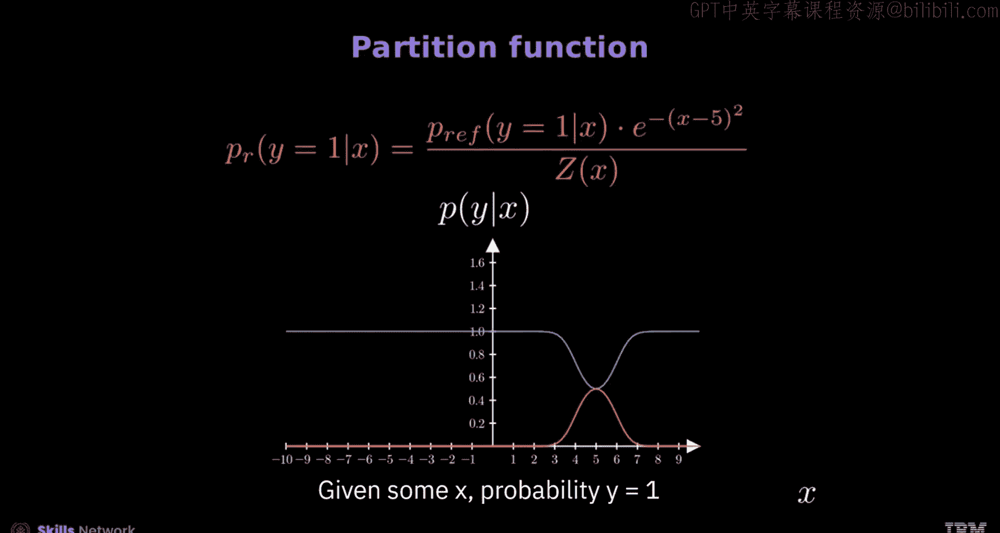

# 153：IBM《生成式人工智能工程｜Falsk、生成式AI应用、数据分析、机器学习、Keras、架构和数据、NLP基础、transformer、微调、高级微调、RAG》 p153 12_DPO分区函数.zh_en -BV1NAq6Y9E7z_p153-

。Welcome to DPO Partition function After watching this video。

 you'll be able to describe the DPO concept and its models and use the partition function to convert a simple distribution to a complex one for the DPO objective。

Direct preference optimization or DPO is a reinforcement learning technique designed to fine tune models based on human preferences more directly and more efficiently than traditional methods。

 DPO involves collecting data on human preferences by showing users different outputs from the model in asking them to choose the better one。

 This preference data is crucial for training。 Unlike traditional reinforcement learning methods。

 which might optimize for a reward signal indirect related to human preferences。

 DPO directly optimizes the models's parameters to produce outputs that better align with human choices。

 novel applications like chatd GT leverage reward based methods that first develop a reward model and then use a or critic algorithm such as a proximal policy optimization or PPO。

However， in academic benchmarks， state of the art results are often attained through reward free methods like direct preference optimization DPO。

 This is because reinforcement Learn orL is extremely complex and involves training reward models。

DPO involves three models。 the reward function， the target decoder and the reference model。

 The reward function uses an encoder model。 For example。

 consider a reward model designed for evaluating the relevance of text on LLMs。

 If your input text is this is a， and the response is cat。

 the reward model would give a low score of 0。1。 The score would be low because cat has nothing to do with LLMs。

 Conversely， if the response is reward function， which is more relevant， the score would be high。

 such as 0。99。 This is because the reward function is related to LLms。

 You also have a target decoder model with parameters the and a reference model。

Running all three models on your GPU is challenging， but the main goal is to obtain a policy。

 pi star， and its parameters that maximize the following objective。

 where beta is a regularization term measuring the divergence from the reference model This optimization shown here requires advanced methods from reinforcement learning or。

 This RL objective function is usually solved by proximal policy optimization or PPO in DO。

 you can convert this complex problem into a simpler objective function that is more straightforward to optimize。

😡。

The partition function is a broad topic， but right now you will only use it for a straightforward example to convert a simple distribution to a more complex one。

😡。

First， let's explore the logistic function， Sigma， which maps any real number to a value between 0 and 1。

 this function forms the basis for the logistics probability function。

 which calculates the probability of y being 0 or1 given x let's call it P ref。

 as you are going to create a new distribution from it。😡，First。

 let's plot the probability of y being 0 given x， This probability is represented by 1 minus sigma of x and is shown in blue。

As x increases， the probability of y being 0 decreases。 Next。

 you'll plot the probability of y being1 given x。 This probability is represented by the sigma of x and is shown in red。

 as x increases the probability of Y being1 also increases。 The partition function。

 Z of x is the sum of the probability of Y being 0 and Y being one given x。

 This ensures that the total probability is one for each x。

 Since this is a valid probability function。 It is redundant。

 You can scale the probability of y equals 0 as a function of x， using an exponential function。

 This function is always positive and is symmetric along the Y axis。 However。

 this is not a true probability since it must meet the criteria of a probability function。Similarly。

 you can scale the probability of y equals 1 using a Gaussian function， which is also positive。

 It is shown here in red as a bell shaped curve centered at a specific x value。 Again。

 this is not a true probability function as it needs to meet the probability function criteria of summing one for each x。

The partition function Z plays a crucial role in normalizing probabilities and custom probability functions。

 Let's start by plotting the partition function in green。 It is not even close to one。 Next。

 you'll plot the scaled probability function for y equals 0 as a function of x shown in blue。

 After scaling by Z， you can see that the function transforms significantly。

Repeat this process for the scaled probability function for y equals1。 plotted in red。 again。

 after scaling， the function changes noticeably。 It's simple to verify visually。

 summing the probabilities for both values of y should yield1 for any value of x。

 This demonstrates how normalization affects probability functions。

 En that they meet criteria of a valid probability distribution。

Let's recap In this video， you learned that direct preference optimization or DPO is a reinforcement learning technique designed to fine tune models based on human preferences more directly and efficiently than traditional methods。

 DPO involves collecting data on human preferences by showing users different outputs from the model in asking them to choose the better one。

 DPO involves three models。 The reward function which uses an encoder model。

 The target decoder and the reference model in DPO。

 you can convert a complex problem into a simpler objective function that is more straightforwards optimize。

 The partition function plays a crucial role in normalizing probabilities and custom probability functions。

😡。

