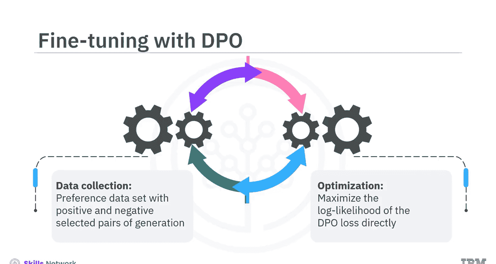
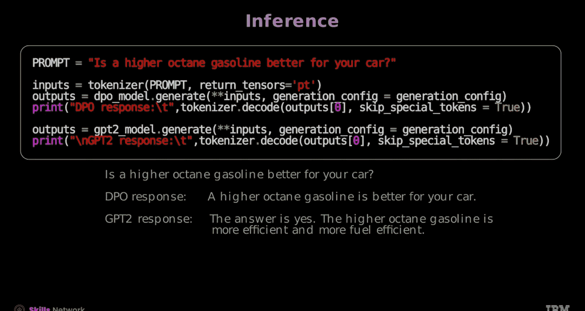

# 156：IBM《生成式人工智能工程｜Falsk、生成式AI应用、数据分析、机器学习、Keras、架构和数据、NLP基础、transformer、微调、高级微调、RAG》 p156 15_使用Hugging Face进行DPO.zh_en -BV1NAq6Y9E7z_p156-

Welcome to DPO with Hugingface。 After watching this video。

 you'll be able to discover Huging face tools for direct preference optimization or DPO and introduce the libraries and resources available for model fine tuning。

 you'll also implement steps for DPO fine tuning such as preproces data set model creation training。

 evaluation and inference Def fine tune a language model via DPO is easier compared to proximal policy optimization or PPO。

 There are two main steps when fine tuning with DPO。First is data collection。

 where you'll gather a preference data set with positive and negative selected pairs of generation given a prompt。

The second is optimization where you'll maximize the log likelihood of the DPO loss directly。

For DO， let's use a data set available on HugingFace provided by Bra Home。To begin。

 load the data using the following command。😡，This data set is divided into six splits。

 and each record within these splits has seven features。

You need three features chosen rejected and prompt。Essentially。

 the data set provides a preferred response and a rejected response for each prompt。

To get a better understanding of the data set， you can inspect a sample record by executing this command this will display one entry from the data set showing the structure and the content of the records。

😡，Before using this data set with the DPO trainer， you must reformat it。Specifically。

 you need to extract the prompt and both the rejected and chosen responses to match the input requirements of the DPO trainer。

 define process function to remove the unwanted features and format the rejected as chosen responses。

Then using the map method， apply the process function to the whole dataset set。 Finally。

 create the training and evaluation sets。 ass sample record after preprocessing the data set is shown here。

 Let's look at the steps required to create and configure the model and tokenizer for your task。

 First， start by loading the decoder G2 model。 This is done using the auto model for causal LM class from the Huging phase transformers library。

 Next， load a reference model， which is essentially another instance of the G2 model。

 This is useful for preserving an unmodified version of the model for reference purposes。😡。

To process the text data， you need a tokenizer。Load the GPT to tokenizer as follows。

 then configure the tokenizer by setting its pad token to the end of sequence or E token。😡。

This ensures that padding is handled consistently。For memory efficient fine tuning。

 you can integrate parameter efficient low re configurationfigurations。

 This is applied to the attention parameter， speeding up training。

 You can experiment with different weights and parameter values to optimize performance。

 Let's define training arguments。The hyperparameters are similar to other methods except for beta。

The beta parameter is the temperature parameter for the DPO loss， typically in the range of 0。1 to 0。

5。Next， define the DPO Traer。The reference model is set to none as you are passing Pft config。

 meaning that it is the original model before adding adapter lower layers。By running Traer。trainin。

 you can start training the model using the DPO method on the provided data。😡。

Now let's plot the training loss of the model。Training logs can be retrieved from the Traer do state。

 which is a JSson file。 It can be seen that training loss is decreasing during training to generate responses using the trained model。

 first load the trained DPO model。Also， load the original GPT2 model for comparison purposes。😡。

You can also try the pipeline function GPT2 tokenizer。Next。

 define the generation configuration for the DPO model。😡，For inferencing the model。

 define the input prompt for text generation is a higher octane gasoline better for your car。

Now encode the prompt using the tokenizer。Then generate text using the DO model as well as the original GPT2 model。

Finally， decode the generated text and print the results。

 The results show that the DPO model can generate a more efficient and straightforward response。

 Let's recap In this video， you learned that there are two main steps when fine tuning a language model with DPO data collection and optimization。

 to finet a language model with DPO and hugging face。

 The first step is to pre processces the data set where you will reformat it Then define and apply the process function。

 and finally create the training and evaluation sets。

 The next step is to create and configure the model and tokenizer for your task。

 Then you will define the training arguments and the DPO trainer。😡。

Next， you applaud the model's training laws to ensure that it is decreasing during training。Finally。

 you will load the trained model to generate responses followed by inferencing the model。

