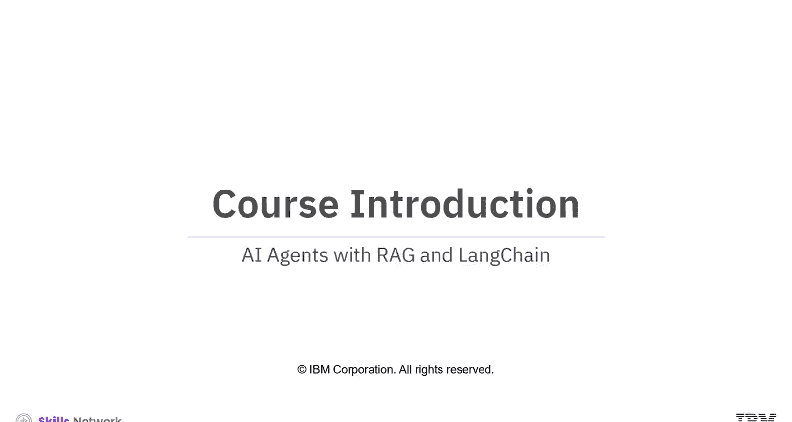
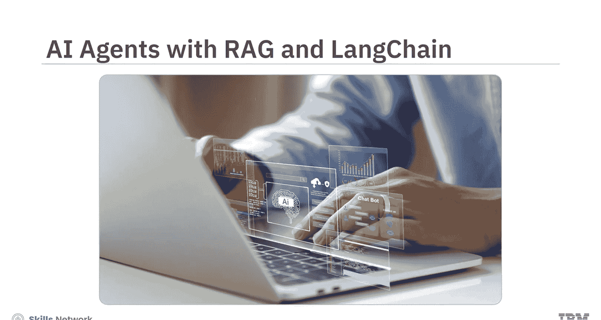
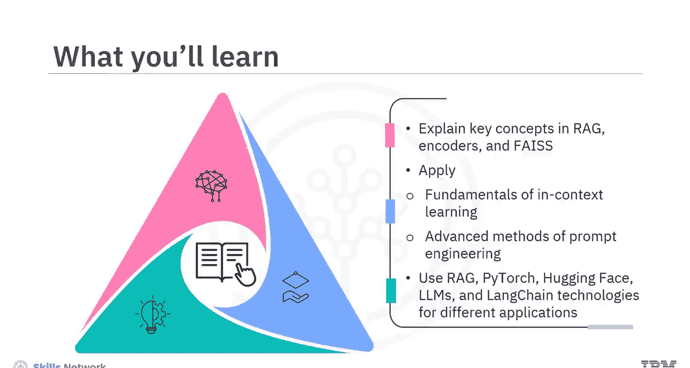
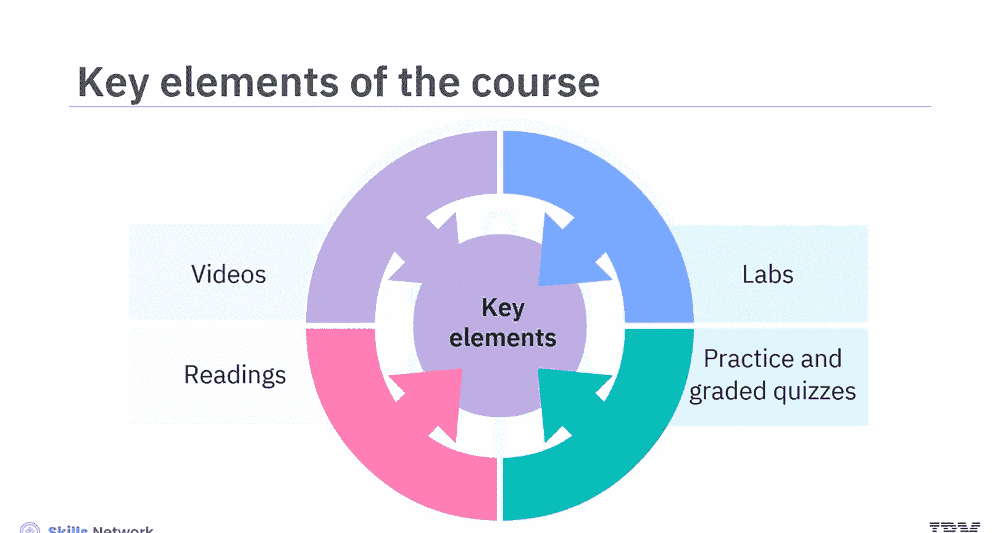
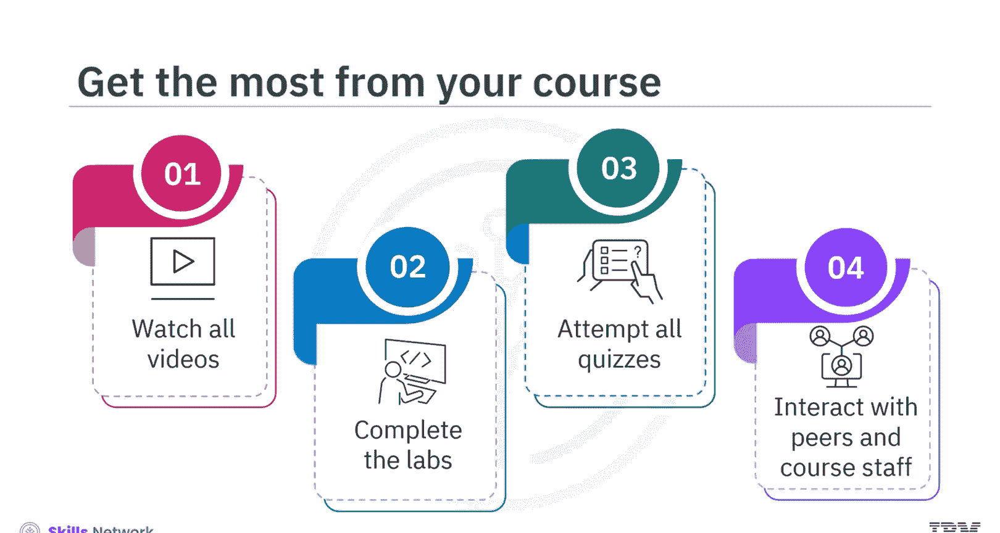

# 157：IBM《生成式人工智能工程｜Falsk、生成式AI应用、数据分析、机器学习、Keras、架构和数据、NLP基础、transformer、微调、高级微调、RAG》 p157 0_课程介绍.zh_en -BV1NAq6Y9E7z_p157-

Welcome to this course on AI agents with Ra and Langchain here you'll learn about AI by working with AI tools and technologies to build job ready skills that will power your AI career forward。

This course is suitable for existing and aspiring data scientists， machine learning engineers。

 deep learning engineers， AI engineers， and developers who want to excel working with LLMs for this course。

 a basic knowledge of Python and Pytororch and an awareness of transformers。

 embeddings and masking would be an advantage。After completing this course。

 you will be able to explain key concepts in retrieval augmented generation or RA， encoders and F。

 you'll be able to apply the fundamentals of in contextex learning and advanced methods of prompt engineering to enhance prompt design。

😡，You will also use RAG， Pytorrch， hugging face， LLMs and Langcha technologies for different applications to acquire job ready skills This course is mainly focused on concepts related to RAG in context learning and Langcha you'll begin the course by learning about RAG an AI framework used to generate responses and its process。

You'll then use the context encoder and question encoder with their tokenizers and explore the F library developed by Facebook AI research you'll also practice applying RaG with Huging face and Pytorrch to different applications。

😡，The fundamentals of in context learning and advanced methods of prompt engineering will help you enhance prompt design Further。

 you'll describe Lang chain's core concepts， components and chat model you'll also explore prompt templates。

 Ex selectors and output parsers Moving ahead， you'll also leverage tools like document loader text splitter。

 vector databases and embeddings to improve the quality of LLM generated responses By deep diving into the Lang chain framework。

 you'll also learn the sequence of chains Lang chain tools and agents and its memory mechanism in hands on labs。

 you will use the Jupiter labs environment to practice these concepts and technologies to build the solid foundation for their application in your projects Finally。

 you will learn job ready skills by performing a guided project based on a real world scenario The course has the right mix of content to facilitate learning Vide are short and focused on the main topic readings provide detailed content primarily in text format the labs provide。

The technical environment， detailed instructions and code snippets that you can use to complete hands-on exercises the practice and graded quizzes will help you apply what you learned and assess your knowledge to get the most from this course watch all videos complete the labs to practice your new skills and attempt all quizzes you can also interact with peers and get help from course staff using the course discussion forums let's get started on this exciting journey Good luck。

