# 159：IBM《生成式人工智能工程｜Falsk、生成式AI应用、数据分析、机器学习、Keras、架构和数据、NLP基础、transformer、微调、高级微调、RAG》 p159 2_RAG编码器和FAISS.zh_en -BV1NAq6Y9E7z_p159-

Welcome to Ra Encors and Fice。After watching this video you'll be able to describe context encoders and how they work you will also be able to explain Facebook AI similarity search or Fice。

Question encoders and discuss how you can generate answers。

Imagine you're an AI engineer tasked with designing a chatbot to handle the ever changing landscape of company policies。

You might consider leveraging retrieval augmented generation， also known as RaG。

This approach combines the power of a language model with realtime information retrieval。

 enabling the chatbot to provide up to date responses without frequently training by integrating RAG。

 your chatbot can dynamically query an updated database of company policies and generate responses that reflect the most current information。

This enhances the chatbot's accuracy and relevance and reduces maintenance overhead。

 making it an ideal solution for managing fluid corporate environments Let's break down the ragG process。

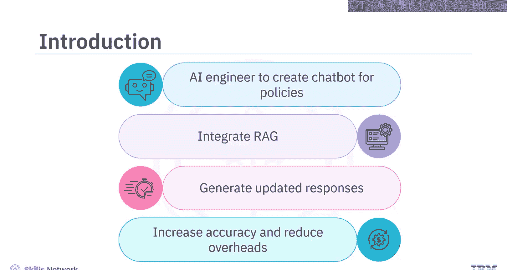

The retriever and code's user provided prompts and relevant documents into vectors。

 stores them in a vector database， and retrieves relevant context vectors based on the distance between the encoded prompt and documents。

The generator then combines the retrieved context with the original prompt to produce a response。

Let's learn more about the context Enr。

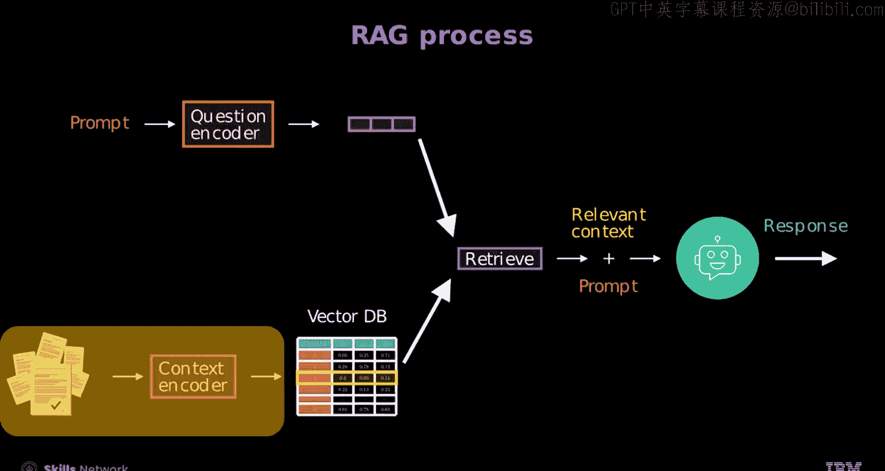

The denseense Pass Retrieval or DPR Contex Ender and its tokenizer focus on encoding potential answer passages or documents。

This encoder creates embeddings from extensive texts。

 allowing the system to compare these with question embeddings to find the best match。

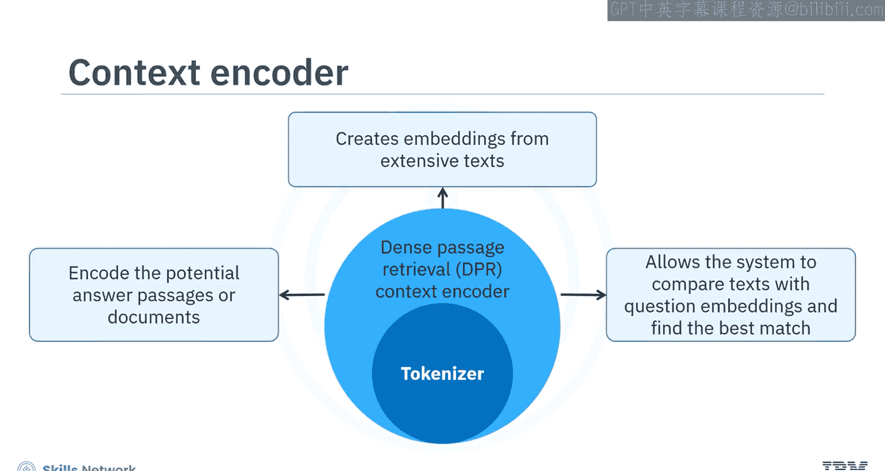

Let's begin by understanding how you can use the context tokenizer。First。

 import the DPR Con encoder tokenizer from the Transformer's library。

Then load the pretrain tokenizer associated with the specified model。

 enabling the tokenization of context documents。Next。

 you must provide a list of tus containing a pair of sentences。

The context tokenizer will process the input text by tokenizing。

 padding and truncating it to a maximum length of 256 tokens。

 and then converting the text into a dictionary of pytorrch tensors。

The output will be referred to as token Info。Token Info holds the essential details for RAG。

 including input IDs， which represent the token IDs or token indexes for the input text and token type IDs。

 which represent the segment IDs are accompanied by attention mask values Following this。

 the Ra embeddingies are generated。As the next step。

 import the DPR context Ender class from the Transformers's library for the Cont Ender。Here。

 the encoder model specifies which pretrained DPR context encoder model to use。

Then initialize the encoder， which loads the pretrain DPR context encoder model to convert text passages into RA context vector embeddings。

You can generate the question using RA context embeddings。First。

 tokens are encoded it passes the tokenized input known as token In through the context encoder to obtain the embeddings Next。

 the puller output shape is retrieved from the encoded outputs。

It indicates the shape of the puller output2 is the number of input text pairs processed。

 768 is the dimensionality of the embedding vector for each text pair as defined by the DPR model。😡。

Consider an example of loading a text file containing company policies and pre processingcessing it to extract individual paragraphs sample paragraphs from the text file are displayed here。

Consolidate all the concepts discussed so far into a single function named in code context。

 the output is a variable called paragraphs， which contains text across 76 paragraphs， Consequently。

 the context embeddings have a shape of 76 by 768 or 76 represents the number of paragraphs and 768 denotes the dimension of each embedding。

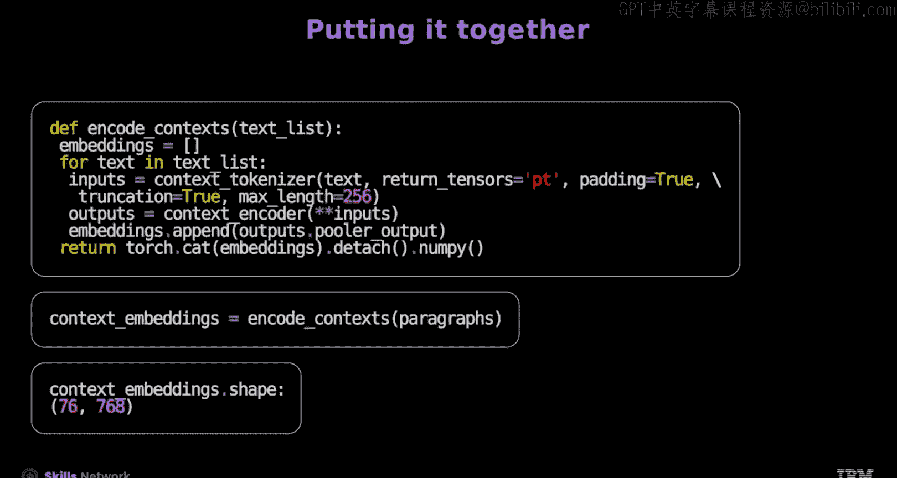

Let's explore Facebook AI similarity search also known as Fice。

 it is a library developed by Facebook AI research that offers efficient algorithms for searching through large collections of high dimensional vectors。

😡。

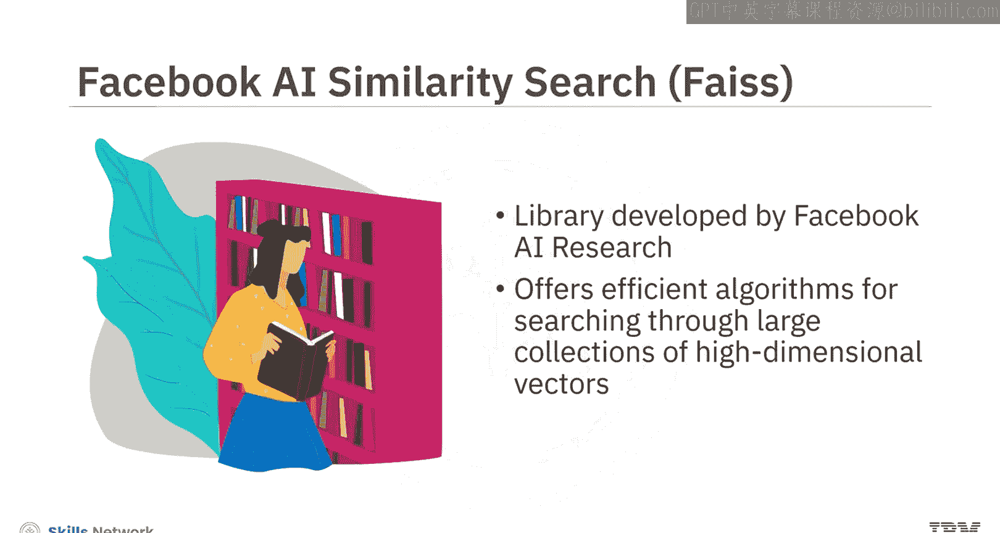

FIS is essentially a tool to calculate the distance between the question embedding and the vector database of context vector embeddings。

You have to import F， which will be used to calculate the distance first， pre process embeddings。

This part of the code converts the context embeddings into a nuy array of TFat 32。

 the next part initializes a F index object for L2 or Euclidean distance named indexex。

 and adds the context embeddings to this F index， making them searchable。Next。

 let's learn about the question encoder。

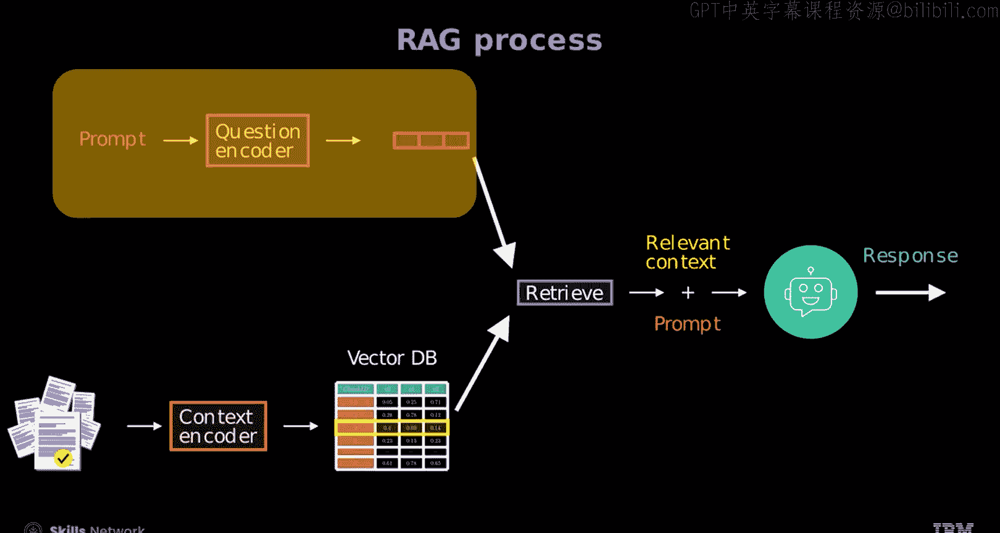

In contrast， the DPR question encoder and its tokenizer focus on encoding the input questions into fixed dimensional vector representations。

 grasping their meaning and context to facilitate answering them。

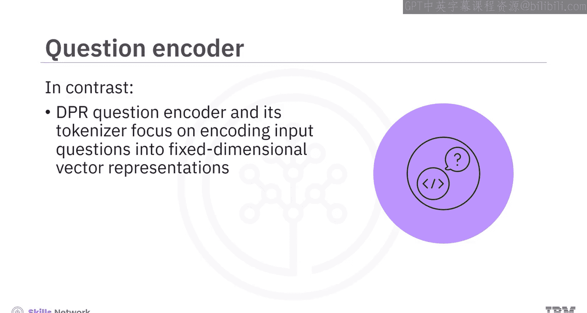

You can import the DR question encoder and DR question Enr tokenizer classes from the Transformer library。

 which are used for encoding questions。First， load the pretrain tokenizer for the question encoder model。

 enabling the tokenization of Que text。Then load the pretrained question encoder model。

 which converts tokenized question text into dense vector embeddings。

The question encoder transforms questions into dense embeddings。

 which are used to search through a corpus of context embeddings for the most relevant documents。

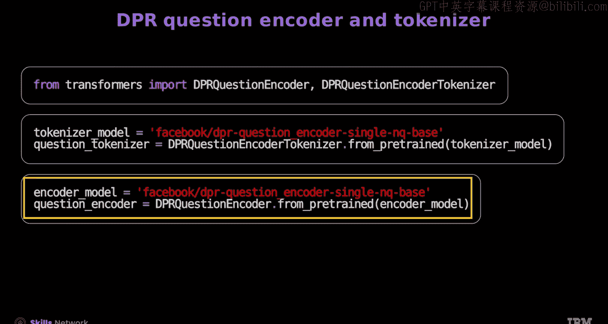

Next， let's learn about the retrieval process。

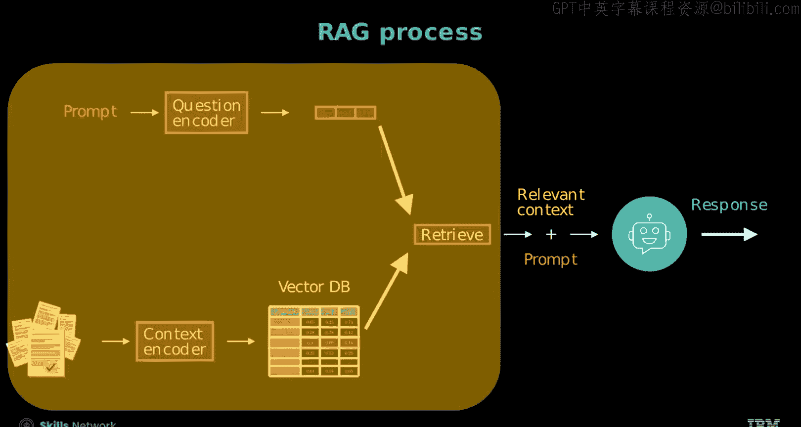

Here is an example where you can test it and retrieve the context embeddings nearest to a question。

The first part converts the question into embeddings。Next。

 it uses the F index to identify the top three closest context embeddings to the question embedding this search will provide these embeddings distance D and indices I this part outputs the distances and indices of the top three closest embeddings。

The Euclidean distances between the question embedding and the top three closest context embeddings in the F index are shown。

 smaller values indicate closer matches， suggesting more relevant context。

The indices of the top three closest context embeddings in the F index are provided。

These indices can be utilized to retrieve the corresponding context documents。In this example。

 corresponding paragraphs are printed according to the index found in the previous step。

These are documents that are most relevant to the question， they can be used as inputs to the model。

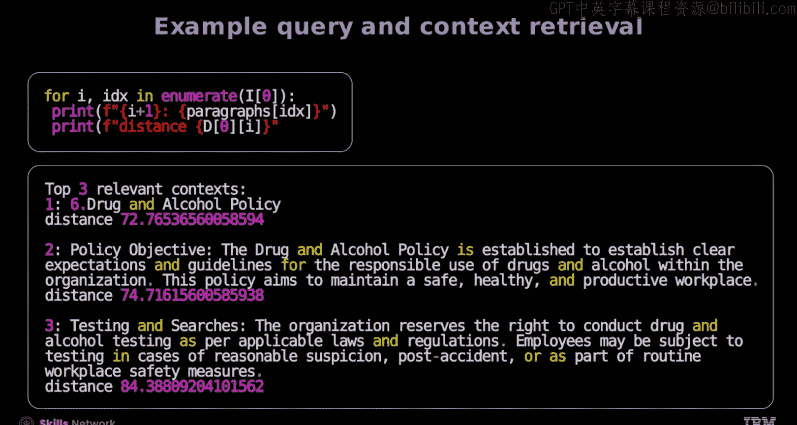

Finally， let's input the prompt in context to generate a response。

You will need a decoder model such as a chat bot to effectively respond to the query question First。

 import the bart for conditional generation and Bart tokenizer classes from the Transformers's library。

Load the pre trained bard model and its corresponding tokenizer。

 This setup is crucial for initializing the text processing framework。

Tokenize the input question to prepare it for BarRT。

 ensure the tokens are returned as Pytorrch tensors by using returned tensors PT。

Set the maximum length to 1024 with truncation to true to keep the input length within 1024 tokens。

Then use bar to generate an answer with the following parameters。

The maximum length of the generated sequence is 150。

 the minimum length of the generated sequence is 40。The length penalty is 2。0。

 which adjusts the length of the generated text where higher values discourage longer sequences。

The number of beams for beamM search is 4， enhancing the quality of the generated sequences。

Early stopping is set to true。 It holds the generation process early if all beams reach the end token。

The generated token IDs are then converted to a human readable string， omitting special tokens。

Now display the generated response from BarRT based on the input question。

 providing immediate feedback on the output quality。Here。

 define the function to call a Bart model using the code discussed in the previous step。

The questions are tokenized and converted to indexes， which facilitates response generation。

Define a question and call a function which returns the answer generated by Bart Next。

 the answer as generated by Bart is displayed。The chatbot model has not been trained on the company's policies。

 limiting its ability to generate relevant responses directly。Therefore。

 you will utilize the context most closely related to the questions identified by RaG。

 this context will then be input into the chat bot to produce appropriate outputs。

Here you can enhance the process by providing BarAt with the context of the question。First。

 define a function that incorporates the text into the process。

 employ F to identify the context indexes closest to our question demoted by I。

The content resembles the question stored in top contexts。The model generates an answer。

 taking the identified context into account。 That's all。 There's no need to train the chat bot。

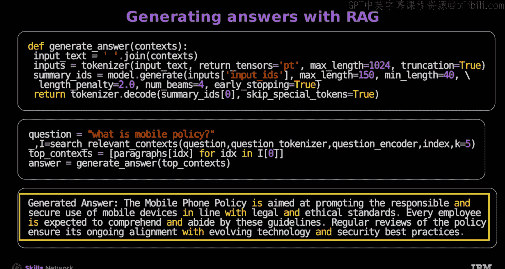

Let's recap。In this video， you learned that the RA process involves encoding prompts intos。

 storing them， and retrieving relevant ones to produce a response。

The DPR context encoder and its tokenizer encode the potential answer passages or documents FIS is a library developed by Facebook AI research for searching through large collections of high dimensionsional vectors。

The question encoder and its tokenizer encode the input questions into fixed dimensional vector representations to facilitate answering them。

Finally， you learned how to generate answers without context and by using RaG。

