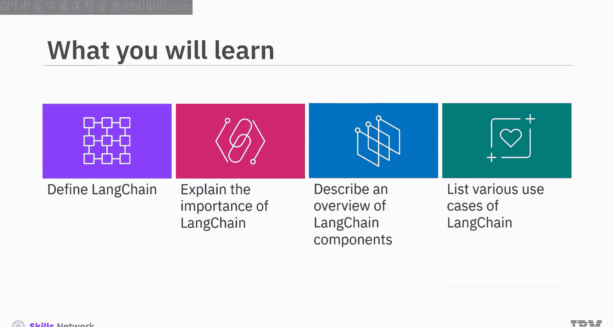
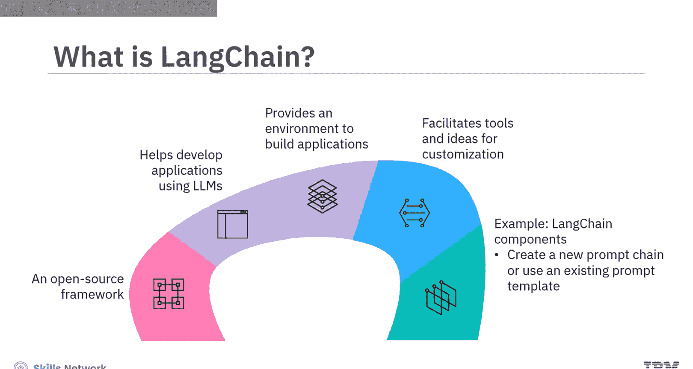
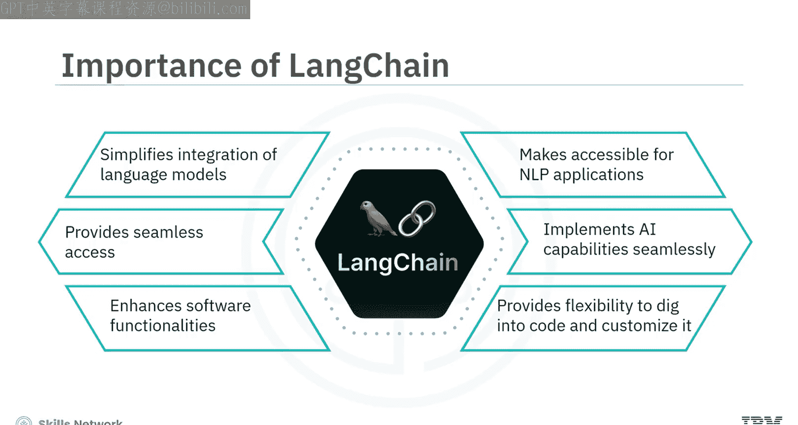
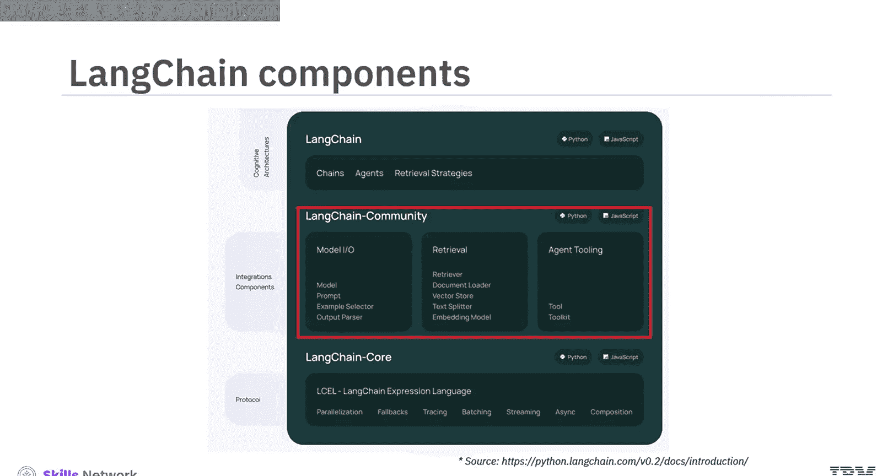
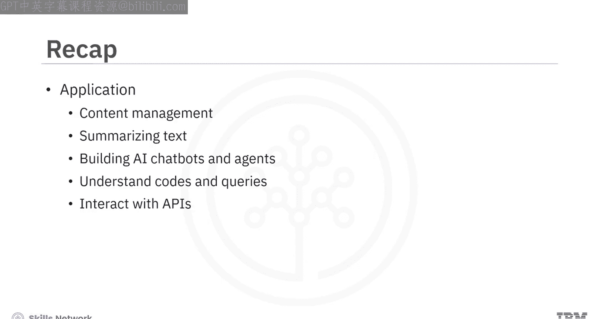

# 160：IBM《生成式人工智能工程｜Falsk、生成式AI应用、数据分析、机器学习、Keras、架构和数据、NLP基础、transformer、微调、高级微调、RAG》 p160 3_LangChain简介.zh_en -BV1NAq6Y9E7z_p160-

Welcome to Introuction to Langchain。After watching this video。

 you'll be able to define lane chain and explain its importance。

 You'll also be able to describe an overview of lane chain components and list various use cases of lane chain。

Consider a content management company that manages a large amount of content， including blogs。

 articles， videos， podcasts， and interactive media across platforms。

 the company faces challenges in managing the vast content library， ensuring quality。

 automating workflows， and ensuring the content reaches the right audience Therefore。

 the company considered leveraging the capabilities of Langcha to streamline its content management process to do so。

 they have arranged an initial introductory session for its employees to understand LangChain。

Let's begin by first understanding what Langchain is Langchain is an open source framework that helps develop applications using large language models or LLMs。

😡，Langchain is a generic interface for LLM， providing an environment to build and integrate applications into external data sets and workflow。

 Additionally， Langchain facilitates tools and ideas to customize the generated model。

 improve its accuracy and provide relevant information。 For example。

 a developer can leverage Lang chain components to create a new prompt chain or use the existing prompt templates to allow LLMs to reproduce the response based on different variables。

Do you know why Langchain is important， Langchain simplifies the integration of language models like G 4 and makes it accessible for developers to build natural language processing or NLP applications。

 It provides developers with seamless access to advanced AI technology and machine learning。

 Langchain also helps developers seamlessly implement AI capabilities into their projects by unlocking new possibilities and enhancing software functionalities。

Langchain also offers unparalleled flexibility and freedom to developers to dig into the code base freely。

 customize it， and develop commercial products based on business requirements。

Now let's look at the components of Langchain， the Lang chain framework consists of several open source libraries。

The first component of L chain includes chains， agents。

 and retrieval strategies which help to make an application's cognitive architecture。

The next component is Lang chainin core。 Lang chain core is a Lang chainin expression language and is the base for abstractions。

 Lang chainin community is a third party integration。

It includes partner packages such as Langchain IBM， Langchain Open AI， and Langchain Anthropic。

 it also splits several integrations into lightweight packages depending on Langchain Co。

Next， let's look at the use cases of Lang chain。LangChain offers various applications that encourage developers to create seamless AI solutions across different domains。

Langchain helps build chat bots and AI agents to enhance user interactions。

 it also simplifies API integration to connect them seamlessly with various services。

Langchain also helps developers extract valuable insights by understanding code and queries in tabular data。

 Further， Langchain helps generate document based questions and answers， summarizes text。

 and enhances information retrieval and content management Langchain is an encompassing tool for various NLP tasks that extends the platform's capabilities to extract and evaluate data。

Let's recap in this video you learned about the overview of Langchain Langchain is an open source framework that helps to develop AI applications using LLMs Langchain simplifies the integration of language models like GPT4 and makes it accessible for developers to build natural language processing or NLP apps。

😡，The components of Langchain include Langchain， Langchain Core and Langchain community Langchain is applicable in various domains such as content management。

 text summarization， building AI chatbots and agents， understanding codes and queries。

 and integrating with APIs。

。