# 163：IBM《生成式人工智能工程｜Falsk、生成式AI应用、数据分析、机器学习、Keras、架构和数据、NLP基础、transformer、微调、高级微调、RAG》 p163 6_LangChain核心概念.zh_en -BV1NAq6Y9E7z_p163-

Welcome to Langchain Core conceptcept After watching this video。

 you'll be able to define a Lang chain and describe its components。

Let's begin by understanding what laneang chain is。

 Lang chain is an open source interface that simplifies the application of element process using LLMs。

It facilitates a structured way to integrate language models into various use cases。

 including natural language processing or NOP and data retrieval。 It consists of several components。

 documentsments， chains， agents， language model， chat model， chat message。

 prompt templates and output parsers。 In this video， you'll review the language model， chat model。

 chat message， prompt templates and output parsers of Langcha。

 The language models and Lang chain are the foundation of LLms。

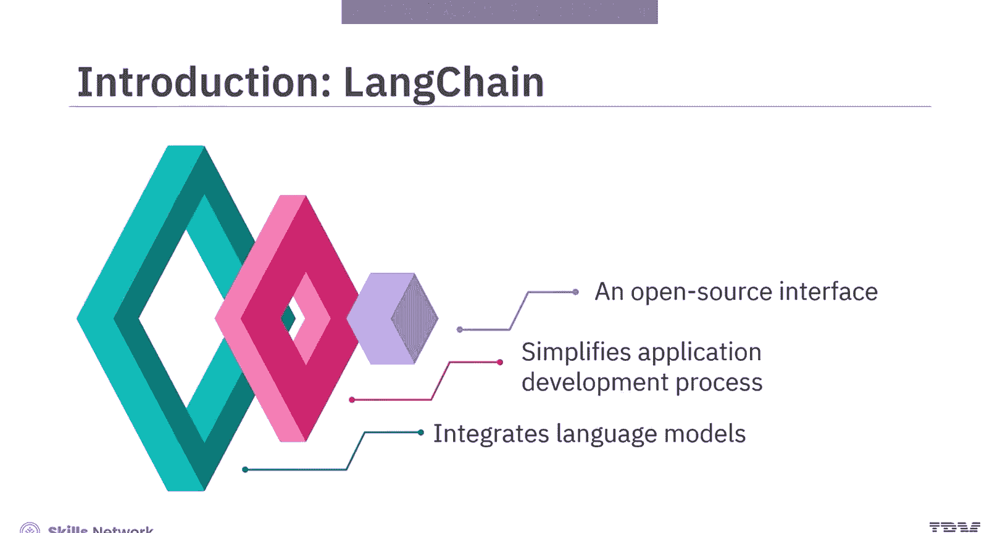

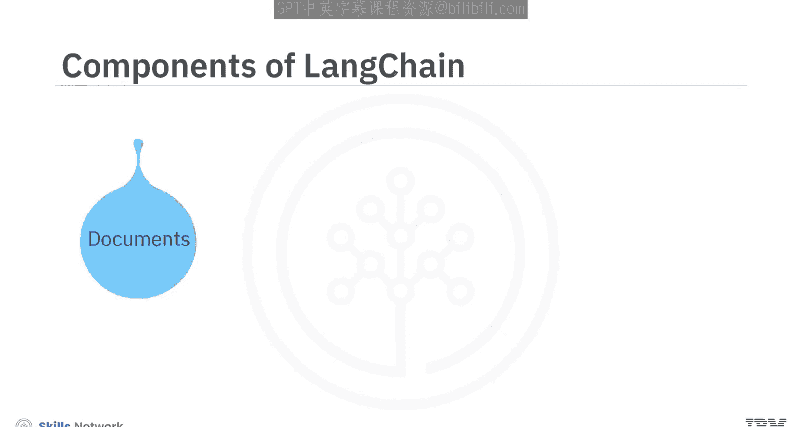

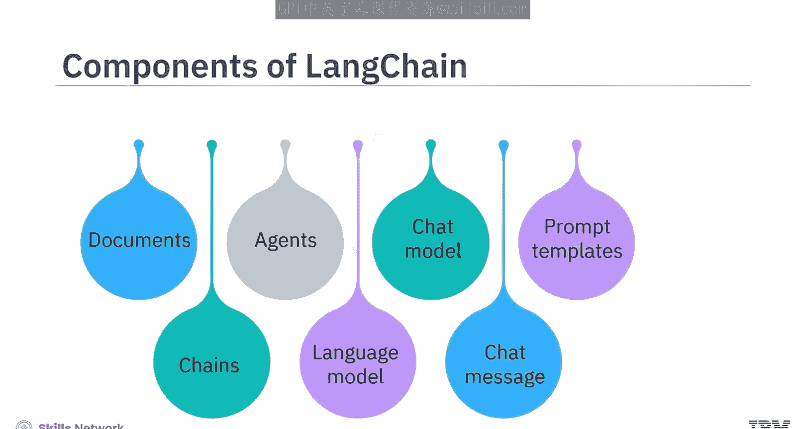

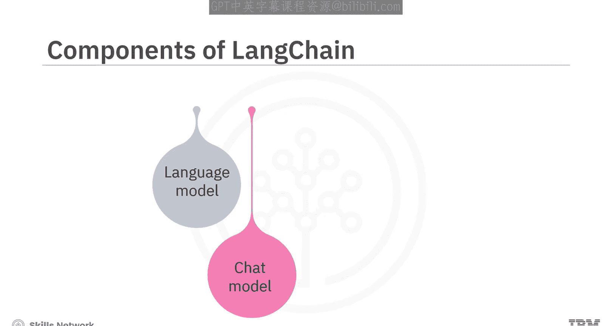

It uses text input to generate text output and helps complete tasks and summarize documents Langchain uses IBM。

 Open AI， Google， and metata as a primary language model， for example。

 to generate a response for a new sales approach using a language model， let's use IBM's Watson X。

 AI to create an LLM based on the Miural 8 by 7 billion instruct model。

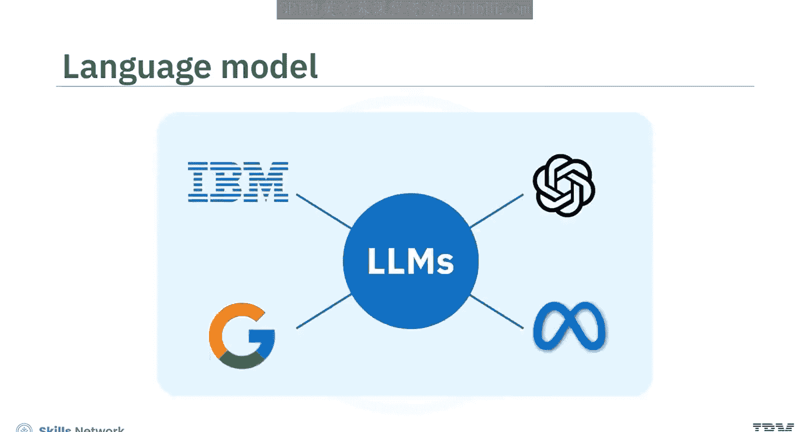

Ensure that the necessary dependencies such as Genpars and model inference are imported from the IBM Watson Maine learning package now customize the model by adjusting settings such as tokens and temperature。

A created model object will appear Next， the model shows a generated response text for the inserted prompt。

 You can view the generated sample response。 The next component of blank chain is the chat model and language model。

 A chat model is designed for efficient conversations。

 It means that it understands the questions or prompts and response to them like a human。 Next。

 to generate a response。 First， create a language model using Watson X dot AI and transform the model into a chat model using Watson X LLM function。

 This converts the chat model into a conversational LLM to engage in dialogues。 For example。

 to see the response， insert a question into the model， such as who is man's best friend。

 You can view the generated sample response for the question。😊。

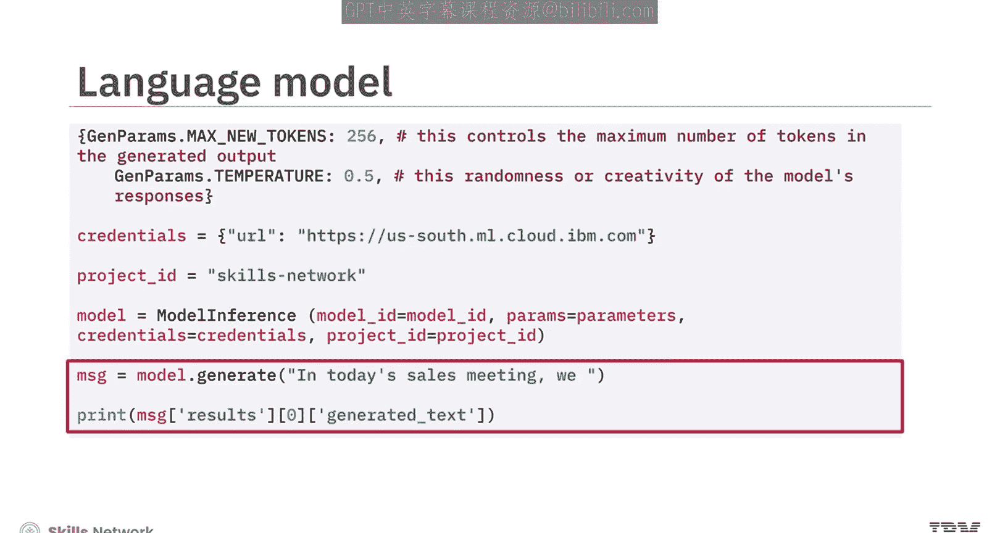

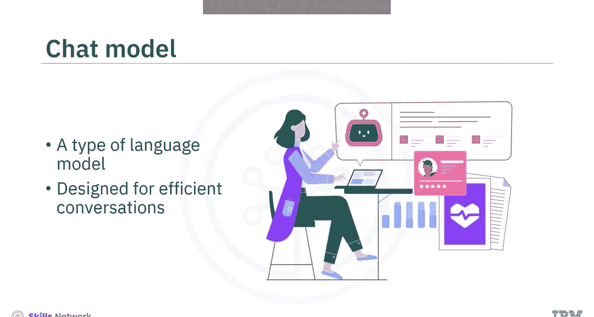

Chat models handle various chat messages to make the model effective in the dynamic chat environment。

 For example， the human message helps user inputs。 The AI message is generated by the model。

 The system message helps instruct the model。 The function message helps to function to call outcomes with a name parameter。

 and the tool message helps in tool interaction to achieve results。In the chat message。

 each chat message consists of two key properties。 The role means who is speaking and the content means what is being said。

Look at the example of a system generated message in which the model has given instructions to be an AI bot to respond to the question what to eat in one short sentence。

 to respond to this question， the chat model creates a list of messages。First。

 configure the model as a fitness activity bot using a system message。

 then simulate the past conversation using human message and AI message Next。

 using these settings the model generates responses based on the previous dialogue。

You can operate the chat model using human message as input and allow the model to generate responses without system message or AI message cues。

😡，It means that the chat bot responds directly to human inputs the next component of Lang chain is prompt templates。

 the prompt templates and Lang chain translate the user's questions or messages into clear instructions。

😡，The language model uses these instructions to generate appropriate and coherent responses。

 The types of prompt templates are string prompt templates is useful for single string formatting。

 chat prompt templates is useful for message lists and specific templates such as message prompt template。

 including。AI message prompt template， system message prompt template。

 human message prompt template and chat message prompt template allows flexible role assignment。

 The messages placeholder provides full control over message rendering and few shot prompts template provides specific examples or shots for LLms。

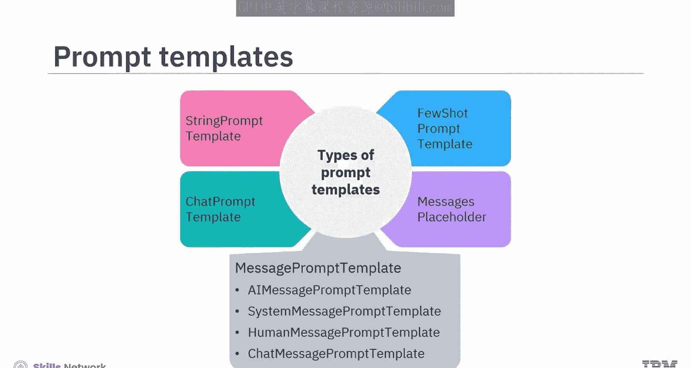

Let's use the chat pro template to generate a response in this prompt template。

 specify a message's role in content。 Next， within the content。

 include the parameter placeholders for repeated use to generate dynamic and flexible messages based on the input parameters and format your prompt。

 Now， let's look at the example selectors in prompt templates。

 It is important to select the most relevant examples from the example library to put them into the prompt。

 an example selector in the prompt template makes this process efficient。 For example。

 the few shot prompt template provides specific examples or shots to LLM。

 These examples or shots inform the model about the inserted context and guide the LLM to generate the desired output。

 using example selectors from line chain。 you can optimize the few shot prompt templates by selecting semantic similarity。

 Max marginal relevance for diversity Ex of efficient prompts and Ngramm overlap for textual similarity。

 The screen displays the。

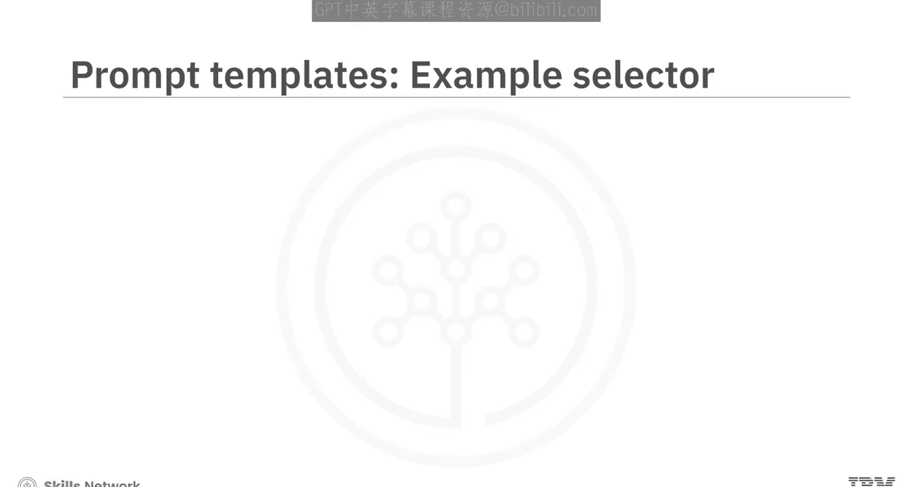

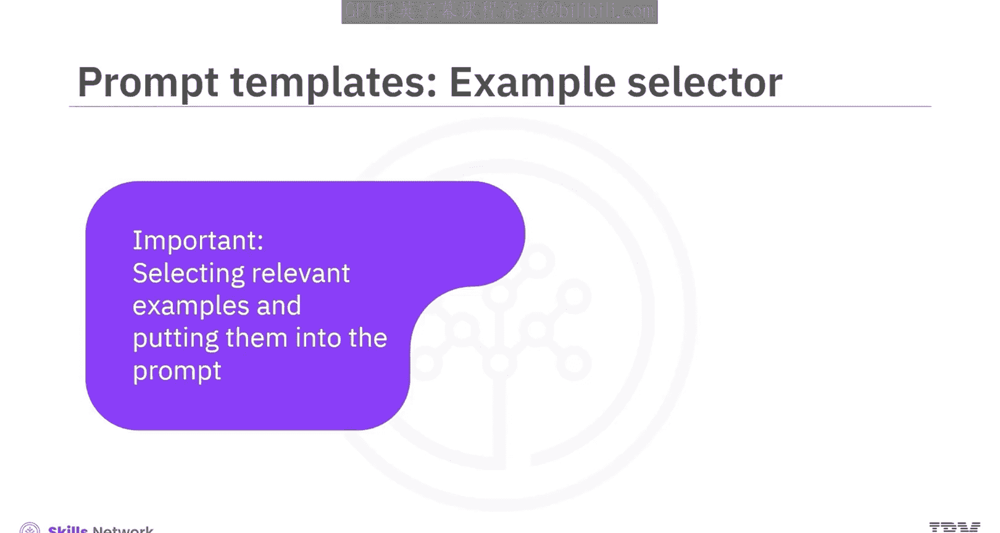

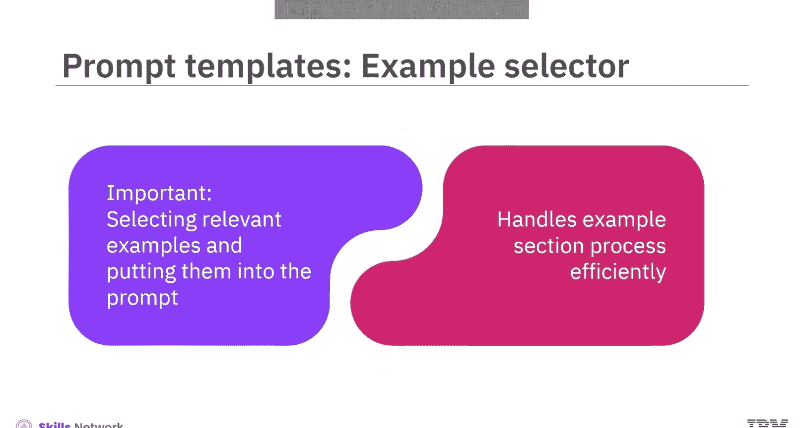

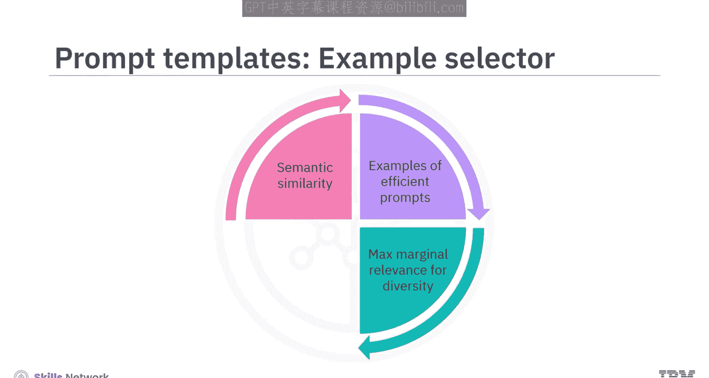

To select examples using an Ngram overlap example selector to form a few shot pros The next component of L chain is the output parsers The output parsers transform the output of an LLM into a more suitable format for generating structured data。

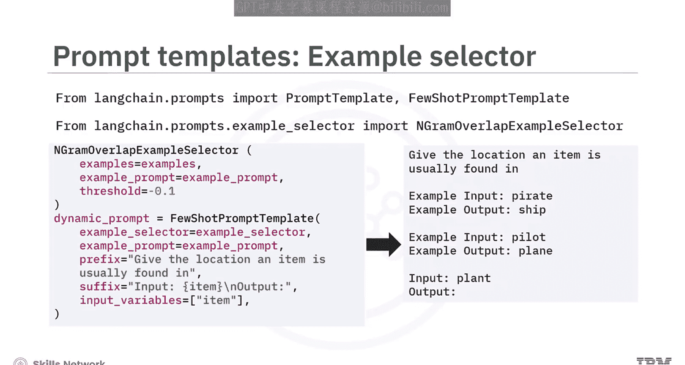

The Lang chain provides a library of output parsers for various data formats， including JSON， XML。

 CSV， and handada frames。Output parsers allow you to tailor the model's output to meet specific data handling needs。

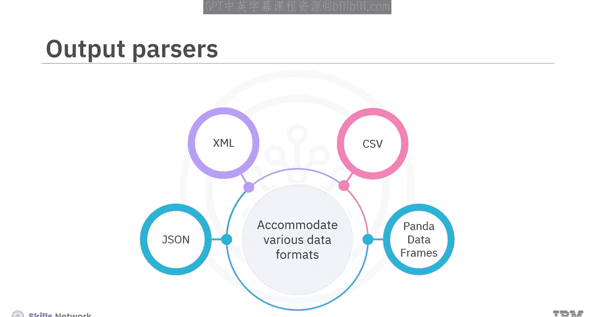

For example， let's use comma separated list output parser to convert LLL's response into CSV format。

This output parser effectively structures the output and simplifies it to handle and analyze in spreadsheet applications。

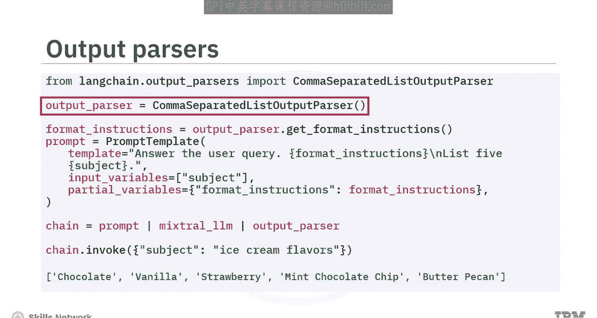

Now let's recap in this video you've learned about the components of L chain。

Langchain is an open source interface that simplifies the application of element process using LLMs。

The core components of L chain are the language models in L chain use text input to generate text output。

 The chat model understands the question or prompts and responds like a human。

 The chat model handles various chat messages such as human message， AI message， system message。

 function message and tool message。The prompt templates and L chain translate the questions or messages into clear instructions。

You've also learned about the example selector， which instructs the model for the inserted context and guides LLM to generate the desired output。

 Lastly， you learned about the output parsers that transform the output from an LLM into a suitable format。

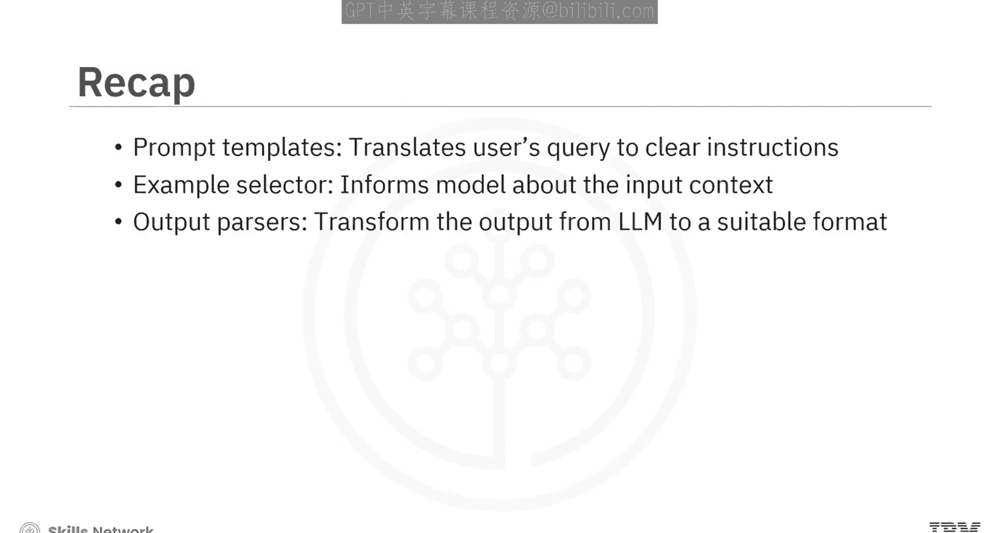