# 164：IBM《生成式人工智能工程｜Falsk、生成式AI应用、数据分析、机器学习、Keras、架构和数据、NLP基础、transformer、微调、高级微调、RAG》 p164 7_构建RAG应用的LangChain文档.zh_en -BV1NAq6Y9E7z_p164-

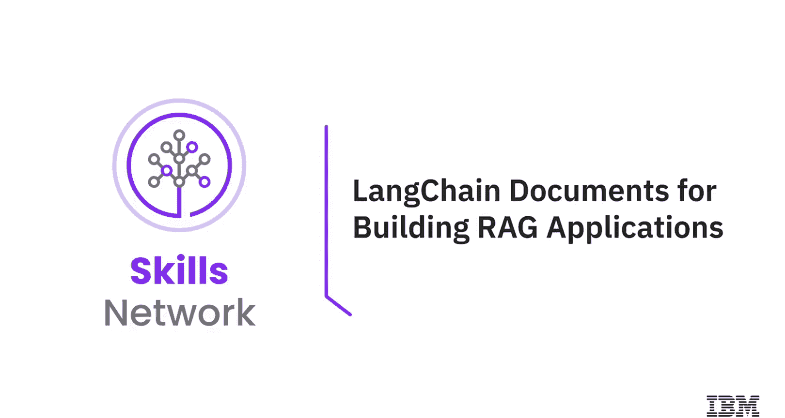

Welcome to Langchain Documents for Building RaG applications。

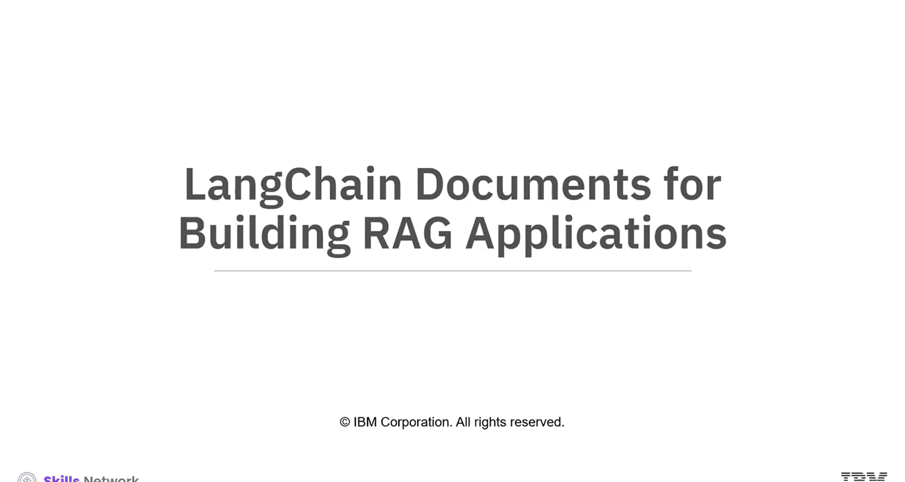

After watching this video， you'll be able to explore La chainin tool documents to build RA applications you'll also be able to explain the components of documents such as the document object。

 document loader， text splitter， Ve database and retriever building applications rely on AI technologies to understand how to build and implement LLM based applications。

😡。

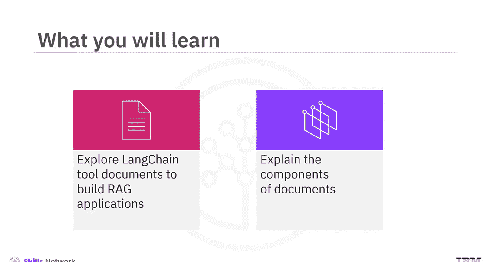

Langchain simplifies the application building process by providing an easy to use interface for integrating data。

 APIs and pretrained language models for building applications it is vital to collect relevant documents。

 Let's delve into Lang chain documents。

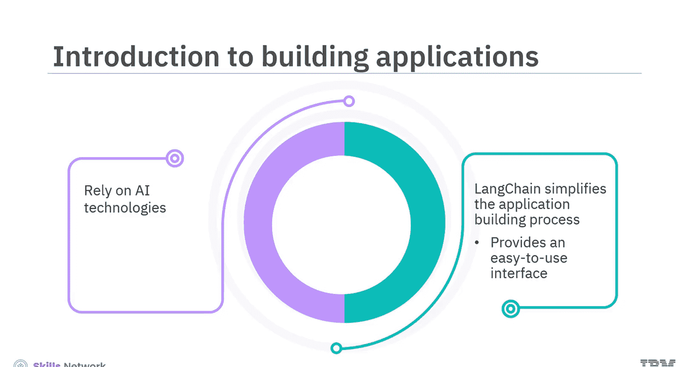

LLM applications incorporate user specific data that doesn't require initial training Retrieval augmented generation or RAG played an important role in achieving this。

In RA， the external data is retrieved and then integrated during the next steps。 Additionally。

 Lang chain facilitates comprehensive tools for rag applications。

 focusing on the retrieval step to ensure sufficient data fetching The data fetching process includes various steps such as document source document loaders。

 document split document embeddings， document storage and document retrieval。

 Let's review each of them。 The document source and Lng chain serves as a container for data information using key attributes。

 These attributes are the page content attribute， which holds document content limited to strings and the metadata attribute stores arbitrary data associated with the document for example。

 document I file name and other relevant details。 These attributes allow the document object to manage and use document data within Lng chain。

 for the Ra application loading documents as a vital process。

 Lang chain loads document from more than 100 sources。

 including major providers such as airbite and unstructured。 It handles various documents。

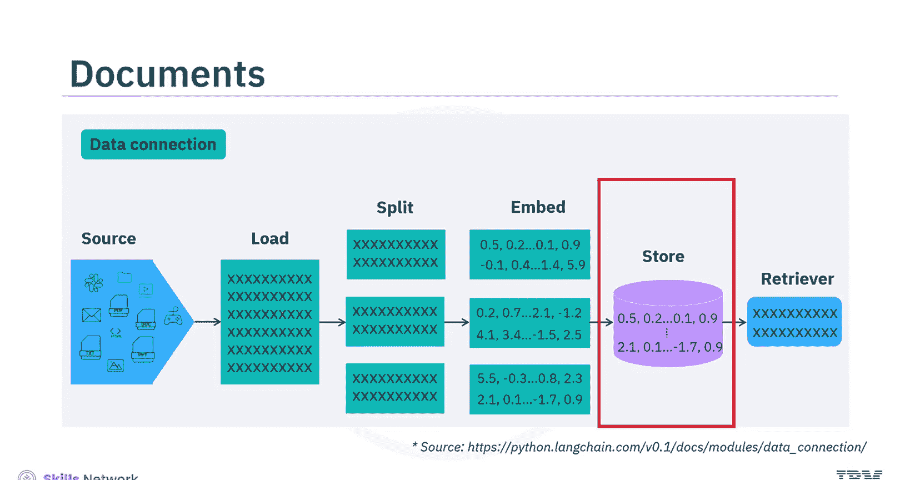

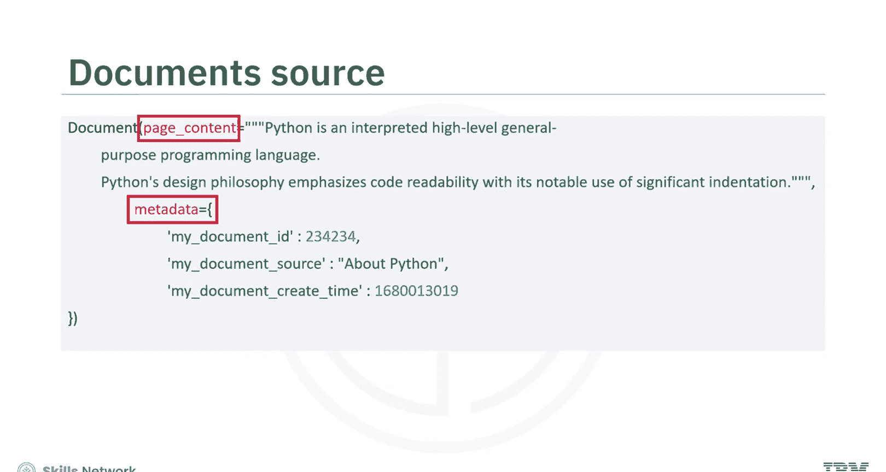

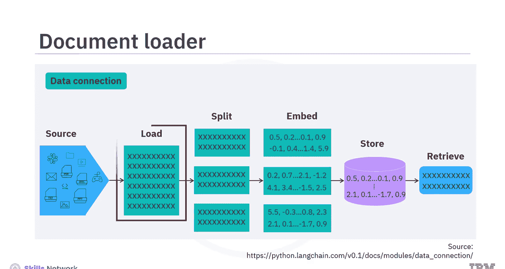

Tpes including HTML， PDF and code from various locations such as S3 buckets and public websites For example。

 the web based loader imports text content directly from websites or URLs The next is the document transformation step where data gets split into chunks Langchain retrieves relevant isolated sections from the documents by splitting large documents into manageable pieces with tailored text splitters。

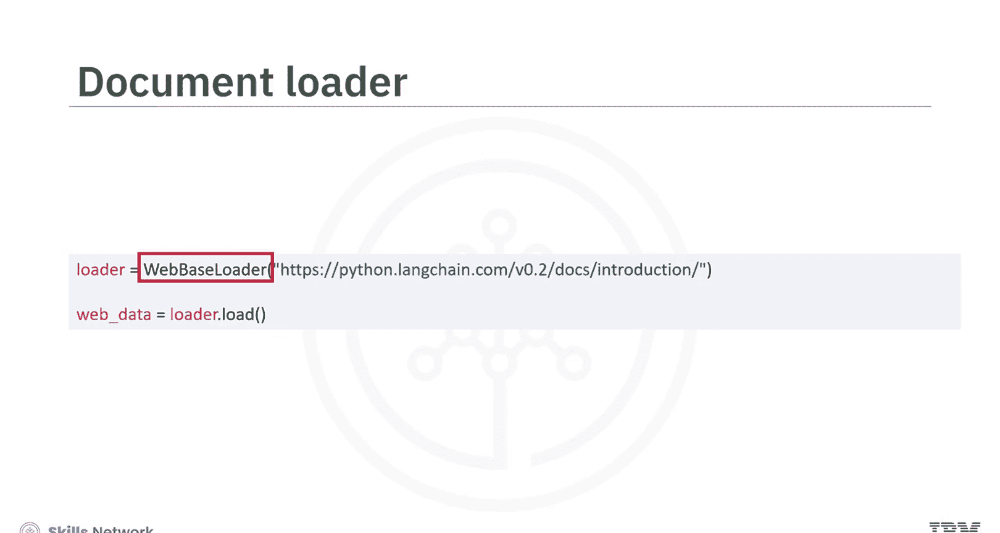

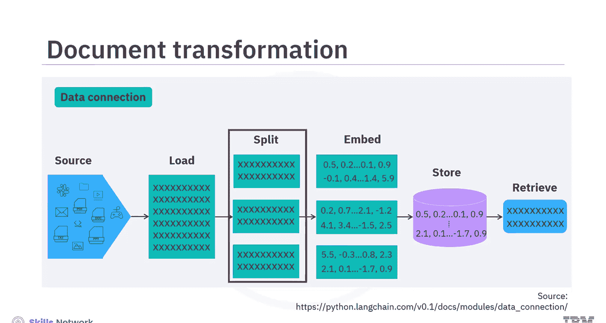

For example， the recursive character text splitter recursively splits the text。

 and the Markdown header text splitter uses Markdown headers to divide text Let's use character text splitter with a user defined separator to view the number of chunks the content has been split into Next is creating embeddings for documents embeddings capture the semantic meaning of the text。

 For example， let's use an embedding model from whatsson next。 AI。

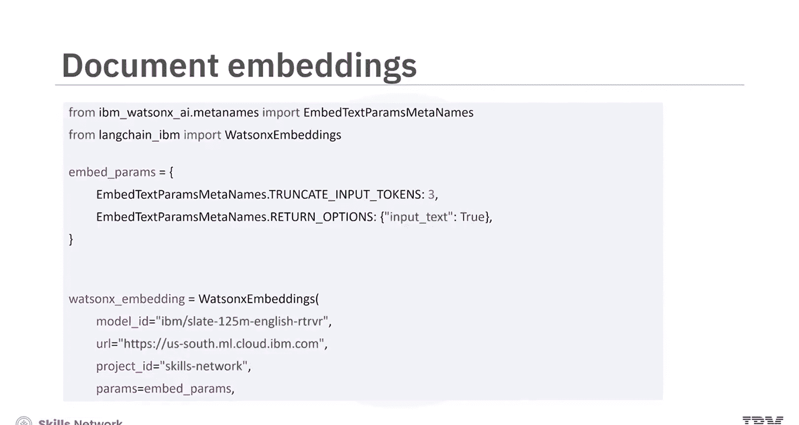

The embeddings have become increasingly important。 There's a growing need for databases to store data efficiently。

 For example， let's use the Chromo vector database to store embeddings and perform a similarity search to retrieve relevant content for the inserted query。

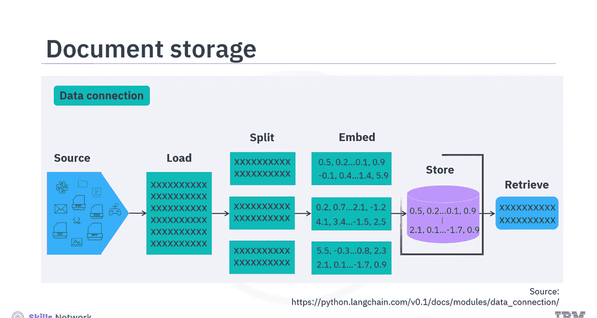

You can view the content that the LLM has retrieved from the query by calculating the distance and finding the nearest text chunk and bedding。

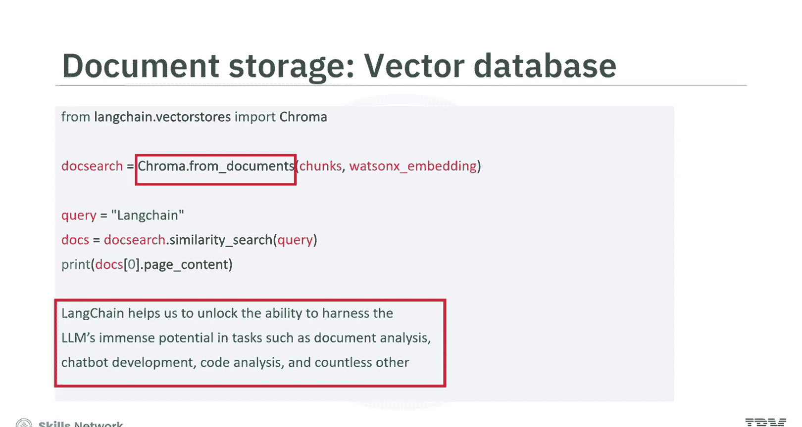

It is important to retrieve data efficiently once it is stored in a vector database。

 Lang chain supports various retrieval algorithms tailored to enhance search effectiveness。

 Langcha facilitates various retrievers such as vector store retriever for similarity searches。

 the parent document retriever for searching within the document chunks and the self query retriever for separating。

 Let's identify relevant information for Lang chain using vector store retriever for the document。

 Here is an example of the response。 You can see that it shows a similar result as the similarity search strategy to search in a vector database because the vector store retriever is based on similarity。

 Let's recap。 In this video， youve learned that Lang chain facilitates comprehensive tools for Ra applications。

 focusing on the retrieval step to ensure sufficient data fetching。

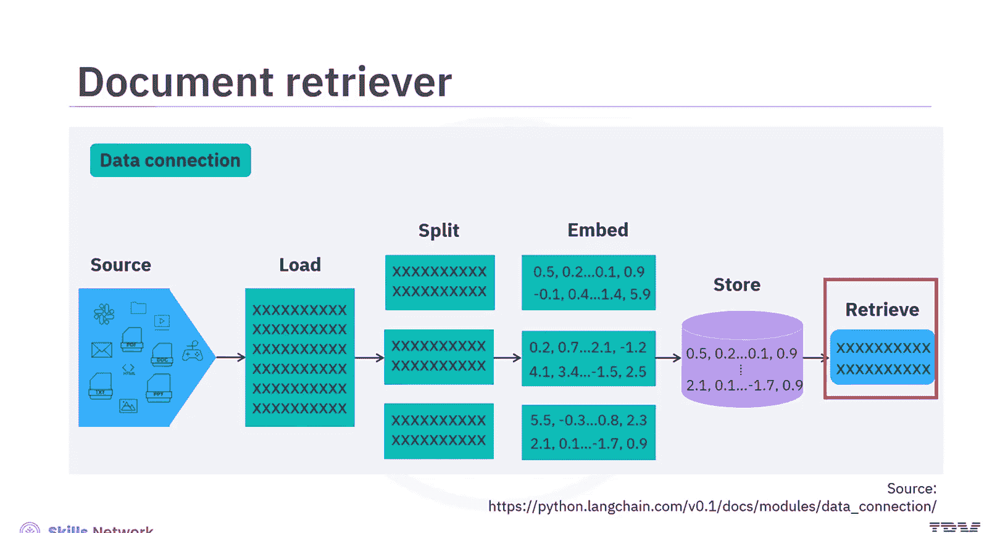

The document object in Langchain serves as a container for data information。

 including two key attributes such as page content and metadata。

 Lang chain document loader handles various document types such as HTML， PDF。

 and code from various locations。Langchain in document retrieves relevant isolated sections from documents by splitting them into manageable pieces。

 an embedding model embeds documents and Lang chain facilitates various retrievers。

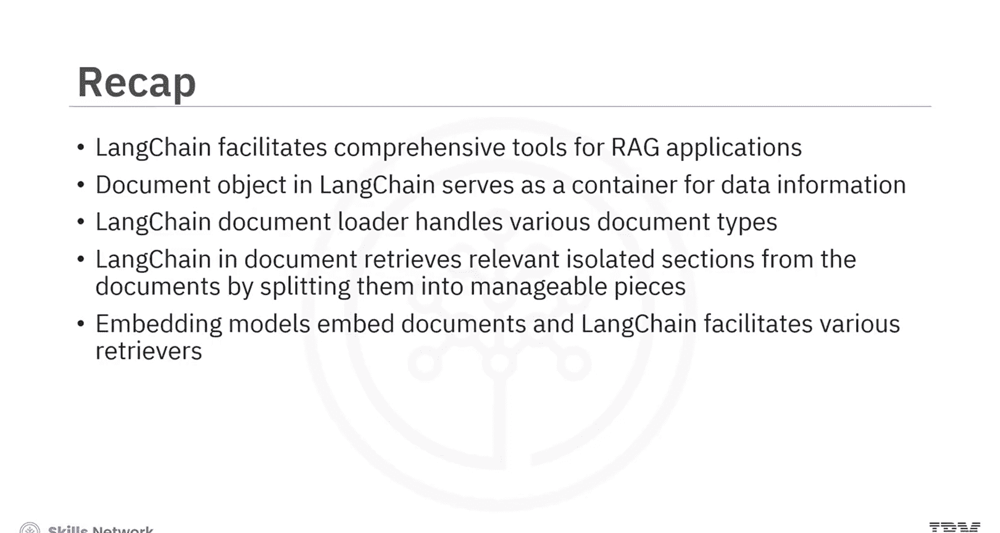