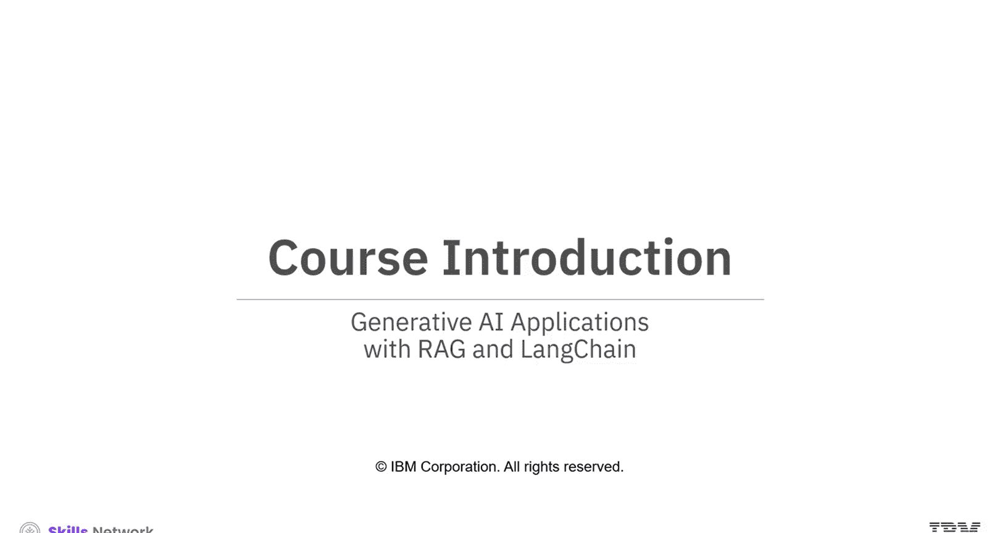
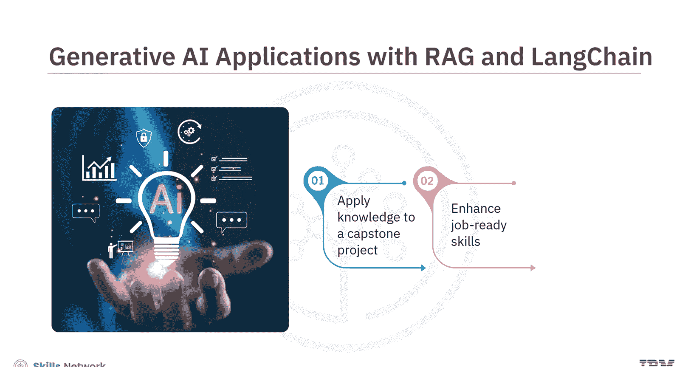
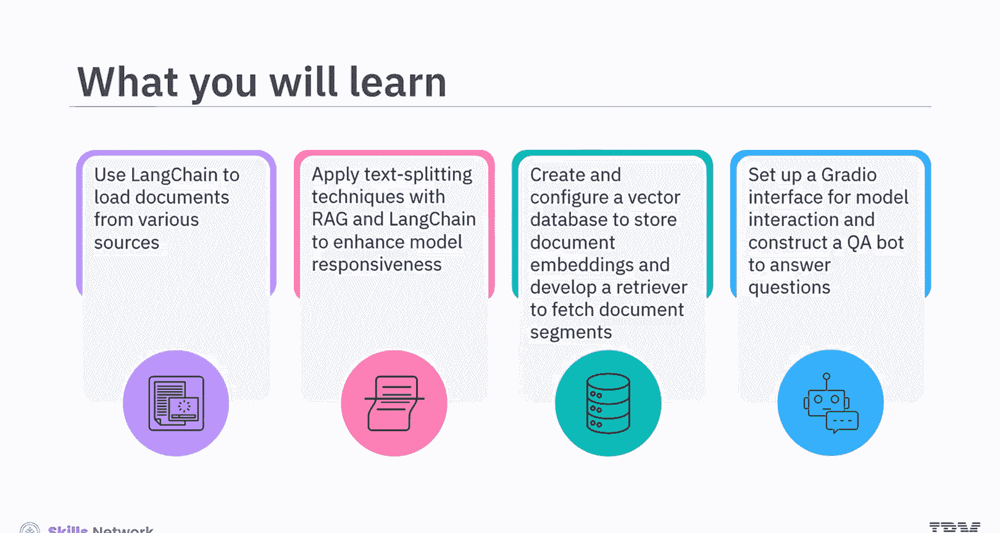
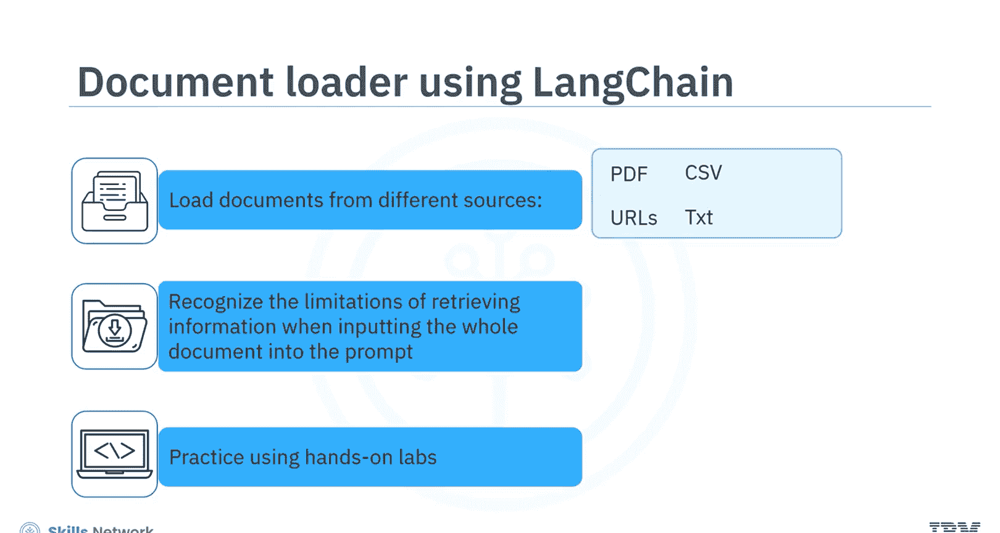
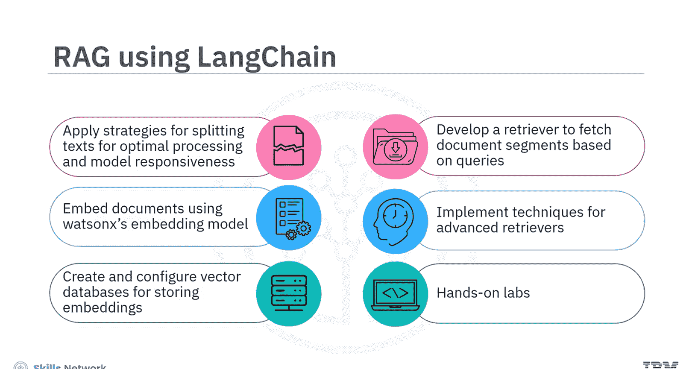
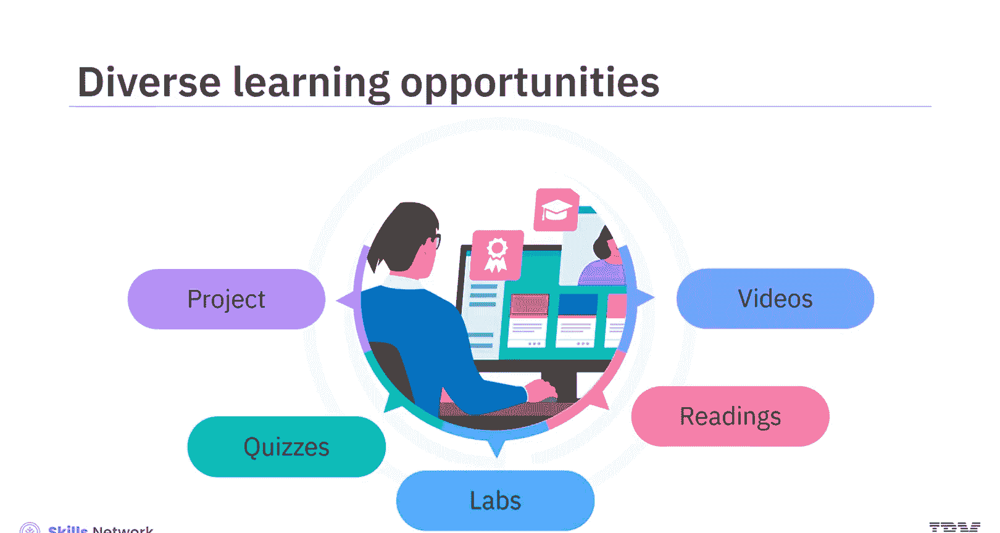
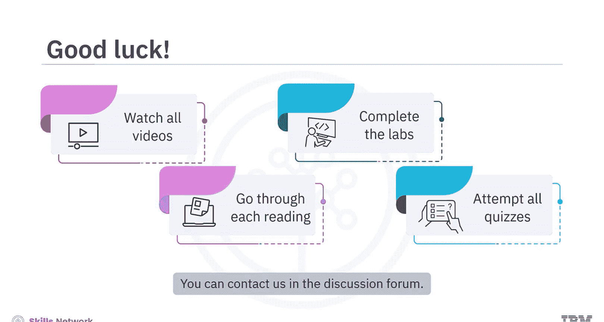

# 166：IBM《生成式人工智能工程｜Falsk、生成式AI应用、数据分析、机器学习、Keras、架构和数据、NLP基础、transformer、微调、高级微调、RAG》 p166 0_课程介绍.zh_en -BV1NAq6Y9E7z_p166-

Welcome to this course on generative AI applications with Ra and Langchain。

Here you will have the opportunity to apply your newly acquired knowledge and skills to a capstone project on AI applications that use retrieval augmented generation or RAG and Lang chain this course will enhance your job ready skills and accelerate your career in AI。

This course is suitable for those interested in AI engineering， and includes training， developing。

 fine tuning， and deploying large language models or LLMs。

 existing and aspiring data scientists and machine learning engineers will benefit greatly from this course。

The course requires a basic knowledge of Python familiararity with LLMs。

 Lng chain and rag would be an added advantage。After completing this course。

 you will be able to use Langcha to load documents from various sources such as PDF， CSV， URLs。

 and textex。You will also be able to apply text splitting techniques with rag and L chain to enhance model responsiveness。

 You will learn how to create and configure a vector database to store document embeddings and then develop a retriever to fetch document segments based on queries。

 Finally， you will be able to set up a simple radio interface for model interaction and construct a question answering or QA bot using Lang chain and LLM to answer questions from loaded documents。

😡。

You will begin by learning to use Lang chain to load documents from different sources such as PDF。

 CSV， URLs， and text。Further， you will learn the limitations of retrieving information when inputting the entire content of a document into a prompt。

You will use the Jupiter Las environment in the hands on labs exercises to practice these concepts and technologies。

Next， you will learn concepts related to RAG using Lang chain。

You will learn about tech splitting strategies for optimal processing and apply them to enhance model responsiveness。

You will also learn how to embed documents using the Watson X embedding model。Further。

 you will become acquainted with how to create and configure vector databases to store embeddings。

You will learn how to develop a retriever to fetch document segments based on queries。

 you will explore techniques for implementing advanced retrieveeverrs。😡。

You will once again practice these concepts and tools and hands on labs。

You will then learn how to integrate the front end interface with LLM applications and set up a symbol radio interface to interact with LLM models。

Finally， you will construct a QA bot to answer questions from loaded of documents。Here too。

 you will be able to practice the techniques using hands on labs Finally。

 you will complete the last mile of acquiring job ready skills by participating in a guided project based on a real world scenario。

😡，This course has rich and diverse learning opportunities to facilitate your learning journey Inal videos are supported by informative readings that promote sound conceptual learning。

 a technical practice environment in the form of handson labs allows you to apply your conceptual knowledge of key tools and techniques。

Finally， the quizzes and project help you assess your learning。

So there's a lot to cover here to get the most from this course， watch every video。

 go through each reading， complete all hands on labs and activities and attempt all quizzes。😡。

Join us on this journey to explore the growing and dynamic field of AI applications with rag and lane chain。

 If you have any queries regarding the course material。

 please don't hesitate to contact us in the discussion forum。 Let's get started。 All the best。😊。

。