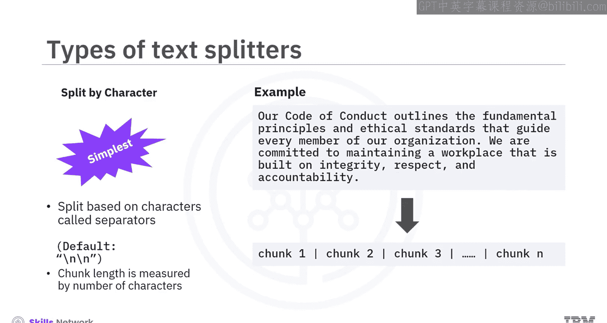
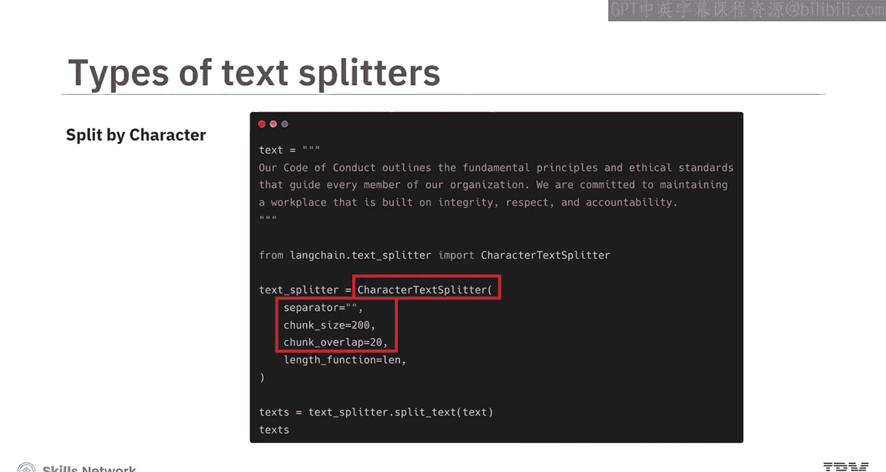
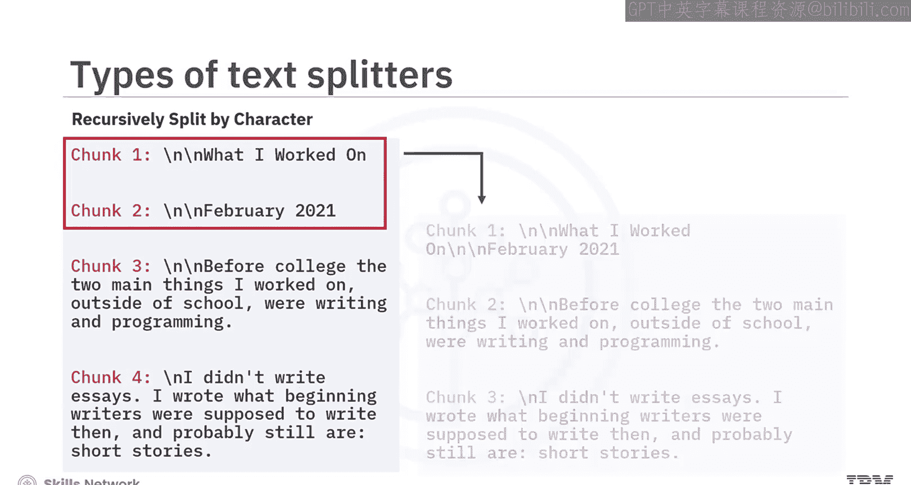
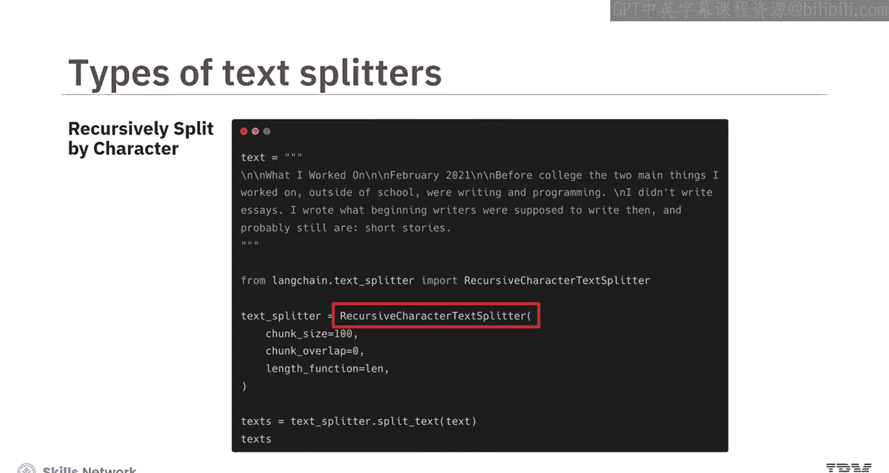
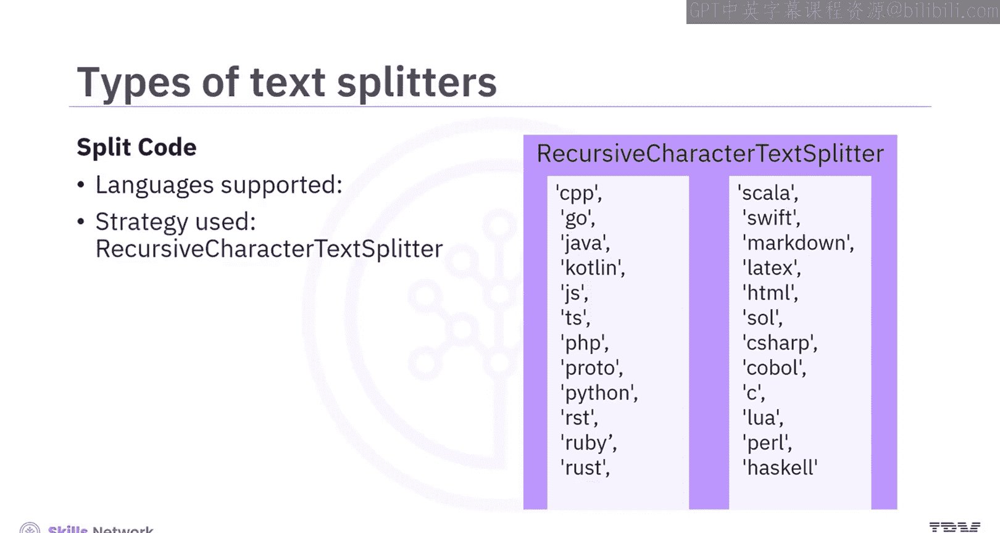
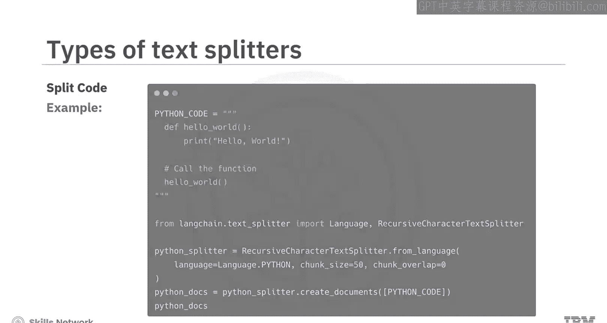
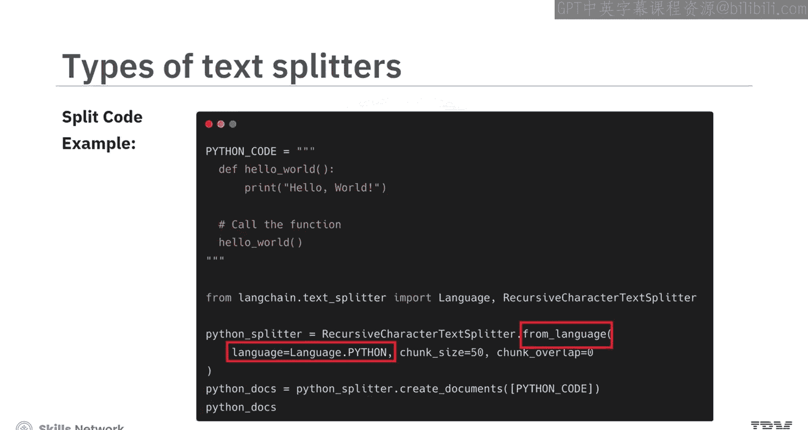
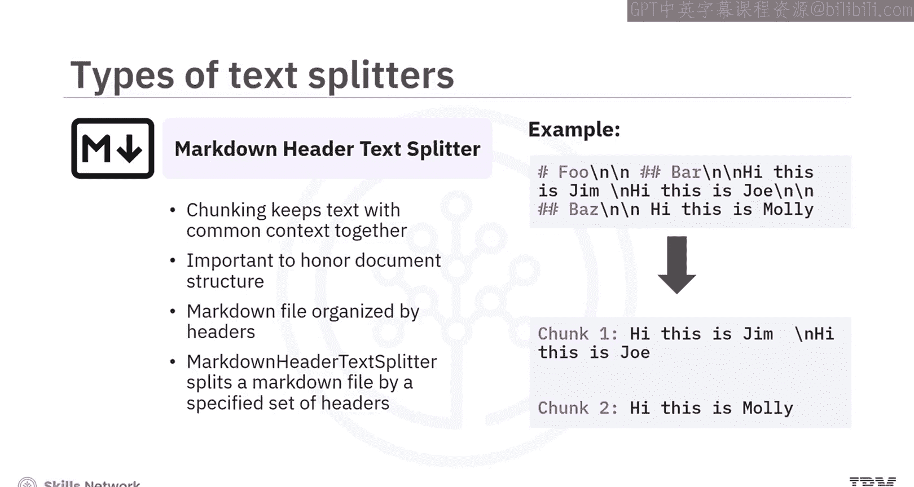
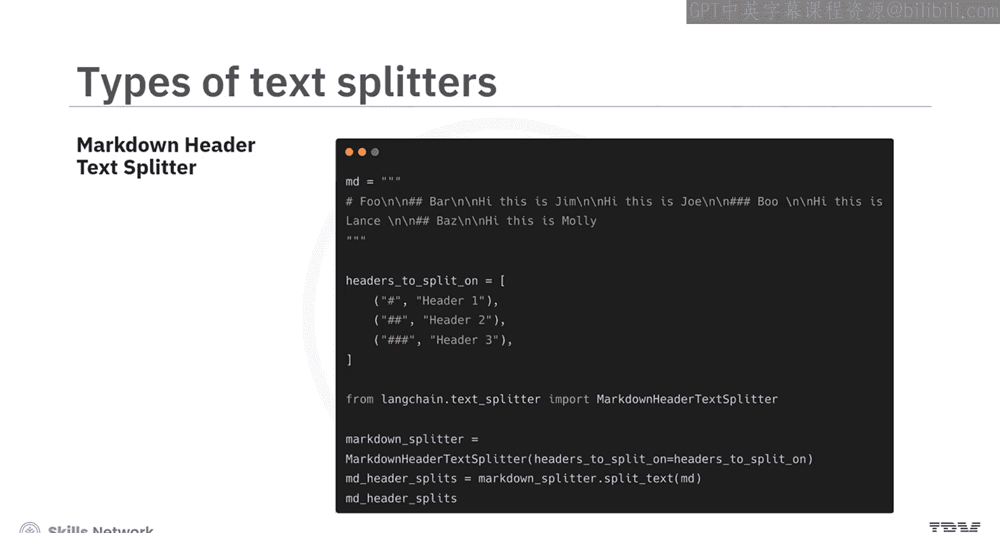
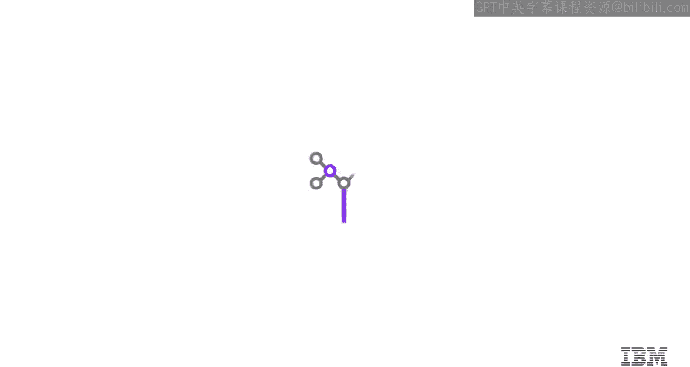

# 168：IBM《生成式人工智能工程｜Falsk、生成式AI应用、数据分析、机器学习、Keras、架构和数据、NLP基础、transformer、微调、高级微调、RAG》 p168 2_分割文本以优化处理的策略.zh_en -BV1NAq6Y9E7z_p168-

Welcome to Strgies for Spting T for Op Pro。After watching this video。

 you'll be able to describe how Langchain uses text splitters to split， combine。

 filter and manipulate documents to meet specific needs。

 You will also be able to discuss some commonly used splitters and how to use them。

 including split by character， recursively split by character。

 split code and mark down header text splitter。 The first step is to load the documents using the document loader。

 Once you've loaded the documents， the next step is transforming them to suit the applications better。

For example， you might need to split a long document into smaller chunks that can fit into an LLM's context window。

Langchain offers a variety of built in document splitters that simplify this process。

 these tools allow you to easily split， combine， filter and manipulate documents to meet your needs。

Let's look at how a text splitter works。 First， it breaks the text into small。

 semantically meaningful chunks， often sentences。 Next。

 it combines these small chunks into larger ones， aiming for a specific size。

 Once it reaches that size， the splitter designates that chunk as a separate piece of text。

Then the splitter creates a new chunk with some overlap from the previous one to maintain context between chunks At a fundamental level。

 T splitters operate along two axes。 The first axis is how the text is split。

 which refers to the method or strategy used to break the text into smaller chunks。

 It could involve splitting its specific characters， words， sentences or even custom defined tokens。

 The second axis is how the chunk size is measured。

 which relates to the criteria used to determine when a chunk is complete。

It might involve counting characters， words， tokens， or custom defined metrics。

Certain key parameters in a text splitter determine how the splitter works。 First。

 let's talk about the separator。 The separator is the character or set of characters used to split the text into manageable chunks。

 For example， some common separators are line change character， paragraph change character or space。

The default separator is by paragraphs。 Next， you have chunk size。

 This term refers to the maximum number of characters each chunk can contain。

A chunk refers to a segment of texts separated from a larger body of text。The default number is 1000。

 Then you come to chunk overlap， which refers to the number of characters that overlap between consecutive chunks。

 The default number is 200。Finally， there's the length function。

 the length function determines how the length of chunks is calculated。

Langchain offers several different types of text splitters。

 Let's explore some commonly used splitters shown here and how to use them。First。

 there is character text splitter， it is the simplest method。Here， the split is based on characters。

 They are also called separators。 You can measure the chunk length by the number of characters。

 For example， here is a paragraph of text。The character splitter can split the text into different chunks。

 and each chunk is divided by the customized separator。

You can even set overlaps between chunks to ensure information isn't lost。

Here is the code that shows how to use the character text splitter。

 A single character is used as a separator， and the chunk size is set at 200 with an overlap is 20。

This means the text will be split once the number of characters reaches 200。Here after the splitting。

 you can see how the text is divided into two chunks with some overlapping characters in yellow shown between each chunk。

 The recursive character text splitter employs recursion as the core mechanism to accomplish text splitting。

It is recommended for generic text， it takes a large text and tries to split it up until the chunks are small enough。

It does this by using a set of characters。 The default characters provided to it are by paragraphs。

 sentences， words or characters。 For example， here。

 it takes in the text and then tries to split it by the first separator。

 which is by paragraph shown by the back slash N character。You end up with three chunks here。 Next。

 assess each chunk to ensure that they are smaller than the specified size。 say 100 characters。

 The first two chunks meet this condition， but the third does not。

 So you proceed to the next level of splitting by sentences。This splits the third chunk further。

 resulting in four chunks。 Afterward， you will find that combining the first two chunks stays under the 100 character limit。

 so you can merge them。This results in your final set of chunks。

Here is the code that shows how to use the recursive character text splitter。

Code T splittter enables you to split your code with multiple languages supported Here is a list of supported languages it offers。

😡，The split strategy is used based on the recursive character text splitter。

Here is an example of splitting the Python code， although it is based on the recursive character text splitter。

 when applied to the code splitter， you need to add from language after calling the recursive character text splitter class inside it。

 you need to specify the language you aim to split。 As mentioned。

 chunking aims to keep text with a common context together。😡。

With this in mind， you might want to honor the document structure。

 a markdown file is organized by headers， creating chunks within specific header groups as an intuitive idea。

You can use the Markdown header text splitter to address this challenge。

 which will split a markdown file by a specified set of headers for example。

 if you have markeddown raw text like this， you can use markdown header text splitter to split the content with any header。

 in this case， bar and BS。😡。

Here is the code for implementing the split of the markeddown file by headers。 In this video。

 you learned that Langchain uses text splitters to split a long document into smaller chunks that can fit into an LLM's context window。

Tech splitters operate along two axes， the first is the method used to break the text into smaller chunks。

 and the second is how the chunk is measured， The key parameters of a text splitter are separator。

 chunk size， chunk overlap and length function。Some commonly used splitters are split by character。

 recursively split by character， split code， and markdown header text splitter。

