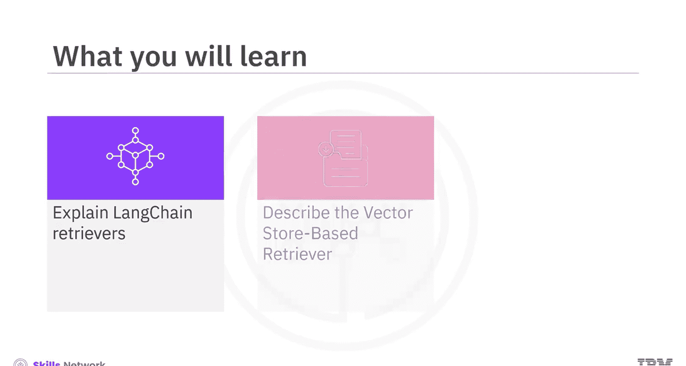
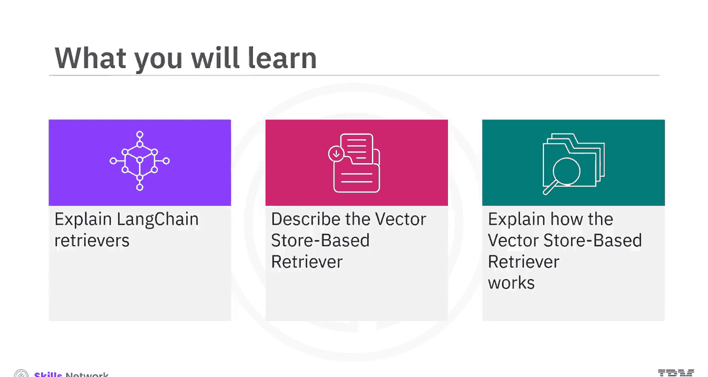
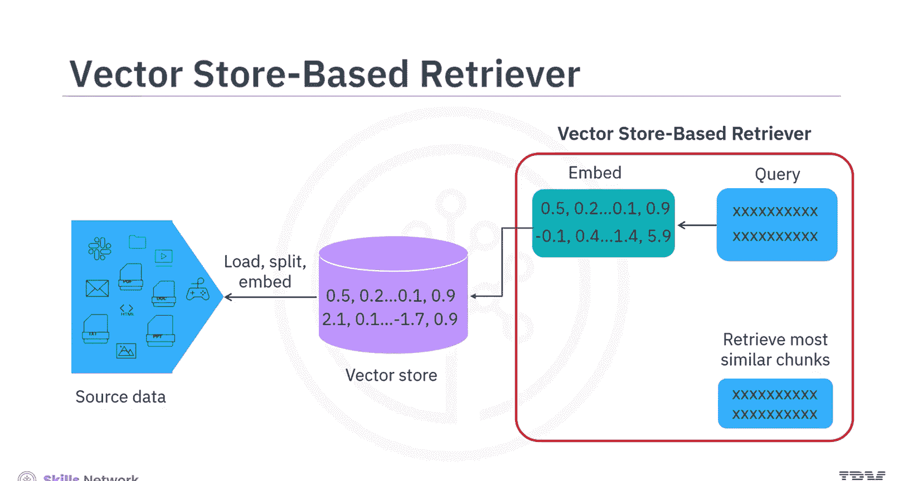
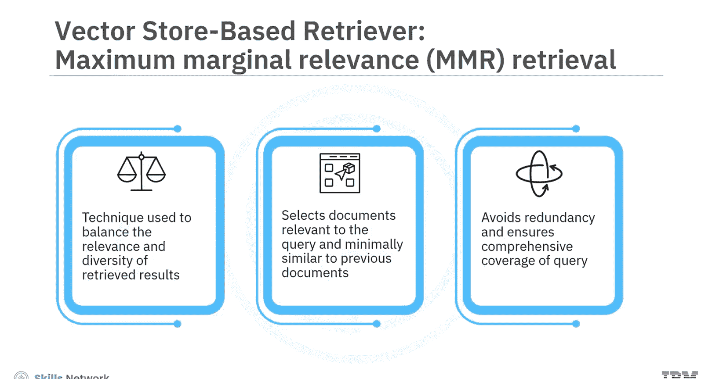
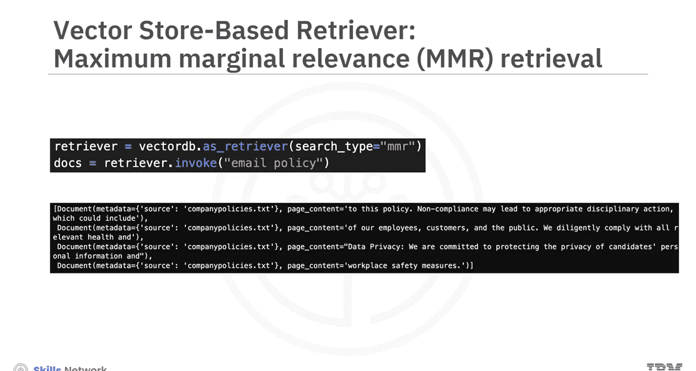
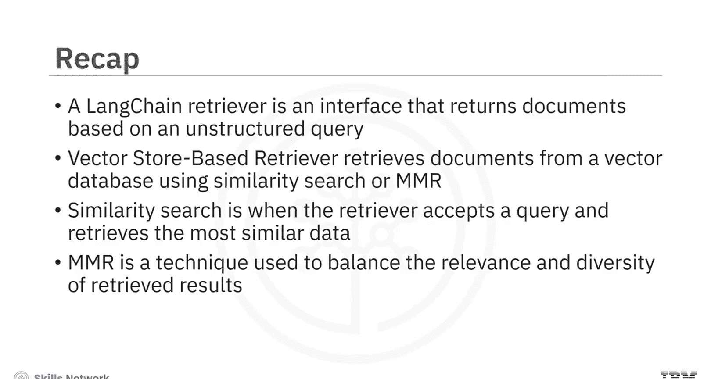

# 170：IBM《生成式人工智能工程｜Falsk、生成式AI应用、数据分析、机器学习、Keras、架构和数据、NLP基础、transformer、微调、高级微调、RAG》 p170 4_探索LangChain中的高级检索器（第1部分）.zh_en -BV1NAq6Y9E7z_p170-

。Welcome to explore advanced retrievers in Lang chain Part 1。 After watching this video。

 you'll be able to explain what Lng chain retrieveeverrs are。

 You will also be able to describe the vector store based retriever and explain how it works。

 Let's begin by understanding what a lang chain retriever is。

 A lang chain retriever is an interface that returns documents based on an unstructured query。

 It is more general than a vector store。 It doesn't necessarily store documents as its purpose is to retrieve them or their chunks。

 a Lng chain retriever accepts a string query as input and returns a list of documents or chunks as output。

 Although the process of retrieving data sounds simple。

 it can be subtly complex with several implementations possible。😡。

Let's learn more about the simplest type of retriever， the vector store based retriever。

 which retrieves documents from a vector database。 recall that this vector database is brought into existence by loading source documents。

 splitting them into chunks and embedding them。 The vector store based retriever plugs into this existing vector store。

 It accepts a query and retrieves the most similar data。 In this case， the most similar chunks。

 The vector store based retriever works by embedding the query and then comparing it with em chunks。

 using similarity search or maximum marginal relevance。

 also known as MMR to retrieve the most relevant chunks。

 The vector store based retriever is simple to understand because it queries an existing vector store and does not require an LLM to retrieve the most similar chunks。

 In addition to using a similarity score， you can use maximum marginal relevance retrieval or MMR。

 MMR and vector stores as a technique used to balance the relevance and diversity of retrieve results。

 It selects documents that are both highly relevant to the query and minimally similar to。

SeThis approach helps to avoid redundancy and ensures a more comprehensive coverage of different aspects of the query In this particular example。

 the query email policy results in three retrieve documents。

Let's recap in this video， you learned that a L chain retriever is an interface that returns documents based on an unstructured query。

 It has several types。 The vector store based retriever is one such type that retrieves documents from a vector database。

 It can be created directly from the vector store object with the retriever method by using similarity search or MMR。

 similarity search is when the retriever except a query and retrieves the most similar data。

 MMR is a technique used to balance the relevance and diversity of retrieve results。😡。

