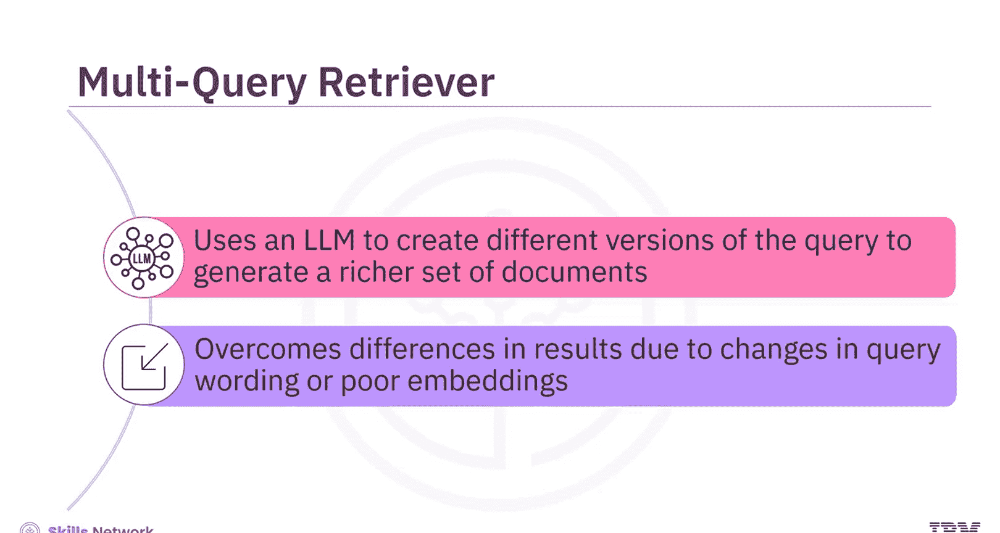
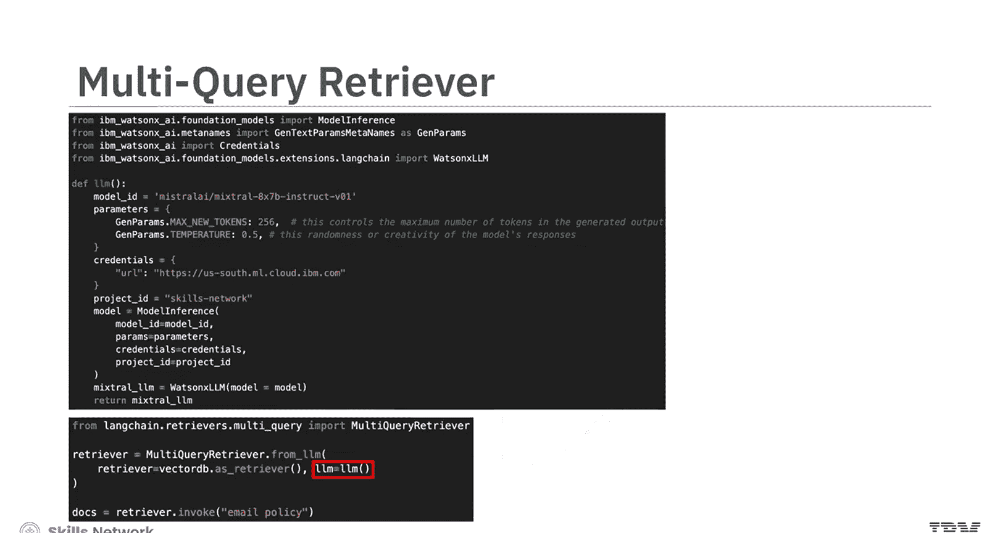
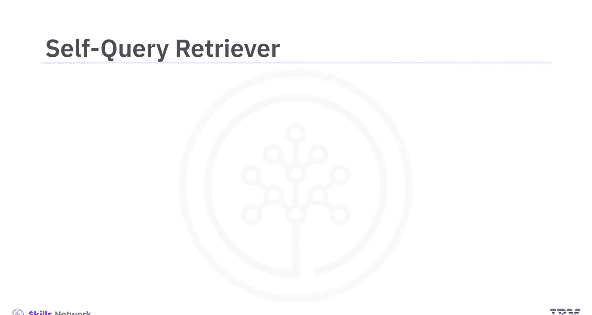
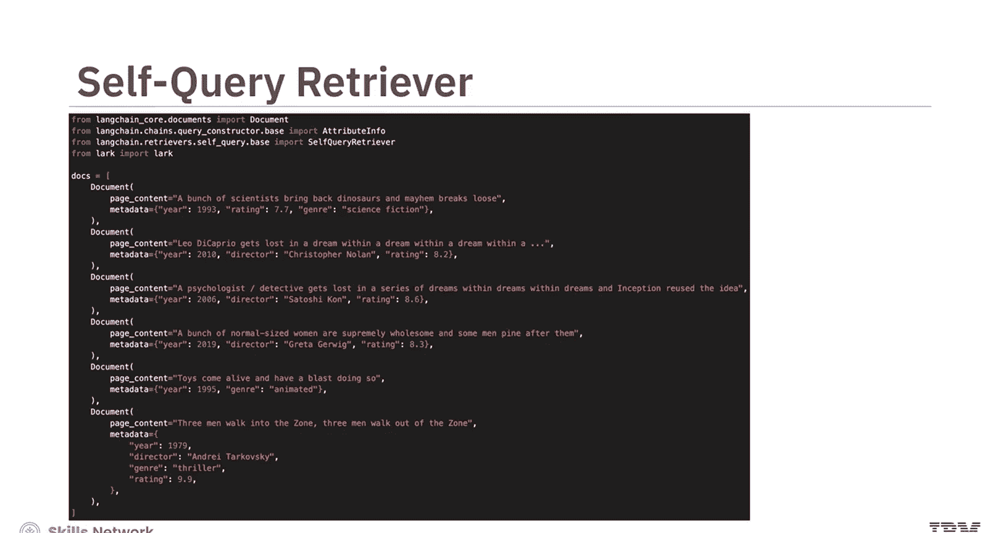
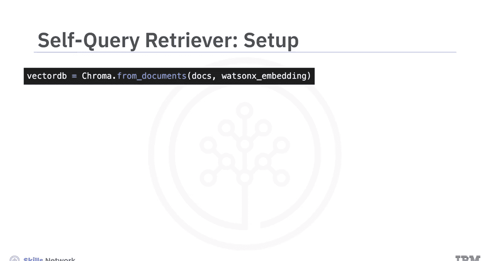
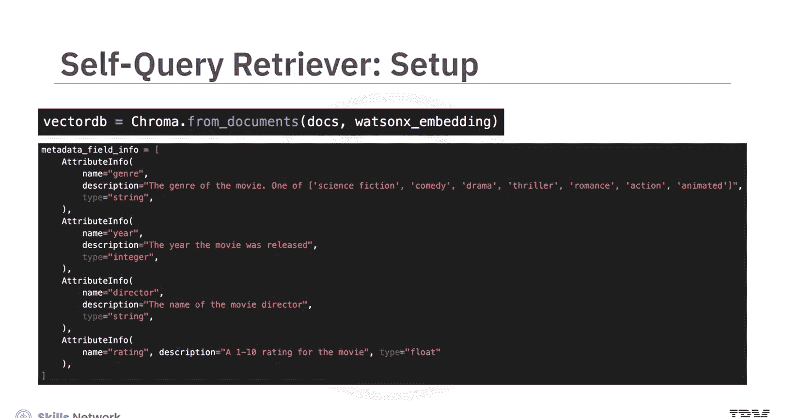
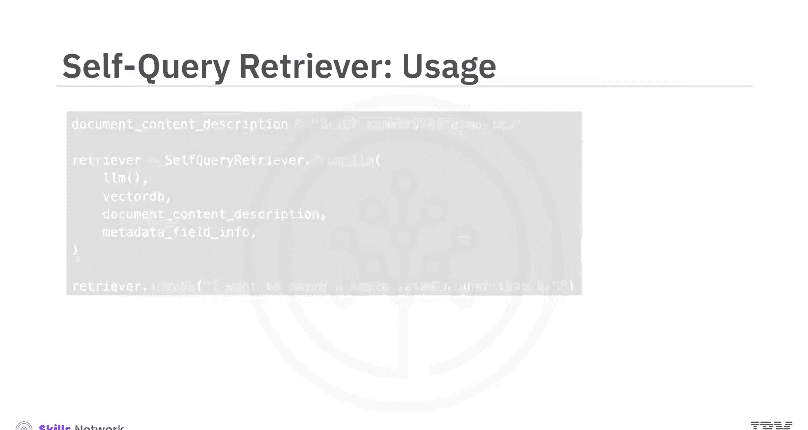
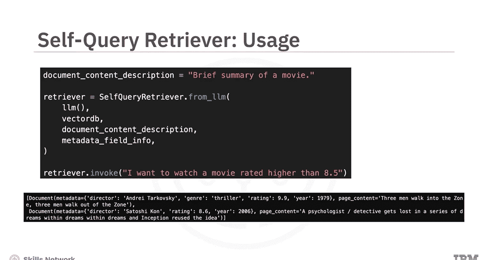
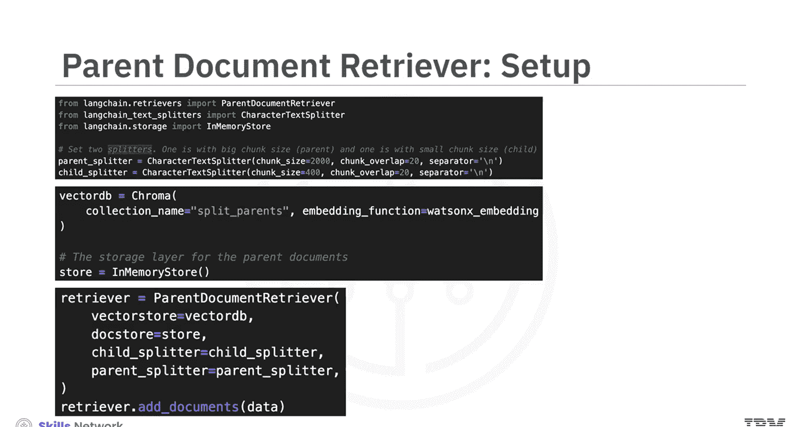

# 171：IBM《生成式人工智能工程｜Falsk、生成式AI应用、数据分析、机器学习、Keras、架构和数据、NLP基础、transformer、微调、高级微调、RAG》 p171 5_探索LangChain中的高级检索器（第2部分）.zh_en -BV1NAq6Y9E7z_p171-

Welcome to explorelore Advance Reevers in Lang chainin Part 2。After watching this video。

 you'll be able to describe the different types of lane chain retrievers。

 namely the multi queryry retriever， the self query retriever， and the parent document retriever。

 you'll also be able to identify the difference between these retrievers。

A L chain retriever is an interface that returns documents based on an unstructured query。

 the simplest type of retriever， the vector store based retriever。

 retrieves documents from a vector database， the multi queryry retriever is similar to the vector based retriever。

 except it uses an LLM to create different versions of the query。

Generating a richer set of retrieved documents。This is done to overcome potentially different results that can result from subtle changes in query wording。

 or if the embeddings do not capture the semantics of the data well。

In this particular example， a Watson X LLM instance has been created that uses the mixtureural 8 by 7b foundational model to generate different query versions。

 The multi queryry retriever object itself is then created using the multi query retriever class from the LLM method This method except a retriever parameter which is the vector based retriever used to retrieve results for each query in this particular example。

 the simple similarity search retriever is being used However， other retrievers can be used here。

 such as the MMR retriever。 Additionally， the multi queryry retriever class from the LLM method except an LLM parameter。

 where the LLM is used to generate alternative versions of the query is past 10 for each query。

 the multi query retriever retrieves a set of relevant documents and takes the unique union across all queries to get a larger set of potential relevant documents。

Now， suppose that instead of documents that just contain text。

 you also have metadata about these documents。In other words。

 suppose your documents look like the ones presented in this code。

Here you see documents that contain text describing movies。

 as well as some metadata relating to those movies， such as the year in which the movie was released。

 the director of the movie and the movie's IM DB rating。

 None of the retrievers you have looked at so far have the ability to access this metadata because only the document text is considered。

 This is where the self query retriever comes in。 The self query retriever converts the query into two components。

 a string to look up semantically and a metadata filter to go along with it。

Let's set up the self query retriever。 The first cell converts the documents you just saw into a vector store from which you can retrieve documents。

 The second cell describes the metadata fields for the documents in the vector store。 For instance。

 the year attribute is described as an integer that indicates the year in which the movie was released。

These metadata field descriptions helped the LLM create meaningful metadata filters to choose relevant documents。

Given a vector store and metadata description as described here。

 you can retrieve documents based on the text and the metadata using the self query retriever class from the LLM method。

 this method accept an LLM， a vector database， a document description。

 and a metadata field description as attributes。

Retrevieving documents using the query， I want to watch a movie rated higher than 8。5。

 successfully returns to movies with ratings greater than 8。5。

When splitting documents for retrieval， there are often conflicting requirements。 On the one hand。

 you may want small documents so that their embeddings can accurately reflect their meaning。

 On the other hand， you want long enough documents so that the context of each chunk is retained。

 This is where the parent document retriever comes in。 During retrieval。

 The parent document rer first fetches the smaller chunks。

 looks up their parent Is and returns the larger documents in which the small chunks live。

 Let's set up the parent document retriever。The parent document retriever has two text splitters。

 A parent splitter that splits the text into large chunks to be retrieved and a child splitter that splits the document into small chunks to generate meaningful embeddings。

 You also need a vector store for the embeddings and a store for the parent documents。 Finally。

 you need to create the parent retriever object and add the documents to it using the add documents method。

The parent document retriever can be invoked using the same unified syntax as all of the previously seen retrievers note that for the query smoking policy。

 the parent document retriever retrieves large chunks generated by the parent splitter。

 not the chunks created by the child splitter。

Here， the retrieved chunk is the smoking policy exactly what the query asked for。

Let's recap in this video， you learned that the multi queryry retriever uses an LLM to create different versions of the query。

 generating a richer set of retrieved documents。😡，The self query retriever converts the query into two components。

 a string to look up semantically， and a metadata filter to accompany it。Finally。

 you learned that the parent document retriever has two text splitters。

 a parent splitter that splits the text into large chunks to be retrieved。

 and a child splitter that splits the document into small chunks to generate meaningful embeddings。

