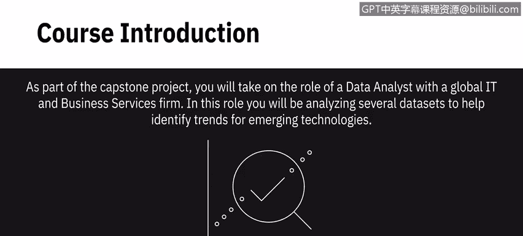
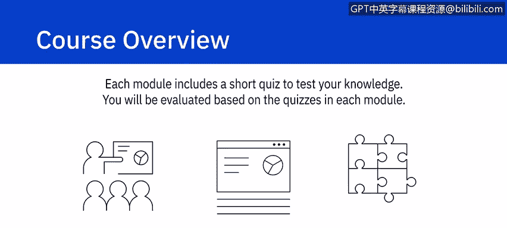
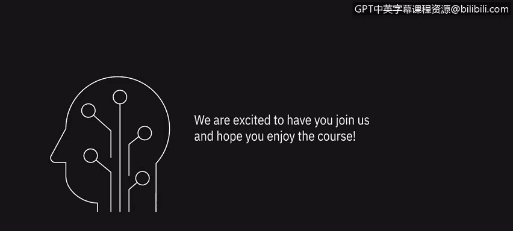

# IBM 数据分析师专业证书课程 9：《数据分析毕业项目》🎓

在本课程中，我们将完成数据分析师专业证书的毕业项目。这是一个实践性的项目，旨在综合运用你在整个专业证书课程中学到的所有技能。你将扮演一家全球IT和商业服务公司的数据分析师角色，通过分析多个数据集来识别新兴技术的趋势。

## 课程概述 📋

成功完成这个毕业项目将帮助你获得数据分析师专业证书。这个顶点项目为你提供了一个实践动手的机会，以展示你在此专业证书课程中迄今为止掌握的所有技能。

作为毕业项目的一部分，你将扮演一家全球IT和商业服务公司的数据分析师角色。在这个角色中，你将分析多个数据集，以帮助识别新兴技术的趋势。

## 项目模块与流程 🔄

以下是项目将涵盖的六个主要模块及其核心任务。

### 模块 1：数据收集 📥

上一节我们介绍了项目的总体目标，本节中我们来看看数据收集阶段。在模块1中，你将从各种来源收集关于热门技术技能的数据。

以下是数据收集的主要来源：
*   职位发布
*   博客文章
*   调查问卷

### 模块 2：数据整理与准备 🧹

收集到数据后，下一步是进行整理和准备。在模块2中，你将运用数据整理技术来处理收集到的数据，为分析做准备。

以下是本模块将涉及的关键数据整理技术：
*   查找重复值
*   移除重复值
*   查找缺失值
*   填补缺失值

### 模块 3：数据分析与洞察 🔍

准备好数据后，就可以开始深入分析了。在模块3中，你将应用统计技术来分析数据，并识别洞察和趋势。

以下是本模块将探索的核心分析问题：
*   需求最高的编程语言是什么？
*   需求最高的数据库技能是什么？
*   最流行的集成开发环境（IDE）是什么？
*   开发者的人口统计数据，如性别和年龄分布。

### 模块 4：数据可视化 📊

识别出趋势后，需要用清晰的方式将其呈现出来。在模块4中，你将根据要呈现的数据选择合适的可视化方式。

以下是本模块将使用的可视化工具示例：
*   图表
*   绘图
*   直方图

### 模块 5：创建交互式仪表板 🖥️

静态图表之外，交互式仪表板能提供更动态的分析体验。在模块5中，你将使用Cognos工具创建交互式仪表板，以动态方式分析和呈现数据。

### 模块 6：数据叙事与成果展示 🎤

分析的最后一步是讲述一个引人入胜的故事。在最后一个模块中，你将运用叙事技巧来提供分析过程的叙述并展示你的发现。

你将获得一个演示文稿模板来启动这个过程，并帮助你创建一个引人入胜的故事来展示你的发现。

## 课程评估方式 ⚖️

了解如何完成项目后，我们来看看课程的评估方式。每个模块都包含一个简短的测验来测试你的知识。

以下是课程评估的三个组成部分：
1.  基于每个模块测验的评估。
2.  你创建的仪表板将由你的同伴进行评审和评分。
3.  你的数据叙事演示文稿将由你的同伴进行评审和评分。

## 开始学习前的准备 🚀

在开始项目之前，建议你花几分钟时间熟悉课程环境。

以下是开始前的准备步骤：
*   浏览课程网站。
*   查看每周我们将涵盖的材料。
*   预览你需要完成以通过课程的作业。
*   点击“讨论区”，查看你可以与其他学习者和课程团队讨论课程材料的论坛。

如果你对课程内容有疑问，请将其发布在论坛中，以便从课程社区中的其他人那里获得帮助。对于Coursera平台的技术问题，请访问学习者帮助中心。

我们很高兴你能加入我们，并希望你喜欢这门课程。

祝你好运，让我们开始吧！

## 总结 ✨

在本节课中，我们一起学习了IBM数据分析师专业证书毕业项目的整体框架。我们了解了项目的六个核心模块：从数据收集、整理、分析、可视化，到创建交互式仪表板，最后通过数据叙事展示成果。同时，我们也明确了课程的评估方式和开始学习前的准备工作。现在，你已经准备好踏上这段综合实践之旅，运用所学技能解决真实的数据分析问题了。