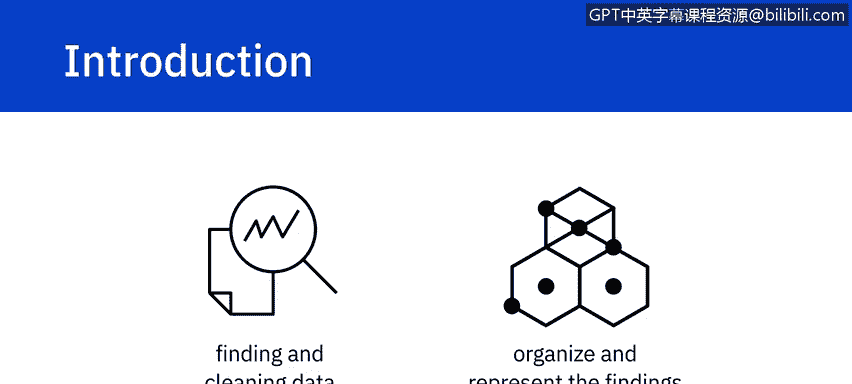
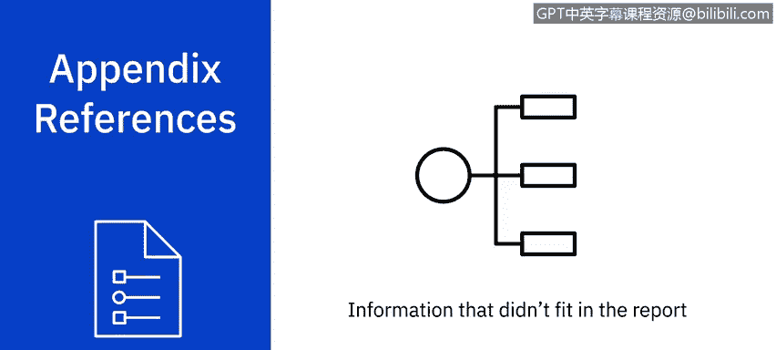

# 📊 IBM 数据分析师专业证书课程 9：《数据分析毕业项目》 - P2：成功数据发现报告的核心要素

在本节课中，我们将学习如何有效地组织和呈现数据分析的发现。一份成功的数据发现报告是沟通分析结果的关键，它能确保你的发现被清晰、准确地传达给受众。

## 概述

虽然发现和清理数据是数据分析的重要第一步，但如果你无法有效地组织和呈现发现，那么分析的核心概念可能会丢失。本节视频将指导你如何通过关注特定要素来创建一份成功的数据发现报告。

## 报告的重要性与初始步骤

在数据被收集、清理和组织之后，解释工作便开始了。此时，你能够获得数据的完整视图，并有望回答分析开始前提出的问题。

接下来，你通常需要开始撰写一份发现报告，以解释所学到的内容。根据利益相关者及其接收信息的方式，报告的形式可能有所不同。这可能包括书面报告、幻灯片演示，或者两者兼有。发现报告是数据分析的关键部分，因为它传达了所发现的内容。

开始这个过程时，收集到的数据和信息可能看起来有些令人不知所措。克服这个障碍的最佳方法是首先创建一个大纲。通过完成大纲，你可以获得一个完整的图景，并开始以精确而简洁的方式撰写。

## 报告的标准结构

尽管创建数据驱动演示文稿的格式多种多样，但我们创建了一个简单且易于遵循的有效大纲。在创建大纲时，请始终记住要针对你的受众进行结构化，并创建适合你具体情况的演示文稿。

以下是报告的标准结构要素：

*   **封面页**：此起始部分包含演示文稿的标题、你的姓名以及日期。
*   **执行摘要**：此部分简要说明项目的细节，应被视为一份独立的文档。信息取自报告的主要观点，可以重复信息，但不引入新信息。
*   **目录**：目录按顺序包含报告的章节和子章节，以便为受众提供内容概览。这也使读者能够直接跳转到对他们更重要的特定部分。
*   **引言**：引言解释分析的性质，陈述问题，并给出通过执行分析要回答的问题。
*   **方法论**：方法论解释分析中使用的数据来源，并概述收集数据的计划。例如，是使用聚类方法还是回归方法来分析数据。
*   **结果**：此部分详细介绍数据收集、组织方式以及分析方法。这部分还将包含图表，用以证实结果，并通过提供数据解释来引起对更复杂或关键发现的注意。这样，你能够向受众提供详细解释，并说明其与引言中所述问题的关联。
*   **讨论与启示**：在此部分，你将与受众讨论从研究中得出的启示。例如，假设你正在为大学毕业生研究顶级编程语言，你会发现他们需要学习多种语言以在就业市场中保持竞争力，还是某一种语言始终占据主导地位？
*   **结论**：此最终部分应重申引言中给出的问题，并对发现进行总体总结。它还将说明分析的结果，以及未来是否会采取任何其他步骤。
*   **附录**：此部分包含那些不太适合报告正文，但你仍然认为足够重要而需要包含的信息。这类信息可能包括原始数据收集的地点，或其他细节，如资源、致谢或参考文献。

请注意，每个要素的深度和长度可能因受众和报告格式而异。

## 总结

本节课中，我们一起学习了创建一份成功数据发现报告所需的重要元素。我们了解了从封面页到附录的完整报告结构，以及每个部分的核心目的。掌握这些要素能帮助你清晰、专业地呈现分析成果。

在下一节视频中，我们将学习呈现发现时的最佳实践。