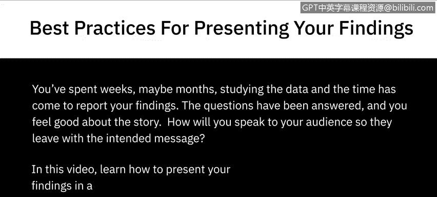
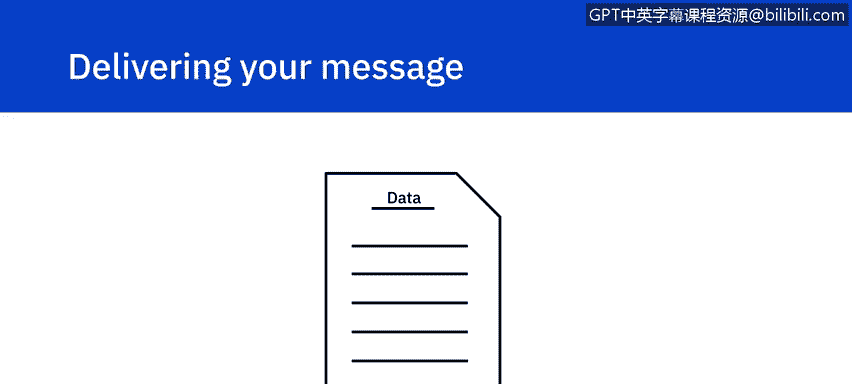
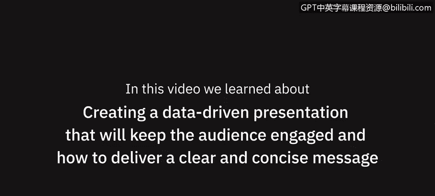

# IBM 数据分析师专业证书课程 9：《数据分析毕业项目》｜ P3：呈现发现的最佳实践 📊

在本节课中，我们将学习如何有效地呈现数据分析的发现。你将了解如何组织报告内容，确保信息清晰、有说服力，并能吸引听众的注意力。

---

经过数周甚至数月的数据研究，现在到了汇报成果的时刻。问题已经得到解答，你对整个分析故事充满信心。那么，如何向听众传达信息，才能让他们准确理解你的核心结论呢？本节视频将教你如何呈现你的发现，以吸引并保持听众的注意力。

进行数据驱动的演示看似简单，但要准确传达信息，有几个关键因素必须牢记。

---

## 确保图表清晰可读 📈



上一节我们讨论了数据分析的流程，本节中我们来看看如何将分析结果可视化。制作数据演示时，确保图表和图形尺寸合适、标签清晰至关重要。

你是否曾参加过一场演示，其中的信息难以阅读或理解？虽然这看似显而易见，但过小的图表和标签很容易被忽视。请务必从不同距离测试可视化效果，就像你的听众会做的那样。如果数据无法清晰呈现，那么可能需要重新设计。

---

## 围绕核心信息构建故事 📖

在准备报告时，你可能会觉得只有用数据填满幻灯片才能解释清楚发现。虽然作为数据分析师这似乎很合理，但你的听众可能不会欣赏数据的复杂性，而只会看到一堆数字。

为了解决这个问题，请遵循以下步骤：
1.  **首先，形成需要传达给听众的核心信息。**
2.  **围绕这些信息构建故事框架。**
3.  形成大纲后，再回过头插入数据来支撑你的发现。

通过不过度依赖数据，并采用这种方法来创建演示文稿，你将构建出一个能吸引听众兴趣的精彩故事。

---

## 每张图表只传达一个观点 🎯

使用图表和图形呈现数据是传达信息的最佳方式。然而，如果提供过多信息，反而会造成混淆。

例如，请看下面这个饼图示例。你能解读出关键信息是什么吗？演示者试图传达什么？

```python
# 示例：一个信息过载的饼图（概念性描述）
# 图表包含了过多分类，导致核心信息模糊不清。
```

在这个例子中，图表信息过多，很难确定演示者想表达的观点以及听众应关注的重点。坚持一个核心观点，避免将多个要点总结到一个可视化图表中，你就能准确地向听众传达想法，避免任何混淆。

---

## 剔除无关数据，保持简洁 ✂️

数据分析师可能花费数月研究数据，然而，一些对分析师来说有趣的细节，可能与项目核心无关。试图向听众解释每一个小细节，而不识别无关数据，可能会损害关键信息的传递。

以下是保持演示清晰简洁的关键：
*   **删除不必要的数据**。
*   **仅突出支持你核心观点的数据点**。

通过消除这些不必要的数据，只强调支持关键想法的数据点，你的演示将保持清晰和简洁。

---





在本节课中，我们一起学习了如何创建能吸引听众的数据驱动型演示文稿，以及如何传递清晰、简洁的信息。记住，有效的呈现是将复杂分析转化为 actionable insights（可执行的见解）的关键一步。