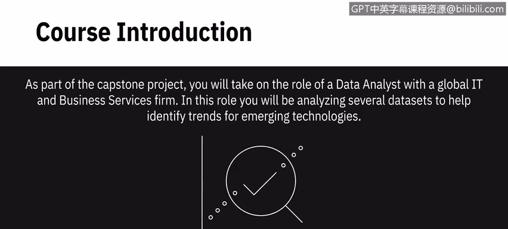
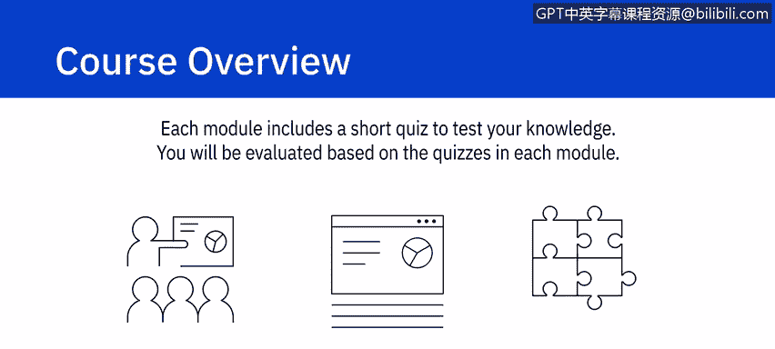
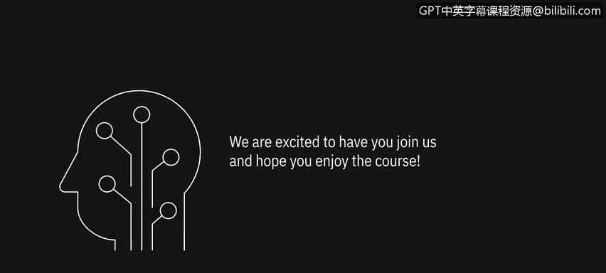

# IBM 数据分析师专业证书课程 9：《数据分析毕业项目》🎓

在本课程中，我们将学习如何完成一个综合性的数据分析毕业项目。该项目旨在整合并应用你在整个专业证书课程中学到的所有技能。我们将扮演一家全球IT和商业服务公司的数据分析师角色，通过分析多个数据集来识别新兴技术的趋势。

---

## 课程概述 📋

恭喜你坚持到现在。成功完成这个毕业项目将使你获得数据分析师专业证书。

这个毕业项目为你提供了一个实践机会，以展示你在此专业证书课程中迄今为止掌握的所有技能。

作为毕业项目的一部分，你将扮演一家全球IT和商业服务公司的数据分析师角色。

在这个角色中，你将分析多个数据集，以帮助识别新兴技术的趋势。

---

## 项目模块详解 🔧

上一节我们介绍了课程的整体目标，本节中我们将详细看看项目的六个核心模块。

### 模块 1：数据收集

在模块1中，你将从各种来源收集关于热门技术技能的数据。

以下是数据来源的示例：
*   职位发布
*   博客文章
*   调查问卷

### 模块 2：数据整理与准备

在模块2中，你将运用数据整理技术来处理收集到的数据，为分析做准备。

以下是本模块将涉及的关键技术：
*   查找重复项
*   移除重复项
*   查找缺失值
*   填补缺失值

### 模块 3：数据分析与洞察发现

接下来，我们将进入模块3，应用统计技术来分析数据并识别洞察和趋势。

以下是本模块将探索的核心问题：
*   需求最高的编程语言是什么？
*   需求最高的数据库技能是什么？
*   最流行的集成开发环境（IDE）是什么？
*   开发者的人口统计数据，如性别和年龄分布。

### 模块 4：数据可视化

在模块4中，重点将放在根据你想要呈现的数据选择合适的可视化方式。

我们将使用以下图表来揭示你的发现和趋势：
*   图表
*   绘图
*   直方图

### 模块 5：创建交互式仪表板

在模块5中，你将使用Cognos工具创建交互式仪表板，以动态地分析和呈现数据。

### 模块 6：数据叙事与成果展示

在最后一个模块中，你将运用讲故事技巧来提供叙述并展示你的分析结果。

你将获得一个演示文稿模板来启动这个过程，并帮助你创建一个引人入胜的故事来展示你的发现。

---

## 课程评估与支持 🤝

每个模块都包含一个简短的测验来测试你的知识。

你的评估将基于以下部分：
*   每个模块中的测验
*   你创建的仪表板和故事叙述演示文稿将由你的同伴进行评审和评分。

### 开始学习建议

首先，建议你花几分钟时间探索课程网站。

回顾我们每周将涵盖的材料，并预览你需要完成以通过课程的作业。

点击“讨论”查看论坛，在那里你可以与其他学习者和课程团队讨论课程材料。

如果你对课程内容有疑问，请将其发布在论坛中，以从课程社区的其他成员那里获得帮助。

对于Coursera平台的技术问题，请访问学习者帮助中心。

我们很高兴你能加入我们，并希望你享受这门课程。

---

## 总结与鼓励 🚀

本节课中我们一起学习了《数据分析毕业项目》的整体结构、六个核心模块的内容以及课程的评估方式。这个项目是你展示所学技能的绝佳机会。祝你好运，让我们开始吧。