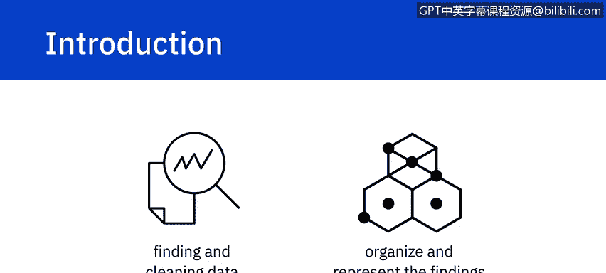
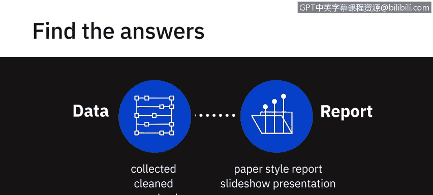
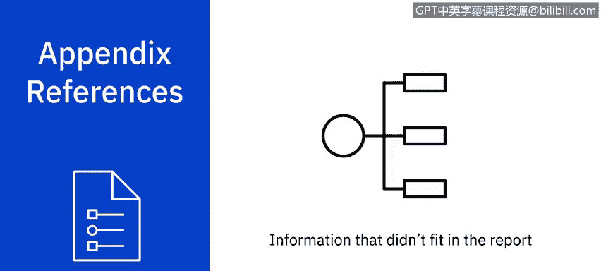

# 📊 IBM 数据分析师专业证书课程 9：《数据分析毕业项目》- 成功数据报告的核心要素

在本节课中，我们将学习如何组织和呈现数据分析的发现，以创建一份成功的数据报告。一份有效的报告对于向受众清晰传达分析结果至关重要。

虽然发现和清理数据是数据分析的重要第一步，但如果你无法有效地组织和向受众呈现你的发现，那么整个分析的概念和成果可能会被埋没。

## 📝 报告的重要性与形式

在数据被收集、清理和组织之后，解读工作就开始了。此时，你能够获得数据的完整视图，并有望回答在分析开始前提出的问题。

接下来，你通常需要撰写一份发现报告，来解释你学到了什么。根据利益相关者及其接收信息的方式，报告的形式可能有所不同。这可能包括一份书面报告、一个幻灯片演示文稿，或者两者兼有。发现报告是数据分析的关键部分，因为它传达了所发现的内容。

开始撰写报告时，收集到的数据和信息可能看起来有些令人不知所措。克服这个障碍的最佳方法是先创建一个大纲。通过完成大纲，你可以获得一个完整的图景，并开始以精确而简单的方式撰写。

## 🗂️ 构建报告大纲

虽然创建数据驱动演示文稿的格式多种多样，但我们创建了一个简单易懂且有效的大纲。在创建大纲时，请始终记住要针对你的受众进行结构化，并创建适合你具体情况的演示文稿。

以下是报告的基本结构：

1.  **封面页**：此部分包含演示文稿的标题、你的姓名以及日期。
2.  **执行摘要**：简要概述项目细节，应被视为一份独立的文档。
3.  **目录**：按顺序列出报告的章节和子章节，让受众对内容有一个概览，也方便读者直接跳转到对他们更重要的特定部分。
4.  **引言**：解释分析的性质，陈述问题，并给出希望通过分析来回答的问题。
5.  **方法论**：解释分析中使用的数据来源，并概述收集数据的计划。
6.  **结果**：详细介绍数据收集、组织和分析过程。
7.  **讨论与启示**：与受众讨论从研究中得出的启示。
8.  **结论**：重申引言中提出的问题，并对发现进行总体总结。
9.  **附录**：包含不适合报告主体但你认为仍然足够重要的信息。

请注意，每个要素的深度和长度可能因受众和报告格式而异。

## 🔍 深入理解各章节

上一节我们介绍了报告的整体结构，本节中我们来详细看看每个核心部分的具体内容和作用。

### 执行摘要
创建报告的第一步是恰当地撰写执行摘要。这份摘要将简要解释项目的细节，并且应被视为一份独立的文档。其中的信息取自你报告的主要观点。虽然可以重复信息，但不应呈现任何新信息。

### 引言
目录之后的部分是引言。引言解释了分析的性质，陈述了问题，并给出了希望通过执行分析来回答的问题。

### 方法论
方法论解释了分析中使用的数据来源，并概述了收集数据的计划。例如，是使用了**聚类分析**还是**回归分析**方法来分析数据。

### 结果
这一部分详细说明了数据收集、组织以及分析的过程。此部分还应包含图表，这些图表可以证实结果，并通过提供对数据的解读来引起人们对更复杂或关键发现的注意。通过这种方式，你能够向受众给出详细的解释，并传达其与引言中所述问题的关联。

### 讨论与启示
在这一部分，你将与受众讨论从研究中得出的启示。例如，假设你正在为大学毕业生研究顶级编程语言。你的发现是他们需要学习多种语言以在就业市场中保持竞争力，还是有一种语言始终占据主导地位？

### 结论
我们现在来到了报告发现的结论部分。这最后一部分应重申引言中给出的问题，并对发现进行总体总结。它还应说明分析的结果，以及未来是否会采取任何其他步骤。

### 附录
最后，我们有附录。此部分包含那些确实不适合报告主体，但你仍然认为足够重要而需要包含的信息。这类信息可能包括原始数据的收集地点，或其他细节，如资源、致谢或参考文献。

## 🎯 课程总结

在本节课中，我们一起学习了创建一份成功的数据发现报告所需的重要元素，包括报告的结构、各章节的作用以及撰写要点。记住，一份清晰、结构良好的报告是连接你的分析与决策者的桥梁。

在下一个视频中，我们将学习呈现你的发现时的最佳实践。