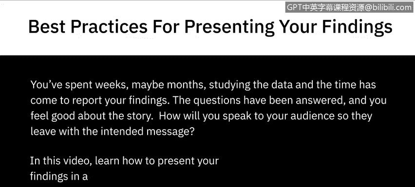
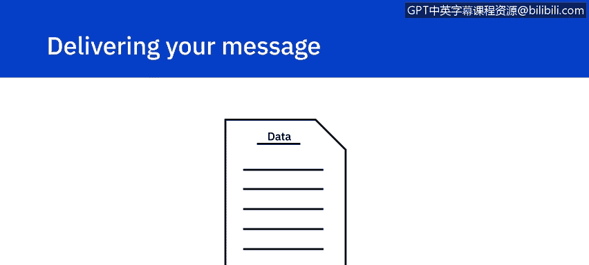

# IBM 数据分析师专业证书课程 9：《数据分析毕业项目》- 第6讲：展示分析结果的最佳实践 📊

在本节课中，我们将学习如何有效地展示数据分析结果。你将了解如何准备和进行数据驱动的演示，确保你的信息清晰、有说服力，并能吸引听众的注意力。

---

经过数周甚至数月的数据研究，现在到了汇报成果的时刻。问题已经得到解答，你对整个分析故事充满信心。那么，如何向听众讲述，才能让他们准确理解你想要传达的信息呢？本节视频将教你如何以一种能够吸引并保持听众注意力的方式来展示你的发现。

进行数据驱动的演示看似简单，但要准确传达信息，有几个重要因素需要牢记。

以下是确保演示效果的关键实践：

1.  **确保图表清晰可读**：图表和图形不应过小，并且标签必须清晰。
2.  **数据仅作为支撑证据**：仅使用数据来支持你的核心论点。
3.  **每张图表只阐明一个观点**：避免在一张可视化图表中总结多个要点。
4.  **剔除无关数据**：删除那些不支持关键信息的数据。

---

## 1. 确保可视化清晰可读 👀

你是否曾参加过一场演示，其中的信息难以阅读或理解？虽然这看似显而易见，但过小的图表和标签很容易被忽视。

**最佳实践是**：像你的听众一样，从不同距离测试你的可视化效果。如果数据无法清晰呈现，那么或许应该考虑重新设计。

---

## 2. 围绕核心信息构建故事，而非堆砌数据 📖

在准备报告时，你可能觉得解释发现的唯一方法就是在幻灯片中塞满数据。作为一名数据分析师，这似乎很合理，但你的听众可能不会欣赏数据的复杂性，只会看到一堆数字。

为了解决这个问题，**请遵循以下步骤**：

1.  首先，确定需要传达给听众的关键信息。
2.  围绕这些核心信息构建整个演示的故事框架。
3.  在形成大纲后，再回过头插入数据来支撑你的发现。

通过不过度依赖数据，并采用这种方法来创建演示文稿，你将构建出一个对听众而言引人入胜且有趣的故事。

---

## 3. 每张图表聚焦一个核心观点 🎯

使用图表和图形展示数据是传达信息的最佳方式。然而，如果你提供的信息过多，反而会造成混淆。

例如，请看下面这个饼图。你能解读出关键信息是什么吗？演示者试图传达什么？

在这个例子中，图表包含了太多信息，很难确定演示者想表达的重点以及听众应该关注什么。

**解决方案是**：坚持一个想法，不要将多个要点总结到一个可视化图表中。这样你就能准确地向听众传达观点，避免任何混淆。

---

## 4. 剔除无关数据，保持简洁 ✂️

数据分析师可能会花费数月时间研究数据，然而，一些对分析师来说有趣的发现，可能与该项目的核心目标无关。

试图向听众解释每一个细节，并且没有识别出无关数据，可能会损害关键信息的传递。

**核心原则是**：通过剔除这些不必要的数据，并仅突出支持你关键想法的数据点，你将使演示保持清晰和简洁。

---

## 总结 📝

本节课中，我们一起学习了如何创建能够吸引听众的数据驱动型演示，以及如何传递清晰、简洁的信息。关键要点包括：确保可视化图表清晰可读、围绕核心信息而非原始数据构建故事、每张图表只阐明一个观点，以及果断剔除无关数据以保持演示的专注力。掌握这些最佳实践，将帮助你有效地展示分析成果，确保你的专业见解被准确理解和认可。