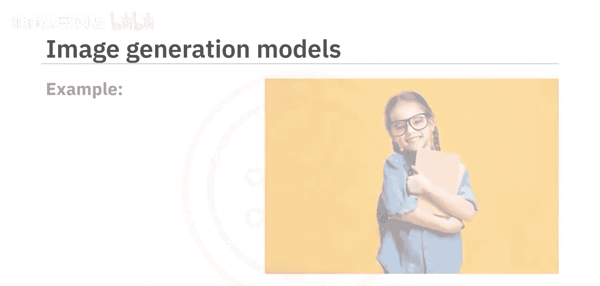
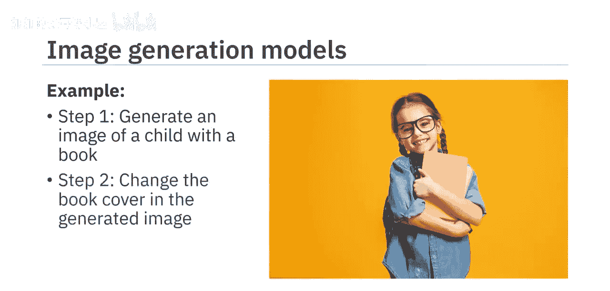
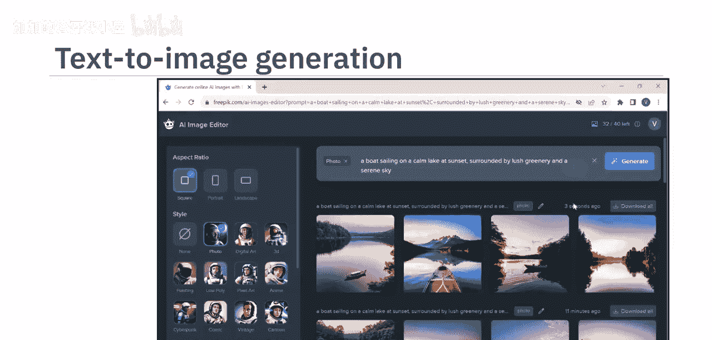
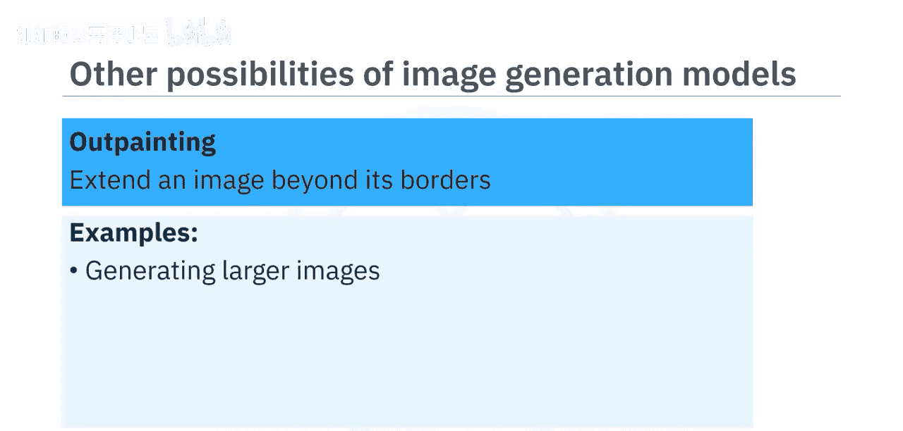
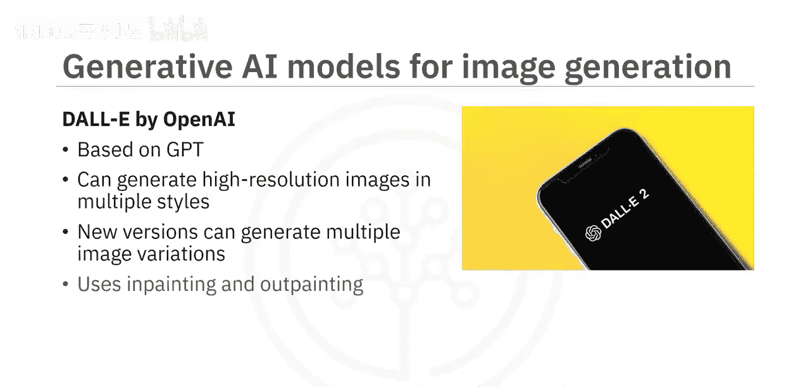
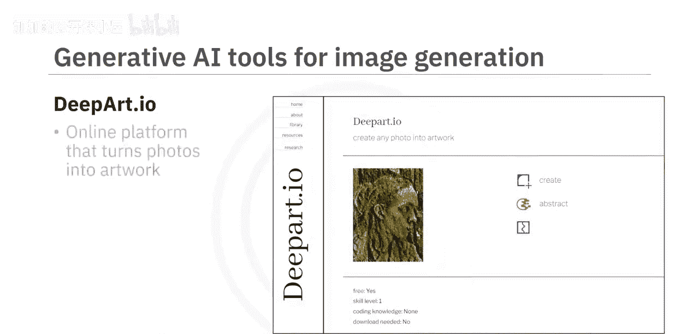
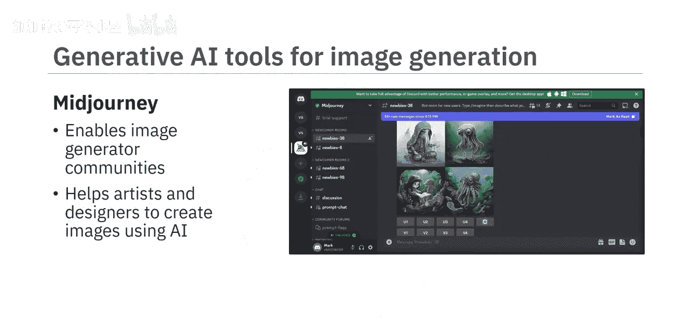
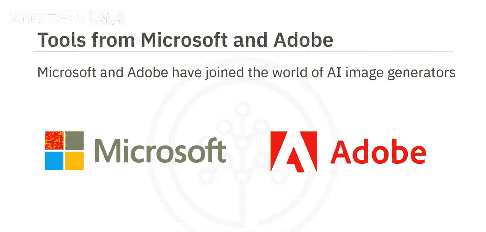
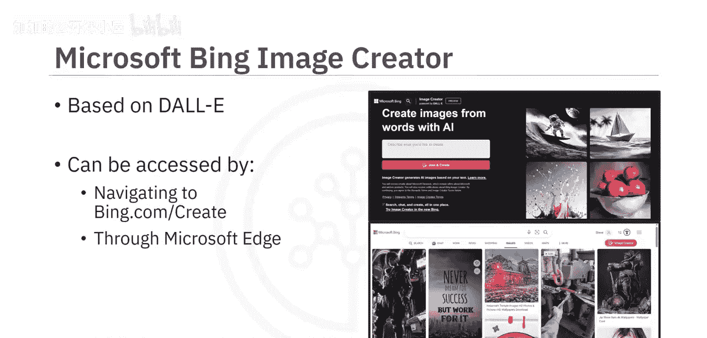
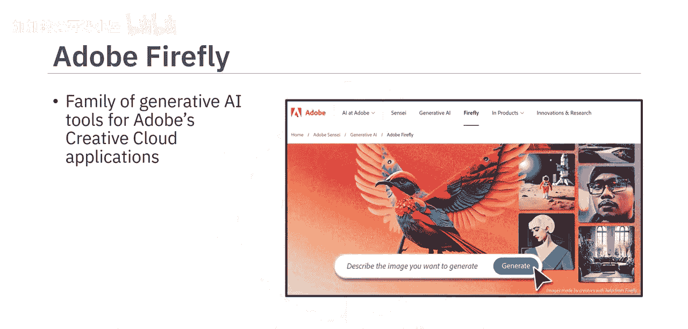

# 生成式AI专项课程：第11课：图像生成工具 🖼️

在本节课中，我们将学习生成式AI在图像生成领域的基本能力，并介绍几种主流的图像生成模型与工具。

生成式AI图像生成模型能够根据指令创建全新的图像，并能对现有图像（无论是真实的还是生成的）进行定制化修改，以获得期望的输出。例如，你可以要求模型生成一张“一个孩子手里拿着一本书”的图片，随后还可以进一步要求“将书中封面的颜色改为红色”。

## 图像生成基础

上一节我们了解了图像生成的基本概念，本节中我们来看看如何使用一个工具进行实际操作。

让我们使用一个免费的AI图像生成器（例如FreePik）来生成一张新图片。你需要输入一段文本提示词来描述你想要的图像。假设你输入以下提示词：“一艘船在日落时分的平静湖面上航行，周围是郁郁葱葱的绿树和宁静的天空。” 请记住，提示词中描述图像的词语将直接影响生成图像的准确性和质量。接下来，选择图像风格并点击生成。系统会生成多张图片供你选择，你可以下载选中的图片，也可以通过修改提示词来生成其他图像。

## 图像生成模型的更多可能性

除了基础的文本生成图像，图像生成模型还具备多种高级功能。

以下是几种关键的图像处理能力：

*   **图像到图像转换**：指将一个领域的图像转换到另一个领域，同时保留原始图像的内容和风格。例如：
    *   将草图转换为逼真的图像。
    *   将卫星图像转换为地图。
    *   将安防摄像头图像转换为更高分辨率、细节更丰富的图像。
    *   增强医学影像的细节。
*   **风格迁移与融合**：指从一张图像中提取风格，并将其应用到另一张图像上，从而创建混合或融合图像。例如，将一幅画作转换为照片风格。
*   **图像修复**：指重建图像中缺失或损坏的部分，使其变得完整。这项技术可用于：
    *   艺术品修复。
    *   法证分析。
    *   在保持连续性和上下文的前提下，移除图像中不需要的物体。
    *   在增强现实中，将虚拟物体无缝融入真实场景。
*   **图像扩展**：指通过生成与原始图像风格一致的新部分来扩展原始图像的边界。这可以用于：
    *   生成更大尺寸的图像。
    *   提升图像分辨率。
    *   创建全景视图。

## 主流图像生成模型

图像生成和修改能力的演进，得益于背后驱动模型的不断发展。

*   **OpenAI的DALL-E**：基于GPT模型，在大量图像及其文本描述的数据集上训练而成。DALL-E能够生成多种风格的高分辨率图像，包括逼真的照片和绘画。其新版模型还提供了生成多种图像变体，以及通过图像修复和扩展进行图像转换的能力。
*   **Stable Diffusion**：一个开源的文生图扩散模型。扩散模型是一种能创建高分辨率图像的生成模型。Stable Diffusion主要用于根据文本提示生成图像，但也可用于图像到图像转换、修复和扩展。
*   **NVIDIA的StyleGAN**：该模型将图像内容和图像风格的建模分离开来，从而能够精确控制风格，并操纵特定特征（如姿势或面部表情）。StyleGAN已演进到能够生成分辨率更高、细节更逼真的图像。

## 常用图像生成工具

了解了核心模型后，我们来看看一些可供使用的工具。

你可以使用Crayon、FreePik、Pixlr等免费工具来探索生成式AI的文生图能力，这些工具能以不同的形式和风格生成图像。

Photor和DeepArt提供了多种预训练风格，允许你创建自己的自定义风格。DeepArt.io是一个在线平台，可以将照片转化为不同艺术风格的作品。

MidJourney是一个平台，它培育了一个图像生成社区，帮助艺术家和设计师使用AI创作图像，并探索彼此的作品。

## 集成与应用

许多生成式AI图像生成器还提供API接口，允许将其功能集成到不同的软件程序和工具中。一些提供API的流行图像生成器包括DALL-E、MidJourney和Crayon。

科技巨头如微软和Adobe也已进军AI图像生成领域。

*   **微软Bing Image Creator**：基于DALL-E模型。你可以通过访问Bing.com/create或通过Microsoft Edge浏览器来使用该工具。这使得Microsoft Edge成为首个集成AI图像生成器的浏览器。
*   **Adobe Firefly**：这是一个生成式AI工具系列，旨在与Adobe Creative Cloud应用程序（如Photoshop和Illustrator）集成。Firefly使用Adobe Stock图片、开放许可内容和公共领域内容进行训练。它能接受超过100种语言的文本提示，并包含多种工具，允许你操控颜色、色调、光照、构图，以及使用生成式填充、文本效果、生成式重新着色、3D转图像和图像扩展等功能。

## 总结

本节课中，我们一起学习了生成式AI模型和工具能够通过文本或图像提示生成新图像。它们还提供了图像到图像转换、风格迁移、图像修复和图像扩展等能力。几个突出的图像生成模型包括DALL-E、Stable Diffusion和StyleGAN。市面上有多种图像生成工具，提供多样化的图像生成和转换功能。部分图像生成器还能以API形式集成。我们还了解到，Adobe Firefly是一个旨在与Adobe创意云应用程序集成的生成式AI工具系列。