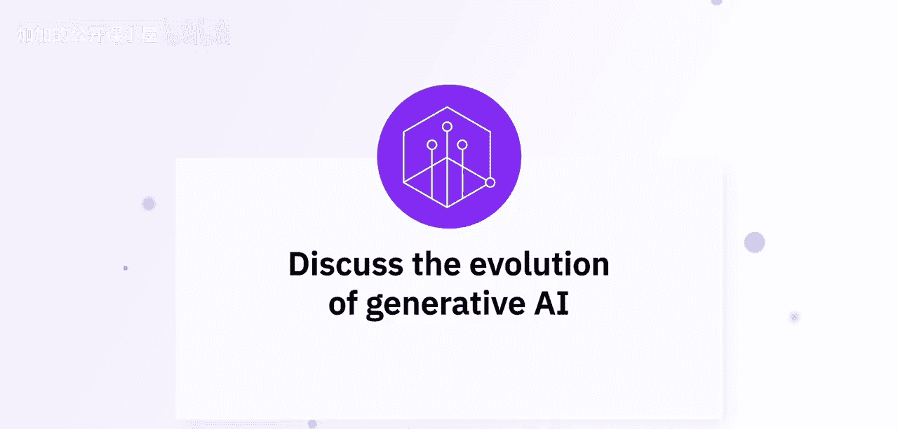
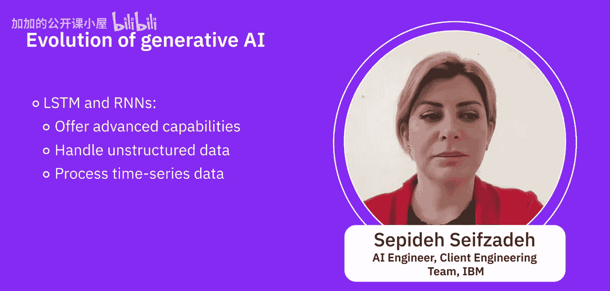
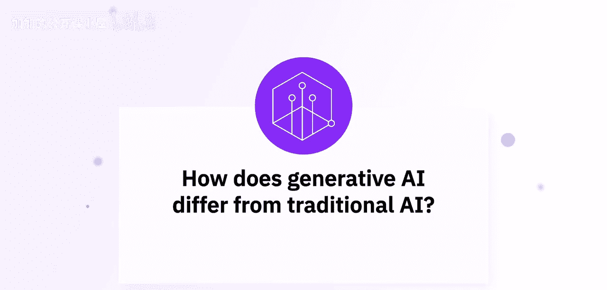

# 生成式AI基础：P1：专家视角下的演进与差异 🧠

在本节课中，我们将通过专家的视角，了解生成式人工智能的演进历程，并探讨它与传统人工智能方法的根本区别。

---

## 概述：生成式AI的演进轨迹

生成式人工智能是随着人工智能整体发展而演进的，但最近获得了更多关注。它存在了超过20年，但过去并不流行。近年来，随着**生成对抗网络**和**变分自编码器**等技术的出现，它获得了巨大的发展动力，几乎成为了行业的未来。

生成式AI的演进，以其创造新颖原创内容能力的显著进步为标志。早期的生成式AI模型在连贯性和质量上有所不足。但自从**GPT-3**，以及后来的**GPT-4**和**DALL-E**出现后，它们能生成高度复杂的文本和图像，极大地增强了各领域的创造力和自动化水平。

简单来说，生成式AI已经到来，它是一个创意引擎。可以把它想象成一个超级聪明的艺术家，不仅能遵循指令，更能创造新事物——绘画、写故事，甚至构思全新的想法。

---

## 技术演进的关键阶段

上一节我们了解了生成式AI的整体发展，本节中我们来看看推动其进步的具体技术阶段。以下是其演进过程中的几个关键模型和方法：

1.  **规则驱动模型**：最初的系统严格遵循预设的规则和上下文工作，灵活性有限。
2.  **机器学习与统计模型**：这些模型能够从数据中发现模式。通过**监督学习**、**半监督学习**或**强化学习**，它们比规则系统更智能，能识别数据中的规律。
3.  **深度学习与神经网络**：能够以更先进的方式处理数据集中的模式，并应对非结构化的数据格式。
4.  **生成对抗网络**：**GANs** 的出现标志着生成任务的新时代，它能够生成全新的数据。
5.  **Transformer与大型语言模型**：后来出现的**LSTM**和**Transformer**架构（如基于此的神经网络），让我们在处理非结构化数据、时间序列数据集和特定用例方面取得了更大进展。特别是2017年《Attention Is All You Need》论文提出的Transformer，为生成任务开启了新纪元。

---

## 生成式AI与传统AI的核心差异

了解了生成式AI的“成长史”后，本节中我们来看看它与我们更熟悉的传统AI有何不同。区分生成式AI与传统AI方法至关重要。

*   **传统AI**：专注于分析和预测现有数据，例如**分类**、**回归**、推荐等任务。它基于已有信息做出判断或预测。
*   **生成式AI**：特别是在**GANs**和**Transformer模型**出现后，其核心是创造与训练数据相似的新数据。它不仅仅是分析，更是“发明”。

过去五六十年，人工智能的发展是从基础走向应用和预测。而**生成式AI更侧重于利用人工智能技术生成类人的高质量输出**。

一个简单的比喻是：传统AI执行你告诉它的命令，而生成式AI则学习并自主创造，就像一位酷炫的AI发明家，准备释放人工智能的创造潜力。

---

## 总结

本节课中，我们一起学习了生成式AI从早期规则系统到现代强大模型（如GANs和Transformer）的演进历程。关键点在于，生成式AI的核心能力是**创造**，而传统AI的核心能力是**分析与预测**。理解这一根本区别，是掌握生成式AI如何为项目管理等领域带来变革性价值的第一步。