# IBM【中英⚡面向项目经理的生成式AI 专项课程｜Generative AI for Project Managers Specialization】 p06 P6 03_生成式人工智能的能力 [BV1DnxVziEnn_p6]

Welcome to the capabilities of generative AI After watching this video。

 you'll be able to describe some of the capabilities of generative AI and explore their use in the real world。

 Let's start with a high level overview of some of the capabilities of generative AI that we'll discuss。

 First is the text generation capability of generative AI。 That is its ability to generate clear。

 lucid and contextually relevant textual responses。 The second capabilities， image generation。

 that is synthesizing artistic and realistic images that are very similar to real ones。

 The third capabilities， audio generation， generative AI enables music composition and synthetic audio generation。

 The fourth capabilities well discuss is video generation。

 generative AI enables the generation of dynamic films and small videos based on textual descriptions and even images。

 The fifth capability is the codegen capability of generative AI。

 generative models can generate code functions and programs。

 will also discuss the data generation and augmentation capability。😊，Of generative AI。

 This helps generate synthetic data to create augment data sets。 Finally。

 we'll explore generative AI's capability to create real and immersive virtual worlds。

 These are just some of the capabilities of generative AI。Essential。

 whatever the human mind is capable of conceiving as a potential use case for the application of generative AI。

 Now， let's delve deeper into some of these capabilities。

 Let's begin that the text generation capabilities of generative AI。

 at the core of generative AI's text generation capabilities are advanced AI powered large language models or L L Ms。

😊。

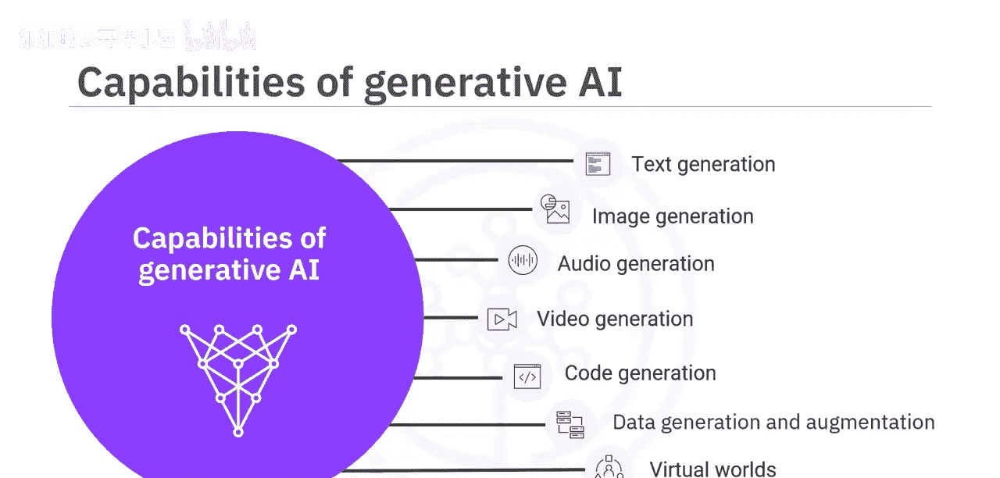

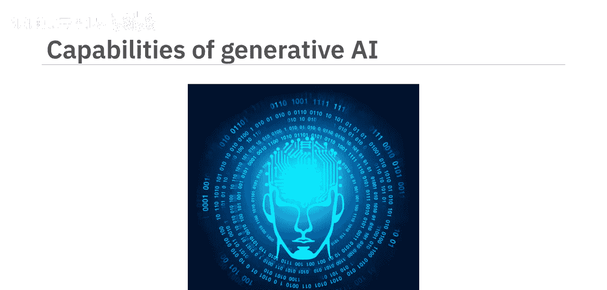

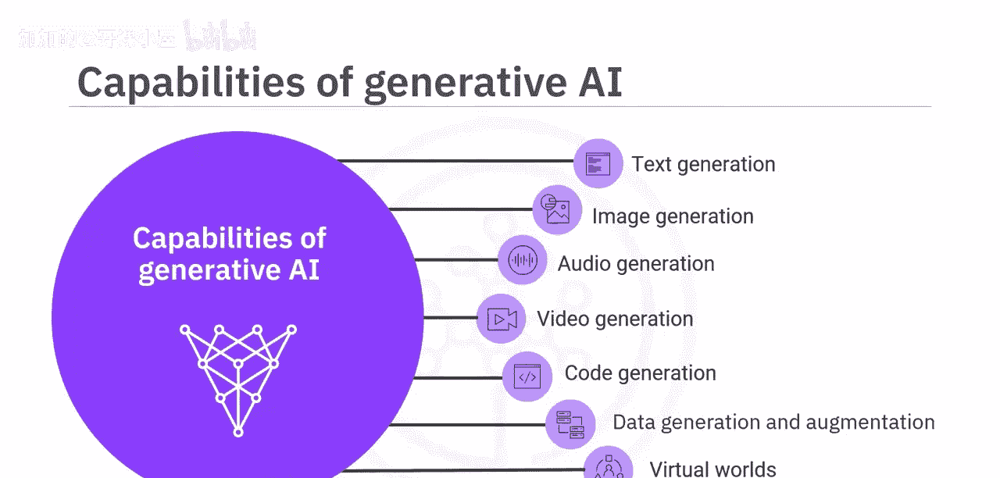

LLMs are trained on large data sets and can generate human like text in various contexts。

 These models learn patterns and structures within the data to generate coherent and contextually relevant responses。

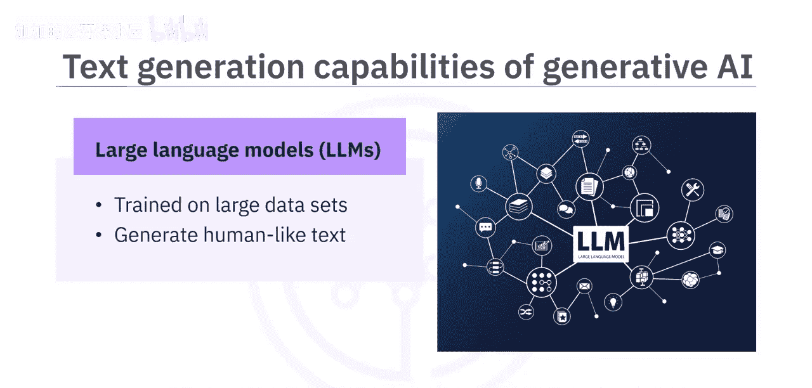

These models generate text， converse and provide explanations， summaries and more。

 Some popular LLMs are open AI's generative pretrain transformer or GT。

 and Google's Paways language model or Pm。 These models can perform various language related tasks。

 such as text completion。Summarization， question answering， translation。

 cogeneration and image and text pairing， conversational interactions with chatbots and virtual assistants are powered by LLms。

 Let's look at the image generation capabilities of generative AI generative models can generate high quality convincing images based on deep learning techniques such as generative adversarial networks organNs and variational autoenrs or VaEs。

 These generated images exhibit realistic textures， natural colors and finegrain details。

 giving the impression of a real camera capture。 St G， for example。

 can generate high quality high resolution new images of imaginary faces， animals or nature。

 While deep art can create comprehensive artwork from a simple sketch。

 Dll E can generate entirely new images as described by the users。 A apart from applications and art。

 design， entertainment， gaming and research domains。

 generated images can augment training data and aid medical imaging and。😊。

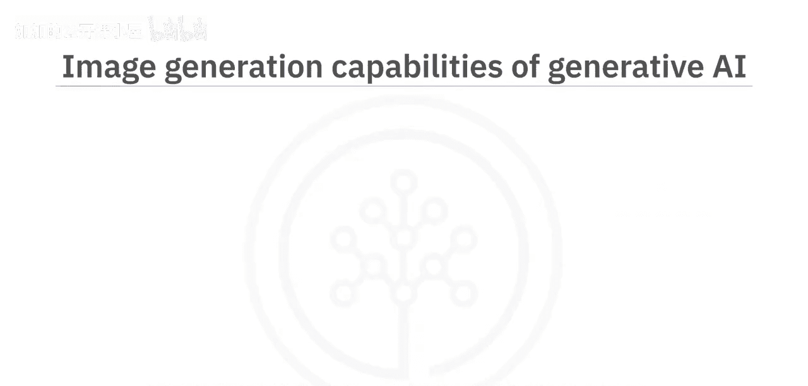

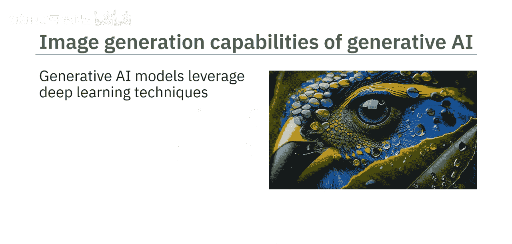

Scientific visualization In the context of audio generation。

 generative models can generate new musical compositions。

 convert text into audio using text to speech or TtS and create synthetic voices and natural sounding speech generative models can convert。

 modify and transform and clean up voices， also reduce noise and enhance audio quality These models also have the capability to mimic human voice to a fair amount of likeness wavegan。

 for example， can create new and realistic raw audio waveform， including speech。

 music and natural sounds。

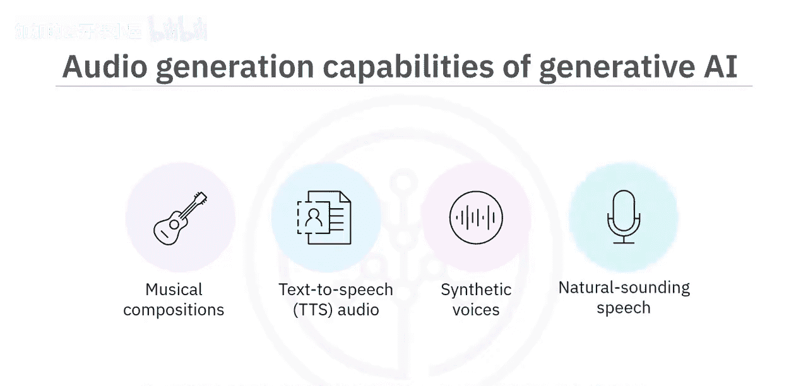

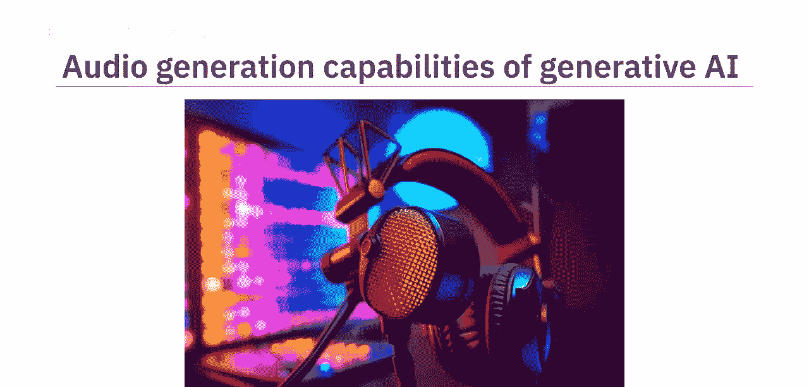

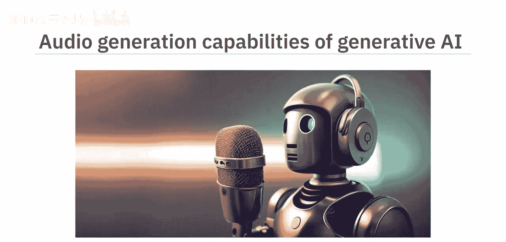

Musenet from open AI can combine various instruments。

 styles and genres to generate novel musical compositions。

 Google's Takatron 2 and Mozilla TtS use advanced TtS systems to create synthetic speech。

 resembling human tone， pitch， modulation， pronunciation， rhythm and expressions。

 audio generated by generative models as applications in media， creativity， entertainment， training。

 education， gaming， virtual reality and several other domains。 Now。

 let's look at the video generation capabilities of generative AI。

 generative AI models can create dynamic and lucid videos ranging from basic animations to complex scenes。

 These models transform images into dynamic videos by incorporating temporal coherence in natural language processing。

 temporal coherence refers to the consistency and continuity of meaning or context over time。

 This enables these models to exhibit smooth motion and plausible transitions and videos。😊。

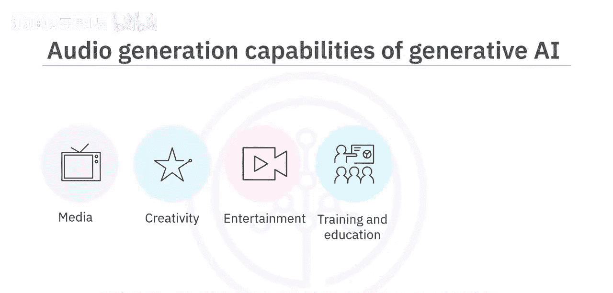

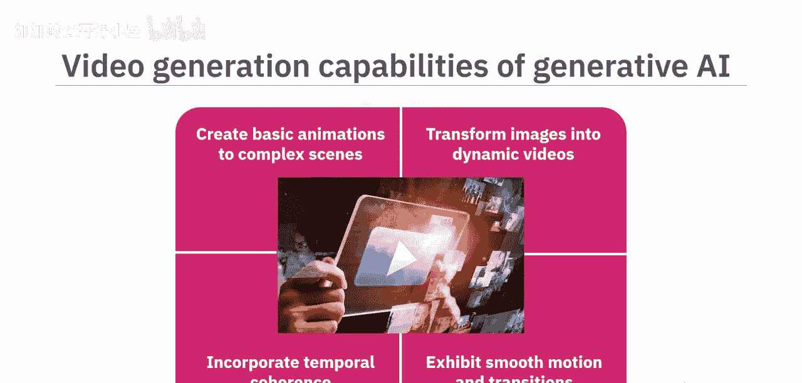

For instance， a popular AI model video G follows textual prompts users provide to generate new videos。

 Use can specify the desired content and guide the video generation process， including completion。

 editing synthesis， prediction and style transfer。 These generated videos can be used in domains such as art。

 entertainment， education， gaming medicine and research。 Now。

 let's talk about generative AIs code generation capabilities。

 generative models can generate new code snippets， functions or complete programs based on desired functionality trained on existing code repositories。

 These models can complete or create code， synthesize or refractor code。

 I and fixed bugs and code test software and create documentation， including comments。

 function descriptions and usage examples。 For instance。

 Github copilot and IBM Watson code assistant are AI based programming assistance that help autocomp code。

 Ac hard tasks and generate code for provided input。 AI generated code can。😊。

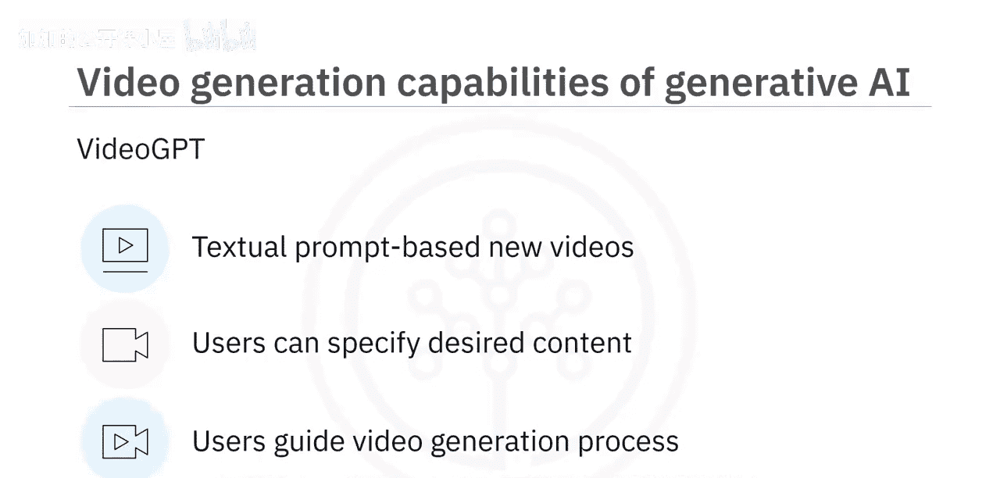

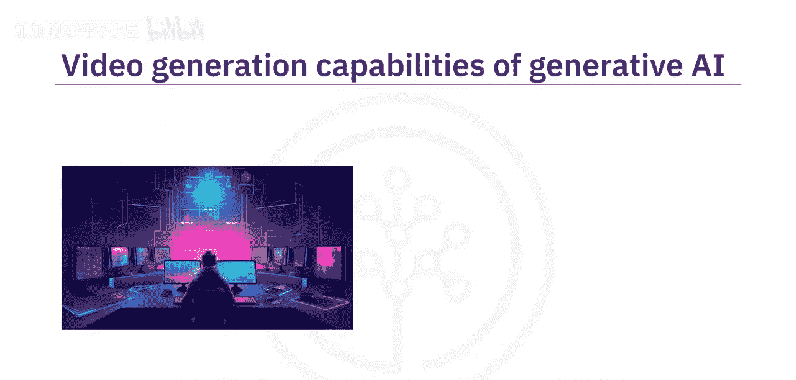

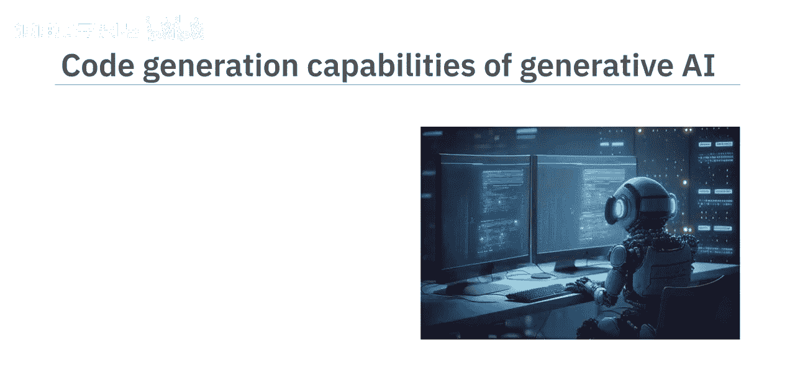

Be used in software and web development， machine learning and natural language processing。

 data science and analytics， robotics and automation。

 virtual game and AR VR environment development and audio video and speech processing。

 Soft developers can benefit from leveraging code generation capabilities to write。

 debug and test their code。 Now， let's explore the data generation and augmentation capabilities of generative AI generative models can generate new data and augment existing data sets。

 Gene synthetic data sets helps increase the diversity and variability of the data leadingad to more robust and effective performance。

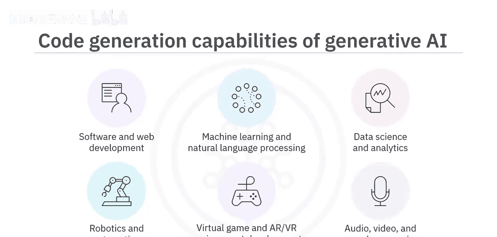

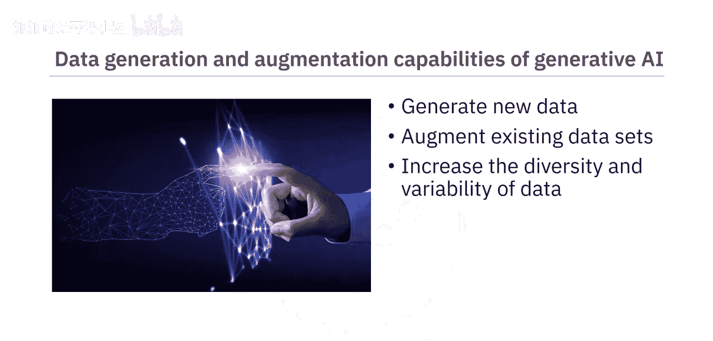

These models can generate new samples and augment data sets for images， text， speech。

 tabular data and statistical distribution， time series， data， finance， and more。

 The data generation and augmentation capabilities of generative AI have applications in medicine。

 healthcare care， gaming， education and training， art and creativity。

 self- drivingiv automobiles and many more。 Another powerful capabilities of generative AI models is their ability to create highly realistic and complex virtual worlds。

 You can create avatars that simulate realistic behavior， expressions， Con and even decisions。

 You can also create complex virtual environments with realistic textures。

 sounds and objects that follow the principles of the physical world。

 Metaverse platforms use generative models to create unique and personalized experiences for individual users。

 generative AI also makes it possible to create virtual identities with unique personalities。

 avatars that can be fitted with specific personal traits that reflect in their behaviors and conversation。

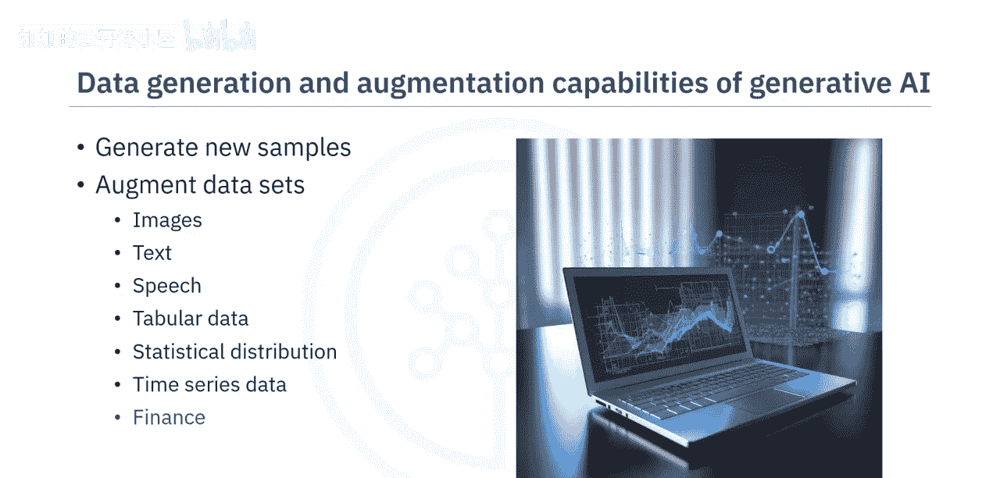

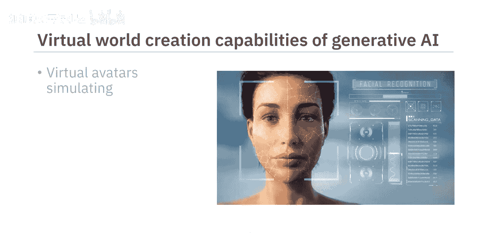

The virtual world capability of generative AI is applications in gaming， entertainment。

 education augmented in virtual reality， metaverse platforms and also virtual influencers and digital personalities。

 In this video， you learn about some of the capabilities of generative AI models and their use in the real world。

 generative AI can create coherent and contextually relevant content and generate realistic high quality images。

 synthetic voices， new audio and dynamic videos， and generative AI models can generate and complete code and synthesize new data to augment the existing data sets。

 generative AI models are also capable of creating highly realistic and complex virtual worlds。

 including virtual avatars and digital personalities。😊。

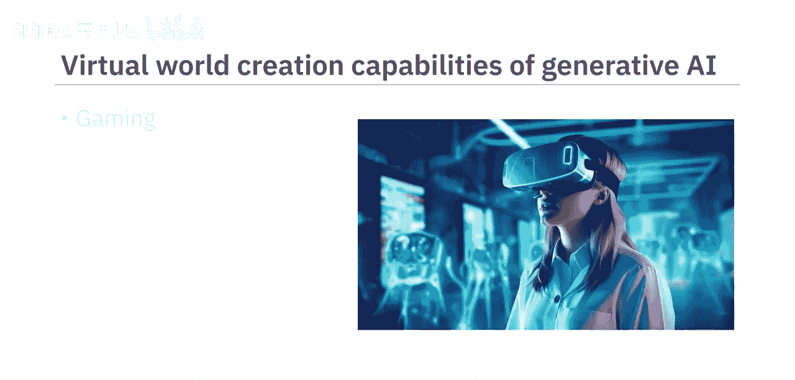

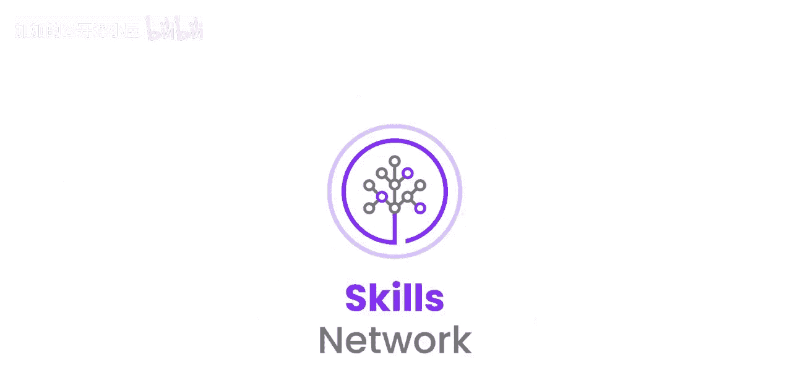