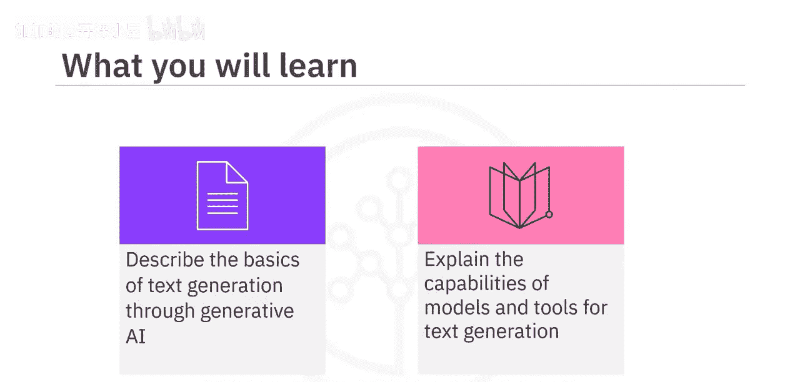
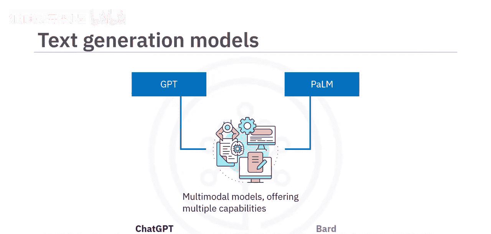
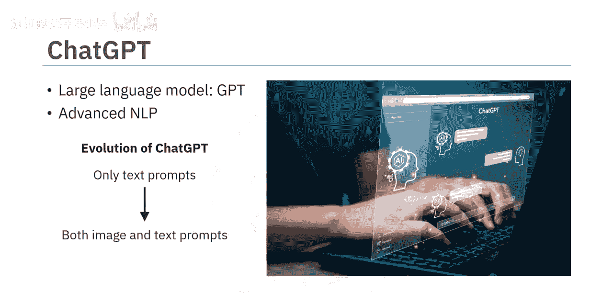

# IBM【中英⚡面向项目经理的生成式AI 专项课程｜Generative AI for Project Managers Specialization】 p10 P10 02_文本生成工具 [BV1DnxVziEnn_p10]

Welcome to tools for text generation。 After watching this video。

 you'll be able to describe the basics of text generation through generative AI。

 explain the key capabilities of common models and tools for text generation。

 at the core of the text generation capabilities of generative AI are large language models or LLMs based on patterns and structures learned during training。

 LLms interpret context， grammar and semantics to generate coherent and contextually appropriate text drawing statistical relationships between words and phrases allows LLms to adapt creative writing styles for any given context。

 LLms are the basis for many text generation models。

 Two such examples are generative pretrain transformer or G and palm These models have evolved into multimodal models offering multiple capabilities。

 Let's learn about the capabilities of these models through two popular tools。

 chat G and bard Chat G is based on。😊。

GPT is the large language model and uses advanced natural language processing or NLP。

 While originally， chat GPT only took text prompts as input to generate new contents with the newer versions。

 It can take both image and text inputs。 Chat GPT offers diverse capabilities for text generation。

 It is capable of smooth and context based conversation。

 Let's start a conversation with chat G to learn a concept。

 In put a prompt that says I've heard about generative AI and want to learn more。

 chat GP responds with some basic information based on the context。

 When you take the conversation forward to refine the research by asking how can I use generative AI to improve my storytelling skills as a prompt。

 chat GPT provides the response based on the context and question provided by you。

 Feel free to experiment and guide the conversation further。

 Chat GP will build an informative and interesting conversational flow。

 It can also help you with varied creative tasks。 Let's enter the prompt。

Help me to create slides to demonstrate the features of a learning platform。

 and chat G comes with suggestions about the title， content and visuals for specific slides。

 Although chat GPT is most proficient in English， it can understand and respond to several other languages。

 Let's prompt it to write hello in French and Spanish。 And it generates the desired output。

 Chat G PT can also be a useful tool to assist you in learning a new language or any subject for that matter。

 Another popular text generation tool is Google Bard。

 it is based on Google's advanced language models。 Pm short for pathways language model。

 Pm is a combination of transformer model in Google's pathways AI platform。

 Path AI is based on pathways， which are specialized modules responsible for a particular task。

 such as N LP or machine translation。 In addition to the massive training data set of text and code。

 It also pulls information from sources on the Internet to respond to prompts。

 Try experimenting with different prompts to explore the capability。Of bard。

 Let's try barred with a prompt to get a summary of the latest news on a topic。

 such as provide a summary of the latest news on the war in Ukraine。

 It provides you with multiple drafts as the response。 You can select one of these or regenerate。

 Next， let's try bard to generate ideas or solve a problem。

 Let's prompt it to provide a strategy for a digital marketing campaign for promoting a fashion brand。

 It provides a step by step approach to the marketing campaign。 Cha。

 G P T and Bard offer capabilities for other valuable use cases。 For example。

 they can help you with basic mathematics， statistics and problem solving through these subjects。

They are also proficient in financial analysis， investment， research， budgeting and more。

 Furthermore， chat G and Bard can generate code and perform code related tasks across various programming languages and frameworks。

 Having interacted with both chat G and bard， you'll notice that chat G is more effective in generating dynamic responses。

 and maintaining conversational flow。 While bard may be a better choice for researching the latest news or information on a topic as it is access to web sources through Google search and Google Scholar。

 It's important to realize that generative AI models， including G and Pm are evolving。

 So their capabilities and features may change。 Apart from chat G and bard。

 there are other text generators as well。 Jasper， for example。

 generates high quality marketing content of any length。 tailored to a brand's voice。

 Write is a valuable tool for creating high quality content for blogs， emails。

 Seo metadata and ads on social media。 Also， copy AI is great for。😊。

Creating content for social media， marketing and product descriptions。

 Another tool write Sonic offers specific templates for different types of text。

 such as articles and blogs， ads and marketing。 There are also tools available for specific use cases。

 For example， tools like resumer can generate a summary of a text by extracting key ideas or concepts。

 Next， tools like youclassifier used for classification to assign one or more categories to a snippet of text。

 Tos for sentiment analysis Under and generate text that reflects the underlying emotions expressed in human language。

Examples include brand 24 and Rep state for multilingual language translation。

 you can use language weaver and Yandex。It is important to note that many of the open source generative AI tools collect and review the data shared with them to improve their systems。

 This is an important consideration for interacting with these tools to avoid sharing any confidential or sensitive information。

 So do we have open source privacy preserving alternatives。 The answer is yes， G for all。

 for example， can be installed on your machines to run as a privacy aware chatbot without internet or a graphics processing unit。

Further， chatbots like H2 O AI and private G are designed to protect user privacy by running on local machines without any internet connection using the power of LLms。

 Not only that， you can customize these tools for use within a specific organization by linking them to your organization's documents and databases。

 generative AI based text generators offers several benefits。

 These tools are good learning aids as they provide step by step explanations。

 they can generate different forms of text quickly， enabling efficiency for writers and creators。

 These tools enhance creativity and inspire new ideas。

 by enabling engaging and interactive conversations。

 they're useful as virtual assistance and chatbots， by automating repetitive writing tasks。

 they can increase productivity for organizations with multilingual support。

 they enable communication and content localization for global audiences In this video。

 you learned that LLm's interpret context， grammar and semantics to generate coherent and contextual。

😊，LLMs are the basis for many generation Two popular generation tools are open AIs chat G and Googled Cha GT is based on GT and bard is based on P。

Both chat， GT and Bard can generate different kinds of text。

 translate languages and answer your questions in an interactive and informative way。

 Some of the other tools we talked about include Jasper， copypy AI， write Sonic。

 open source privacy preserving text generators include GT for all H20 AI and private G。

