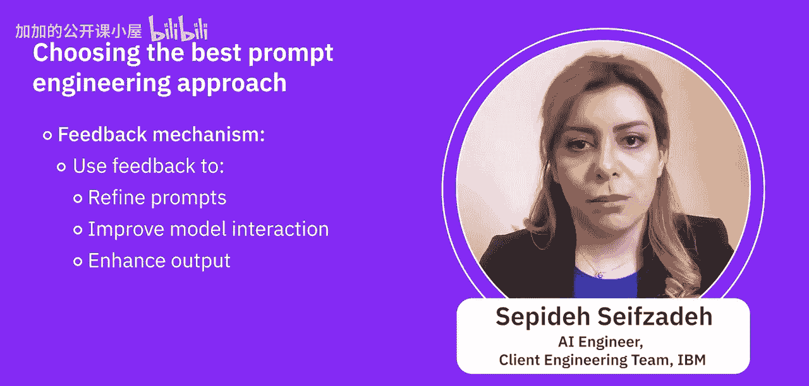

# IBM【中英⚡面向项目经理的生成式AI 专项课程｜Generative AI for Project Managers Specialization】 p28 P28 05_专家观点：选择提示工程方法的关键考量 [BV1DnxVziEnn_p28]

Hello and welcome to this expertt Viewpoints video。

 Let's hear from experts as they talk about the key factors to consider when choosing the best prompt engineering approach。

😊。

When choosing a prom engineering approach there are some aspects that we should consider。

 for example what is a task objective there are different tasks that generative AI can be used for。

 for example， text generation and sumization， codegen， code translation， image generation。

 so first we should think about what task we are actually trying to tackle then we have to consider the model capability because different models are aimed to tackle different use cases。

A lot will depend upon the kind of application that you're targeting if you're targeting a specific paragraph or you know textual application to be written。

 you have to be very clear about the kind of way in which those paragraphs need to be organized and how they need to be linked so again the main point comes back to the context of analysis second thing being the clarity of thought if you have a specific task in mind and you know you have to mention it in as much detail and clarity as you can。

And otherwise， whatever happens is that the output is even generic or worse。

 it can be associated with some sort ofuc which is called as AI hallucination aspect。

When choosing a prompt engineering approach， clarity。

 balance and understanding of your AI model are key， ensure your prongs are clear and concise。

 strike a balance between specificity and openness and experiment with different lens for optimal results。

Tor your prompts to leverage the strength of your AI models and provide sufficient context for coherent responses。

By considering these factors， you can ensure success in pro engineering。If you are generating。

 for example， let's say the code， you have to have all the features of the output that you need from that particular code and they need to be in a sequential and very descriptive order。

 otherwise the entire prompt is just going to give you a generic response which might not be very useful。

So yeah， again， coming back to the main three aspects of any good form， which is the clarity。

 the context and the features， they have to be put in place in a proper order and a good enough context。

 so in terms of getting a proper and descriptive response。

In our prompt we should also consider that the data requirements。

 sometimes we need more amount of data and sometimes the model needs less amount of data。

 for example， the context sensitivity， how much context or background knowledge we have to provide for our model to be able to respond to the questions in the way that we are looking for so the context amount of the background knowledge that we provide to the model also important the feedback mechanism so that we can learn about how the response is provided with the specific prompt improve the way that we interacts with the model and enhance the output that it generates so these are some of the considerations that we want to consider when choosing the right prompt engineering approach。

。

