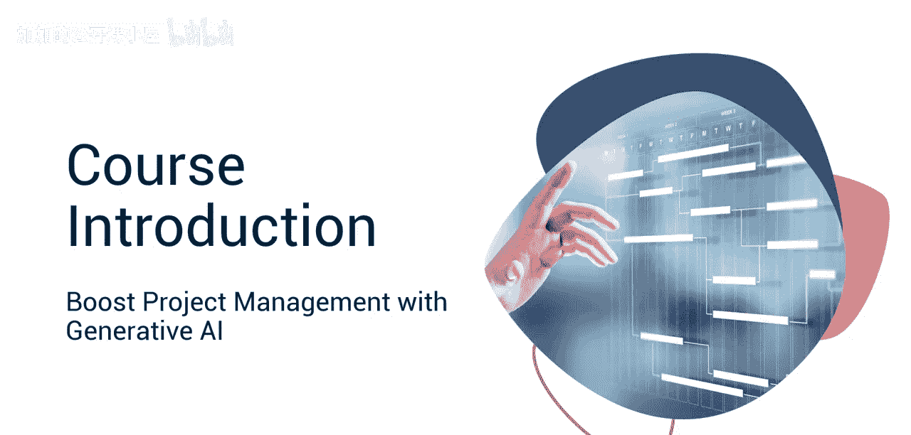
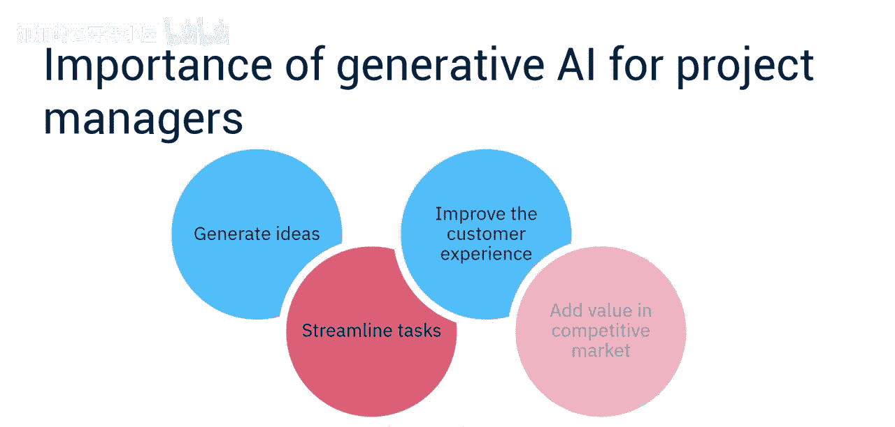
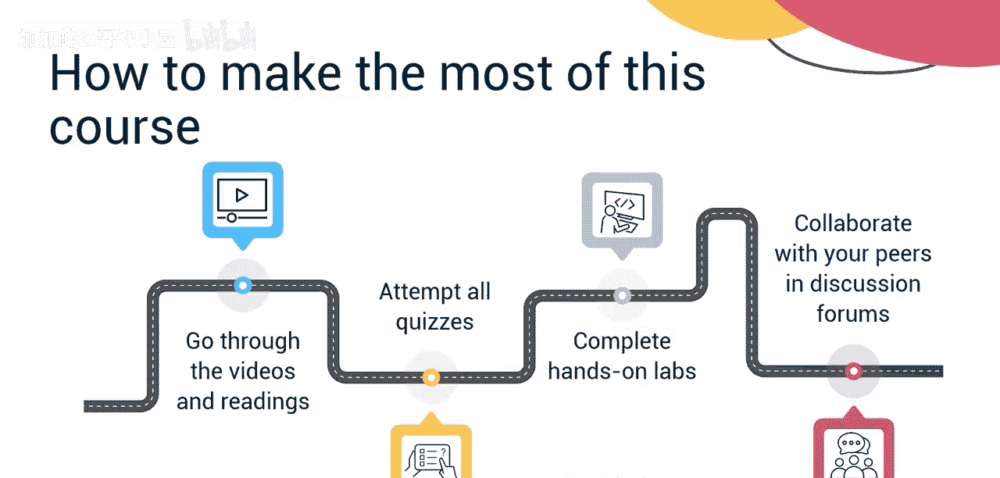

# IBM【中英⚡面向项目经理的生成式AI 专项课程｜Generative AI for Project Managers Specialization】 p31 P31 01_课程介绍 [BV1DnxVziEnn_p31]

Hello and welcome to our course where you will learn how to use generative AI tools to significantly increase or unleash your overall project management effectiveness。

My name is Daniel Ymans， and I will be your instructor for this course。

 I have played various roles in my career， including project and program manager， product manager。

 Scrum master and product owner Currently I am a college professor。

 corporate trainer and a subject matter expert at skill up technologies generative AI is reshaping customer demands as a project manager embracing generative AI is not just a trend It's a strategic necessity。

Generative AI can help you generate ideas that extend well beyond the data you likely have access to。

It can help you streamline tasks in a manner that allows you to focus on the most critical project management tasks。

In addition， generative AI can help improve the customer experience and add value in a competitive market environment。

I encourage you to visit the Project Management Institute website Genrative AI isn't just a buzzword。

 it's a theme AI is a powerful tool that empowers project managers to innovate。

 personalize and optimize， so embrace it， learn and unlock new possibilities for your products。

This course is part of the generative AI for project manager specialization。

 It is designed for new or seasoned project managers hoping to stay ahead of the AI curve。

Learners should be familiar with the project management lifecycle and basic project management concepts。

They should also have a basic understanding of generative AI and prompt engineering。

Module1 will provide an overview of how AI is rapidly evolving in the world of project management。

AI is significantly transforming the landscape of project management。

 and more and more project managers are using AI to improve project management effectiveness。

You will learn how AI tools and techniques have improved the streamlining of tasks。

 enhanced idea generation， and improved overall project management efficiency and effectiveness。

In moduledule 2， you will learn how to apply generative AI tools to improve performance through a series of demonstration videos。

 we will also discuss ethical considerations associated with generative AI and provide an overview of challenges you may encounter with tips to overcome them in the last module you will complete a final project and take a final assessment to test your understanding of key concepts。

There is a lot to cover here to get the most from this course。 go through the videos and readings。

 attempttemp all quizzes， complete all the hands on labs and use the discussion forum to connect and collaborate with your peers。

 If you have any queries with the course material。 please don't hesitate to contact us in the discussion forum。

😡。

Welcome to the course， we look forward to sharing how AI can unleash your project management career and ensure you and your firm are not left behind in the race to create new and innovative products that delight your customers and provide your firms with a critical。

 competitive advantage。

