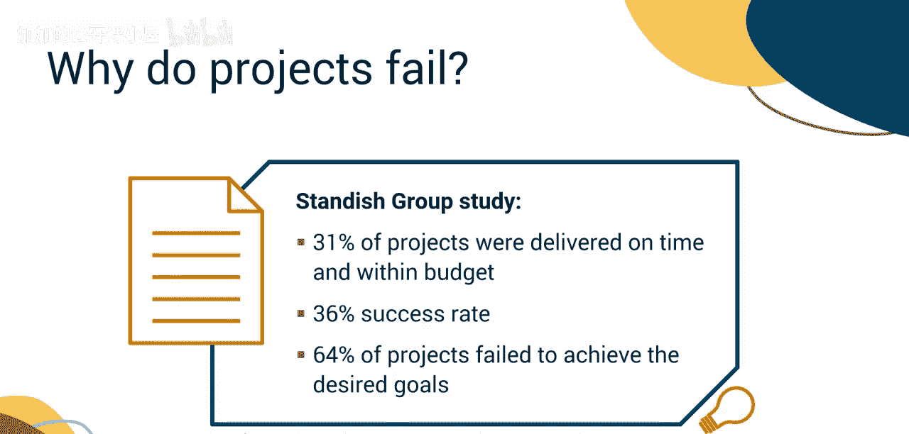
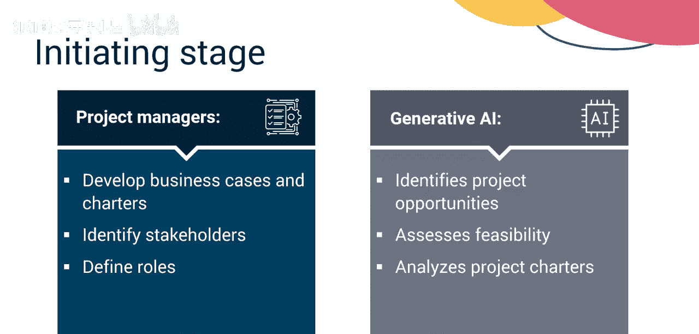
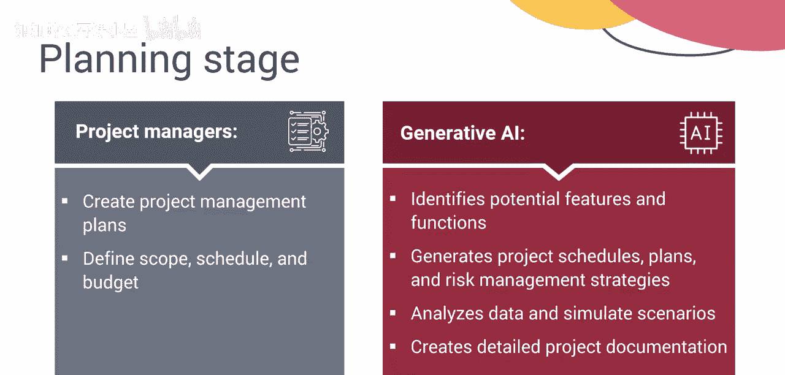
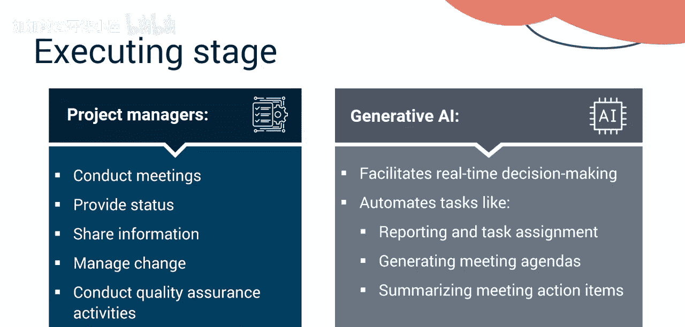
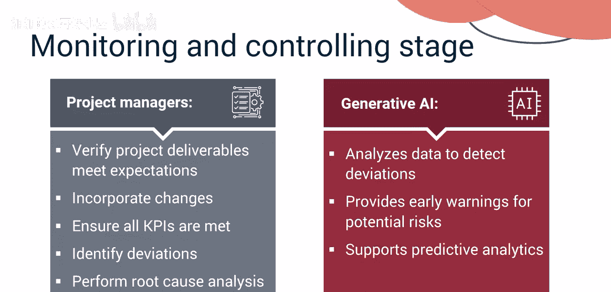
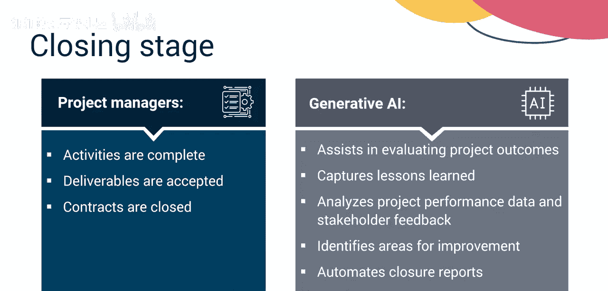
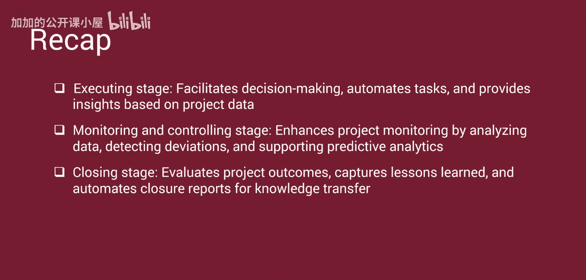

# IBM【中英⚡面向项目经理的生成式AI 专项课程｜Generative AI for Project Managers Specialization】 p32 P32 01_生成式人工智能在项目管理中的应用 [BV1DnxVziEnn_p32]

Welcome to Generative AI for Project Management After watching this video。

 you will be able to describe the role of the project manager and explain how generative AI can enhance the project management lifecycle。

Genative AI is a powerful and versatile tool for project managers， it streamlines tasks。

 encourages collaboration and fosters innovation， enhancing project success。

 generative AI can generate reports， draft meeting agendas， and even compose emails。

 allowing project managers to focus on strategic planning and problem solving， Additionally。

 it can analyze project data to predict challenges and offer solutions。

 making project execution smoother， let's learn about the role of the project manager。

The project manager must lead and manage the entire project management lifecycle from initiation to closure in the initiating and planning stages。

 the project manager focuses on developing the project charter。

 engaging stakeholders and creating a comprehensive project management plan to set the stage for successful execution during executing。

 monitoring and controlling and closing stages， the project manager ensures the development， testing。

 validation， acceptance， and transition of project deliverables。😊。

The project manager is accountable for delivering projects on time and within budget。

 meeting approved requirements and delivering value， however。

 despite the efforts of project managers， project success rates remain variable with many projects failing to meet their objectives。

A recent Stan group study stated that only 31% of projects were delivered on time and within budget with a success rate of 36%。

 this means that 64% of all projects fail to achieve the desired goals let's learn how generative AI can revolutionize your approach and improve your success as a project manager in the initiating stage。

 project managers initiate projects by developing business cases and charters。

 identifying stakeholders and defining their roles。

 generative AI assists in identifying project opportunities and assessing feasibility using historical data and predictive analytics it can also analyze project charters and suggest critical roles Next。

 in the planning stage， project managers create comprehensive project management plans defining scope。

 schedule and budget generative AI supports planning by identifying potential features and functions and generating project schedules resource allocation plans and risk management strategies。

Analyze data to identify dependencies， optimize resource utilization and simulate various scenarios to identify an effective project plan。

 It can also assist in creating detailed project documentation like work breakdown structures WPS and risk registers。

 streamlining the planning process in the executing stage project managers conduct meetings provide status。

 share information and manage change They conduct quality assurance activities to ensure processes。

 standards and quality are adhered to generative AI facilitates realtime decision making by providing insights based on project data and automates tasks like reporting and task assignment generating meeting agendas and summarizing meeting action items This allows project teams to focus on high value activities。

 Next， in the monitoring and controlling stage Project managers verify that project deliverables meet expectations In changes ensure all Kpis are met I deviations。

😊。

perform root cause analysis when issues develop generative AI enhances project monitoring and control by analyzing data to detect deviations。

 provide early warnings for potential risks and support predictive analytics for better decision making and resource allocation Finally in the closing stage project managers ensure all activities are complete Deliverables are accepted and contracts are closed generative AI assists in evaluating project outcomes and capturing lessons learned for future projects It can analyze project performance data and stakeholder feedback to assess the project success and identify areas for improvement generative AI can also automate closure reports facilitating knowledge transfer by generating insights and recommendations based on the project experiences In this video you learned that generative AI streamlines tasks fosters collaboration and enables innovation for project managers Project managers lead the project life。

Cycle from initiation to closure， developing charters。

 engaging stakeholders and ensuring deliverables meet requirements within budget and on time。

 generative AI revolutionizes project management across all stages， initiating stage。

 identifies project opportunities， assesses feasibility， and suggests critical roles， planning stage。

 identifies features， generates schedules， resource allocation plans， and risk management strategies。

 executing stage facilitates decision making， automates tasks and provides insights based on project data。

 monitoring and controlling stage enhances project monitoring by analyzing data。

 detecting deviations and supporting predictive analytics and closing stage。

 evaluates project outcomes， captures lessons learned。

 and automates closure reports for knowledge transfer。😊。

