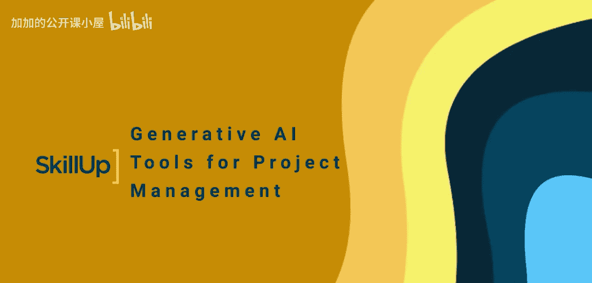
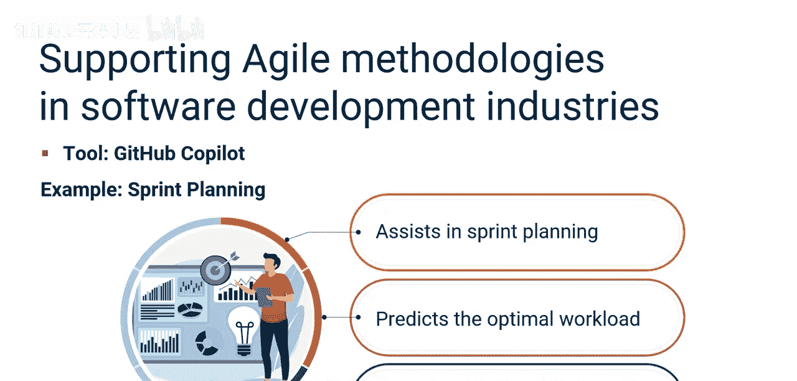
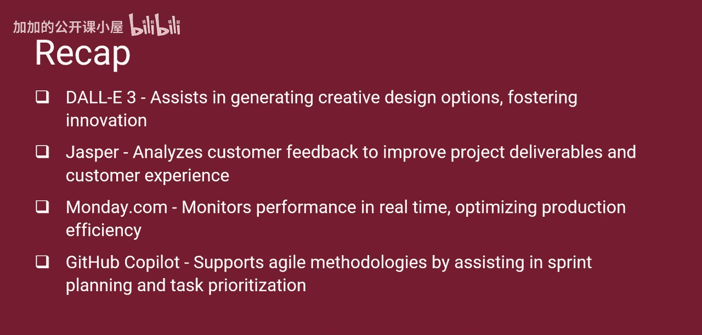

# IBM【中英⚡面向项目经理的生成式AI 专项课程｜Generative AI for Project Managers Specialization】 p33 P33 02_生成式人工智能项目管理工具 [BV1DnxVziEnn_p33]

Welcome to a video on generative AI tools for project management After watching this video。

 you will be able to describe how generative AI is enhancing project management across multiple industries。

Review examples of generative AI tools that made a difference in project management。

Project managers are leveraging a variety of generative AI tools to their advantage。

Generrative AI can be used to plan and execute traditional waterfall or predictive projects and agile or adaptive projects。

Let's review some generative AI tools that project managers use in their project management tasks。

Project managers use Clickup's AI features to automate the creation of construction schedules and develop project network diagrams。

The tool can analyze past project timelines and current resource availability and generate optimized schedules that save time and reduce manual planning efforts。

Geminize AI capabilities， analyze historical clinical trial data， and external health trends。

 predict potential risks， develop risk registers， and suggest risk response strategies。

This analysis empowers healthcare project managers to make informed decisions and proactively manage clinical trial risks notions integration with AI tools like chat GPT can transcribe and summarize meetings in real time。

This ensures all team members have access to key decisions and action items。In addition。

 this enhances team alignment and productivity by providing clear and concise meeting summaries。😊。

Dalli3 generates multiple design options based on initial parameters provided by the design team。

These AI generated designs serve as a starting point for designers to refine。

 which leads to more innovative and diverse product outcomes。

Project managers are sharing visual depictions of potential project deliverables as part of their requirements documentation when applicable。

Jasper uses AI to analyze customer feedback and sentiment across various channels。

This analysis helps retail project managers understand customer needs and preferences。

 allowing them to tailor project deliverables， enhance customer satisfaction。

 and increase value Mondayday。coms AI features monitor production line performance in real time and provide alerts for deviations from the plan。

This helps manufacturing project managers quickly address inefficiencies and optimize production workflows。

Many projects are accomplished using an agile or hybrid framework。

Agile falls under the adaptive framework， heading and emphasizes flexibility， collaboration。

 customer feedback， and small rapid releases。GitHub Copilot assists in sprint planning by predicting the optimal workload and identifying the most critical tasks。

These insights help software development project managers plan efficient sprints and align development cycles with project goals in this video you learned industry specific applications can enhance project management effectiveness and increase chances of project success。

 clickup automate scheduling and resource allocation。

 allowing project managers to focus on strategic planning。

Gmini analyzes clinical trial data for risk management。

 helping project managers make informed decisions。Notion enhances communication and collaboration through AI generated meeting summaries Doli3 assists in generating creative design options。

 fostering innovation。Jasper analyzes customer feedback to improve project deliverables and customer experience。

Monday。com monitors performance in real time， optimizing production efficiency。

GitHub Copilot supports Agile methodologies by assisting in sprint planning and task prioritization。

