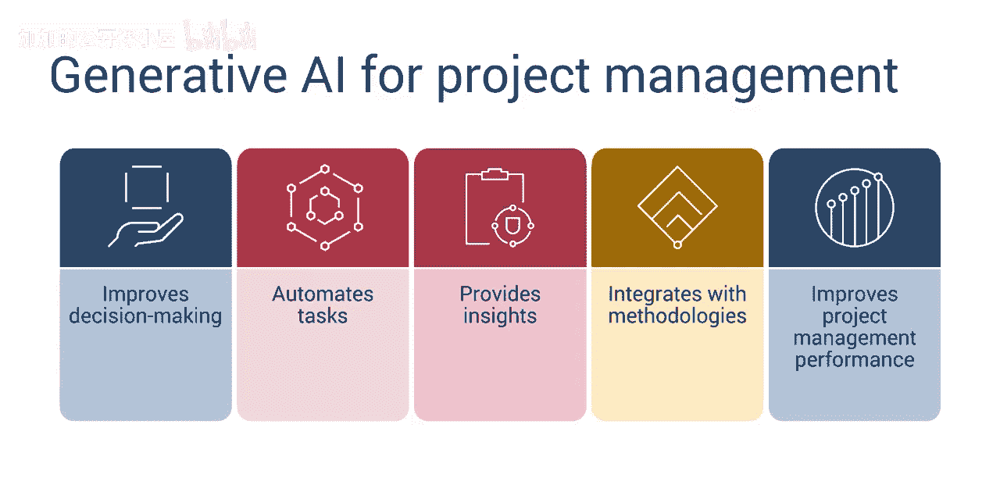
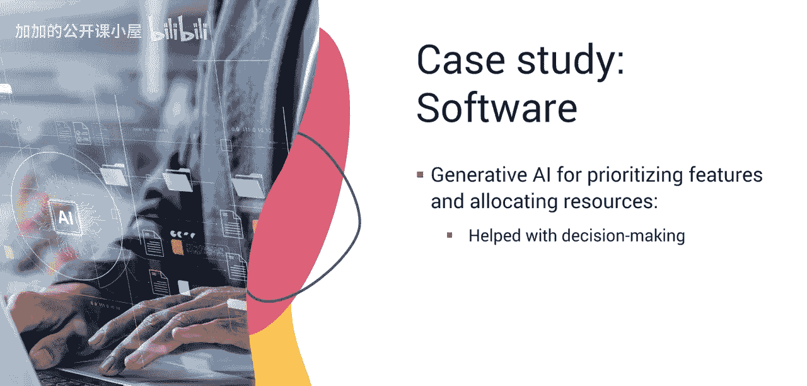
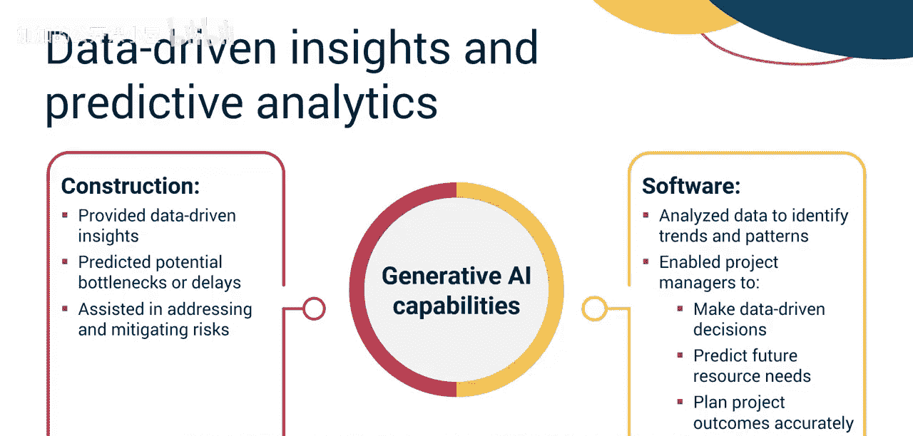
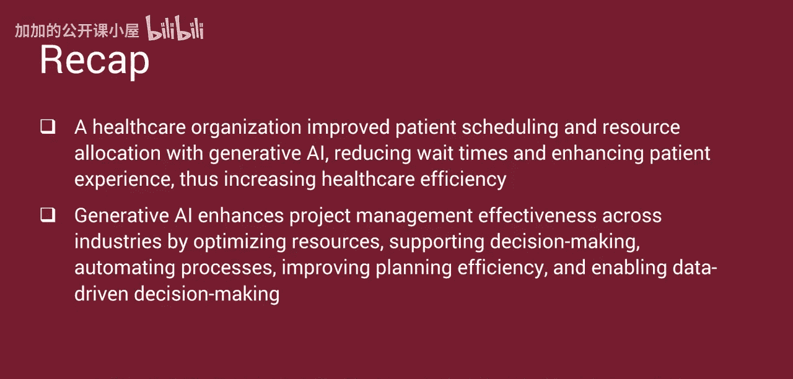

# IBM【中英⚡面向项目经理的生成式AI 专项课程｜Generative AI for Project Managers Specialization】 p34 P34 03_发挥生成式人工智能的强大力量 [BV1DnxVziEnn_p34]

Welcome to leveragingaging the power of generative AI。After watching this video。

 you will be able to explain case studies in the successful use of generative AI and summarize how generative AI improves project management effectiveness。

Generrative AI is revolutionizing project management by improving decision making， automating tasks。

 providing new insights， and seamlessly integrating with existing methodologies。

Organizations using these advancements are more likely to succeed in their projects。

Let's look at some short case studies where generative AI helped improve project management performance。

A multinational construction firm used generative AI algorithms to create better project schedules。

 The AI tool analyzed historical project data， stakeholder preferences and available resources。

It then suggested schedules to minimize project duration and use resources effectively。

This helped the firm to complete projects faster and within budget。

 leading to client satisfaction and gaining a competitive advantage in the industry。

A software development company was struggling to prioritize software features and allocate development resources across multiple projects。

They used generative AI to help with decision making； project managers entered project requirements。

 deadlines， and resource availability into the AI system。

The AI then provided optimized plans for prioritizing features and allocating resources。

This allowed the company to deliver high quality software products on time and within budget。

 leading to improved client satisfaction and increased revenue。

A healthcare organization used generative AI to improve hospital patient scheduling and resource allocation。

 the AI system analyzed patient data， medical staff availability and facility limits。

It then created personalized patient appointment schedules that reduced wait times。

 made better use of resources and improved patient experience。

This led to a new automated process that increased efficiency in healthcare delivery and enhanced staff productivity。

Next， let's summarize what we learned from these case studies and how generative AI improved project management effectiveness and added value。

A project manager must identify and allocate resources as per project requirements。

This is a critical task that requires time， effort， and oftentimes revisions。

 generative AI improved resource allocation in two of the case studies。

Construction generative AI algorithms optimized project schedules by analyzing historical data。

 stakeholder preferences， and resource constraints。

Planning time was reduced and effectiveness increased。

Software AI Systems assisted in prioritizing software features and allocating development resources across multiple projects based on project requirements。

 deadlines， and resource availability。This usage enhanced product quality， expedited schedules。

 and reduced resources。The project manager is accountable for all project deliverables and is expected to provide benefits and value。

Generative AI provided decision making support in two case studies。Construction。

 AI generated schedules minimize project duration and resource usage while maximizing efficiency。

This led to projects being delivered ahead of schedule and within budget。

Software Generative AI provided optimized feature prioritization and resource allocation strategies。

This resulted in high quality software products being delivered on time and within budget。

The healthcare case study highlighted process development and improvement。

Generative AI analyze patient data， medical staff availability。

 and facility constraints to generate personalized patient appointment schedules。

This minimized wait times， maximized resource utilization and improved the overall patient experience。

 leading to increased efficiency in healthcare delivery and reduced operational costs。

Project management depends upon completing various time consuming and interrelated project processes。

This planning takes time， effort and expertise。Generative AI improves the overall planning efficiency in two of the case studies。

Construction generative AI automated the process of generating project schedules。

 reducing manual effort， and the likelihood of human error。

This saved time and effort and allowed the project team to focus on high priority activities。

Healthcare， an AI driven patient scheduling system automated the process of generating personalized appointment schedules。

 freeing up the administrative staff to focus on other tasks and reducing scheduling errors This simplified the process eliminated high risk manual steps and delighted customers。

Lastly， project managers rely on accurate data to identify and respond to risks and issues and make data driven decisions。

Construction， generative AI provided data driven insights into project performance and predicted potential bottlenecks or delays。

This allowed project managers to proactively address issues and mitigate risks。

Software AI System analyze project data to identify trends and patterns。

This enabled project managers to make data driven decisions， predict future resource needs。

 and plan project outcomes more accurately。

In this video， you learned that。Generative AI revolutionizes project management by improving decision making。

 task automation， insights generation， and integration with existing methodologies。

A construction company optimized project schedules with generative AI。

 resulting in faster completion within budget and enhanced client satisfaction。

A software development company utilized generative AI for feature prioritization and resource allocation。

 leading to timely delivery of high quality software and increased client satisfaction and revenue。

 a healthcare organization improved patient scheduling and resource allocation with generative AI reducing wait times and enhancing patient experience。

 thus increasing healthcare efficiency。Generative AI enhances project management effectiveness across industries by optimizing resources。

 supporting decision making， automating processes， improving planning efficiency。

 and enabling data driven decision making。

