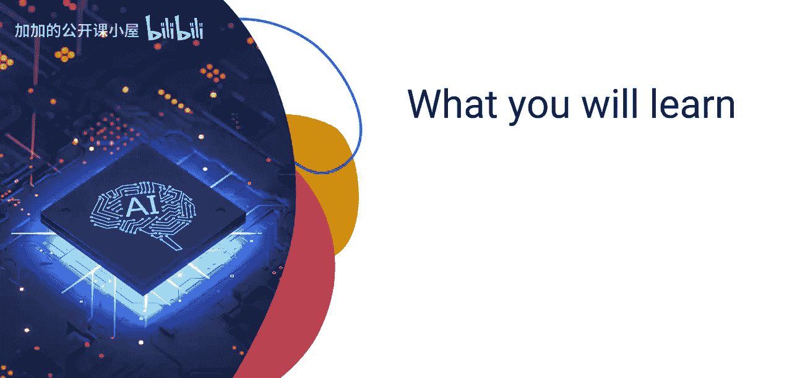
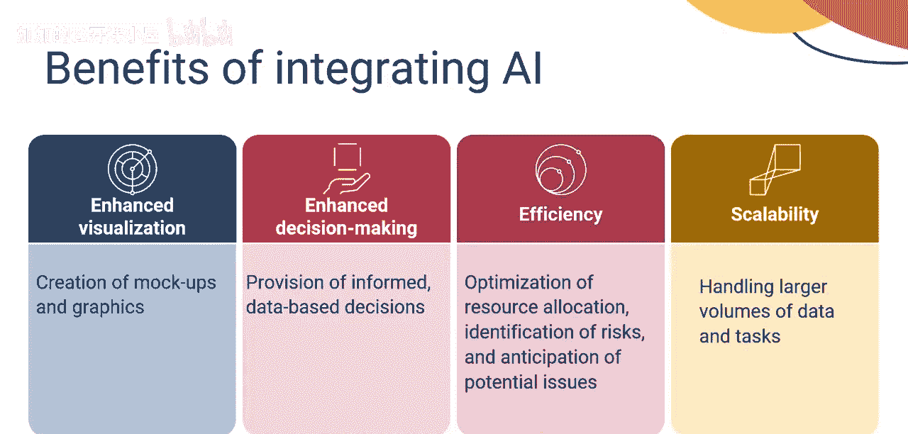
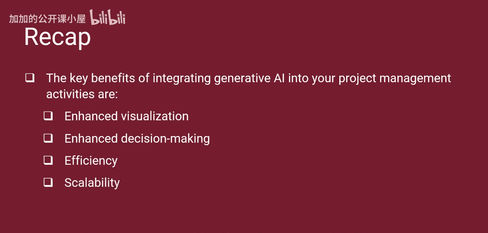

# IBM【中英⚡面向项目经理的生成式AI 专项课程｜Generative AI for Project Managers Specialization】 p35 P35 04_有效整合生成式人工智能 [BV1DnxVziEnn_p35]

Welcome to integrating AI effectively After watching this video， you will be able to。

Explain the steps required to effectively integrate AI into a project manager's daily activities。

List the benefits of integrating AI for the project manager。

Generative AI is a dynamic and emerging force that possesses the power to reshape how projects are planned and executed。

Project managers now face the challenge of understanding and harnessing this tool's power。

AI has become a strategic imperative that all project managers must adopt to ensure firms improve their competitive advantage and satisfy customer expectations as their needs increase for advanced。

 highly functional and technology based solutions。Let's learn a step by step approach to leverage the power of generative AI。

Identify project goals， review the project charter and the business case that initiated the project。

Define and quantify the overall business objectives for the project。

Work closely with your team to identify opportunities to leverage generative AI。

Examples may include automating certain tasks， developing creative requirements solutions。

 or improving internal and external communications with stakeholders。

Acquire team members who have experience with generative AI if possible。Develop use cases。

 a use case is defined as a specific scenario or situation that describes how a system。

 product or service is used by its intended users。It outlines the steps。

 interactions and expected outcomes， use cases can be used to determine where generative AI can be applied to a project solution to automate processes。

 generate reports， facilitate brainstorming sessions， or create visual assets。Analyze workflows。

 work closely with your team， and analyze the workflows for your project。

The work breakdown structure， WBS defines keyword packages that must be accomplished。

The Project Network diagram provides the end to end workflow for all work packages and defines the project's critical path。

 identify critical activities， pain points， potential bottlenecks and risks。

 identify where generative AI can be used effectively to streamline and optimize the project's workflow。

Develop a proof of concept， POC， use an iterative approach。

Select a single use case and implement a generative AI solution。Develop a prototype。

 evaluate performance， and gather feedback from users。Generative AI is a journey， not a destination。

Develop minimum viable product MVP。An MVP is defined as a version of a product with just enough features to be usable by early customers who can then provide feedback for future product development。

MVP can take the form of product demos， landing pages， prototypes， or version phase deliverables。

Developing an MVP is the goal of each iteration when using an adaptive or Agile framework。

MVP can also be used in a predictive or waterfall framework by taking a phased or iterative approach。

Use generative AI systems to develop the MVP， assess the impact， gather feedback， and adjust。

Encourage collaboration and feedback， encourage continual communication and feedback between team members。

Stress the importance of alpha and beta testing to address defects and solicit customer feedback。

Continually refine the generative AI tools and models you are using to gain additional efficiencies。

Monitor and control， monitor the effectiveness of your generative AI solutions over time。

 track key metrics such as productivity gains， error rates， and user satisfaction。

Stress the importance of documenting and sharing lessons learned。

Lessons learned are critical to share information with future project managers so they can benefit from what was learned on your current project。

There are multiple benefits that can be gained from integrating generative AI into your project management activities。

They include。Time saving， automation of repetitive tasks such as client emails， status reports， etc。

Freeze up time for the project manager and team to focus on more critical project management activities。

Imroved communication generative AI can improve communication effectiveness。

This may include generating stakeholder correspondence， automating information sharing。

 or developing communications management plans。Automation of reports。

 generative AI can automatically generate status reports that keep stakeholders informed and engaged。

These reports can be summarized， organized， and distributed without the need for human intervention。

Creativity， generative AI can be used to brainstorm requirements and solutions， generate use cases。

 and more。It can help foster innovation within your project team。

Enhanced visualization generative AI can create mockups and graphics for presentations and solution illustrations。

Enhanced decision making， access generative AI insights and recommendations to provide more informed database decisions。

Efficiency streamline project management processes to optimize resource allocation， identify risks。

 and anticipate potential issues。Scalability， scale project management capabilities to handle larger volumes of data and tasks without creating the need for more core team members。

In this video， you learned that generative AI has the potential to advance project management to new heights of excellence in a firm。

It is the role of the project manager to understand this potential。

 take the steps necessary to leverage this power effectively。

 move the firm forward and add value for the firm's customers。

The steps required to integrate generative AI into daily project management activities effectively include identify project goals。

 develop use cases， analyze workflows， develop proof of concept， POC。

 develop minimum viable product MVP， encourage collaboration and feedback， monitor and control。

 the key benefits of integrating generative AI into your project management activities are time saving。

 I communication， automation of reports， creativity， enhanced visualization。

 enhanced decision making， efficiency， scalability。

