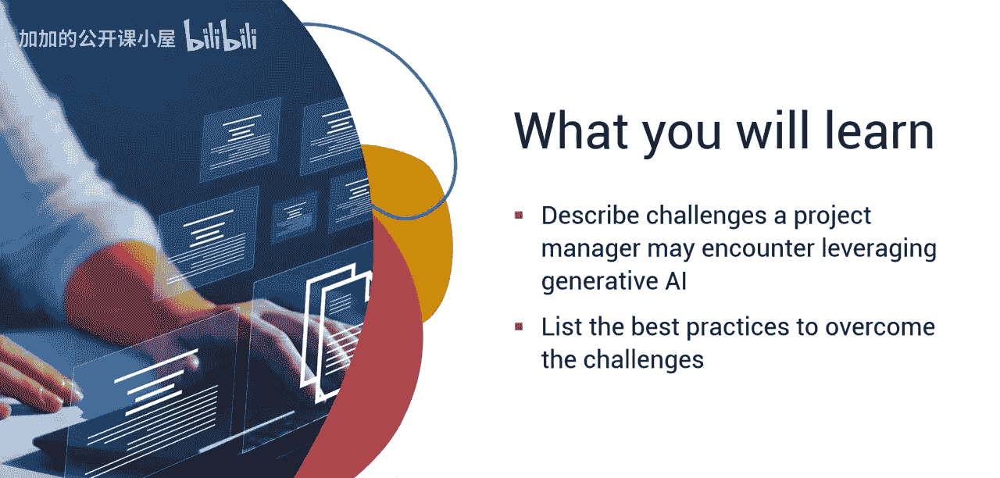
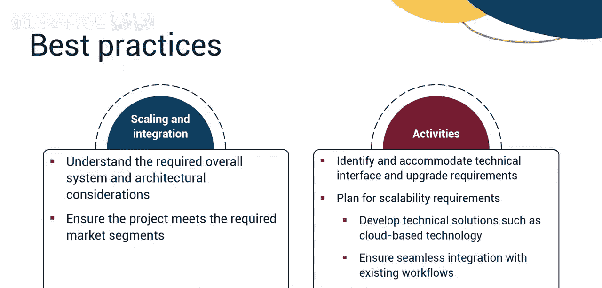
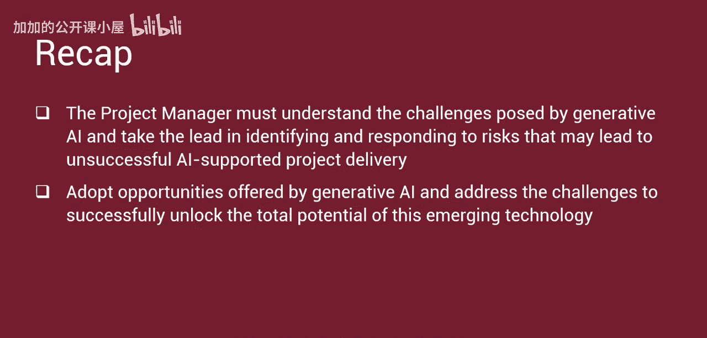

# IBM【中英⚡面向项目经理的生成式AI 专项课程｜Generative AI for Project Managers Specialization】 p36 P36 05_生成式人工智能挑战 [BV1DnxVziEnn_p36]

Welcome to a video on the generative AI challenges encountered by a project manager。

After watching this video， you will be able to describe challenges a project manager may encounter leveraging generative AI。

List the best practices to overcome the challenges。

Genrative AI presents opportunities for project managers to embrace innovation。

 plan and execute value driven projects， and improve their personal project management performance。

There are various benefits of using this powerful tool to manage projects， however。

 there are some challenges the project manager must be aware of and would need to address there are challenges that pose risks to a successful project implementation。

😊，Let's review some of the top challenges。Interfaces generative AI systems must often integrate with existing or legacy systems to provide total feature and functionality benefits。

 Some legacy systems may not be able to accommodate AI technology。

This results in potential degradation of plant features and functionality。

The project manager must identify system dependencies and plan for integration。

Governance and data security generative AI algorithms access available data to provide outputs。

The project manager must work with the team to ensure sensitive data is not inadvertently shared。

Sharing could result in a security breach， unwanted sharing of critical intellectual property。

 IP or information disclosures that violate privacy considerations。

Scalability AI scaling refers to the process of expanding the impact and value of artificial intelligence AI solutions。

The project manager must address blockers that may reduce the scalability and reach of a proposed AI capability。

Cost benefit analysis AI supported projects require adequate resources to plan， develop and complete。

The project manager must ensure that AI benefits outweigh the costs。

A primary goal of all firms is to ensure their projects enhance the competitive nature of the firm and provide return on investment ROI。

The team， leveraging AI to enhance projects requires a skilled and diverse team of professionals working together to meet the project goals。

There is currently a severe talent shortage of skilled AI personnel。

 which can result in reduced scope， schedule delays and high resource costs， ethics and bias。

 an AI system is only as good as the data it accesses to operate AI bias also known as machine learning bias or algorithm bias refers to the occurrence of biased results due to human biases that skew the original training data or AI algorithm。

These biases can lead to distorted outputs and potentially harmful outcomes。

Bs can lead to customer dissatisfaction， brand degradation， loss sales， and project failure。

Ethical guidelines are also complex and must be understood and adhered to ethical breaches in AI can have farreach consequences。

 affecting not only the firm， but also individuals and society the project manager must identify potential challenges and mitigate their potential risk to ensure a successful and value driven project outcome Here are some tips to keep in mind。

😊，Regulatory， ensure you are aware of the firm's policy on data sharing。

Draft a policy if there is limited or no guidance and ensure it is part of your project management plan and include potential risks in the project Ri Register。

Activities include engage legal and IP experts to ensure policies governing data sharing are legal and viable。

 establish safeguards and checks to ensure data breaches or misuseed does not occur。

Implement robust data management systems， adhere to privacy regulations。

 and protect sensitive information。Ethics and bias。

Avoiding bias in generative AI models and navigating legal complexities are critical AI product success factors。

Regularly audit models with the team ensure key stakeholders are involved in model development with the skills and mindset to identify and reduce bias。

Understand copyright and patent implications。Understand and define ethical guidelines that must drive AI product development。

 implement quality control measures to identify and mitigate issues before negatively impacting project deliverables。

Resources The project manager must ensure all skills and competencies required to leverage generative AI models are in place and committed to excellence。

Analyze each project charter and develop a stakeholder register that lists every team member's role and responsibility。

Perform a skills assessment。Identify the skills your team possesses and the skills they need。

 share gaps with senior management and develop solutions to grow the required skills internally or acquire them externally。

Invest in training existing teams， add training work packages to the work breakdown structure， WBS。

The generative AI landscape is dynamic， ensure the team has access and knowledge of current and future trends in generative AI。

 work closely with the team and identify all personnel and other resources needed to achieve product goals。

Develop a resource management plan。Alloccate resources cost effectively。

Perform a cost benefit analysis that quantifies the value of the product concept。

Prioritize features and functions to ensure you meet the minimum viable product MVP needs and maximize the ROI。

 develop a communications management plan to ensure information is provided in a timely manner。

Communication is the glue that holds the project together。

Communicate and collaborate effectively and often。Scaling and integration。

 understand the overall system and architectural considerations required to plan and execute AI supported projects effectively。

Ensure the project meets the needs of the current and expanding market segments your project deliverables must support。

Identify and accommodate technical interface needs and upgrade requirements to address compatibility issues and bridge gaps to create unified and seamless systems。

Plan for scalability from the outset。Identify requirements and develop technical solutions such as cloud based technology to meet scalability needs。

Ensure seamless integration with existing workflows In this video。

 you learned that the project manager must understand the challenges posed by generative AI and take the lead in identifying and responding to risks that may lead to unsuccessful AI supported project delivery。

Adopt opportunities offered by generative AI and address the challenges to successfully unlock the total potential of this emerging technology。

