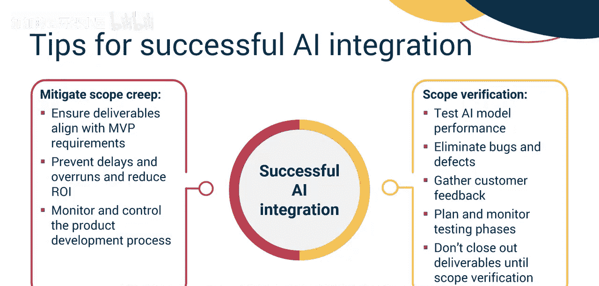
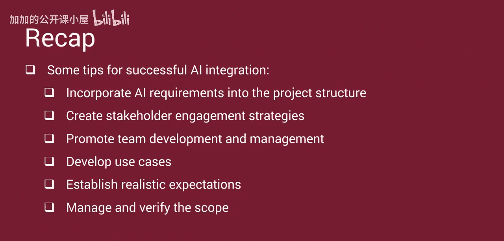

# IBM【中英⚡面向项目经理的生成式AI 专项课程｜Generative AI for Project Managers Specialization】 p37 P37 01_生成式人工智能流程成功 [BV1DnxVziEnn_p37]

Welcome to generative AI Pro Success。After watching this video。

 you will be able to define steps in the generative AI development process and identify tips to ensure a successful generative AI development process。

The project manager is accountable for ensuring that generative AI systems used to support the project are seamlessly integrated and add value。

Successful integration helps with informed decision making， enhanced project quality。

 potential schedule and resource savings， and improved value for stakeholders let's look at the steps a project manager must take to integrate generative AI into the project。

A project manager starts with the project charter， which outlines the basics of the project。

They review the project objectives and ensure generative AI is included in the project's requirements documentation during planning。

Next， the project manager must assess the organization's readiness by identifying opportunities that support the organization's strategic initiatives and address customer pain points or opportunities。

They should assess the availability of technology needed to implement generative AI in the project management process and ensure these needs are included in the requirements documentation for the project。

Then， the project manager should build the team by identifying key stakeholders for integrating generative AI into the project。

These stakeholders should be documented in the initial stakeholder Reg with clearly defined roles and responsibilities。

The project manager should collaborate with key stakeholders， including data scientists。

 machine learning engineers， domain experts， designers， and development teams。

Each stakeholder can share unique perspectives and knowledge to improve the overall project deliverables。

Throughout the planning process， the project manager and stakeholders should continually review and validate the project plan to ensure alignment and progress。

Lastly， to leverage the generative AI system in a project。

 the project manager should work closely with subject matter experts to collect and prepare data。

 select the appropriate generative AI model， integrate the systems and train the model。

Model selection is a crucial part of generative AI integration。

 so the project manager must collaborate with data scientists to choose the right AI models that align with the project and organizational objectives。

The project manager should also develop a quality management plan to test the model and gather user feedback since the project manager is often not the generative AI expert。

 it is essential to identify and engage experts to ensure the selected AI models add value。

The project manager should continue to work closely with these experts during the execution and monitoring phases to ensure that project goals are being realized Next。

 we will explore some tips on how to ensure this AI integration is successful。

Project managers should ensure generative AI integration requirements are included in the project Work breakdown structure。

 WBS and Project Network diagramia， this means that all activities impacted by generative AI must be clearly defined and assigned。

Project managers should identify the various roles that comprise the cross functional project team since stakeholder commitment cannot be assumed。

 the project manager must identify the required levels of commitment for each stakeholder developing stakeholder engagement strategies is important to ensure all stakeholders are committed at the required level。

The project manager must form， develop， and manage the project team through the form， St normm。

 and perform stages of team development。Building a successful team includes providing an environment where team members believe in their ability to succeed both individually and collectively for the organization。

You should develop measurable performance goals， provide timely feedback。

 and address issues as and when they occur。Effective communication。

 facilitated by a communications management plan can help with team collaboration and productivity。

To make informed decisions， a project manager collaborates closely with experts to develop use cases。

 these cases help identify opportunities where generative AI can enhance project planning， execution。

 and overall deliverable quality and value。For instance。

 a use case might detail how a user interacts with a new product requiring coordination with the user experience。

 UX team to ensure a seamless and satisfying customer experience。

It's crucial to establish realistic project expectations。

All project requirements and deliverable specifications should adhere to the smart criteria。

 specific， measurable， achievable， relevant， and time bound。😊，This ensures clarity and feasibility。

 guiding the project towards successful outcomes。To mitigate the risk of scopepe creep。

 it's essential to ensure that all project deliverables align with the minimal viable product MVP requirements and do not exceed established feature and functional specifications。

Scope creep can lead to schedule delays， cost overruns， and reduce return on investment ROI。

Therefore， as a project manager， you must closely monitor and control the fine tuning process to ensure the final product meets MVP specifications without unnecessary additions。

 Lastly， verifying the scope of deliverables is crucial。

This involves testing the model's performance through alpha testing to eliminate bugs and defects and beta testing to gather critical customer feedback。

As the project manager， you are responsible for effectively planning and monitoring these testing phases。

It's essential not to close out the project or transition deliverables until scope verification is complete。

 ensuring that the final product meets the desired standards and expectations。

In this video， you learn that project managers ensure generative AI systems supporting projects are seamlessly integrated and add value。

 the steps for integrating generative AI into projects。Align project Charer to objectives。

 assess organization readiness。Plan stakeholder engagement select and integrate AI model。

Encourage ongoing collaboration。Some tips for successful AI integration incorporate AI requirements into project structure。

Create stakeholder engagement strategies。 Proote team development and management。😊，Develop use cases。

Establish realistic expectations， manage and verify scope。

。

