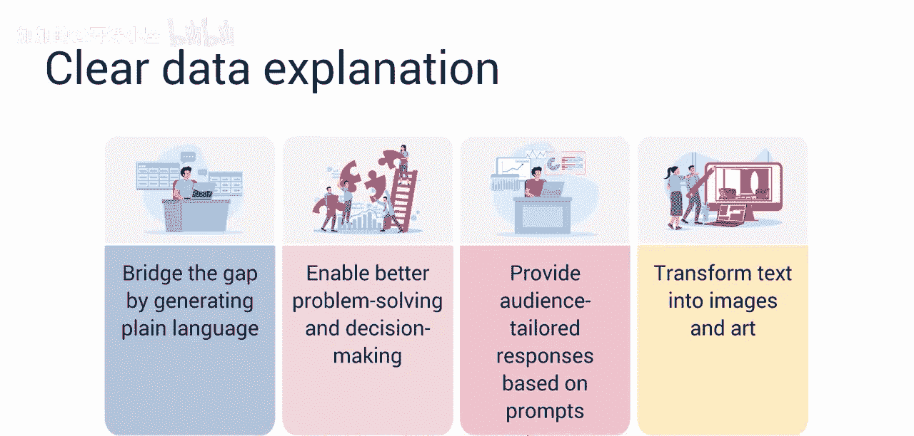
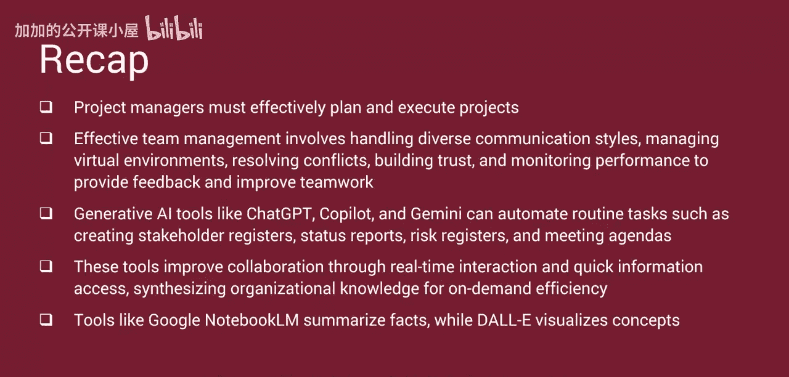

# IBM【中英⚡面向项目经理的生成式AI 专项课程｜Generative AI for Project Managers Specialization】 p38 P38 02_利用生成式人工智能提升沟通与协作效率 [BV1DnxVziEnn_p38]

Welcome to usingsing Generative AI to improve communications and collaboration。

After watching this video you will be able to summarize key communications and collaboration requirements and illustrate how generative AI can improve communication and collaboration effectiveness communication is one of the most important skills a project manager needs according to the project management intit Eff communications directly or indirectly impacts approximately 90% of the tasks a project manager must perform a successful project manager understands that communication and collaboration are the glue that holds the project together let's learn how project managers manage end to end communication for a project success Project managers must plan and execute the project effectively these broad responsibilities include preparing executive level communications and status reports。

 facilitating meetings effectively developing and managing scope schedule and cost baselines managing risk sharing knowledge and fostering an environment for continual improvement Stholder identification and engagement。

😊，Is essential the project manager must identify all required stakeholders and assign their respective roles and responsibilities。

 They must develop strategies to engage stakeholders and gain their commitment。

 effective team development and management are crucial for project success Project managers must handle teams with diverse communication styles establish norms and ground rules and manage virtual environments。

 They must ensure effective communication even if the team does not share a common language Project managers should also provide personalized training plans to team members to ensure the team possesses the skills to succeed。

 Additionally， project managers must be able to resolve conflicts and build trust within the team Finally project managers must monitor team performance and provide feedback to sustain and improve performance they must also analyze feedback from multiple stakeholders generative AI tools possess the capability to enhance communications and collaboration in project management addressing many。

😊，Common challenges Let's explore some examples of how generative AI can improve overall project management effectiveness generative AI systems such as chat GT。

 Copit and Gemini can analyze project data and produce comprehensive stakeholder registers clearly define roles and responsibilities and automate status reports。

 risk registers， meeting agendas and minutes This automation reduces project managers time on routine tasks。

 allowing them to focus on more critical activities generative AI tools can analyze stakeholder preferences and tailor communications to meet specific needs they can also adapt a project managers or stakeholders' communication style by analyzing communication patterns for example。

 generative AI can analyze a stakeholder's preference for concise updates and tailor project summaries to brief bullet points It can also adjust a project managers's formal style to be more conversational for specific audiences and suggest negotiation strategies。

On past successful interactions， generative AI can produce natural language interfaces that improve stakeholder collaboration using a vectorized knowledge base。

 they generate humanlike responses， allowing team members to pose questions to the AI tool and receive immediate information This on- demandd access reduces dependence on the project manager。

 tools like Copilot， chat GPT， and Gemini enable virtual collaboration environments。

 where team members can interact and collaborate in real time， regardless of their physical location。

Generative AI can synthesize knowledge within an organization。

 making it accessible and reducing the time required to access critical information。

 improving efficiency and productivity， tools like coppilot chat GT and Gemini allow the team to focus on accomplishing essential tasks by providing quick access to synthesize knowledge generative AI can streamline communication processes and enable seamless communications across geographic boundaries and cultures it can suggest pertinent ground rules and norms for team charter development facilitating realtime communication and collaboration while reducing the risk of misinterpretation AI writers and paraphrasing tools like Google notebook Lm can summarize facts Ex complex ideas and organize information To like Dolly can provide visual representations of project concepts and understanding generative AI can simulate various scenarios and provide decision support by analyzing potential outcomes and implications。

😊，Con track communications and collaboration metrics to measure progress。

 identify trends and adapt strategies accordingly generative AI can bridge the gap between technical and non-technical stakeholders by generating plain language explanations of complex data this clarity enhances understanding。

 enabling better problem solving， decision making and overall collaboration in a team tools like coppit Geini and chat GPT can provide audience tailored responses based on prompts Dli3 can transform basic text ideas into detailed images and AI generated art。

 bringing project concepts to life visually。

In this video you learned that project managers must effectively plan and execute projects effectiveff team management involves handling diverse communication styles。

 managing virtual environments， resolving conflicts building trust and monitoring performance to provide feedback and improve teamwork。

 generative AI tools like chat GPT copilot and Gemini can automate routine tasks such as creating stakeholder registers。

 status reports risk registers and meeting agendas。

 these tools improve collaboration through real-time interaction and quick information access。

 synthesizing organizational knowledge for on-demand efficiency。

 tools like Google notebook Lm summarize facts while Dali visualizes concepts and AI bridges technical and non-technical gaps with plain language explanations and visual representations。

