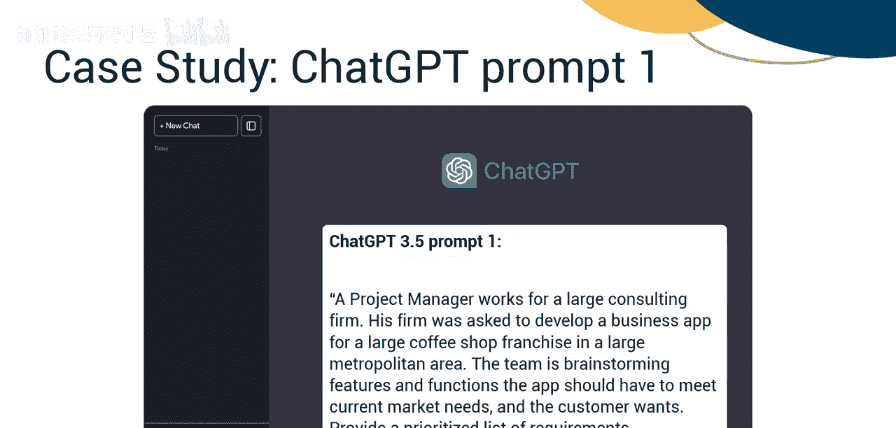
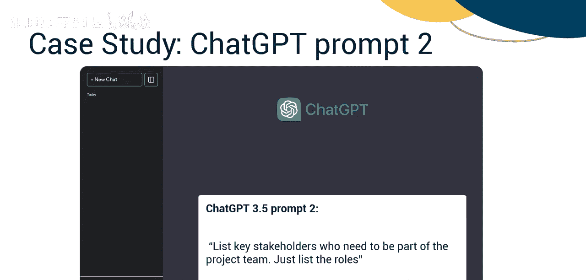
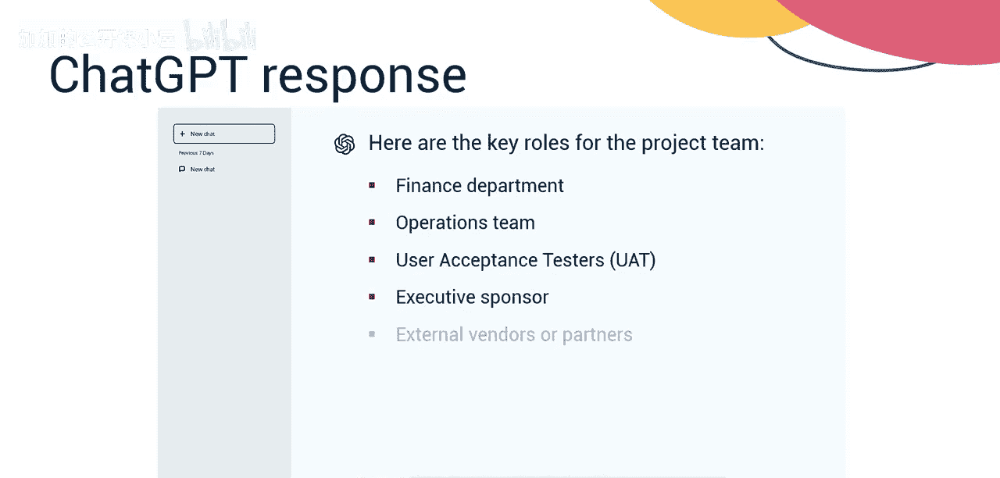
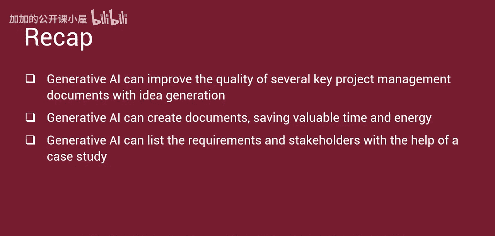

# IBM【中英⚡面向项目经理的生成式AI 专项课程｜Generative AI for Project Managers Specialization】 p39 P39 03_生成式AI在创意生成与需求识别中的应用 [BV1DnxVziEnn_p39]

Welcome to a video on the generative AI for ideaea generation and Re Ident。After watching this video。

 you will be able to identify the project management documents to effectively use generative AI for idea generation。

Illustrate effective use of generative AI through a short case study。

Project managers can use generative AI to brainstorm and generate a wide range of ideas for their projects。

Generative AI prompts share relevant information about the project goals， constraints。

 and context to produce creative suggestions for approaches， features， or solutions。In addition。

 generative AI can assist in analyzing project requirements by analyzing large amounts of data。

 user feedback， market trends， or existing project documentation。It can help identify patterns。

 extract key insights， and suggest requirements based on the analyzed data。

Several critical project management documents can benefit from using generative AI for idea generation and content creation Project Charter generative AI helps project managers brainstorm and articulate the project vision。

 objectives， scope and success criteria required in the project charter it assists in generating clear and concise statements that align with stakeholder expectations and project goals。

Project Plan Generative AI supports project managers in creating detailed project plans by generating work breakdown structuresBS。

Network diagrams， project budgets， and multiple support plans。

Requirements Do generative AI supports project managers in eliciting。

 analyzing and documenting project requirements by generating use cases， user stories。

 functional specifications， and acceptance criteria。

It helps ensure that requirements are clearly defined， traceable。

 and aligned with stakeholder needs and expectations。

Risk management plans generative AIADS project managers in identifying potential project risks。

 assessing impact and probability， and developing risk response strategies。

It can generate risk registers， risk assessment matrices。

 and contingency plans based on historical data， industry benchmarks， and expert knowledge。

Communication plan generative AI assist project managers in developing comprehensive communication management plans by suggesting communications items。

 channels， frequency， stakeholders， and key messages。It generates status report templates。

 meeting agendas， and stakeholder updates to facilitate effective communication throughout the project lifecycle。

Change Management Plan generative AI helps project managers anticipate and manage change by generating change management plans。

 impact assessments， and integrated change control processes。

It suggests strategies for assessing change requests， obtaining approvals。

 and implementing changes while minimizing disruption to project activities。

Quality Management Plan generative AI assist project managers in developing quality management plans by generating quality standards。

 metrics， and assurance processes。It suggests techniques for monitoring and evaluating project deliverables。

 identifying defects and implementing corrective actions to maintain product quality。

Procurement management plan generative AI supports project managers by generating procurement documents。

 requests for proposals， RFs。Statements of work， SOWs and vendor evaluation criteria。

It helps streamline the procurement process by suggesting supplier selection criteria。

 negotiation strategies， and contract terms。Let's look at a case study using chat GPT 3。

5 to illustrate how generative AI helps project management。

The following prompt was written in chat GPPT 3。5。Prompt1。

 a project manager works for a large consulting firm。

His firm was asked to develop a business app for a large coffee shop franchise in a large metropolitan area。

The team is brainstorming features and functions the app should have to meet current market needs and the customer wants。

Provide a prioritized list of requirements recommended for this business app。

Here is the chat GPT response。Here's a prioritized list of requirements for the business app。

 for the coffee shop franchise。Mobile ordering。Payment integration。Order tracking。Mu customization。

Rewards and Loty program Push notifications。Store locator and hours。Feedback and ratings。

Integration with social media。Accessibility featuress。Personalized recommendations。

 multi language support。Order history。Inventory management and。Analytics and reporting。

A follow up prompt was provided， list key stakeholders who need to be part of the project team。

Just list the roles。Chat GPT 3。5 responded as follows。Here are the key roles for the project team。

 client representatives。Project manager。Development team， business analysts， marketing team。

 legal and compliance experts。Customer service representatives。IT In team， financeinance Department。

Operations team。User acceptanceance Testers， UAT， executivecut sponsor， externalnal vendors or Part。

In this video， you learned that generative AI can improve the quality of several key project management documents with idea generation generative AI can create documents saving valuable time and energy。

Generative AI can list the requirements and stakeholders with the help of a case study。

