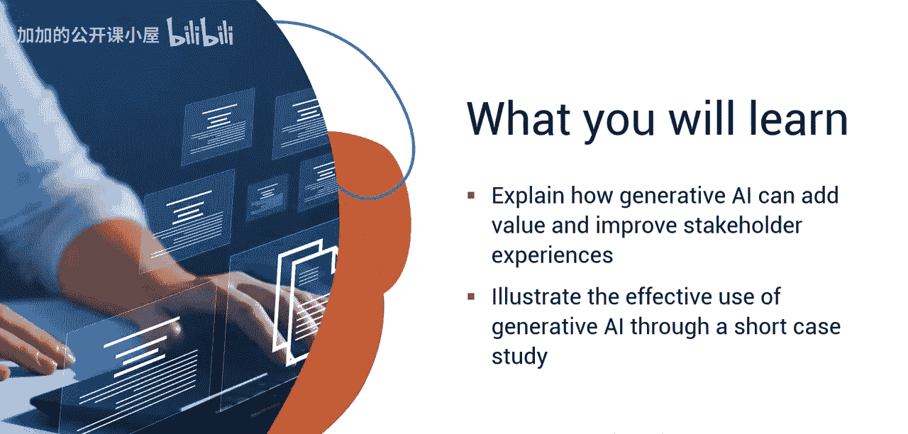
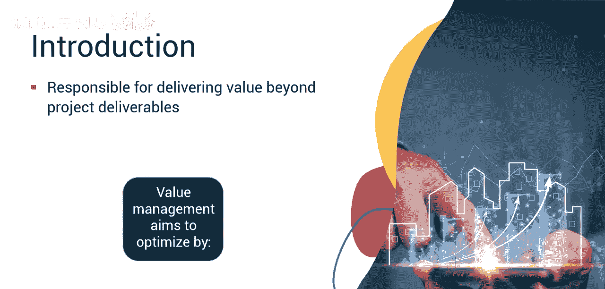
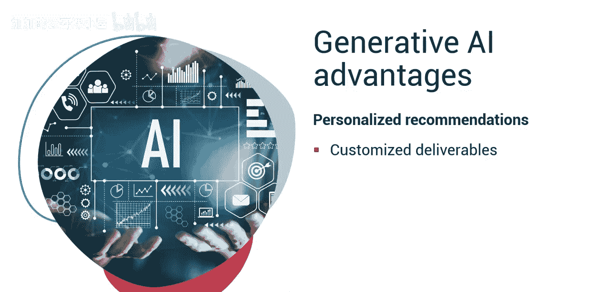
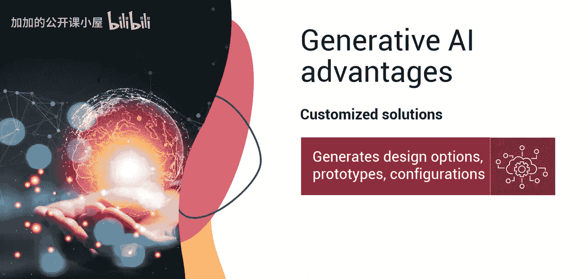
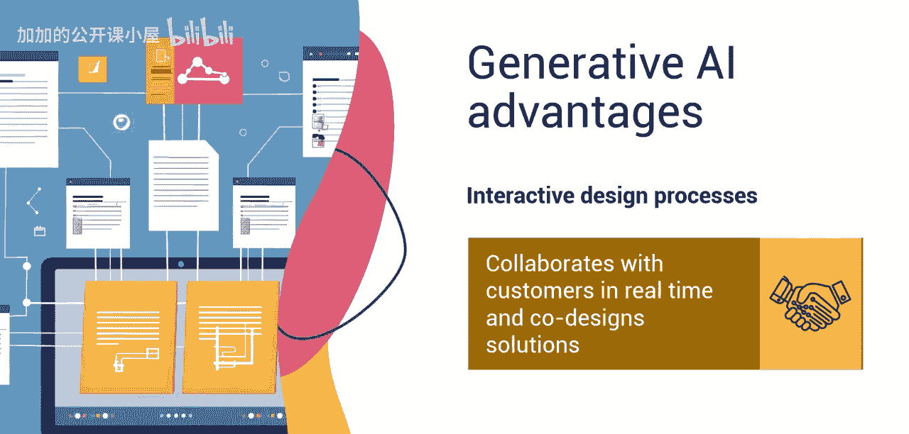
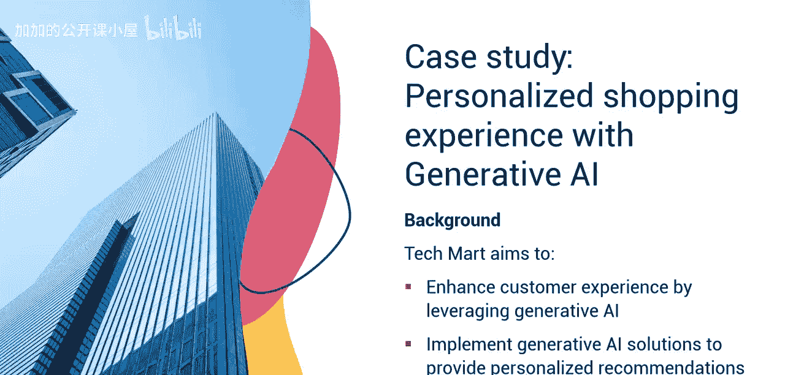
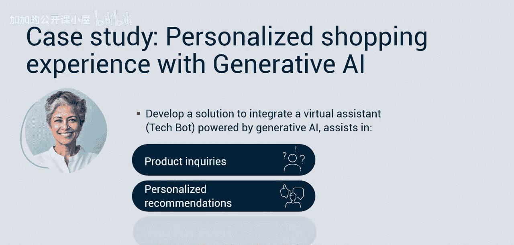
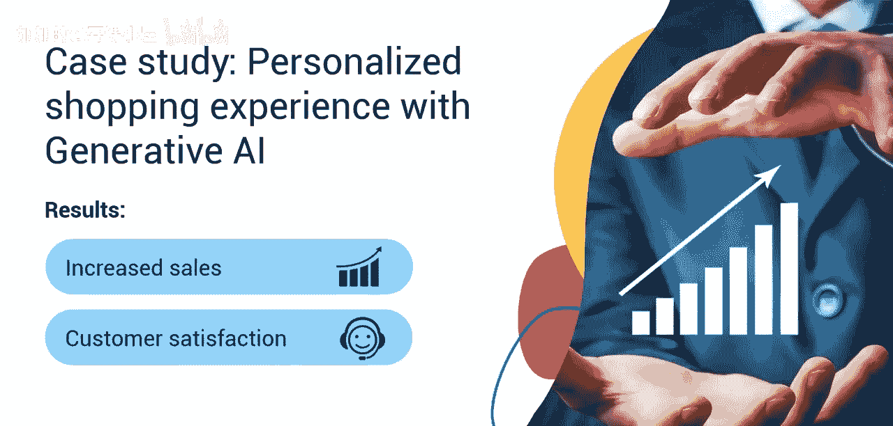
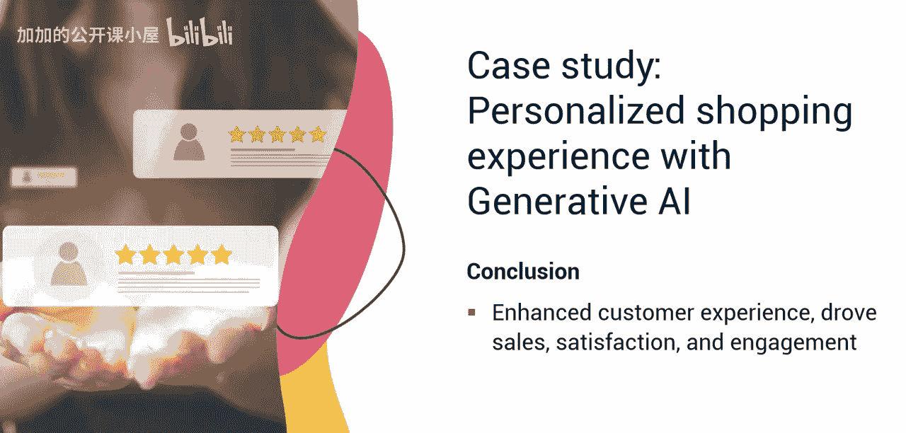
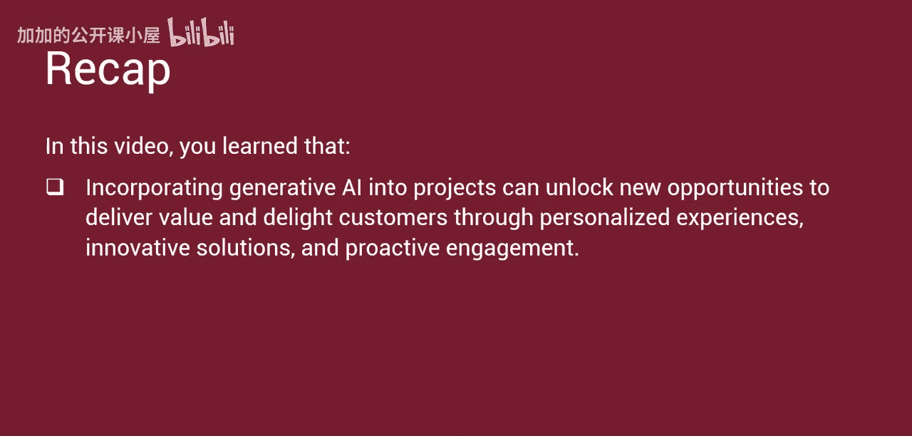

# IBM【中英⚡面向项目经理的生成式AI 专项课程｜Generative AI for Project Managers Specialization】 p40 P40 04_利用生成式人工智能提升利益相关者体验并创造价值 [BV1DnxVziEnn_p40]

Welcome to this video on how generative AI can improve stakeholder experiences and provide value。

After watching this video， you will be able to。Explain how generative AI can add value and improve stakeholder experiences。

Illustrate effective use of generative AI through a short case study。

The Project Management body of Knowledge， PMBOK's 7 edition。

 emphasizes a project manager's responsibility to deliver value。

Value extends beyond simply providing planned project deliverables。

Projects are systems for delivering value， and professionals must consider the broader context of benefits and organizational performance。

Value management aims to optimize organizational performance by motivating people， developing skills。

 fostering synergies， and encouraging innovation。

Incorporating generative AI into projects can unlock new opportunities to deliver value。

 you can delight customers through personalized experiences， innovative solutions。

 and proactive engagement。Generative AI algorithms can analyze customer and stakeholder data to generate customized deliverables and improve communications effectiveness。

Project managers can use this capability to tailor deliverables to individual customer preferences。

 increasing satisfaction and value。

For example， if a stakeholder prefers concise email updates。

 the project manager can customize the communication accordingly。Conversely。

 if another stakeholder prefers detailed progress reports。

 the project manager can provide more comprehensive documentation。

Project managers must manage stakeholder expectations and conform to their definitions of value。

Some project deliverables require customization to meet specific stakeholder needs。

Generative AI generates design options， prototypes。

 or configurations that align closely with customer requirements。

Project managers must work closely with key stakeholders during scope planning。

Generrative AI can facilitate interactive design processes that allow stakeholders to actively participate in creating products or services。

Project managers can use generative AI tools to collaborate with customers in real time and co design solutions that meet and exceed expectations。

The project manager must be able to share the value proposition proposed by the project team。

Generative AI can automate content creation， including the project vision， minimum viable product。

 MVP recommendations， product and service descriptions， marketing materials， and user documentation。

Genrative AI analyzes past project data and feedback to predict future trends or customer behaviors。

Project managers can leverage these insights to anticipate customer needs， mitigate risks。

 and proactively address issues before they occur。Generative AI powered Vi assistant provide customers with personalized support and guidance。

Project managers can deploy virtual assistant to answer queries， provide recommendations。

 or offer troubleshooting assistance。This enhances the overall customer experience and value。

A leading e-commerce company， Techmart， aim to enhance its customer experience by leveraging generative AI technology。

The project manager Priya， was tasked with implementing a project featuring generative AI solutions to provide personalized recommendations and improve customer satisfaction。

Priya initiates scope planning。She collaborates with the company's data science team to develop a recommendation engine powered by generative AI algorithms。

The engine would analyze customers' browsing history， purchase behavior。

 and demographic information to generate personalized product recommendations。In addition。

 Priya and her team plan to develop a solution to integrate a virtual assistant powered by generative AI into the company's website and mobile app。

The Vitual Assistant Techbot would assist customers with product inquiries。

 provide personalized recommendations， and offer real time support through the shopping journey。

The project was a success and provided customer value。

The personalized product recommendations generated by the AI driven engine led to a significant increase in sales。

Customers appreciated the tailored suggestions that aligned with their preferences。

The personalized suggestions resulted in higher conversion rates and revenue growth for Techmart。

Tech bot's proactive assistance and personalized guidance delighted customers and improved overall satisfaction and loyalty。

Customers felt valued and supported throughout their shopping experience。

The personalized guidance led to positive reviews and word of mouth referrals。

The interactive nature of Techbot encouraged customers to engage actively with the platform。

The interactivity drove longer session durations and repeat visit。

The virtual assistant's ability to understand and respond to real time customer inquiries。

 enhanced user engagement and retention。Pya utilized data from the recommendation engine and virtual assistant interactions to gain valuable insights into customer preferences and behavior。

This feedback helped future project managers by providing marketing strategies。

 potential product development initiatives， and best practices for improved customer engagement efforts。

Techmart harness the power of generative AI。They successfully enhanced their customer experience and drove sales。

 satisfaction and engagement。The project team's strategic implementation of personalized recommendations and virtual assistance demonstrated how generative AI enables project managers to provide value and customer satisfaction in the rapidly evolving e-commerce landscape。

In this video， you learned that。Incorporating generative AI into projects can unlock new opportunities to deliver value and delight customers through personalized experiences。

 innovative solutions， and proactive engagement。

