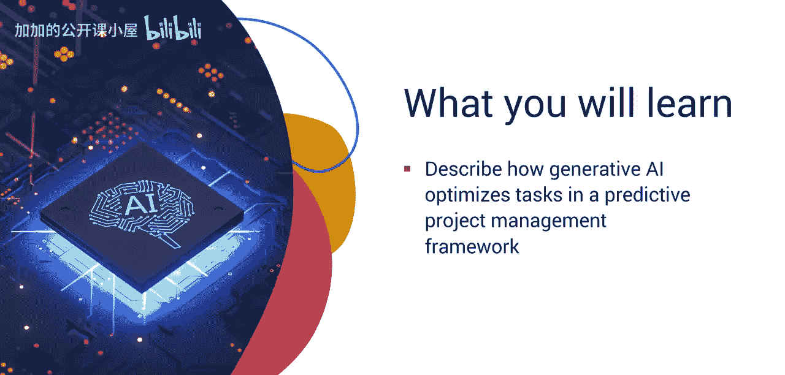
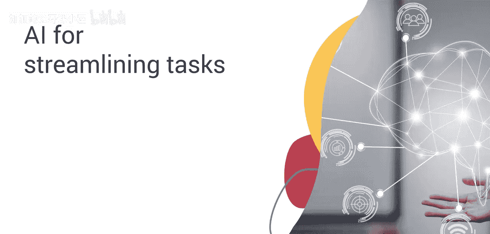
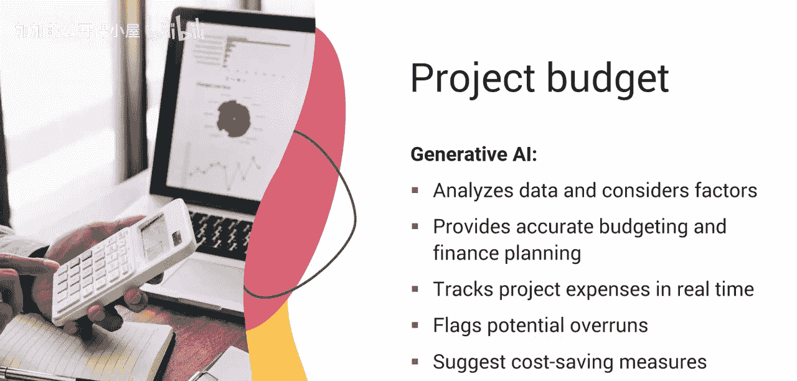
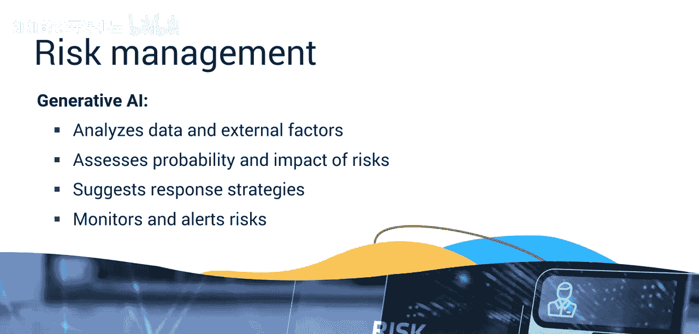
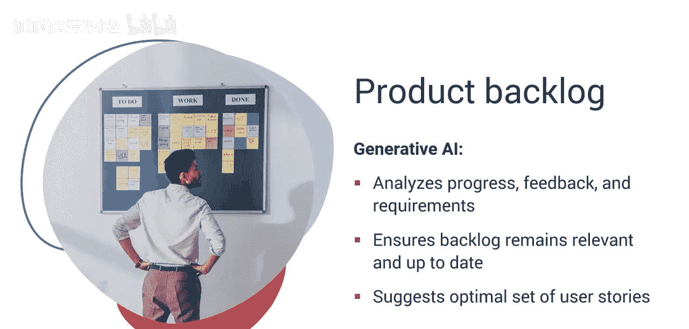
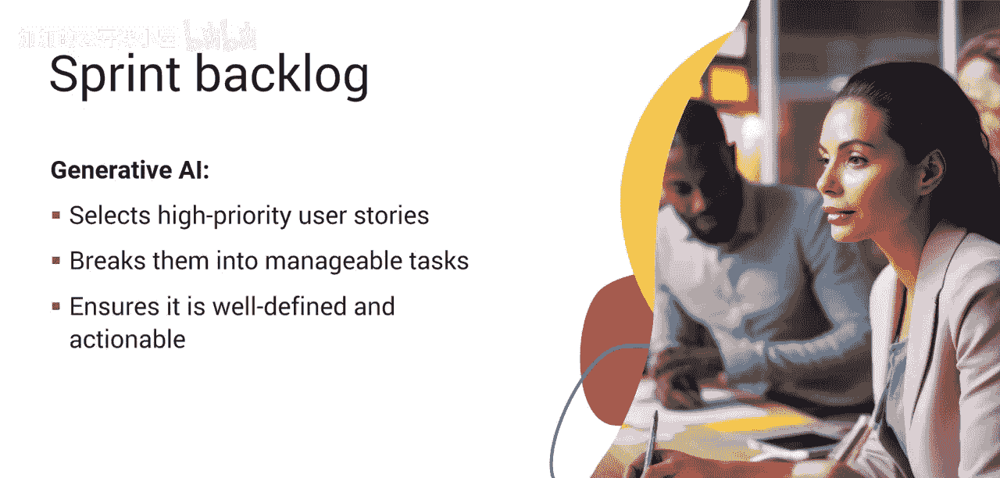
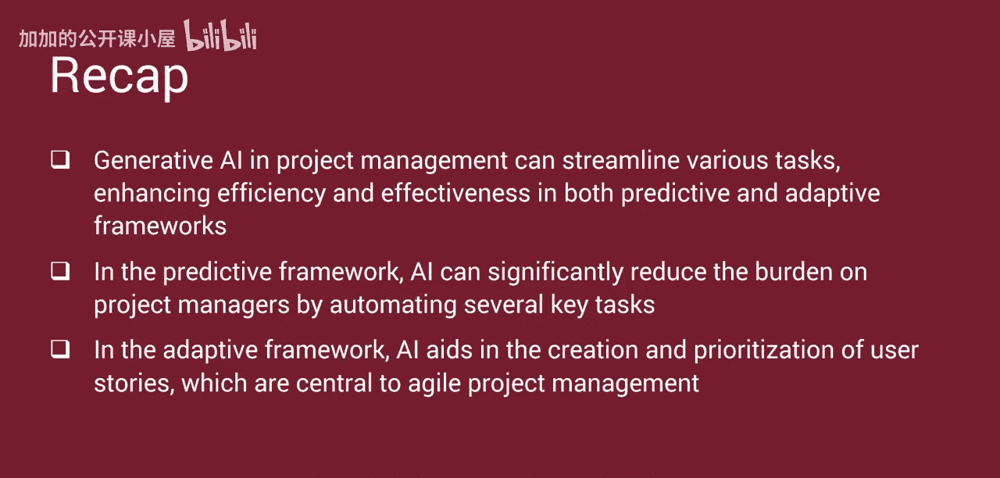

# IBM【中英⚡面向项目经理的生成式AI 专项课程｜Generative AI for Project Managers Specialization】 p41 P41 05_生成式AI助力任务高效处理 [BV1DnxVziEnn_p41]

Welcome to Generative AI for streamamlining tasksask After watching this video you will be able to describe how generative AI optimizes tasks in a predictive project management framework and explain how generative AI enhances task management in an adaptive project framework。

The project manager is required to perform numerous planning processes to prepare a project for execution The project management Institute defines 49 specific processes that must be accomplished to achieve project success 26 of these processes occur in the initiating and planning process groups Each process is important requiring time and effort to ensure planning satisfies the project needs Additionally。

 some project managers must manage projects using an adaptive or a all framework Let's explore how generative AI can streamline project management tasks in both predictive and adaptive frameworks Let's first understand how AI helps streamline tasks in a predictive framework The project charter provides a highleve overview of project objectives and must be approved by the project sponsor generative AI can draft a project charter by accessing information from initial project discussions scope documents and organizational goals It can align the project charter with organizational standards and facilitate。

😊。

Faster approval by highlighting key areas of interest and concern for stakeholders and decision makers。

Identifying key stakeholders and assigning roles and responsibilities is a critical planning step AI helps identify relevant stakeholders by analyzing project documentation。

 organizational charts and previous project data it can assess stakeholder influence interest and impact on the project AI can suggest tailored engagement strategies by evaluating stakeholder communication preferences past interactions and project roles ensuring effective and personalized stakeholder management the work breakdown structure WBS is the cornerstone of planning providing an organized approach to executing all required project activities or work packages generative AI can automatically create a detailed WBS by analyzing project goals。

 scope documents and similar past projects This reduces the time and effort required for manual development AI can dynamically update the WBS in response to changes in project scope or new information ensuring it remains accurate and relevant。

😊，Throughout the project lifecycle， the network diagram uses the WPSS to develop an end to end project schedule AI algorithms can generate network diagrams by identifying efficient sequences of activities and dependencies。

 helping visualize project timelines and critical paths more accurately。

 generative AI can simulate different project scenarios。

 helping project managers understand the impact of changes in schedules or resources and adjust plans accordingly。

 The project budget identifies the required funds to acquire essential project resources。

 AI can predict project costs by analyzing historical data and considering factors such as resource availability。

 market trends and project complexity， leading to more accurate budgeting and financial planning。

 generative AI can track project expenditures in real time flag potential overruns and suggest cost savingaving measures to help maintain the budget the communications management plan ensures that the right communications reach the right stakeholders in a timely and effective。

AI can design communication plans tailored to different stakeholders by analyzing communication preferences。

 past interactions and project needs This ensures effective and efficient information distribution generative AI can automate regular project updates and reports。

 ensuring timely and consistent communication without burdening the project team Lastly。

 Project managers must identify and evaluate risks impacting a project primarily through a risk register AI can identify potential risks by analyzing project data and external factors assess the probability and impact of these risks and suggest risk strategies It can continuously monitor risks Aling project managers to emerging issues and enabling proactive risk management Next。

 we will look at an adaptive framework Many projects are accomplished using a hybrid or adaptive approach adaptapive frameworks include a variety of agile methods including scrum projects accomplished using agile frameworks offer challenges。

AI can support user stories summarize project requirements by role need and value and are typically created by the product owner however many organizations require project managers to perform this work AI can generate user stories by analyzing project requirements user feedback and similar past projects。

 reducing the time required for manual creation and ensuring consistency and comprehensiveness AI helps prioritize user stories based on factors such as business value user impact and development complexity and refines them by suggesting improvements and additional details the product backlog is a repository for user stories。

 prioritize based on customer value and desired order of completion generative AI assists in organizing and maintaining the product backlog by continuously analyzing project progress stakeholder feedback and changing requirements ensuring the backlog remains relevant and up tod AI can suggest the optimal set of user stories for each。

By considering team capacity， dependencies and priority。

 facilitating efficient sprint cycles Finally， the sprint backlog lists all tasks required to successfully complete a user story AI helps generate the sprint backlog by selecting the highest priority user stories from the project backlog and breaking them down into manageable tasks。

 ensuring the sprint backlog is welldefin and actionable AI assists in assigning tasks to team members based on their skills A past performance and suitability In this video you learned that generative AI and project management can streamline various tasks enhancing efficiency and effectiveness and both predictive and adaptive frameworks in the predictive framework AI can significantly reduce the burden on project managers by automating several key tasks In the adaptive framework AI aids in the creation and prioritization of user stories which are central to agile project management。

