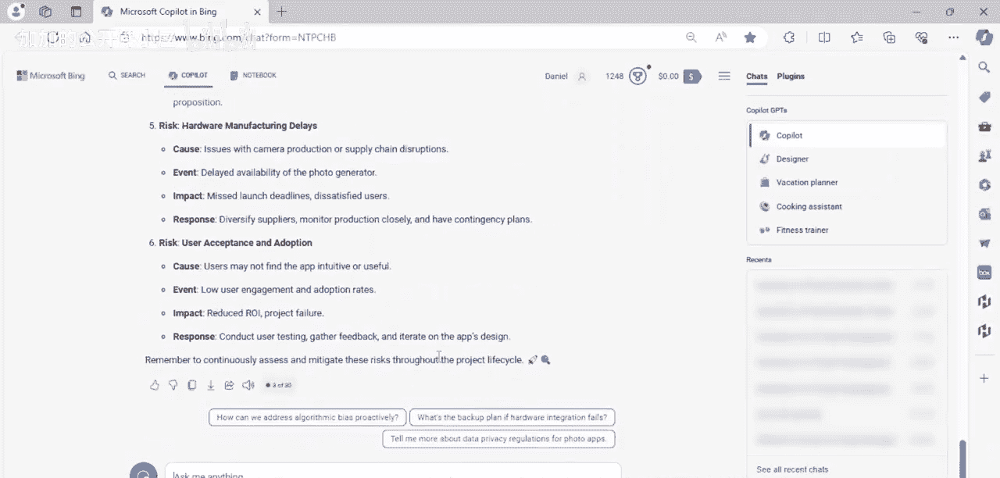
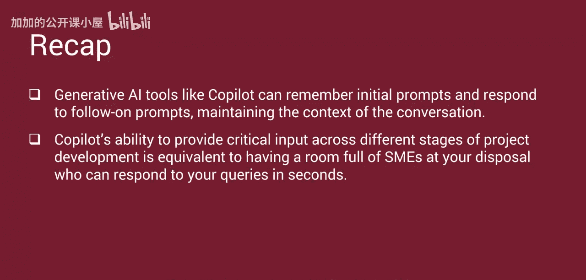

# IBM【中英⚡面向项目经理的生成式AI 专项课程｜Generative AI for Project Managers Specialization】 p42 P42 01_演示-生成式人工智能在科研中的应用 [BV1DnxVziEnn_p42]

Welcome to this demo video where you will learn how to use generative AI for research In this demo。

 we will feature Copi。😊，Generative AI plays a crucial role in assisting project managers by automating various tasks related to data collection。

 analysis and insight generation。 By leveraging generative models。

 project managers can enhance their decision making efficiency。

Let's explore some examples of how generative AI can benefit project management。First of all。

 automated market analysis， generative AI can scan vast amounts of market data。

 identify trends and generate detailed reports， saving the project manager hours of manual research。

This can enable the project manager to develop a compelling value proposition during project initiating and planning that meets the needs of all stakeholders。

Risk assessment AI models analyze historical project data to predict potential risks。

By suggesting response strategies， generative AI helps project managers plan proactively and respond to risks effectively。

Resource allocation generative AI analyzes project requirements and employee skill sets。

It ensures that the right resources are assigned to the right tasks， optimizing resource allocation。

Stakeholder communication generative AI provides customized reports and presentations based on the latest project data to facilitate clear communication with stakeholders。

Project managers can convey project progress， challenges， and achievements more effectively。

Competitive analysis， generative AI can compare competitor projects， products and strategies。

 providing insights on industry standards。 This helps project managers position their projects more strategically。

And this demonstration we'll showcase how coppilot can be used for research purposes。

New users can access Copilot for free on both PC and mobile apps by downloading the Copilot app and using the free version。

 which offers a range of AI powered features for personal use。

Welcome to Copilot Copilot is an easy to use generative AI tool as you can see。

 Copilot wants to become your everyday companion。Copiilot has a number of various functions for this demo。

 we will use Copiilott to help us complete some critical project initiating and planning documents。

Let's review our project concept。A high tech company plans to develop a new generative AI driven professional photo generator。

This new photo generator will include both a camera and an associated app the goal is to develop all project deliverables internally over a six month period。

Well use the power of Copit to ask three questions， let's enter our first prompt。

We copy and paste our prompt into Copit and we request an output。

Let's review Copiloot's recommendations。They begin by stating developing a generative AI professional photo generator is an exciting project。

 let's break down the objectives and value proposition for your project charter。

 it responds to our prompt。In terms of objectives， they provide six prioritized objectives。

 research and requirements gathering， algorithm development， hardware integration， app development。

 testing and quality assurance， deployment and maintenance the second part of our prompt requested a value proposition the value proposition discusses high quality photos。

 time efficiency， cost savings， customization， brand enhancement and innovation。

Now we will follow up our initial prompt with a second prompt。

This prompt will ask who are critical stakeholders and their roles needed to plan and execute the project？

Let's give Copiot a moment and review the recommendations。As you can see。

 Copilot identifies a number of key stakeholders who will be essential to the success of this particular project。

 beginning with the project sponsor， of course， the project manager， the development team。

 UX designers， quality assurance team， marketing and sales， legal and compliance。

 operations and support teams， end users， investors or stakeholders with a financial interest。

Now we will follow up with a final prompt。In this prompt。

 we will ask Copit to list potential risks using a cause。

 event impact and response format for this project。

Coolpit identifies a number of risks risks regarding。Algorithmicbias， technical challenges。

 data privacy and security breaches， market competition。

 hardware manufacturing delays and risk user acceptance and adoption。

Genative AI tools like Copilot can remember initial prompts and respond to follow on prompts maintaining the context of the conversation Copiott's ability to provide critical input across different stages of project development is equivalent to having a room full of subject matter experts at your disposal who can respond to your queries in seconds This concludes this brief demonstration on copit。

