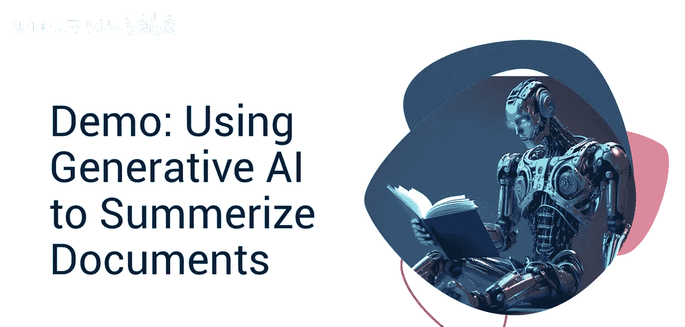
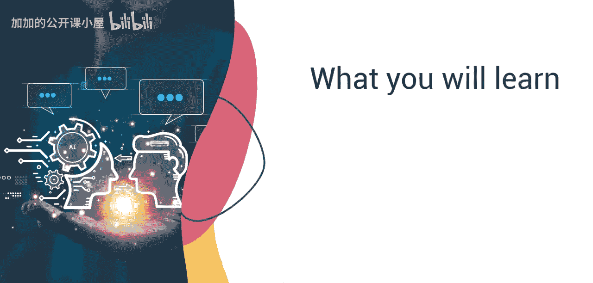
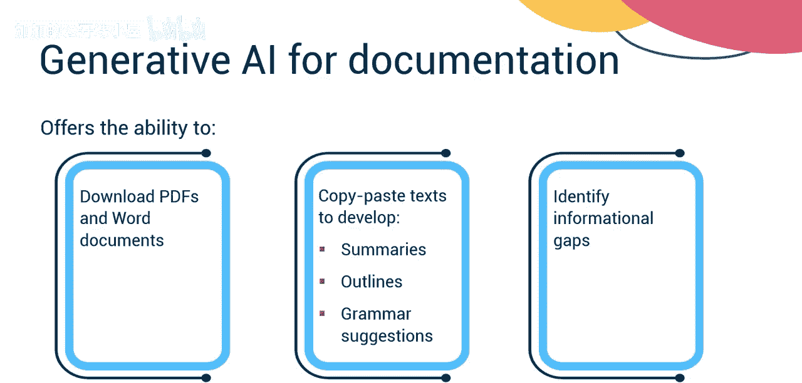
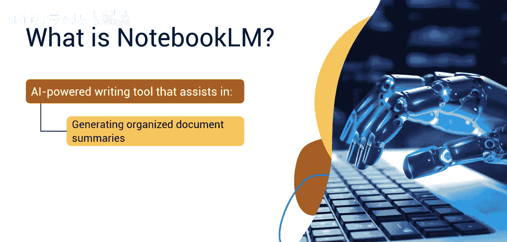
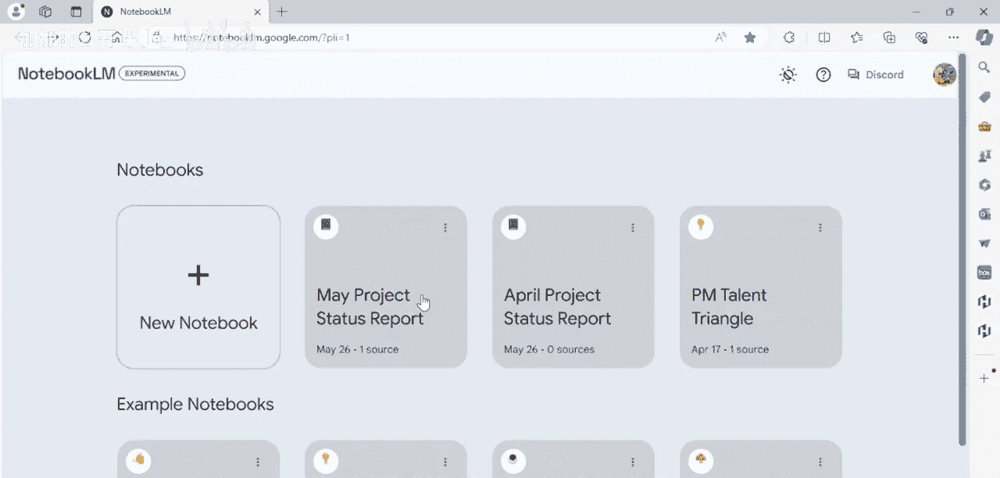
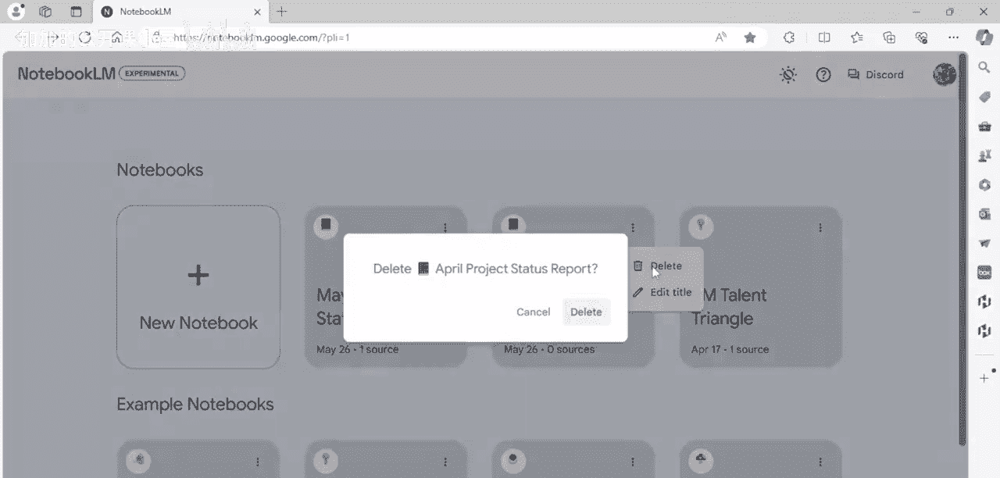
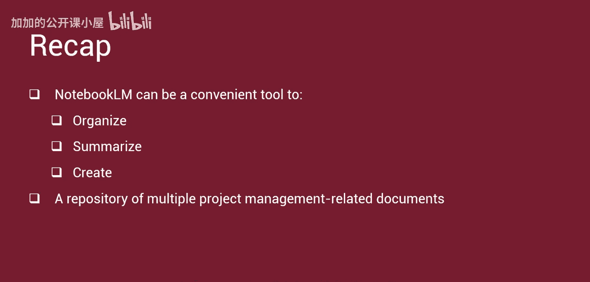

# IBM【中英⚡面向项目经理的生成式AI 专项课程｜Generative AI for Project Managers Specialization】 p43 P43 02_使用生成式AI总结文档的演示 [BV1DnxVziEnn_p43]

Welcome to this demo video where you will learn how to use generative AI to summarize notes and PDF documents。

In this demo， we will feature notebook LM。

As a project manager， you're often overwhelmed with documentation in addition to managing existing documents。

 your task would creating comprehensive ones that cover every aspect of a project from its initiation to its closure。

Generrative AI tools have become increasingly prevalent。

 offering the ability to download PDFs and Word documents。

 or simply copy paste text to swiftly develop summaries， outlines， grammar suggestions。

 identify potential information gaps， and more。Today we'll showcase one such notebook tool。

 notebook LM。

Notbook LM is an AI powered writingrit tool tailored to assist users in generating organized document summaries and creative content。

 brainstorming ideas， and refining writing skills。

Signing up for Note LM is straightforward， just head to their website。

 fill out the registration form with your email address and create a password。

The basic functions of Note LM can be accessed at no cost。Utilizing AI algorithms。

 Note LM provides suggestions， enhances grammar， offers writing prompts。

 and elevates overall writing quality。Users can effortlessly generate ideas， outlines。

 and even complete articles using its content generation capabilities。Additionally。

 the platform incorporates a grammar checking style suggestion and proofreading tools to age users in refining their writing。

Now， let's delve into a brief demonstration of Note LM。Welcome to a demo on Note LM。

This is a generative AI tool that is currently under development or as you can see， experimental。

To access notebook Lm， go to the website， notebooklm。google。

com you will need to sign up initially to use this service。Once you complete registration。

 you will be able to access the work area that you see here。

You are a project manager managing development of a new AI driven air filtration system。

You just finalized your May monthly project status report。

You plan to use Note LM to provide an easy to understand and organize summary of the report。

Let's get started。First， click on the new notebook plus sign。

You are asked to download text or other document types。

 we will download the May Sta report and PDF form。We will now select this PDF and download the document。

Hover your mouse over the source and right click Note LM goes into action。

We can now add the notebook title， May Project Staus report。

We can now select the newly downloaded PDF。Notebook LM provides an overview or a brief synopsis and breaks out and organizes the input into distinct categories。

Let's select a few categories， first， AI system。As you can see。

 Note LM provides a synopsis of the new AI driven air filtration system。

You can copy and paste this information onto any other document or into an email。Next。

 we'll look at action items。This section is broken out into easy to understand bullet statements。

Notebook LM even provides additional related prompts you may wish to access。

 such as summarize project status， analyze budget allocation， and more。

We close the notebook by simply clicking on the back arrow。

Notebook LM saves our notebook we can now access this notebook to review in the future。

We can easily delete notebooks。Let's delete the April monthly status report。

We access the three dots in the upper right hand corner of the notebook and can simply hit delete。

Notbook LM can be a convenient tool to organize， summarize and create a repository of multiple project management related documents。

This concludes this demo on notebook LM。

