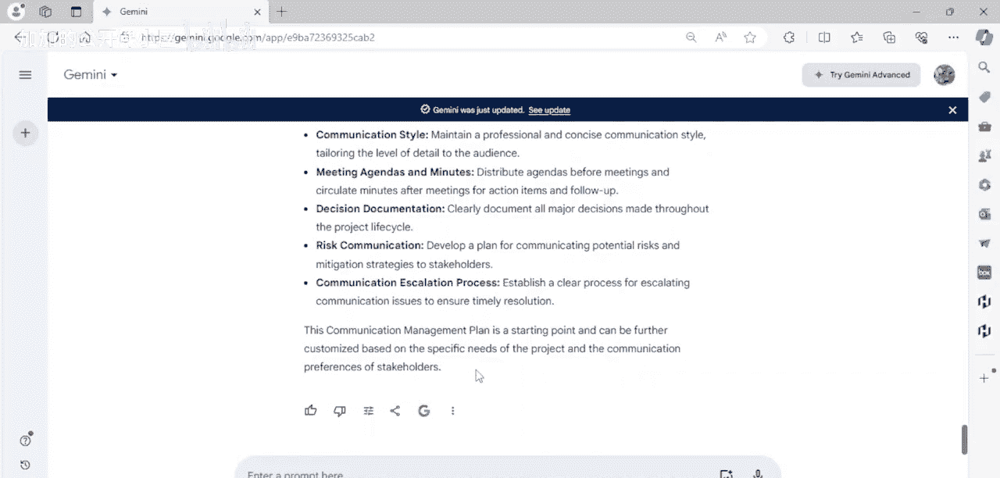
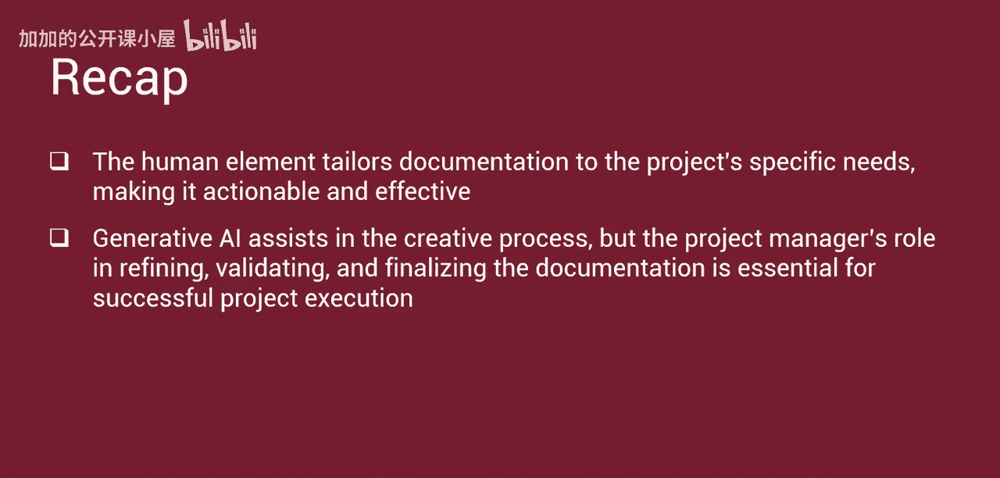

# IBM【中英⚡面向项目经理的生成式AI 专项课程｜Generative AI for Project Managers Specialization】 p44 P44 03_演示-生成式人工智能在项目规划与创新中的应用 [BV1DnxVziEnn_p44]

Welcome to this demo video where you will learn how to use generative AI for project planning and innovation。

In this demo， we will feature Gemini。Generative AI can be a project manager's secret weapon for planning and innovation。

AI can quickly analyze past project data to suggest realistic timelines and resource allocation and create initial work breakdown structures。

On the innovation front， generative AI can brainstorm a wide range of solutions to problems going beyond what the team might have considered。

This analysis allows for a more creative and thought provoking approach to project planning。

Let's explore examples of how generative AI can make traditional project management more efficient。

 dynamic and intelligent。Generative AI can propose a project plan's work breakdown structure based on an overview of a project's overall objectives AI can interpret text。

 raw data and source code to generate suggestions for network diagrams。

Generative AI can recommend quality assurance and quality control activities in addition。

 it can recommend key performance indicators to ensure a project conforms to requirements and is fit for use。

Generative AI revolutionizes communications planning。

 enabling rapid decision making and unparalleled efficiency。

It shapes communication strategies and aids in developing a comprehensive communications management plan。

Generrative AI tools can analyze information， communicate more effectively。

 improve risk identification， and monitor speed and quality。In this demonstration。

 we'll showcase how Gemini can enhance and streamline several project planning activities。

New users can access Gemini by creating a Google account visit Gemini。google。com。

Click sign in and use your Google account credentials。Welcome to Gemini Gemini helps you plan。

 organize and track your projects， streamlining tasks and keep everything on schedule Gemini offers a variety of features to boost your project management efficiency。

 Let's review our project concept。A high tech company plans to develop a new generative AI driven professional photo generator。

This new photo generator will include both a camera and an associated app。 In addition。

 the project concludes a marketing requirement。 The goal is to develop all project deliverables internally over a six month period。

 The team plans to break out work into design， develop， test and launch phases。

We will use the power of Gemini to ask three questions。 Let's input our first prompt。

Enter your prompt as shown。Let's review Gemini's recommendations。

 We asked Gemini to develop a work breakdown structure。

They develop a work breakdown structure with the project name at level one， levell two。

 the design phase， the development phase， the testing phase， and the launch phase。

 information that we provided in our prompt。Now， we can get down to level 3。

 The design phase includes hardware design。Software design。

The development phase includes hardware development， software development。

The testing phase includes hardware testing， software testing。

 and the launch phase includes marketing and promotion and the project launch。

Gemmini provides a brief note at the end， this WBS provides a high level breakdown。

 each subtask can be further broken into even more detailed activities dependent on project needs。

Let's go back to our prompt page and continue our conversation with prompt number two。

Prop number two asks Gemini to develop a milestone chart and tabular network diagram using the numbering in the WBSU that is Gemini created。

So Ge and I responds to our prompt and provides a tabular milestone chart。

We look at the various milestones。And it includes everything that was in the work breakdown structure。

We then are provided with a tabular network diagram。

 It gives us keys in terms of finish to start and finish to finish and predecessor tasks。

Notice we can use this input to develop an actual visual network diagram or load this network diagram information into a tool such as Microsoft Project or Smartheet。

😡，It provides some notes， the table assumes a standard five day work week with dependencies between tasks。

 and the project launch milestone has a duration of zero weeks as it represents a point in time not and activity。

Let's return to our prompt page， and。Ask Ge and I。To provide us with one more planning piece of information。

 our last prompt， develop a tabular communications management plan to support the project。

As requested， Gemini provides the generative AI professional photo generator。

Communications management plan and tabular form。They identify key stakeholder groups。

 information needs， communication methods， frequencies， and responsible individuals。

They even provide some added considerations such as communication style， meeting agenda and minutes。

 documentation decisions， risk communications， and communication escalation process notes。

The communications management plan is a starting point and can be further customized based on the specific needs of the project and the communications preferences of stakeholders。

So let's summarize this brief demo。

Generative AI can be a powerful tool for project managers providing suggestions， generating graphs。

 and automating parts of the project documentation process， however。

 it's crucial to remember that these outputs serve as starting points or enhancements rather than final deliverables。

 it is the project manager's expertise that ensures all relevant information is included and the documentation aligns with the project's goals and compliance requirements。

The human touch， such as professional judgment， understanding of the team's dynamics and stakeholder communication is irreplaceable。

It's this human element that tailors the documentation to the specific needs of the project。

 making it actionable and effective。Genrative AI assists in the creative process。

 but the project manager's role in refining， validating and finalizing the documentation is essential for successful project execution。

。

