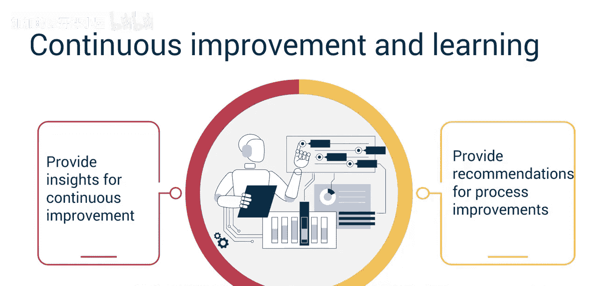
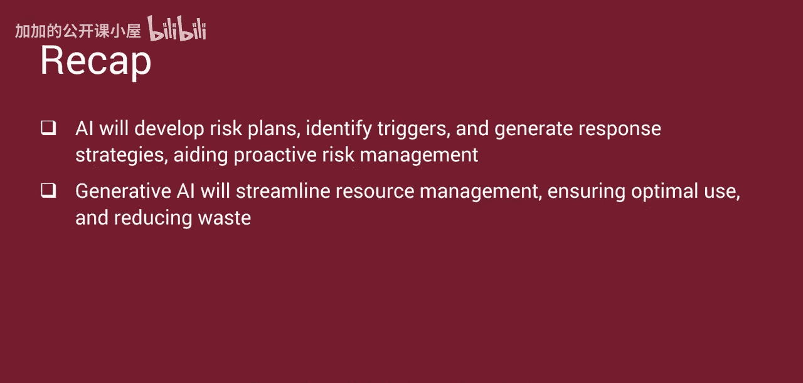

# IBM【中英⚡面向项目经理的生成式AI 专项课程｜Generative AI for Project Managers Specialization】 p45 P45 04_生成式AI的未来演进 [BV1DnxVziEnn_p45]

Welcome to this video on the future evolution of Generative AI After watching this video。

 you will be able to discuss how generative AI will evolve in the future and summarize its impact on project management generative AI already has a profound impact on the field of project management This impact will continue to expand as generative AI advances and new tools and capabilities become available to project managers businesses are racing to understand and harness the power of generative AI The release of chat GT in late 2022 provided a glimpse of generative AI's power the need to embrace the opportunities presented by generative AI is a critical success factor CSF for any firm hoping to remain competitive。

A McKinsey research report indicates that leveraging generative AI features could contribute up to $4。

4 trillion annually to the global economy Adv machine learning that powers generative AI is progressing rapidly the McKinsey report also forecast that experts expect generative AI to perform at a median level of human performance across various tasks competing with the top 25% of people completing those tasks before 2040 generative AI will also impact knowledge work Many jobs and education law technology and even the arts will be automated In addition。

 generative AI will have the power to automate some basic decisions and collaborate effectively with minimal human interface generative AI is already creating new and heightened customer expectations for improved project deliverables Project charters and project management plans must consider requirements leveraging generative AI and human interface capabilities to meet the product and service expectations of。

Growing technology savvy market companiesan are beginning to train generative AI systems to include enterprise specific data rather than being dependent on the public domain This training leads to generating enterprise specific AI strategies。

 policies and standards improving the firms security and increasing competitive advantage Next let's learn how generative AI's evolution will impact project management generative AI presents opportunities for project managers to improve their ability to plan and execute deliverables It also presents challenges the project manager must be aware of and address for success AI drivenn tools will automate the creation of detailed project plans schedules。

 budgets and resource allocation models This automation process will significantly reduce the time spent on initial planning phases and increase overall planning accuracy generative AI will enable more precise scope planning by analyzing customer feedback and market trends to align project deliverables with the expectations of a more demanding customer base this。

Scope planning will ensure that projects are designed to meet or exceed customer requirements。

 enhance satisfaction and competitive advantage and add value AI drivenriven collaboration tools will facilitate better communication and collaboration among project teams these tools integrate seamlessly with existing workflows enabling real-time updates and smoother collaboration across different locations and time zones generative AI will automate the generation of project reports。

 documentation and status updates this automation process will save time for project managers and ensure that stakeholders receive accurate and timely information generative AI will give project managers advanced analytics and insights enabling more informed data-driven decision making This insight will help identify potential schedule acceleration opportunities maximize resources rapidly assess change and determine the best strategy to address issues AI drivenriven change management tools will help project managers anticipate plan。

😊，mananage change effectively generative AI will assist in smoothly guiding teams and stakeholders through transitions。

 ensuring minimal disruption and maintaining project momentum by providing real-time impact analysis and adaptive strategies AI will assess project objectives and develop comprehensive risk plans and registers to expedite risk identification evaluation and response generation triggers will be identified in realtime allowing the team to rapidly predict and address potential issues and implement effective risk response strategies project managers can proactively address risks and stay within scope schedule and cost baselinelines generative AI will eliminate the need for extensive resource analysis and balancing activities it will streamline resource management by analyzing project needs and availability this streamlining process will ensure optimal use of human and material resources In addition。

 this will lead to better workload balancing and capacity planning and reduce resource wastage。

Lastly， AI systems will continuously learn from project data and outcomes and provide insights for continuous improvement Project managers will benefit from AI driven recommendations for process improvement that will lead to more successful project outcomes over time In this video you learn that generative AI is significantly transforming project management with ongoing advancements expected to expand its influence companies are training AI on enterprise specific data to enhance strategies。

 policies， security and competitive advantage AI drivenn tools will automate detailed project plans。

 schedules， budgets and resource allocation En planning accuracy and efficiency generative AI will automate project reports。

 documentation and status updates saving time and ensuring timely information delivery AI will develop risk plans I triggers and generate response strategies Aiding proactive risk management generative AI will streamline resource management ensuring optimal use。

And reducing waste。

