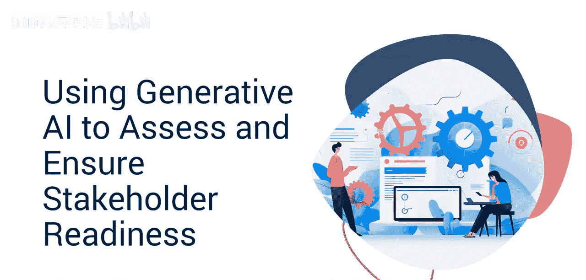
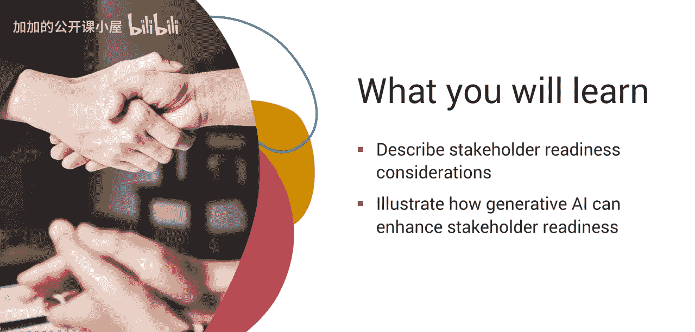
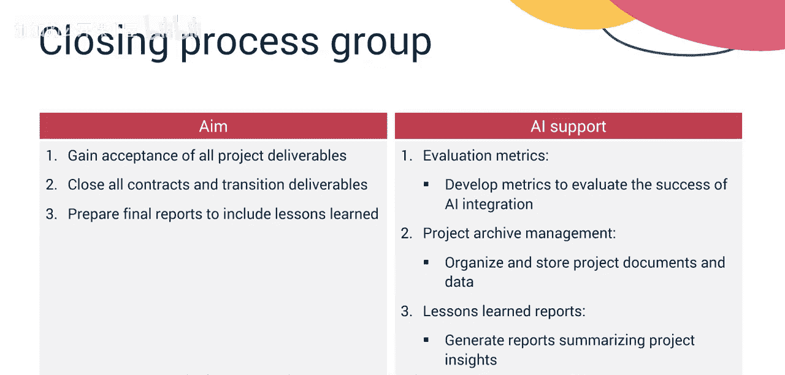
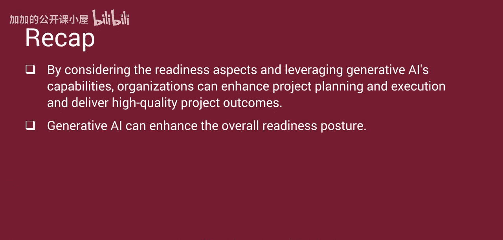

# IBM【中英⚡面向项目经理的生成式AI 专项课程｜Generative AI for Project Managers Specialization】 p46 P46 01_利用生成式人工智能评估利益相关者准备度 [BV1DnxVziEnn_p46]

Welcome to a video on how to use generative AI to assess and ensure stakeholder readiness。

After watching this video， you will be able to。Describe stakeholder readiness considerations。

Illustrate how generative AI can enhance stakeholder readiness。

Many organizations use generative AI to plan and execute projects and provide AI powered products and services。

This paradigm shift requires a project manager to assess and prepare stakeholders for the inclusion of AI。

Let's look at a breakdown of organizational readiness， considerations。

 and how generative AI can support objectives in each project management Institute， PMI Pro Group。

Many teams may be new to AI。The project manager must ensure all stakeholders can grasp generative AI's capabilities and limitations。

AI systems are only as effective as the data they have access to。

Historical project data is crucial for AI to learn from。

The project manager must work closely with the team to identify applicable data sources。

The project manager must prepare all stakeholders for potential workflow shifts due to AI integration。

The project charter should include these factors as assumptions and constraints。

The project management planning process group should also consider their readiness for using generative AI。

The project manager and team must define clear project objectives to allow AI to customize plans effectively。

The work breakdown structure WBS is the cornerstone of project planning。

Consistent WBS formats enhance AI's ability to learn and suggest plans。Project schedules， budgets。

 and resource requirements are based on the WBS。Data security protocols during planning are essential。

Establish data security measures to protect sensitive project information used by AI。

Effective communication planning and management are required during project execution to ensure the team is focused on achieving project objectives。

😊，Ensure effective communication between team members and AI。

The AI tool should be accessible and user friendly for team adoption。

All team members should understand the tools's capabilities and purpose。

Maintain data quality to ensure AI recommendations are accurate。

Check and validate outputs to ensure they are accurate and bias free。

 establish clear project KPIs to measure success and guide AI monitoring。

All team members must share a common definition of these indicators。

 ensure a smooth data flow between project management tools and AI for real time monitoring。

Develop a change management plan to handle deviations suggested by AI recommendations。

Knowledge transfer is critical。Develop a plan to capture learnings from generative AI to use for future projects。

Integrate AI generated reports and insights into project closure documentation。

Assess the effectiveness of AI implementation on deliverables and identify areas for improvement。

After the readiness considerations for each process group。

 let's look at how generative AI can help you ensure stakeholder readiness in each process group。

The initiation process group aims to develop a project charter that identifies the project's objectives。

 identifies stakeholders， assigns roles and responsibilities。

 and gains sponsor approval for the project to move to the planning process group。

AI can analyze past success factors for project selection to recommend suitable project goals and objectives。

AI can assist in identifying relevant stakeholders based on past projects。

It can also recommend key roles and responsibilities essential to project success。

AI can generate feasibility reports with risk assessments based on similar projects to assist in feasibility studies and gain executive approval。

The goal is to develop a comprehensive project management plan that will be approved by the sponsor and accepted by stakeholders。

😊，This plan will include the scope， schedule， cost baselines， and key support plans。

Generative AI will suggest a detailed WPS based on historical project data and industry best practices。

AI will generate draft project timelines that consider dependencies and resource availability。

Generative AI will recommend a budget estimate and resource allocation plan based on past project resources and budget usage。

The goal is to develop the project's deliverables， manage risks and change， monitor progress。

 and share knowledge。Generative AI will monitor tasks and completion based on project priorities and team skills。

It recommends adjustments to resource allocation for improved project efficiency。In risk management。

 generative AI manages potential risks based on real time project data and proposes mitigation strategies。

It forecasts potential project issues based on historical trends and similar projects。

AI automates progress tracking reports based on task completion and resource utilization data。

The goal is to verify that all deliverables meet the specifications defined in the project management plan。

 validate the scope， and ensure optimum resource utilization before moving to project closure。

 generative AI analyzes project data to monitor performance。

 identify deviations and suggest preventative and corrective actions。

 generative AI supports predictive analytics by forecasting potential project issues based on historical trends and similar projects。

It analyzes the effectiveness of risk responses through AI supported risk audits。

Risk audits review a risk response to determine how well it addressed a risk that occurred and recommend follow up actions。

To optimize resources， AI recommends adjustments to resource allocations for improved project efficiency。

The goal is to gain acceptance of all project deliverables。

 close all contracts and transition deliverables， and prepare final reports that include lessons learned。

Generative AI develops metrics to evaluate the success of AI integration in project management。

AI supports Project Arch management and organizes and stores project documents and data effectively for future reference and AI learning。

AI generates reports summarizing project insights and AI's role in achieving outcomes。

It automates lessons learned sharing throughout the enterprise。

In this video， you learned by considering the readiness aspects and leveraging generative AI's capabilities。

 organizations can enhance project planning and execution and deliver high quality project outcomes。

Generative AI can enhance the overall readiness posture。

