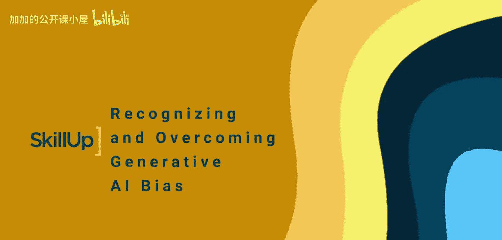
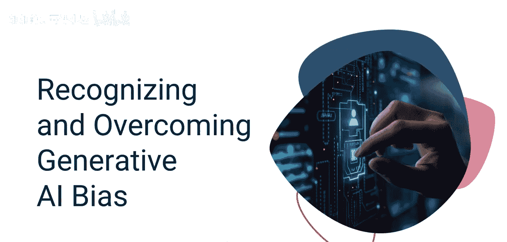
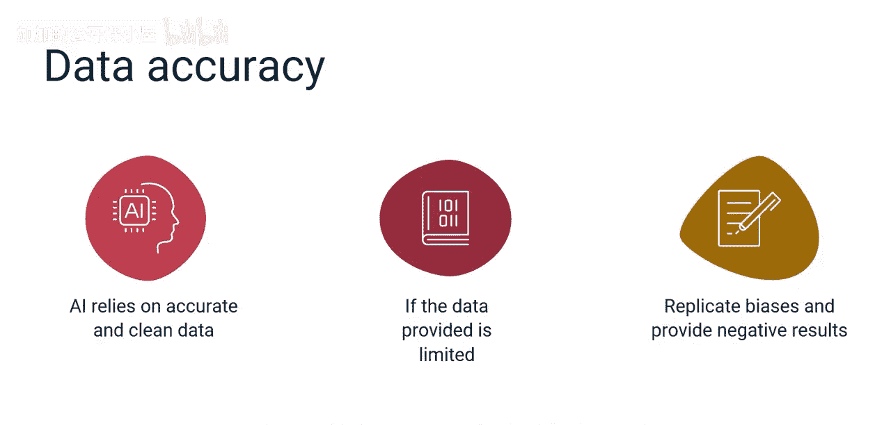
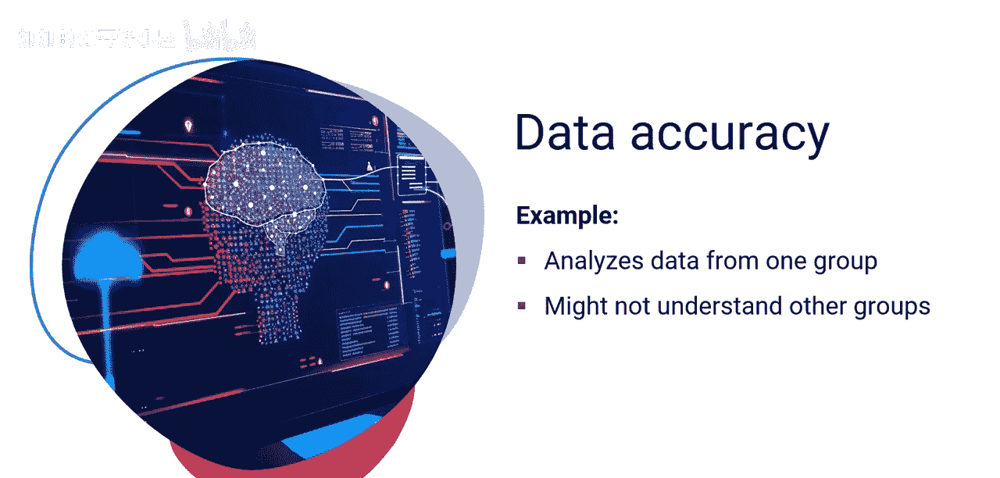
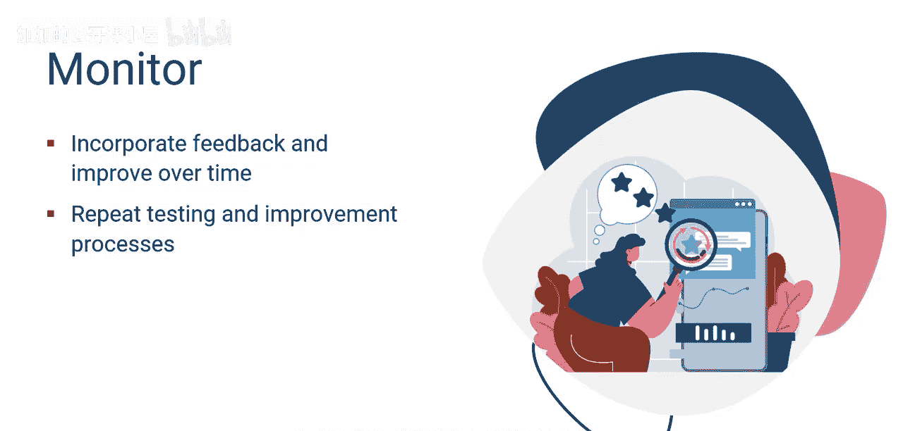
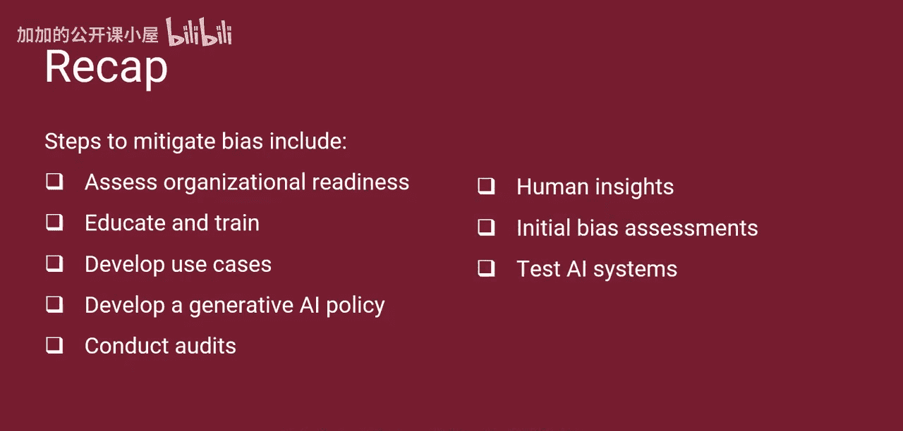

# IBM【中英⚡面向项目经理的生成式AI 专项课程｜Generative AI for Project Managers Specialization】 p47 P47 02_识别并克服生成式人工智能偏见 [BV1DnxVziEnn_p47]

Welcome to recognizing an overcoming generative AI bias。After watching this video。

 you will be able to explain the primary reasons why generative AI products and services have bias。

Define the step by step process to mitigate the risk of bias。

Generative AI systems are only as effective as the humans who identify and provide the data the system uses。

 Human are not perfect and may inject intentional or unintentional biases that impact data quality and potentially skew results。

The project manager must understand the potential for poor data quality that may lead to bias and ensure the risks are identified and mitigated。

Let's review some of the primary causes of why bias can happen in generative AI。

Genrative AI relies on accurate and clean data。If the data used for training is limited or doesn't represent a diverse range of people or situations。

 the AI model will replicate these biases， impacting the results negatively。

For example， if it mostly sees data from one group， it might not understand other groups well。

 leading to biased results。

Sampling bias happens when the data used to train generative AI systems doesn't accurately represent real world situations。

 or is more focused on the intended use case。If the data doesn't cover a wide range of possibilities。

 the AI's outputs will be biased towards what it's been trained on。

Humans have their own biases based on culture and stereotypes；

 if the data used to train the AI model reflects these biases。

 the AI model will learn and reproduce them。For example。

 generative AI might also unfairly make those connections if certain jobs are often associated with specific genders or ethnicities。

When designing and training AI models， it is important to be careful about fairness and equity generative AI learns from the data it's given and the result it produces。

 which can create a feedback loop。If it's trained on bias data or if bias results are fed back into the system。

 the AI model might keep reproducing those biases in future outputs。Lastly。

 the project manager must be aware of the potential for bias and ensure the team possesses awareness of the risks。

Regular audits and checks must be scheduled and performed to reduce the potential for bias to occur。

Next， let's look at the step by step process a project manager must follow to mitigate the risk of bias。

Assess organizational readiness。Educate and train。Develop use cases。Develop a generative AI policy。

Audits， human insights。Initial bias assessments。Test and monitor。Let's explore each step in detail。

First， assess organizational readiness by ensuring a diverse cross functional team equipped with the necessary skills for generative AI planning and development。

Evaluate the organizational infrastructure， data management capabilities， and team proficiency。

Align the project charter and project management plan with the business objectives of the firm to ensure coherence and relevance。

Next， all project team members should be educated and trained comprehensively to understand potential risk factors。

 including bias associated with AI。Provide continuous updates on evolving trends and innovations in generative AI to maintain proficiency。

Establish checks and balances within the team to prevent individual biases from influencing the system's outcomes。

Define clear use cases that outline the objectives and problem solving capabilities of the AI product or service the project will deliver。

Identify customer segments， understand their needs and expectations。

 and train the generative AI model to operate within the defined boundaries to deliver expected results。

Next， establish a generative AI policy with formal processes and procedures for reviewing outputs and conducting periodic audits。

Assign roles and responsibilities within a diverse team to implement checks and balances effectively。

Then， thorough audits of data used for building algorithms and training AI models will be conducted to ensure cleanliness and accuracy。

 and that data is free from cultural bias or stereotypes。

Strive to incorporate diverse data sets to minimize the risk of bias。

Encourage team members to actively monitor for biases and ensure that unintended individual biases do not influence results。

Emphasize teamwork in overcoming bias risks associated with AI development。

Prior to introducing the AI system to customers and users。

 comprehensive bias assessments must be conducted to identify and eliminate potential biases。Next。

 develop a project Deliverables test plan， performform Al testing to identify and eliminate system bugs。

 perform beta testing to gain valuable customer feedback。

Engage user experience UX teams to evaluate and document the customer experience。

Do not launch the new product or service until all feedback has been analyzed and fixes are in place。

Finally， continuously test and monitor AI systems， incorporate customer and user feedback to enhance product and services functionality and features over time。

Repeat the testing and improvement process as new functionality and features are added to the product or service。

In this video， you learned that。Generative AI requires accurate and clean data。

Limited or non diverseverse data leads to biased results。Primary causes of bias include data quality。

 sampling bias， human bias， feedback loop， and awareness and mitigation。

Steps to mitigate bias include。Assess organizational readiness。Educate and train。Develop use cases。

Develop a generative AI policy。Conduct audits。Human insights。

Initial bias assessments test AI systems and monitor continuously。

