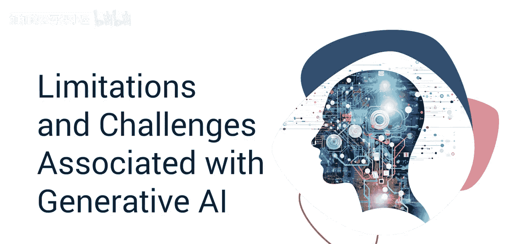
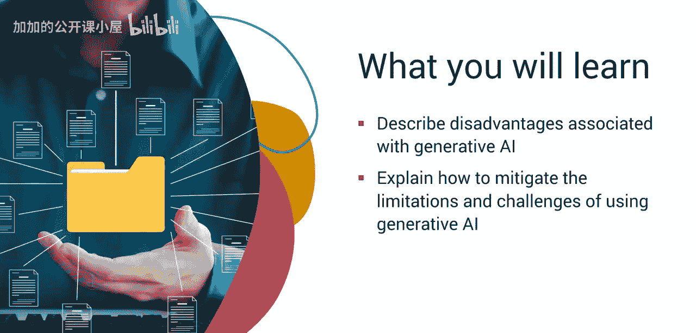
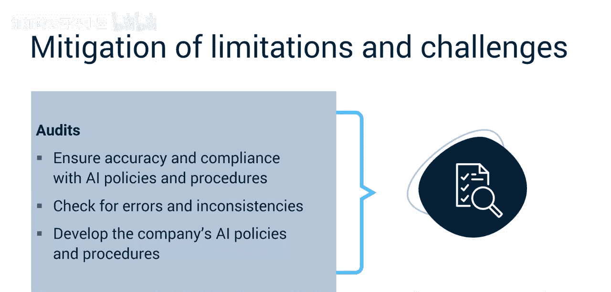
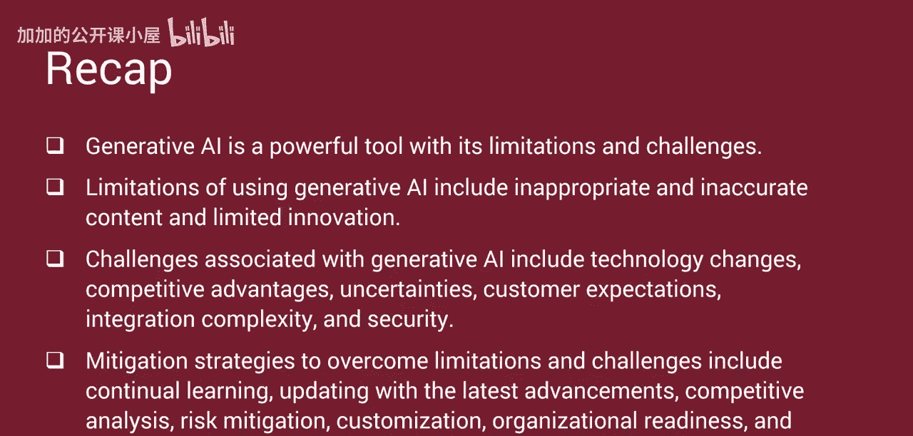

# IBM【中英⚡面向项目经理的生成式AI 专项课程｜Generative AI for Project Managers Specialization】 p48 P48 03_生成式人工智能的局限与挑战 [BV1DnxVziEnn_p48]

Welcome to this video on the limitations and challenges associated with generative AI。

After watching this video， you will be able to describe disadvantages associated with generative AI Ex how to mitigate the limitations and challenges of using generative AI generative AI continues to expand as a tool that all project managers must understand and adopt however。

 the limitations and challenges of using generative AI necessitate careful data management ongoing monitoring and tracking continual human oversight。

 Let's learn about generative AI limitations and provide recommendations to manage and overcome them。

 Let's begin with an overview of generative AI's limitations。

 generative AI systems may sometimes generate content that is unexpected or inappropriate。

 This lack of control can lead to customer dissatisfaction。 Los sales。

 biased outputs and damage to a company's reputation The output from generative AI may not always be accurate。

 This inaccuracy can lower the quality and relevance of the generated content undermining the credibility。

😊。

Of the product or service it's used for generative AI relies heavily on access to large and diverse data sets to learn and generate new concepts。

 However， the quality and variety of the data AI accesses limits its creativity and innovation In other words。

 it can only be as imaginative as the information it has been trained on。 Next。

 let's discuss some challenges of project manager may face while using generative AI and how they can overcome them。

 AI technology is evolving rapidly and AI drivenriven products and services might become outdated quickly。

 Project managers must be aware of these changes and adapt their projects accordingly Many companies are using generative AI to gain a competitive advantage Project managers must stay updated with the latest advancements in AI to ensure that the products and services offered remain competitive in the market。

😊，Regulations surrounding generative AI are constantly changing Project managers must address this uncertainty by creating compelling project objectives and addressing potential concerns or constraints。

 They need to maintain data quality to ensure AI recommendations are accurate check and validate outputs to ensure they are accurate and biasfr Custom expect AI products and services to be innovative and customize Project managers must understand these expectations and deliver products that meet them while catering to different market segments integrating generative AI into existing systems is not a simple plug and play solution Project managers must consider the end to end architecture and infrastructure required to support their AI products effectively generative AI has potential ethical and security concerns such as data privacy violations and intellectual property IP rights issues Project managers must prioritize security and ensure that the products and services they develop comply with。

😊，Relevant regulations and standards now that you understand the limitations and challenges of generative AI let's explore how to overcome them keep learning and stay updated with the latest advancements in AI。

 take courses， attend workshops and read relevant materials to ensure you have the knowledge and skills to excel as a project manager。

Stay informed about what your competitors are doing use AI tools to gather and analyze data to understand how your project deliverables compare to others in the market For instance。

 you can use AI powered software to track competitors' product features。

 pricing strategies and customer reviews some more ideas include identifying and managing market operational technical and regulatory uncertainties by understanding potential risks and developing mitigation strategies。

 you can create a risk registered to document risks by cause event and impact For instance。

 if there's uncertainty about how AI generated content might violate copyright laws。

 develop protocols to ensure compliance reach out to customers and understand the challenges and pain points your products and services can address Use surveys。

 interviews and market research to gather feedback For example。

 you can use AI tools to analyze customer feedback from social media or online reviews to identify common pain points。

In areasas for improvement feedback loops must continue even after the launch of the product。

Continually assess and reassess your organization's readiness to implement AI solutions。

 ensure you have access to the necessary data， expertise and resources， for example。

 consider outsourcing or training your project team if your organization lacks the skills to develop AI models internally。

Align AI product development with your company's overall goals and objectives。

 make sure there's clear communication between leadership and the project development team。

 For example， if the company aims to increase market share ensure that AI products and service features are designed to attract new customers and retain existing ones。

 Design and implement guardrails to ensure accuracy and compliance with AI policies and procedures Se up checks and balances to catch errors and inconsistencies develop a comprehensive set of AI policies and procedures for example。

 regularly review AI algorithms and models to ensure they produce accurate results and comply with regulations In this video you learned generative AI is a powerful tool with its limitations and challenges limitations of using generative AI include inappropriate and inaccurate content and limited innovation challenges associated with generative AI include technology changes。

 Comp advantages。😊。

Uncertainties， customer expectations， integration complexity and security。

 mitigation strategies to overcome the limitations and challenges include continual learning。

 updating with the latest advancements， competitive analysis， risk mitigation， customization。

 organizational readiness， and audits。

