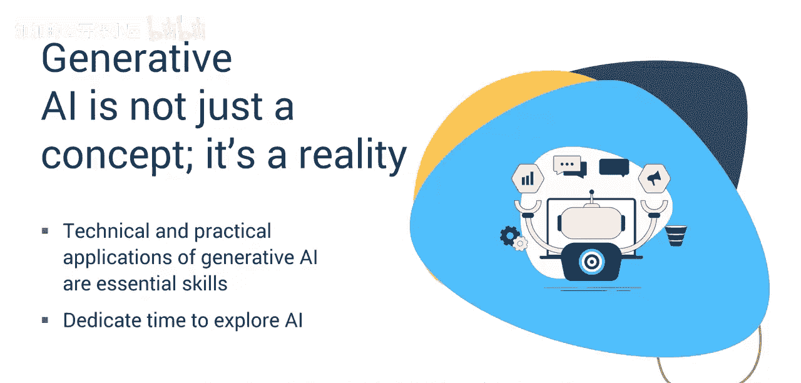
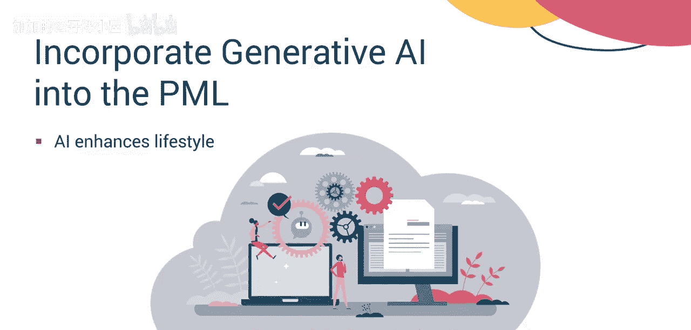
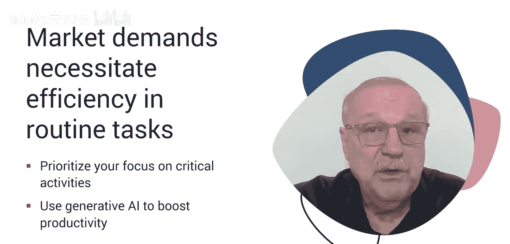
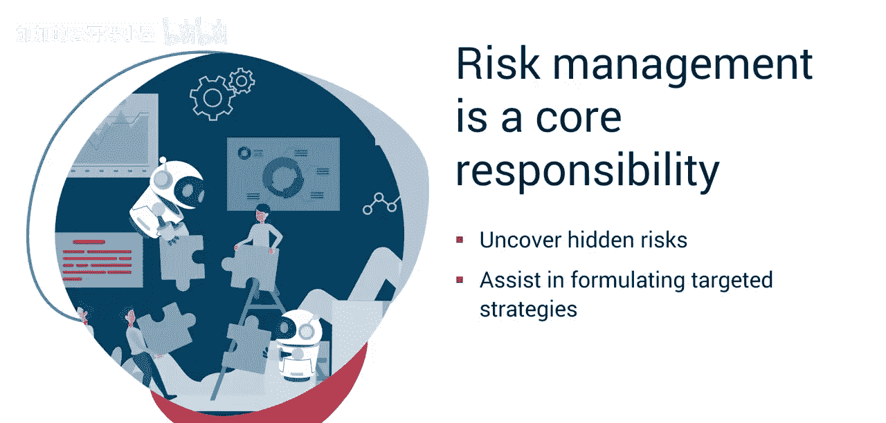
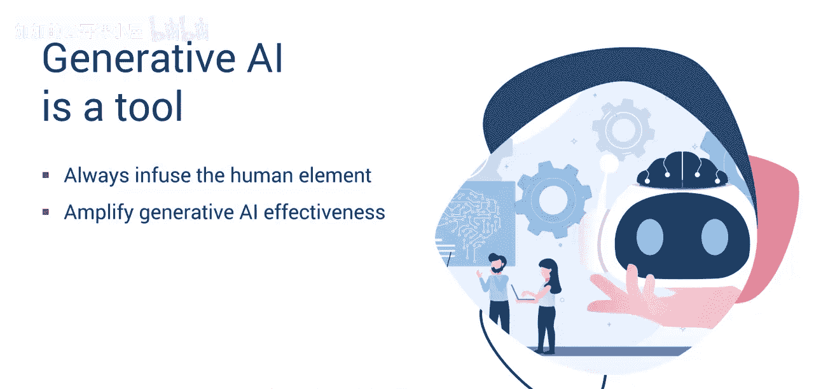
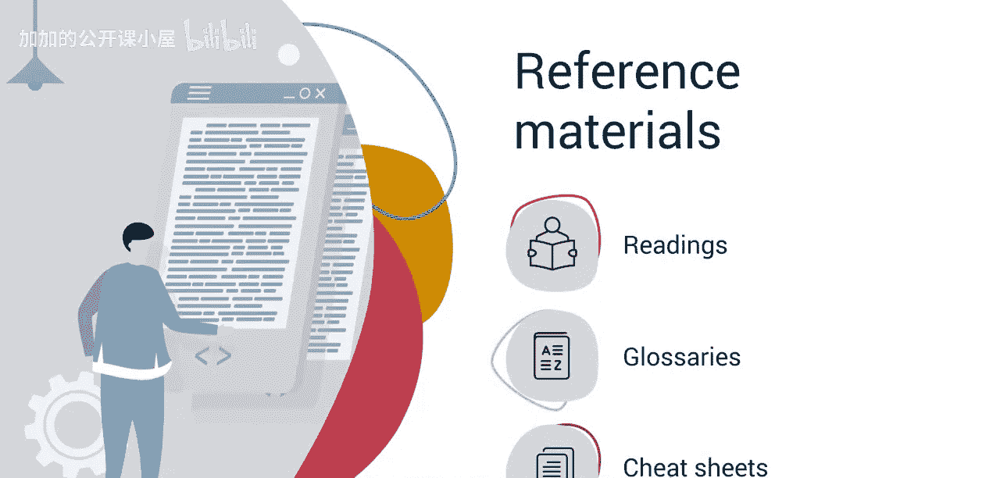

# IBM【中英⚡面向项目经理的生成式AI 专项课程｜Generative AI for Project Managers Specialization】 p49 P49 01_课程亮点与核心要点 [BV1DnxVziEnn_p49]

Congratulations on completing the generative AI unleash your project management potential course。

We've explored a vast array of topics on our journey。As your course instructor。

 I'd like to highlight my top 10 insights and key takeaways。

Number one， generative AI is not just a concept， It's a reality mastery of both the technical aspects and practical applications of generative AI is becoming an essential skill for project managers dedicate time to immerse yourself in this transformative tool。

😡。

Number two， navigating generative AI comes with challenges。

Collaborate with your team to minimize system biases that could distort outcomes； more。

 strive to ensure that your products adhere to the highest ethical standards。Number three。

 incorporate generative AI into the project management lifecycle AI enhances this life cycle rather than replacing it。

Number four， the generative AI toolkit is ever expanding， with new tools emerging rapidly。

 it's crucial to stay updated on the evolution of AI tools and systems， keep ahead of the curve。

Number5， market demands necessitate efficiency and routine tasks as project managers prioritize your focus on critical activities by utilizing generative AI to boost your productivity。

 Number6， hyperpersonization is what customers crave。

 They anticipate products and services tailored to their unique needs。

 generative AI is indispensable in meeting these expectations。

Number seven， the data deluge surpasses individual processing capabilities。

Employ generative AI to craft precise prompts that zero in on the data essential for informed decision making and project planning and execution enhancement remember the quality of generative AI outputs hinges on the specificity of your prompts。

Number8， project managers are pivotal to ensure value work in tandem with your entire project management team to ensure organizational readiness to attain excellence through AI。

😡，Generative AI tools can significantly enhance the capabilities of project managers and their teams by automating routine tasks。

 providing data driven insights， and facilitating decision making processes ensure the team is prepared to embrace this potential。

Number nine， risk management is a core responsibility。

Genrative AI can uncover hidden risks and assist in formulating targeted strategies to reduce their likelihood or impact。

And finally， number 10， remember， above all， generative AI is a tool。

 While the results it generates may not always be flawless。 Use it as a springboard for ideas。

 Always infuse the human element。 generative AI's effectiveness is amplified by the humans guiding it。

😊。

Now that you've reviewed some of the fundamental ideas presented in this course。

 remember to use each modules， readings， glossaries and cheat sheets。

 these assets can help you quickly reference what you learned Congratulations again on completing this course and good luck in your project management journey。

