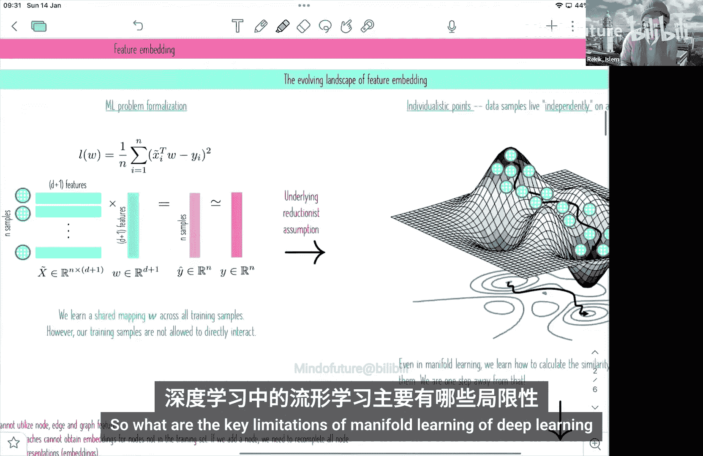

# 004：2.1 基于图的学习背后的逻辑 🧠


在本节课中，我们将学习特征嵌入的核心概念。我们将从机器学习的基础线性回归模型开始，逐步深入到深度学习模型，最终探讨图卷积网络（GCN）的起源和基本原理。课程将涵盖流形学习、基于图的学习技术，并最终介绍基础的图卷积网络模型及其变体。我们将使用线性代数来描述从图中学习或提取嵌入的网络函数和方程。


---


## 概述 📋

本节课旨在梳理从机器学习到图卷积网络（GCNs）的关键概念演进路径。我们将从线性回归模型的基础回顾开始，探讨深度学习模型，并追溯导致GCNs出现的技术发展脉络，包括特征嵌入、流形学习以及基于图的学习技术。最后，我们将学习基础的图卷积网络模型及其不同变体，并使用线性代数来形式化相关的网络函数和方程。

---

## 从线性回归到计算图 📈


上一节我们概述了课程目标，本节中我们来看看机器学习中最基础的模型：线性回归。


### 单输出线性回归模型


在单输出线性回归模型中，我们的目标是学习一个映射权重 **W**。这个线性回归模型或函数允许我们将输入数据 **X_i** 映射到预测目标值 **ŷ_i**。


我们将所有训练样本堆叠成矩阵 **X̃**，得到训练数据矩阵。其中，`n` 是样本数量，`D` 是特征数量。这里的 `+1` 是为了将偏置项整合进特征向量和权重向量中，形成紧凑形式。


*   **输入数据矩阵**：**X̃** ∈ ℝ^(n × (D+1))
*   **权重向量**：**W** = [w_0, w_1, ..., w_D]^T ∈ ℝ^((D+1)×1)，其中 `w_0` 是偏置。
*   **预测输出**：**ŷ** = **X̃** **W** ∈ ℝ^(n×1)
*   **损失函数（L2损失）**：目标是最小化预测值 **ŷ** 与真实值 **y** 之间的平方距离。


这个映射是“通用”的，即同一个 **W** 被应用于所有不同的样本，旨在捕捉所有样本共享的模式。


我们可以将这个数学模型嵌入到一个计算图中进行表示。


以下是单输出线性回归的计算图表示：
```
输入 X̃_i (D+1维) → [与权重 W 相乘并求和] → 输出 ŷ_i (标量)
```
这个计算图执行的操作正是 **X̃_i^T W**。


### 多输出线性回归模型


现在，我们将模型推广到多输出情况，即预测 `C` 个目标分数。


*   **预测输出矩阵**：**Ŷ** = **X̃** **W** ∈ ℝ^(n×C)
*   **权重矩阵**：**W** ∈ ℝ^((D+1)×C)
*   **真实值矩阵**：**Y** ∈ ℝ^(n×C)


与单输出模型的主要区别在于，我们现在为每个目标分数学习一个特定的映射向量（即 **W** 矩阵中的一列）。这是因为输入与不同输出之间的关系（分布）可能完全不同。

以下是多输出线性回归的计算图表示：
```
输入 X̃_i (D+1维) → [与权重矩阵 W 相乘] → 输出向量 ŷ_i (C维)
        (包含特征x1...xD和偏置1)          (包含分数score1...scoreC)
```
计算过程是对所有特征进行加权求和，以得到每个目标分数的预测值。

---


## 引入非线性：神经网络 🧠


上一节我们介绍了线性模型，但当输入与输出之间存在非线性关系时，线性模型会失效。本节中我们来看看如何通过引入非线性来解决这个问题。


为了解决非线性问题，我们需要在模型中引入非线性函数，即激活函数。


一个简单的单隐层神经网络（含多个输出）的计算过程如下：
1.  线性变换：**h** = **W1^T** **x̃**
2.  非线性激活：**a** = σ(**h**)，其中 σ 是激活函数（如ReLU, sigmoid）。
3.  输出层线性变换：**ŷ** = **W2^T** **a**


这里，**h** 或 **a** 被称为隐藏层或潜在表示，它们是原始特征经过非线性变换后得到的新特征。


**关键思想**：神经网络通过非线性变换，将原始数据映射到一个新的表示空间（即隐藏层）。在这个新空间中，数据可能变得更容易用线性模型（如最后的 **W2** 层）来处理或分离。


我们可以将这个思想扩展到更深的网络。一个 L 层深度神经网络可以看作是一系列非线性变换的复合：
**ŷ** = **W_L^T** σ( ... σ( **W_2^T** σ( **W_1^T** **x̃** ) ) ... )


每一层都学习一个变换，将数据映射到一个新的流形（子空间），并且希望随着层数加深，所学习的流形复杂度逐渐降低，直到找到一个最终的、低维的、简单的表示空间。在这个最终空间里，简单的线性模型就能很好地工作。这就是深度学习强大表征能力的核心：通过序列化的非线性映射，将复杂特征嵌入到复杂度递减的流形中。


---


## 流形学习 🌌


上一节我们探讨了深度学习如何通过多层非线性变换学习特征嵌入，本节中我们来看看一个更基础的概念：流形学习。


流形学习是机器学习中的一个重要领域，其目标是在没有目标标签（无监督）的情况下，学习数据的内在低维结构。


**基本设定**：
*   **输入流形**：原始高维数据空间 ℝ^D，数据点 **x_i** 分布在一个复杂的 D 维流形上。
*   **目标**：学习一个嵌入/编码函数 **f**: ℝ^D → ℝ^D'，将数据映射到一个低维的嵌入流形 ℝ^D'（通常 D' < D）。
*   **潜在表示**：**z_i** = **f**(**x_i**) + **ε_i**，其中 **ε_i** 是考虑数据噪声的小扰动。


**核心假设（邻域保持）**：流形学习通常假设，在原始空间中相邻的点（如 **x_i** 和 **x_j**），在嵌入空间中的映射点（**z_i** 和 **z_j**）也应该彼此接近。这旨在保持数据的局部几何结构。


**动机**：在高维原始空间中，欧氏距离可能无法反映数据点之间的真实“语义”距离（例如，需沿流形测地线测量的距离）。流形学习试图发现并保持这种内在结构，从而获得更能揭示数据本质关系的低维表示。


**局限性**：邻域保持假设可能很强。如果原始数据含有大量噪声或异常值，强制保持这种邻域关系可能会将噪声也编码进嵌入中。


---


## 特征嵌入的演进与图的引入 🔄

上一节我们介绍了无监督的流形学习，本节中我们将串联起之前的线索，并引出图的重要性。


我们回顾了特征嵌入的演进路径：
1.  **线性模型**：适用于简单线性关系，但无法处理非线性。
2.  **深度神经网络**：通过多层非线性变换，自动学习从复杂到简单的序列化特征嵌入（流形），最终使问题在表示空间线性可分。
3.  **（无监督）流形学习**：直接旨在学习数据的低维内在流形结构，强调邻域保持。


然而，无论是深度网络还是传统流形学习，在处理某些数据时都存在局限：
*   它们主要关注单个数据样本 **x_i** 自身的特征变换。
*   虽然流形学习考虑样本间关系（通过邻域假设），但这种方式是隐式的、全局优化的，并且对噪声敏感。


这就引出了一个新的视角：**显式地利用数据点之间的关系**。如果我们将数据点视为图中的节点，将数据点之间的关系（相似性、连接性）视为图的边，那么我们就可以利用图结构来指导特征学习过程。


**基于图的学习**的核心思想是：节点的特征嵌入，不仅应该由其自身的属性决定，还应该受到其邻居节点属性（特征）的影响。这种利用图结构进行信息传播和聚合的机制，催生了图神经网络（GNN），特别是图卷积网络（GCN）的发展。


在接下来的课程中，我们将看到如何将卷积操作从规则网格（如图像）推广到非欧几里得结构的图数据上，从而形成图卷积网络的基本模型。

---

## 总结 🎯


本节课我们一起学习了基于图的学习背后的逻辑演进：
1.  我们从基础的**线性回归模型**出发，理解了通用映射和计算图的概念。
2.  为了处理非线性，我们引入了**神经网络**，了解了其通过序列化非线性映射学习复杂度递减的流形，最终实现线性可分的核心思想。
3.  我们探讨了**流形学习**这一无监督方法，其目标是直接保持数据邻域结构以学习低维嵌入。
4.  最后，我们指出了传统方法的局限性，并引出了**基于图的学习**的动机：即显式地利用数据点之间丰富的关系结构（图）来学习更鲁棒、更具代表性的特征嵌入，这为图卷积网络（GCN）的出现奠定了基础。




下一节，我们将深入图卷积网络的具体模型和公式。