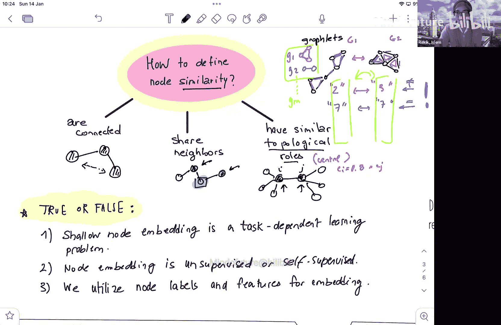
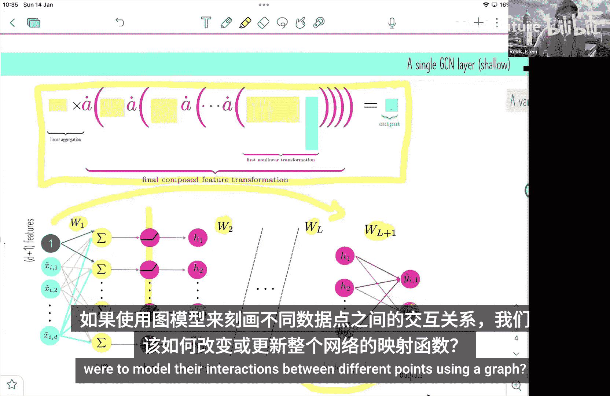

# 006：2.3 浅层图节点嵌入 🧠

在本节中，我们将介绍经典的节点嵌入方法。首先，我们将对这些方法进行概述，然后深入探讨单层图卷积网络（GCN）及其工作原理。

## 概述

在上一节中，我们介绍了机器学习回归问题、线性和非线性，并解释了为什么这些机器学习和深度学习范式存在局限性。它们本质上采用了一种个体主义的方法进行训练，即使我们处理流形学习等高级变体，或者将深度学习形式化为顺序流形学习问题，我们仍然受到不同训练点之间独立性的限制。

因此，我们在上一节末尾引入了通过图结构来建模或编码不同样本之间交互的想法，即通过图结构实现样本的“集体学习”和“集体互动”，以更好地解决分类、回归或多任务问题等下游任务。理论上，所有这些学习任务都可以通过图得到改进。

随之而来的问题是：既然我们将数据编码到图上，我们该如何表示图？如何提取特征？我们回顾了节点图特征提取的基本或经典方法，但这些方法存在局限，无法考虑我们称之为边和特征矩阵的额外信息，即通过节点特征或边特征对图进行的额外标注。

现在，核心在于特征。我们如何学习更好地嵌入、提取或表示图，从而从图中获得更好的特征？正如大家所记得的，本讲座是关于特征嵌入的，现在我们将讨论如何学习更好的特征。让我们退一步，更正式地介绍这个概念。

## 样本嵌入与图节点嵌入

首先，我们定义样本嵌入。假设有一个数据样本 **xᵢ** ∈ ℝᴰ，它具有 D 维特征。样本嵌入，也称为潜在/隐藏表示学习、样本编码、变换或样本映射，是指将样本映射到一个新的空间。这个新空间能让我们更好地表示数据，其维度为 D‘，通常 D’ < D，以实现降维。

对于一个图 **G = (V, E)**，我们的目标是编码单个节点。假设目标是学习一个映射函数 **f** 来表示节点 **u**。这与流形学习类似，即学习如何嵌入特征。目标是学习节点 **u** 的新潜在表示或嵌入 **zᵤ** ∈ ℝᴰ‘。其中，**f** 被称为编码函数，它将节点 **u** 映射到新的特征表示 **zᵤ**。

这一点非常重要，因为如果我们学会了如何更好地表示节点，如何提取一个能摒弃不重要特征、更好地捕捉流形拓扑结构和样本间关系的良好表示，这就能提升下游任务（如分类、回归）以及无监督学习任务（如数据融合、集成或生成学习）的性能。因此，这种表示对于许多学习任务至关重要。

## 嵌入的约束与目标函数

在特征嵌入或浅层图嵌入方法中，嵌入通常受到一个假设的约束：图中相邻的节点在嵌入空间中也应该接近。这是我们在流形学习中也做出的简化假设，即希望保持原始空间和嵌入空间之间的邻域关系。这意味着，如果两个节点 **u** 和 **v** 在图中相似（例如，通过邻接矩阵 **A** 体现），那么它们的嵌入向量 **zᵤ** 和 **zᵥ** 也应该相似。

衡量两个向量相似度的一种方法是计算它们的点积 **zᵤᵀ zᵥ**，这量化了它们之间的相似性。我们的目标是保持节点 **u** 和 **v** 之间的相似性。如果它们在原始空间中的相似性很高，那么这个点积（经过归一化后）应该接近 1。

因此，图节点嵌入的目标函数可以形式化为最大化以下对数似然：

**max ∑_{(u,v) ∈ E} log(σ(zᵤᵀ zᵥ))**

其中，**σ** 是 sigmoid 函数。我们希望对在原始图（邻接矩阵）中相似或接近的节点对，最大化其嵌入表示之间的相似性（点积）。可学习的映射函数 **f** 应该使我们能够最大化这些相似节点对在嵌入空间中的相似性。这体现了“邻域保持”的假设。

机器学习中有一个原则：“告诉我你的邻居是谁，我就能告诉你你是谁。” 这正是邻域保持的体现。如果一个节点与两个具有相同标签的节点接近，那么我们可以假设这个节点也可能共享相同的标签。这个原则非常重要。

## 嵌入矩阵与相似性定义

图节点嵌入是指取图中的一个节点 **v**，对其进行编码，得到嵌入向量 **zᵥ** ∈ ℝᴰ‘。对于图中的所有节点，我们可以得到一个嵌入矩阵 **Z** ∈ ℝ^{|V| × D‘}，其中 |V| 是节点数量，D‘ 是嵌入维度。

现在，你可能会思考这个目标函数以及我们如何学习映射函数 **f**。为了学习 **f**，我们需要预先定义节点之间的相似性度量 **sim(u, v)**，因为我们的目标是保持这个值。我们需要定义如何计算图中每对节点之间的相似性。

文献中有不同的方法，例如使用核方法或其他方式。如何定义相似性取决于图本身、具体问题和学习任务，没有通用的方法。以下是一些思路：

*   **基于连通性**：如果两个节点相连，则认为它们相似；不相连则不相似。
*   **基于共享模式**：例如，两个节点共享许多相同的邻居，可以根据共享邻居的数量来推导它们的相似性。
*   **基于拓扑角色**：例如，两个节点可能都是网络中的关键中心节点，即使它们不直接相连，但由于其中心性度量相似，也可以认为它们在功能上相似。

定义相似性的方式多种多样，它约束并定义了整个优化问题（即上述最大化问题）的设置。具体采用哪种方式完全取决于我们如何定义这里的相似性度量。

## 图元示例

我们不会在此深入探讨所有相似性定义，因为这本身也是图论的一部分。但可以举一个“图元”的例子。图元是小型的子图模式。例如，我们可以通过计算图中不同图元模式的数量来定义图的特征向量，进而计算图之间的相似性。通过组合多种图元模式，可以构建更全面的相似性度量。

## 练习：判断题

现在，让我们一起来做一个小练习。请判断以下陈述的真假。

1.  **陈述**：浅层节点嵌入是一个依赖于任务的学习问题。
    *   **答案**：错误。根据我们给出的形式化定义，目标函数仅依赖于图结构（邻接矩阵），不依赖于任何下游任务（如分类标签）。因此，它是无监督的，不依赖于特定任务。

2.  **陈述**：节点嵌入是无监督或自监督的。
    *   **答案**：正确。如前所述，它不依赖于节点标签，属于无监督学习。如果设计为重构原始图结构，也可以视为自监督学习。

3.  **陈述**：我们利用节点标签和特征进行嵌入。
    *   **答案**：错误。在所述的浅层节点嵌入中，我们仅使用图的结构信息（邻接矩阵 **A**），既不使用节点的特征矩阵 **X**，也不使用任何节点标签 **y**。这是一个非常简化的问题设定。

## 从浅层嵌入到图卷积网络

我们已经看到，这种浅层节点嵌入或编码没有考虑节点可能具有的特征，因此非常简化。它仅依赖于邻接矩阵 **A** 来学习编码函数 **f**。这不允许我们在带有特征的图上工作，并且它是完全无监督的，与下游任务无关。

如果我们想做更复杂的事情，例如学习如何进行分类或回归，就需要扩展这种方法，使其能够考虑标签和特征，并使学习到的嵌入更能代表并与我们期望的最终结果相关联。

现在，我将介绍流行的图卷积网络（GCN），并从单层网络开始。回想一下深度神经网络的基本原理：它们通过一系列非线性激活层进行顺序变换，使我们将原始特征逐步转化为最终的特征表示，在这个表示空间中，问题（如类别关系）变得更容易处理（例如，线性可分）。

我们将在此基础上，通过图结构将这种“个体主义”学习转变为“集体主义”学习。让我们看看，如果使用图来建模不同数据点之间的交互，该如何改变或更新整个网络的映射函数。

## 总结

本节课中，我们一起学习了浅层图节点嵌入的基本概念。我们首先定义了样本嵌入和图节点嵌入的目标，即学习一个映射函数，将节点编码到低维的嵌入空间。我们讨论了嵌入的“邻域保持”约束和相应的目标函数，即最大化相似节点在嵌入空间中的相似性。我们还探讨了如何定义节点间的相似性，并通过练习明确了浅层节点嵌入是无监督的、仅依赖于图结构的这一特点。最后，我们指出了这种方法的局限性，并引出后续将介绍的、能够融合节点特征和标签信息的图卷积网络（GCN）。