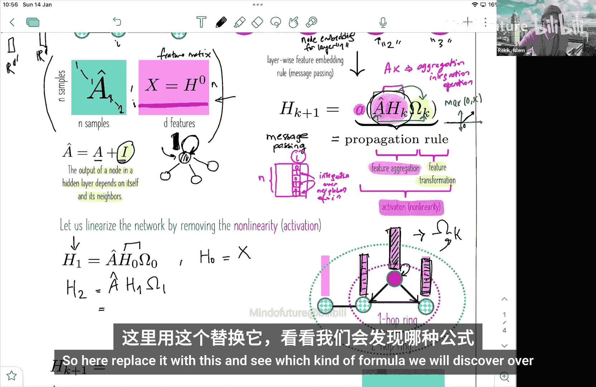
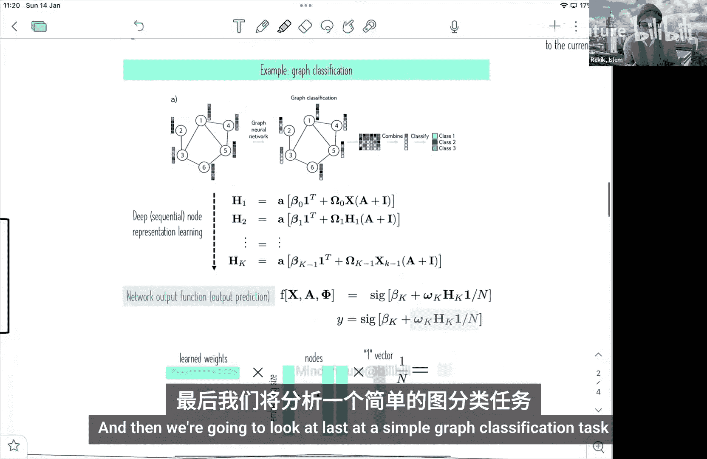

# 007：单层图卷积网络分析 🧠

在本节课中，我们将学习图卷积网络（GCN）的核心工作原理。我们将从一个简单的机器学习模型出发，逐步引入图结构，并深入分析单层GCN如何通过聚合邻居信息和特征变换来学习节点的表示。

---

## 概述

我们将从最小化预测值与真实值之间距离的基本目标开始，探讨如何将图结构（邻接矩阵）融入学习过程。核心在于，我们不仅要学习节点的特征表示，还要利用图的结构来指导这一学习过程，使得相邻节点的表示能够相互影响。

---

## 从简单模型到图结构模型

我们首先考虑一个简单的回归模型，其目标是缩小预测输出与真实目标值之间的距离。这里的损失函数是标准的，但数据的变换方式将有所不同。

在简单机器学习模型中，我们独立处理每个样本。现在，我们希望创建一个图，来编码不同节点（样本）之间的相似性。这个图将由**邻接矩阵 A** 来表示。

**邻接矩阵 A** 定义了图中节点之间的连接关系。需要明确的是，这里的“样本”可以有不同的含义：它可以是一个节点（例如，一张图片、一段文本），也可以是一个完整的图（例如，一个表示分子结构或大脑连接性的图）。在分类整个图的任务中（如判断一个分子图是否健康），我们将整个图视为一个样本。

---

## 图表示学习的目标

在本例中，我们关注的是学习如何表示图中的每一个节点。我们有一个带标注的图，它包含：
*   **特征矩阵 X**：每个节点都有对应的特征向量。
*   **邻接矩阵 A**：定义了节点间的连接结构。

我们的目标是学习一个映射函数（或神经网络）**F**，它能够利用图矩阵 A 和一些可学习参数，将输入特征 X 映射到一个新的、更强大的表示（嵌入）中。

这个过程是层次化的：
*   **Φ₀** 将第0层（输入特征 X）映射到第1层的表示 **H₁**。
*   **Φ₁** 将第1层表示 **H₁** 映射到第2层表示 **H₂**。
*   以此类推，最终在第 K 层得到所有节点的深度表示 **H_K**。

这类似于传统神经网络学习嵌入的过程，但关键区别在于：这里的表示学习受到图结构 **A** 的约束和引导。在训练过程中，**A** 和 **X** 是固定的，而各层的映射函数 **Φ** 和中间表示 **H** 是可学习的。通过优化损失函数（如回归损失），我们迭代更新参数，最终获得强大的节点表示。

---

## 深度神经网络与图卷积网络的类比

为了理解GCN，我们先回顾深度神经网络（DNN）的操作。

一个简单的DNN对输入样本 **X** 进行如下操作：
1.  **特征变换**：通过可学习的权重矩阵 **W** 进行线性变换。
2.  **引入非线性**：应用激活函数（如ReLU）来捕获数据中的复杂关系。
3.  **重复堆叠**：多次重复上述步骤。
4.  **最终预测**：在最后一层，通过一个线性聚合层将学习到的高维特征映射到预测值（如分类得分）。

整个过程是针对每个样本独立进行的。

现在，我们将这个框架推广到图数据。对于一个输入图 **G**，我们拥有：
*   邻接矩阵 **A**
*   节点特征矩阵 **X**

我们将其输入一个图神经网络（这里以简单的GCN为例）。GCN层的操作与DNN类似，但增加了一个关键步骤：

**H⁽ˡ⁺¹⁾ = σ(Â H⁽ˡ⁾ W⁽ˡ⁾)**

其中：
*   **H⁽ˡ⁾** 是第 `l` 层的节点表示。
*   **Â** 是添加了自连接的邻接矩阵（**A + I**）。这是为了确保节点在更新自身表示时，也能考虑自身的特征。
*   **W⁽ˡ⁾** 是第 `l` 层可学习的权重矩阵。
*   **σ** 是非线性激活函数。

这个公式被称为网络的**传播规则**或**消息传递规则**。

---

## 深入分析传播规则

让我们分解这个规则，理解其背后的含义：

1.  **特征聚合（邻居信息整合）**：`Â H⁽ˡ⁾` 这一步是关键。对于每个节点 `i`，它将其所有邻居节点（包括自身）在第 `l` 层的表示聚合起来。这相当于从节点的局部邻域中整合信息。
2.  **特征变换**：`(Â H⁽ˡ⁾) W⁽ˡ⁾` 将聚合后的特征通过可学习的权重矩阵 **W⁽ˡ⁾** 进行线性变换，将其映射到一个新的特征空间。
3.  **非线性激活**：`σ(·)` 对变换后的结果应用非线性函数，使模型能够学习更复杂的模式。

如果我们暂时忽略非线性激活函数，并递归地展开这个更新公式，会得到一个有趣的发现。假设初始特征 **H⁽⁰⁾ = X**，那么经过 `K+1` 层后，节点的表示近似为：

**H⁽ᴷ⁺¹⁾ ≈ Âᴷ⁺¹ X Ω_total**

其中 **Ω_total** 是所有层权重矩阵的组合。

这个公式揭示了GCN的另一个重要视角：
*   **Âᴷ⁺¹** 是添加自连接的邻接矩阵的 `K+1` 次幂。在图论中，`Âᴷ⁺¹` 中的元素 `(i, j)` 表示从节点 `i` 到节点 `j` 长度为 `K+1` 的路径数量。
*   这意味着，**第 `K+1` 层的节点表示，融合了 `K+1` 跳（hop）以内所有邻居的信息**。

**深度与感受野**：因此，GCN的“深度”直接对应于其**感受野**的大小。第一层聚合1跳邻居的信息，第二层聚合2跳邻居（邻居的邻居）的信息，以此类推。网络越深，每个节点在计算最终表示时所考虑的网络范围就越广。

---

## GCN的关键特性与归一化

GCN有几个强大的特性：

*   **适用于任意大小的邻域**：无论一个节点有多少个邻居（1个、2个或更多），聚合操作（通常是求和或平均）都能将它们整合成一个固定维度的向量，然后进行相同的变换。这使得GCN可以处理具有不同节点度的图。
*   **共享的变换权重**：所有节点共享相同的权重矩阵 **W⁽ˡ⁾** 进行变换，这大大减少了参数量并提高了模型的泛化能力。

然而，原始的传播规则 `Â H⁽ˡ⁾ W⁽ˡ⁾` 存在一个问题：高度数（拥有大量邻居）的节点在聚合后会产生数值很大的特征向量，而低度数的节点则相反。这会导致特征尺度不一致，可能使得模型偏向于高度数节点，并且在反向传播时引发梯度不稳定问题。

为了解决这个问题，我们引入了**层间归一化**。常用的对称归一化方法如下：

**H⁽ˡ⁺¹⁾ = σ( D̂⁻¹/² Â D̂⁻¹/² H⁽ˡ⁾ W⁽ˡ⁾ )**

其中 **D̂** 是 **Â** 的度矩阵（对角矩阵，对角线元素 `D̂ᵢᵢ` 是节点 `i` 的度数）。归一化操作 `D̂⁻¹/² Â D̂⁻¹/²` 做了两件事：
1.  它缩放邻接矩阵，使得聚合操作近似于对邻居特征取**平均**，而不是求和，从而消除了节点度数的影响。
2.  它有助于稳定网络中不同层之间的特征分布，缓解梯度爆炸或消失问题，使训练过程更加平稳。

---

## 总结

本节课我们一起学习了图卷积网络单层结构的核心思想：

1.  **目标**：利用图结构指导节点表示学习，使相邻节点的表示相互关联。
2.  **核心操作**：GCN层通过**消息传递规则**，依次执行**邻居特征聚合**、**线性变换**和**非线性激活**。
3.  **深度含义**：GCN的深度对应于其感受野，更深的层可以聚合更远距离的邻居信息。
4.  **关键特性**：GCN能处理不同度数的节点，并共享权重，具有良好的泛化性。
5.  **归一化重要性**：对邻接矩阵进行归一化（如对称归一化）是稳定训练、确保模型性能的关键步骤。

通过将固定图结构 **A** 与可学习变换 **W** 相结合，GCN能够为图中的每个节点学习到包含丰富上下文信息的深度表示，为后续的节点分类、图分类等任务奠定基础。在下一部分，我们将看到如何将这些层堆叠起来，并应用于实际的图学习任务中。