# 016：图神经网络采样方法回顾 🧠

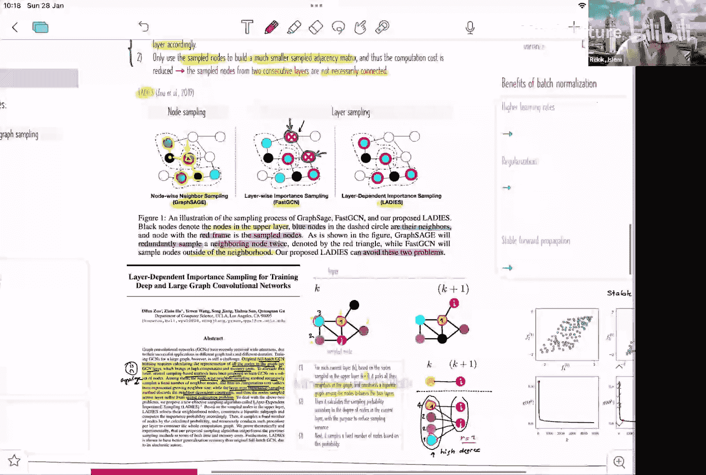

在本节课中，我们将回顾图神经网络中用于创建训练小批量的不同采样方法。为了降低GNN的计算开销，可以采用多种采样策略，每种策略都有其优缺点。我们将一起探讨这些策略。

## 概述 📋

我们已经了解到，有多种采样方法可用于在图神经网络中创建训练小批量。为了降低计算成本，可以采用以下策略之一。每种策略都有其优点和缺点，接下来我们将逐一审视。

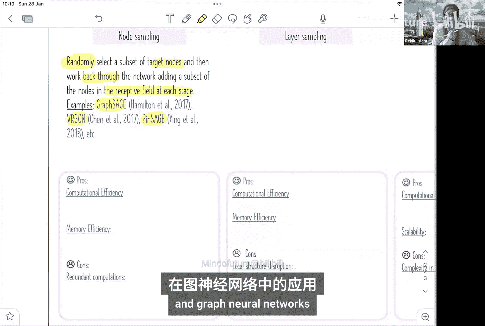

## 节点采样 🎯

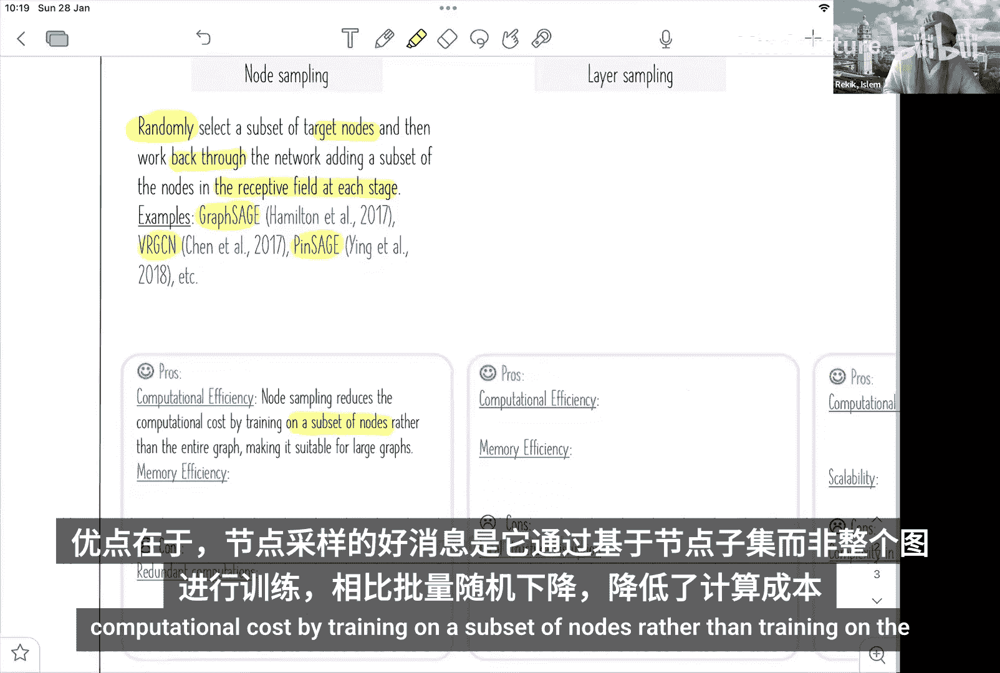

节点采样的核心是随机选择目标节点的一个子集。

以下是节点采样的关键点：
*   **方法**：从图中随机选择一部分目标节点。这些节点可能互不连接。
*   **过程**：以这种方式定义批次后，反向通过网络，并在每一层添加节点及其感受野的子集。
*   **示例**：GraphSAGE是此类方法的代表。此外，还有旨在改进节点采样策略的变体，如方差减少的GN PinS等。

**优点**：
*   **计算成本**：与在全图上训练相比，通过在节点子集上训练来降低计算成本，使其更适合处理大规模图。
*   **内存效率**：在处理大规模图时，允许更高效的内存使用。

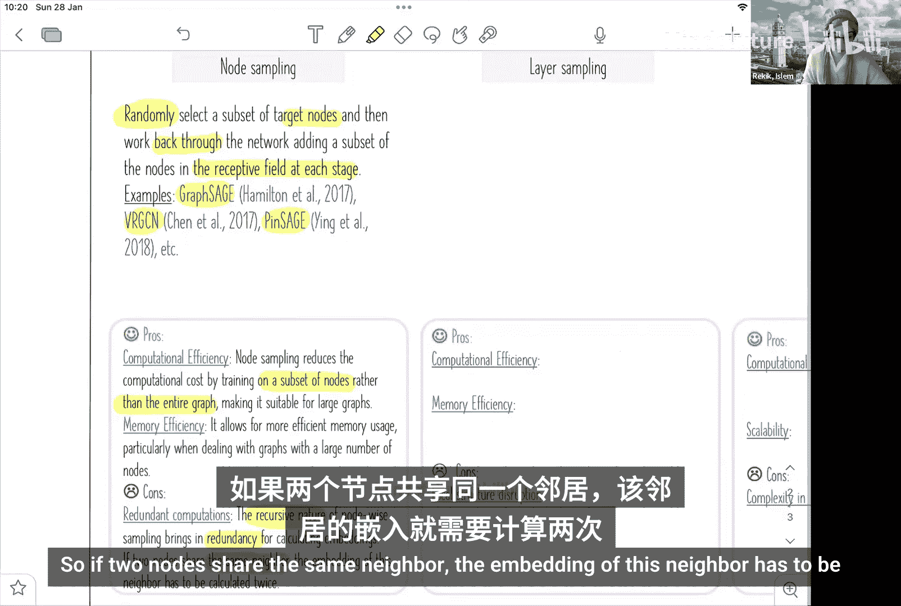

**缺点**：
*   **冗余计算**：由于随机采样，不同节点的感受野可能存在大量重叠。这意味着共享邻居的嵌入需要被重复计算多次。
*   **递归性质**：节点采样的递归性质带来了嵌入计算的冗余。如果两个节点共享同一个邻居，该邻居的嵌入需要被计算两次。

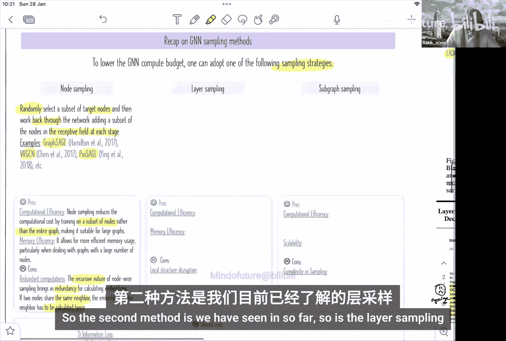

我们可以在图示中看到这一点，例如橙色和绿色的节点。

## 层采样 🧱

上一节我们介绍了节点采样，本节中我们来看看层采样。

层采样的核心是在每一层独立地对感受野进行采样。

以下是层采样的关键点：
*   **方法**：在每一层独立地采样感受野。关键词是“独立”。
*   **目的**：旨在解决节点采样中随着反向传播节点数量激增的问题，并可能减少冗余计算。
*   **示例**：FastGCN、自适应采样、层依赖重要性采样（LADIES）和L2-GCN等都是相关的研究工作。如何改进层采样方法是一个持续的研究领域。

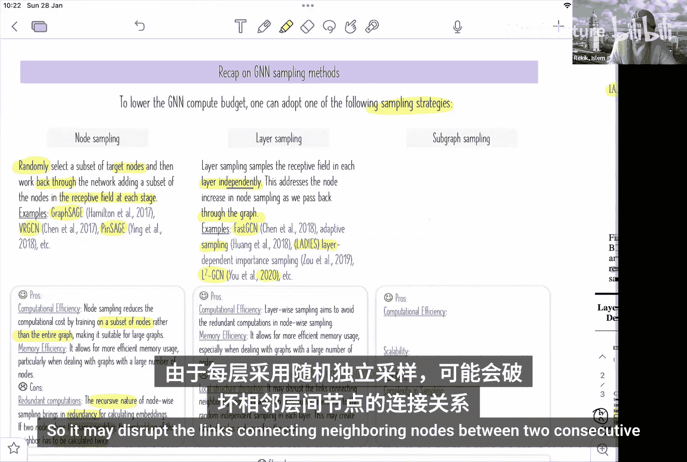

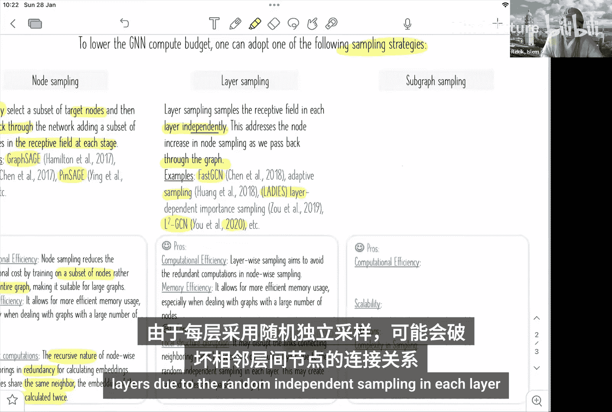

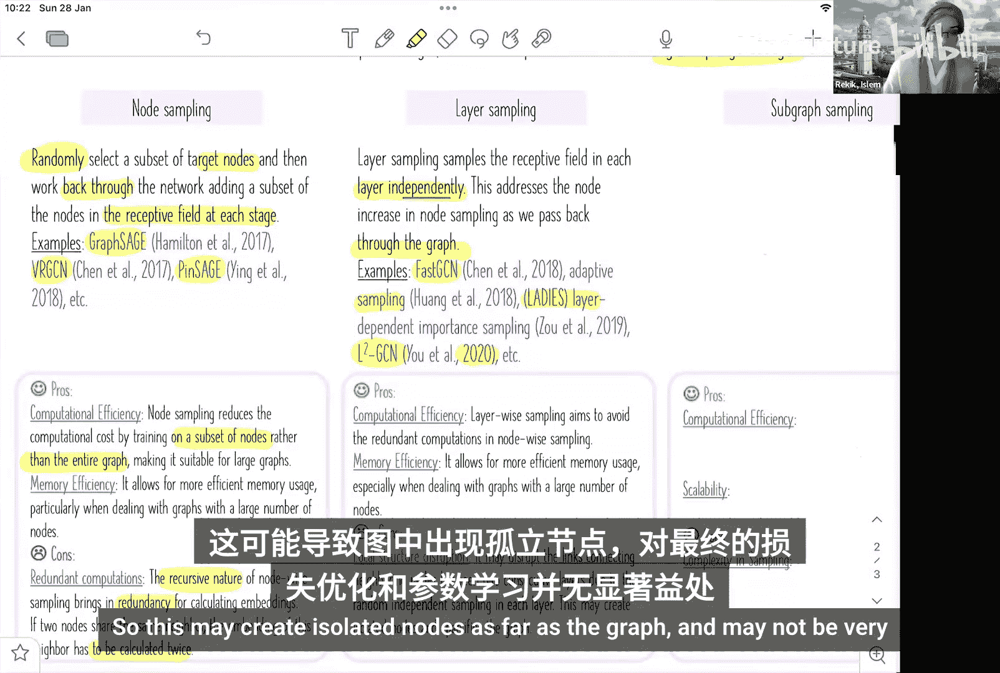

**优点**：
*   **计算效率**：避免了节点采样中的冗余计算，优于第一种方法。
*   **内存效率**：允许更高效的内存使用，略优于节点采样。

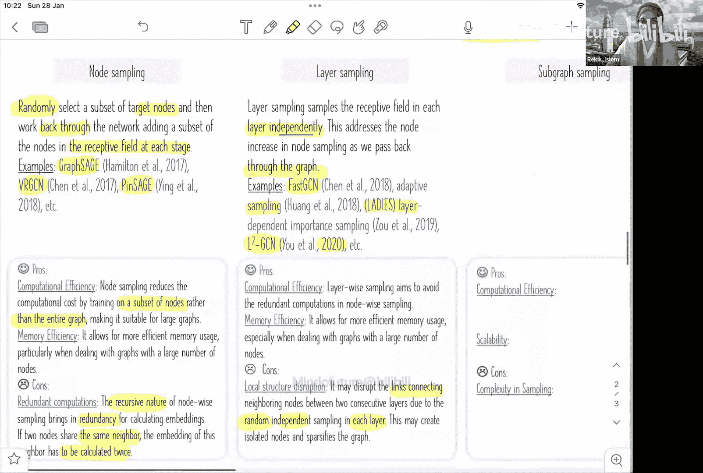

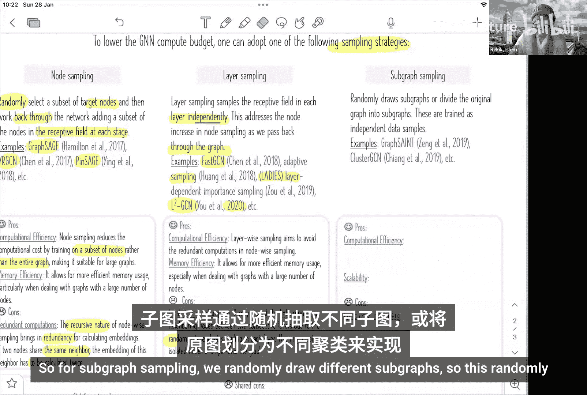

**缺点**：
*   **破坏局部结构**：由于在每一层进行独立的随机采样，可能会破坏连接相邻两层的节点之间的链接。这可能导致孤立节点的产生，使图变得稀疏，从而可能不利于最终的损失优化和参数学习。

## 子图采样 🌐

接下来，我们探讨最后一种方法：子图采样。

子图采样的核心是随机抽取不同的子图，或将原图划分为不同的簇。

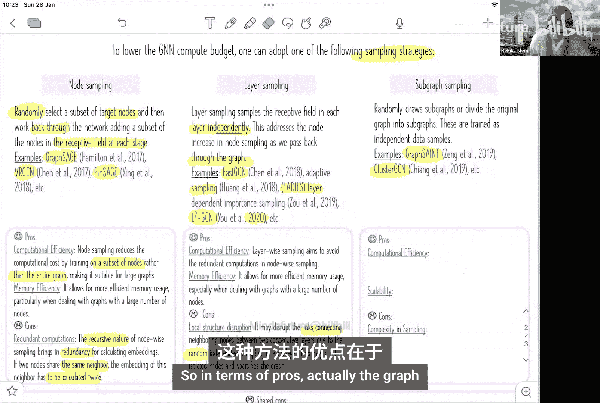

以下是子图采样的关键点：
*   **方法**：随机抽取子图，或将原始图划分为不同的簇。这些子图或簇作为独立的数据样本进行训练。
*   **过程**：每个批次计算损失并更新参数，批次之间没有重叠。本质上是将大图分解为多个小图。
*   **示例**：GraphSAINT和我们已经了解的Cluster-GCN。

**优点**：
*   **数据规模**：显著减少了每次迭代需要处理的数据规模。
*   **可扩展性**：通过将图分解为多个子图，使其非常适合大规模图处理。在可扩展性方面，它明显优于层采样和基于节点采样的方法。

**缺点**：
*   **采样与设计复杂性**：设计有效的图划分或子图采样方法本身具有复杂性。如何进行聚类（例如，基于边相似性或节点特征）可能并不可靠。
*   **聚类质量影响**：聚类或划分的质量将直接影响学习效果，这可能是一个复杂且非平凡的问题。
*   **额外计算资源**：对于超大图，一些聚类算法（如基于流形学习来发现样本间相似性进行聚类的算法）本身可能不具备可扩展性。随着图规模增大，可能无法运行这些聚类算法。

## 总结 🎓

本节课中，我们一起回顾了图神经网络中的三种主要采样方法：**节点采样**、**层采样**和**子图采样**。每种方法都是为了应对大规模图训练的计算挑战而设计的，并在计算效率、内存使用和可扩展性之间有不同的权衡。节点采样简单但可能产生冗余计算；层采样减少了冗余但可能破坏图结构；子图采样可扩展性高，但划分图本身可能带来复杂性和额外开销。理解这些方法的优缺点有助于在实际应用中根据图的特点和资源约束选择合适的技术。