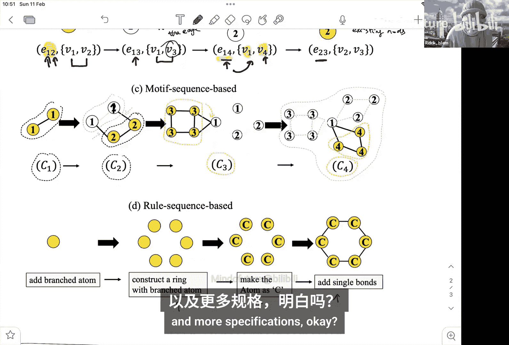

# 026：无条件序列图生成 🧬

在本节课中，我们将学习深度图生成模型的一种分类方法，并重点探讨其中的无条件序列图生成方法。我们将了解如何以序列化的方式逐步构建图结构，包括基于节点、边、子图（motif）和规则的不同生成策略。

---

## 模型分类概览 📊

上一节我们介绍了深度图生成的广阔领域。根据一篇2023年的综述论文，深度图生成模型可以被系统地分类。这种分类法有助于我们理解这个活跃且发展迅速的研究领域。

以下是该论文提出的主要分类框架：

*   **无条件生成模型**：不依赖于特定条件或目标图进行生成。
*   **条件生成模型**：根据给定的条件（如序列、上下文或其他图）来生成图。

本节课，我们将聚焦于**无条件生成**模型下的**序列化生成**方法。根据生成的基本单元不同，序列化生成又可细分为四种子类型。

---

## 节点序列生成 🧱

在节点序列生成方法中，模型以序列方式逐个添加节点及其连接边。其核心思想是：每次向现有图中引入一个新节点时，同时决定该节点与图中已有节点之间的连接关系。

以下是生成过程的步骤分解：

1.  **输入起始节点**：我们从单个节点 **V1** 开始，它没有任何边。
2.  **添加第二个节点**：添加节点 **V2**，并创建连接 **V1** 和 **V2** 的边 **E12**。此时，**V1** 和 **V2** 被视为已生成的部分。
3.  **添加后续节点**：接下来添加节点 **V3**。模型需要学习如何将 **V3** 连接到已有的节点上。它可以选择只连接 **V1** 或 **V2**，也可以同时连接两者。图中示例连接了 **V1** 和 **V2**。
4.  **持续扩展**：此过程持续进行。例如，添加节点 **V4** 时，模型决定将其连接到节点 **V2** 和 **V3**，而不连接 **V1**。这体现在其连接向量为 `[0, 1, 1, 0]`（假设无自环）。

整个过程的目标是通过优化特定的损失函数，学习如何以最优（而非随机）的方式逐步生成节点和边，最终形成完整的图结构。

---

## 边序列生成 🔗

边序列生成方法与节点序列生成类似，但焦点在于**边**。模型以序列方式逐个添加边，边的添加可能会引入新的节点。

以下是该方法的运作方式：

1.  **创建第一条边**：从连接节点 **1** 和 **2** 的边 **E12** 开始。
2.  **添加后续边**：接下来添加边 **E13**。这条边连接了现有节点 **1** 和一个新节点 **3**。因此，添加边的同时也引入了新节点。
3.  **边的两种作用**：新添加的边可以有两种作用：
    *   **连接现有节点**：例如，在已有节点 **2** 和 **3** 之间添加一条新边。
    *   **引入新节点**：例如，添加边 **E14** 时，引入了新节点 **4**。

这种方法的核心区别在于，生成过程以边为驱动单元。研究人员可以设计不同的算法来指导边的生成顺序和连接规则，从而产生多样的图结构。

---

## 子图（Motif）序列生成 🧩

子图序列生成方法进一步扩大了生成的基本单元。它不是一次生成一个节点或一条边，而是**一次生成一个子图（或称为motif）**，然后学习如何将这些子图连接起来。

以下是生成步骤：

1.  **输入起始子图**：从第一个子图 **C1** 开始。
2.  **添加并连接子图**：添加第二个子图 **C2**。关键挑战在于学习如何将 **C2** 与已有的 **C1** 连接起来（如图中创建了两条连接边）。
3.  **持续添加模块**：继续添加子图 **C3** 和 **C4**。每个新子图都需要与已存在的图结构进行连接。例如，**C3** 只连接到了节点 **1**，而 **C4** 也连接到了节点 **1**。
4.  **形成完整图**：最终，整个图是由多个子图模块通过学得的连接方式拼接而成的。

这种方法适用于那些具有明显模块化或重复结构的图，例如某些分子或社交网络。

---

## 规则序列生成 ⚙️

规则序列生成是一种更偏向特定领域的方法。它依赖于预定义的领域规则来指导图的生成和演化过程。这种方法在化学分子生成等领域非常有用。

以下是基于规则的生成示例：

1.  **从原子开始**：以一个原子节点为起点。
2.  **应用规则**：顺序应用一系列化学规则来扩展结构：
    *   **添加支链原子**
    *   **构建环状结构**
    *   **将原子指定为碳（C）**
    *   **在原子间添加单键**
3.  **迭代构建**：通过持续应用这些领域知识规则，可以逐步生成或修改图，使其符合特定的化学或拓扑约束。

---

## 总结 📝

本节课我们一起学习了无条件序列图生成的四种主要方法。我们从最基本的**节点序列生成**开始，了解了如何逐个添加节点和边。接着，我们探讨了以边为核心的**边序列生成**。然后，我们介绍了以更大单元进行构建的**子图（Motif）序列生成**。最后，我们了解了依赖于领域知识的**规则序列生成**。

这些方法展示了如何将我们在消息传递、节点更新等图神经网络中学到的知识，应用于序列化地构建图结构这一创造性任务中。理解这些基本策略是深入探索更复杂图生成模型的重要基础。