# 028：基于图的监督条件生成 🧠

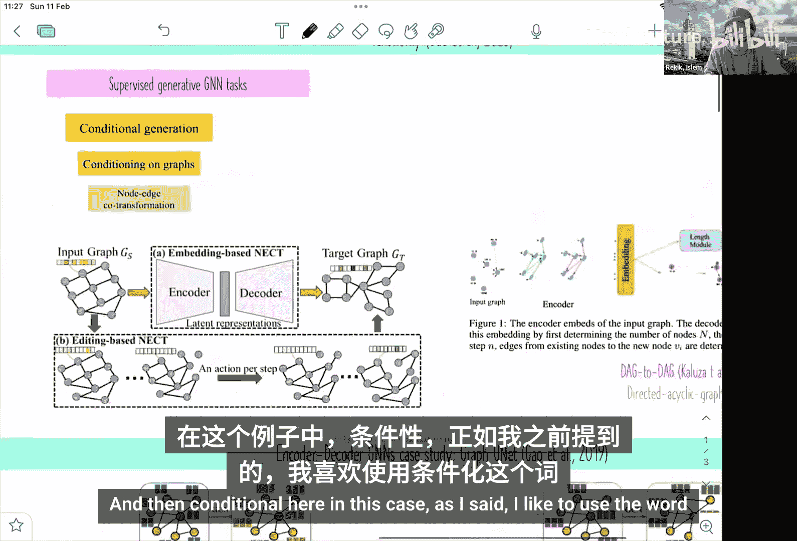

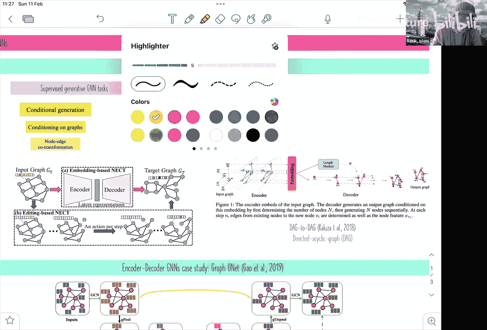

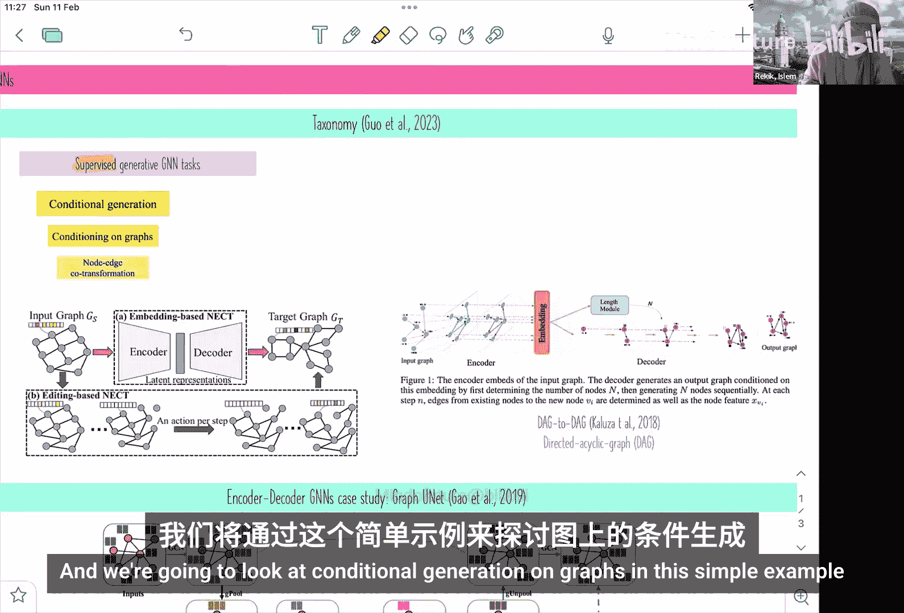

在本节课中，我们将学习基于图的监督条件生成。我们将探讨如何利用图神经网络，在给定输入图（源图）的条件下，生成一个目标图。这与之前学习的无监督图生成不同，因为这里我们有明确的输入-输出配对数据作为监督信号。

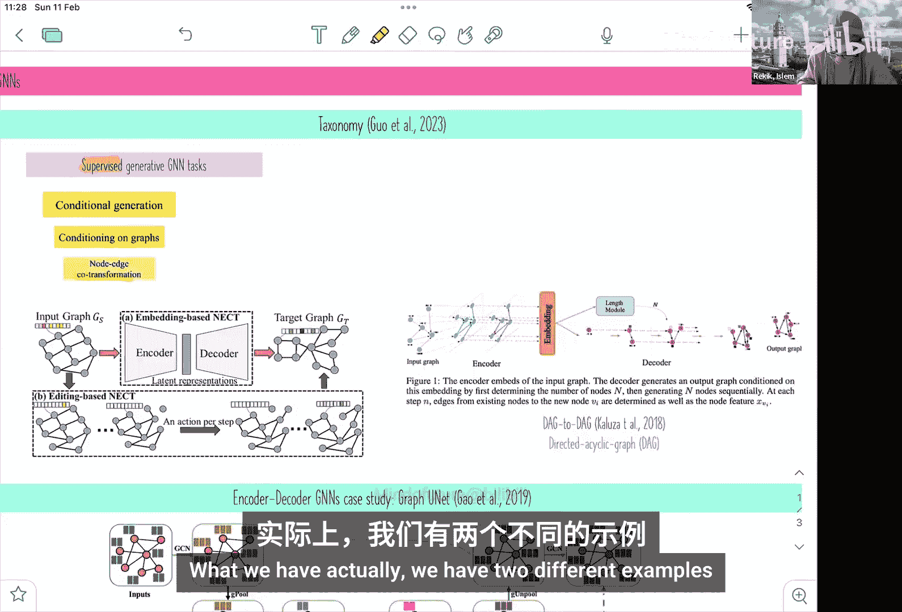

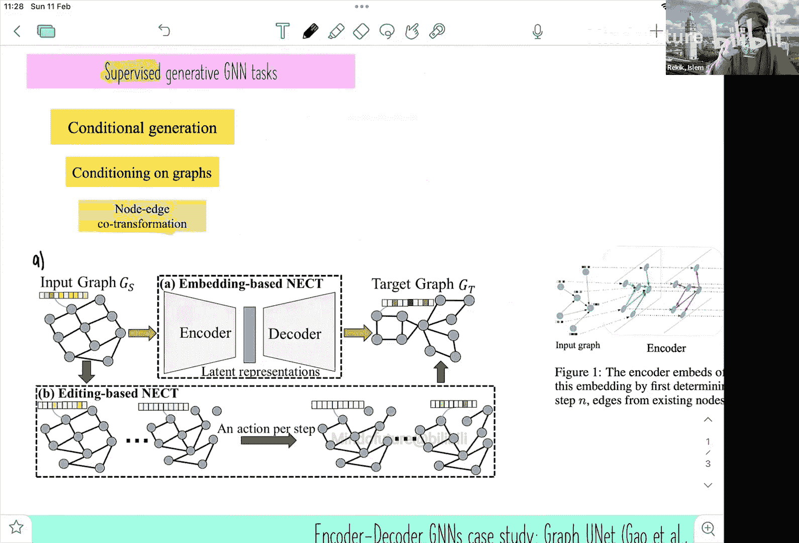

上一节我们介绍了无监督的图生成方法，本节中我们来看看在有监督信号的情况下，如何对图进行条件生成。

## 核心概念：监督与条件生成

首先，我们需要明确“条件生成”的含义。当我们在无监督或自监督场景下工作时，模型学习的是数据本身的分布。然而，在条件生成中，我们拥有输入图（源图）和对应的目标输出图。这里的“条件”指的是生成过程以源图作为条件或输入。

因此，我们拥有的是**监督式生成图神经网络**。我们的目标是学习一个从源图到目标图的映射。

## 两种监督生成范式

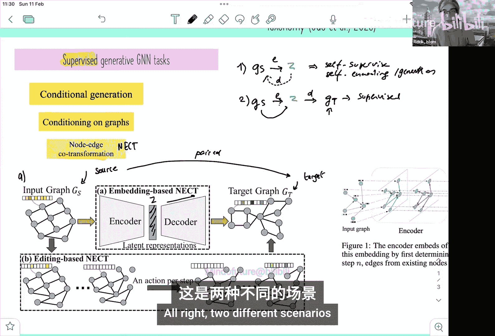

以下是两种主要的基于图的监督条件生成方法：

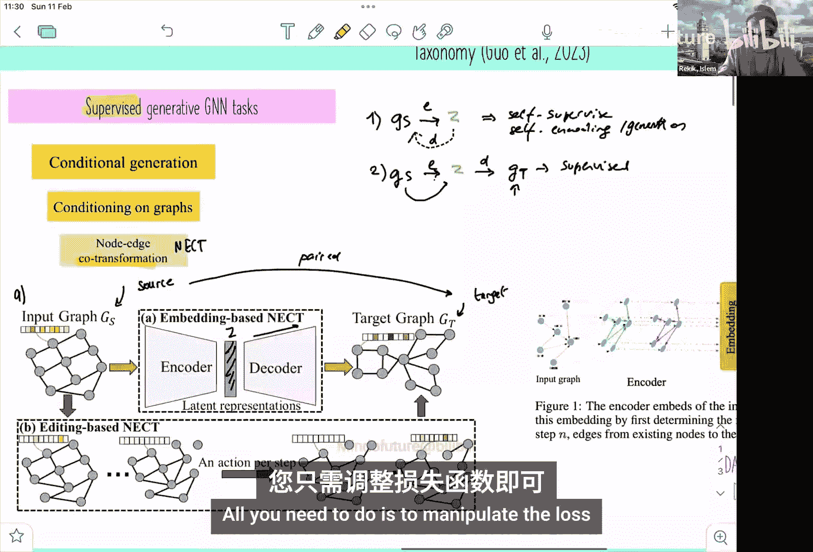

### 范式A：编码器-解码器转换

在这种方法中，我们使用编码器-解码器架构进行图到图的转换。

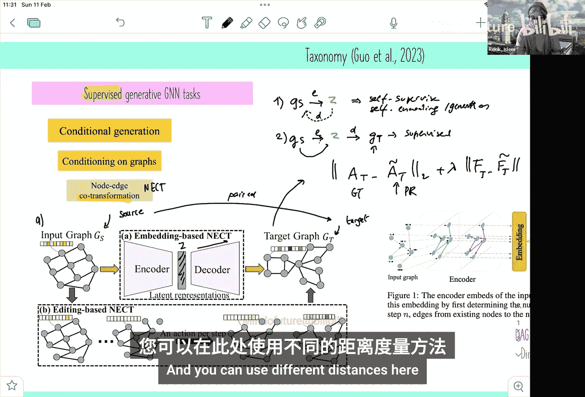

1.  **编码**：首先，我们有一个源图 `G_s`。我们使用图编码器将其编码为一个潜在表示 `Z`。
    ```python
    # 伪代码示意
    Z = GraphEncoder(G_s)
    ```
2.  **解码**：然后，我们使用解码器，将潜在表示 `Z` 解码成目标图 `G_target`。
    ```python
    G_target_pred = GraphDecoder(Z)
    ```
这与无监督重建（自编码）的关键区别在于：无监督时，我们试图从 `Z` 重建回 `G_s`；而在监督条件下，我们从同一个 `Z` 解码出一个不同的 `G_target`。

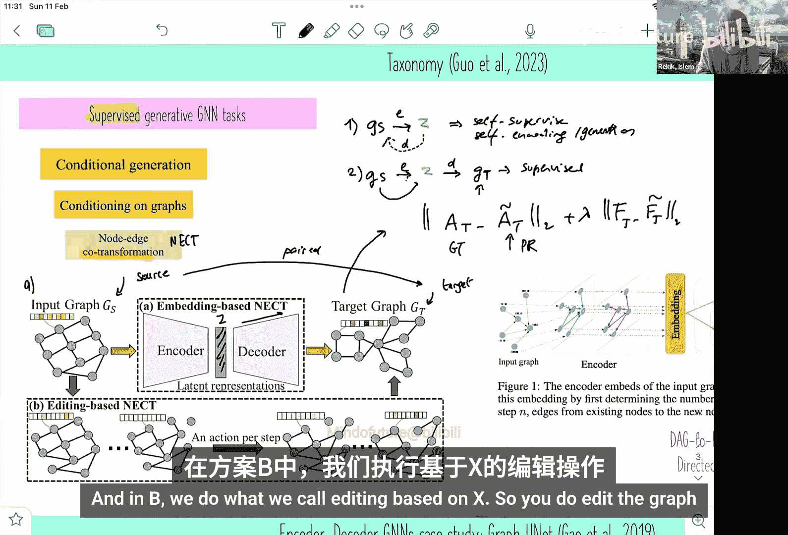

模型的训练目标是最小化预测目标图与真实目标图之间的差异。损失函数可以用线性代数形式表示：

**损失函数公式**：
`L = || A_target - A_pred || + λ * || X_target - X_pred ||`

其中：
*   `A_target` 和 `X_target` 是真实目标图的邻接矩阵和节点特征矩阵。
*   `A_pred` 和 `X_pred` 是模型预测的目标图的邻接矩阵和节点特征矩阵。
*   `||·||` 表示某种范数（如L2范数），`λ` 是一个权衡超参数。

这个损失函数迫使模型学习从源图特征到目标图结构的映射。

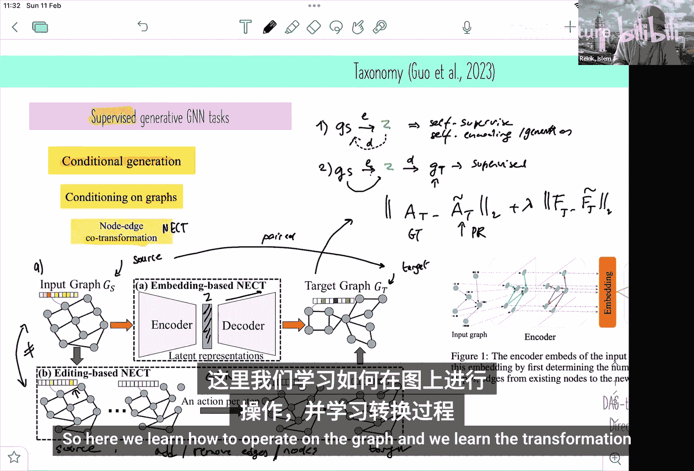

### 范式B：基于编辑的转换

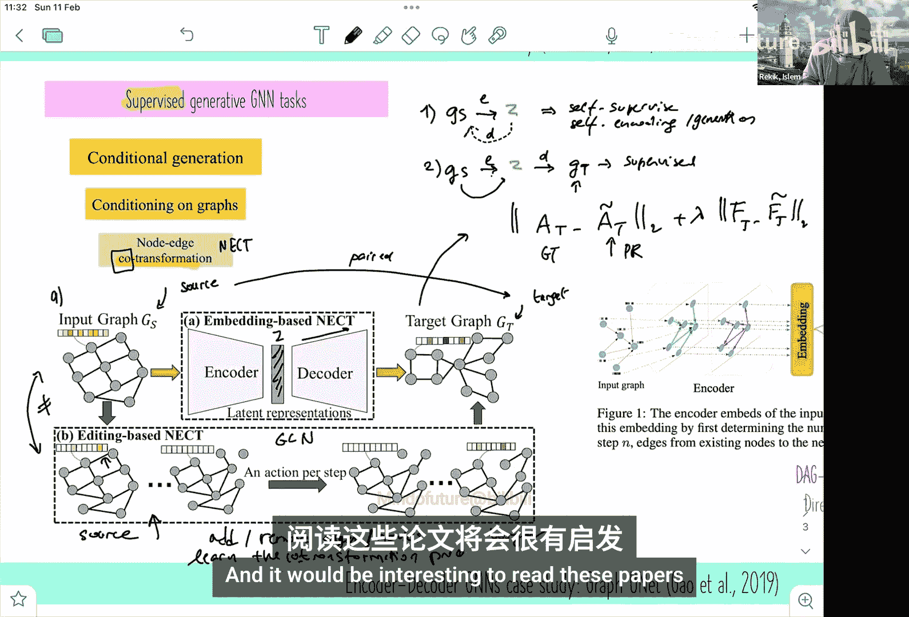

这种方法不通过中间的潜在表示 `Z`，而是直接学习对源图进行一系列编辑操作，以将其转换为目标图。

1.  **编辑操作**：模型学习如何对图进行“编辑”，主要包括：
    *   **添加/删除边**：例如，在目标图中，某条边可能被移除，同时添加了新的边。
    *   **添加/删除节点**：图的结构可能通过增删节点来改变。
2.  **学习变换过程**：模型学习的是一个**节点-边协同变换过程**。它通过图卷积网络（GCN）等机制更新节点嵌入，并基于这些嵌入决定如何编辑图。

这种方法的核心是学习一个逐步的图变换过程，而不是一次性生成整个新图。它模拟了如何通过一系列原子操作将一个图修改为另一个图。

## 实例解析：有向无环图（DAG）翻译网络

为了更好地理解编码器-解码器范式，让我们看一个具体的研究实例：有向无环图（DAG）翻译网络。

**目标**：学习从输入DAG生成输出DAG。

**网络结构和工作流程**：

1.  **图编码**：
    *   输入是一个具有初始特征的图 `G_input`。
    *   使用图编码器对整个图进行编码。这里的关键步骤是**图池化**：我们将所有节点的嵌入聚合（或“坍缩”）为**单个图级嵌入向量** `H_G`。这代表了整个图的概要信息。
    ```python
    # 伪代码示意：通过池化得到图级嵌入
    H_G = GlobalPooling(GraphEncoder(G_input))
    ```

2.  **序列化解码**：
    *   解码器以图级嵌入 `H_G` 为起点。
    *   生成过程是**序列化**的。如果目标图有 `N` 个节点，解码器就需要 `N` 个步骤。
    *   在每一步 `t`：
        *   解码器基于当前已生成的部分图和 `H_G`，预测下一个新节点的特征。
        *   然后，决定如何将这个新节点连接到现有图结构上（即预测边）。
        *   更新内部状态，为下一步做准备。
    *   这个过程重复进行，直到生成所有 `N` 个节点及其连接关系，最终形成完整的输出图 `G_output`。

这种方法的挑战在于设计解码步骤：如何根据嵌入预测节点？如何决定连接？这些通常涉及特定的网络模块和决策规则，详细实现可以参考相关论文。

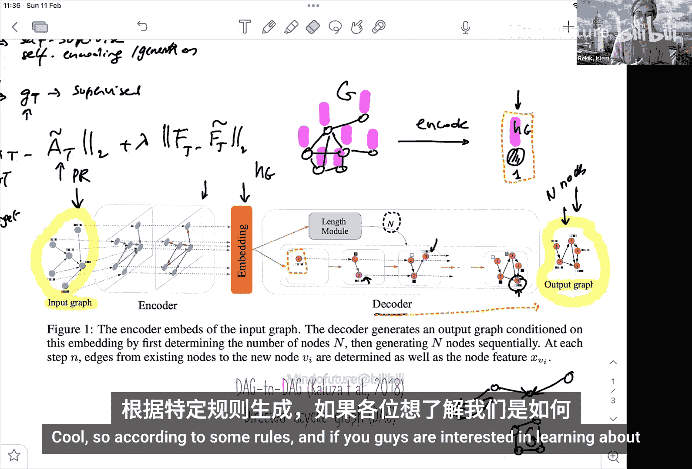

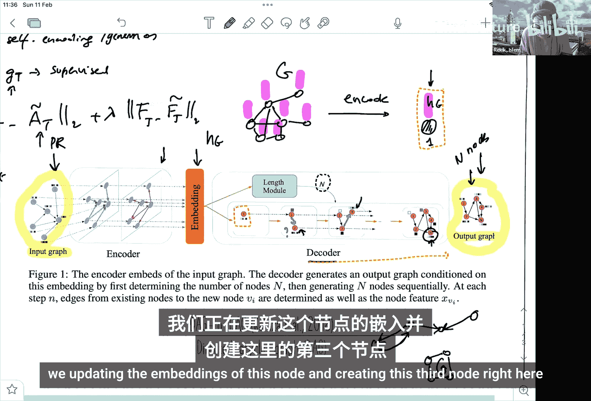

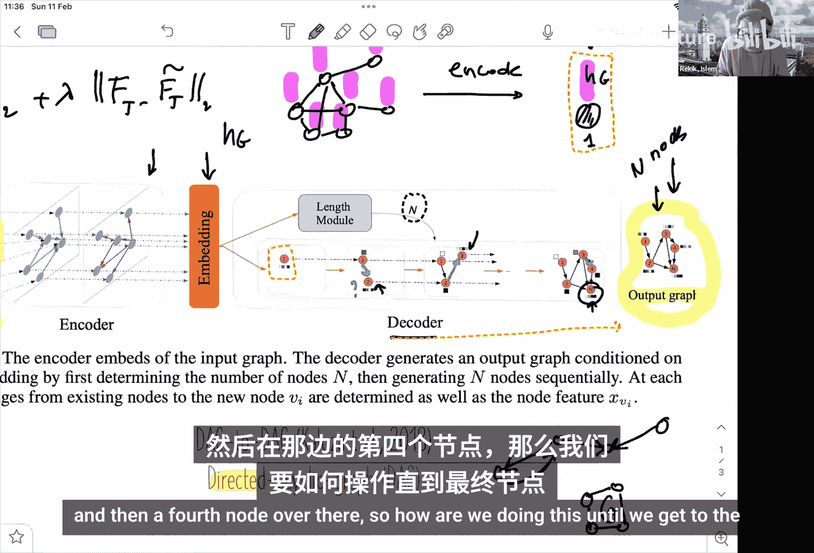

## 总结与思考

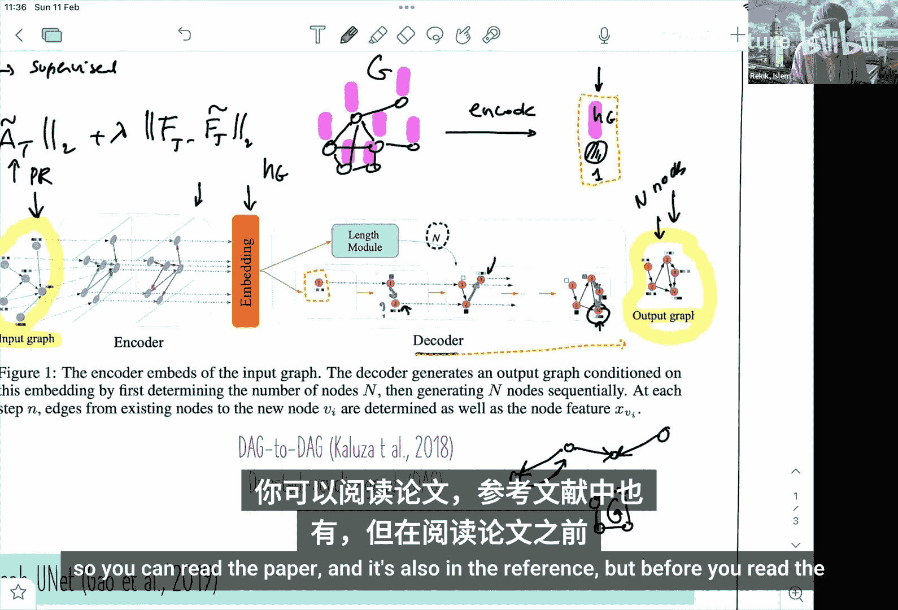

本节课中我们一起学习了基于图的监督条件生成。

*   我们区分了**无监督重建**与**监督条件生成**，后者利用配对的源图-目标图数据进行训练。
*   我们探讨了两种主要范式：**编码器-解码器转换**和**基于编辑的转换**。前者学习一个从源图潜在空间到目标图的映射，后者直接学习对源图进行编辑操作的序列。
*   我们通过**有向无环图翻译网络**的例子，深入了解了编码器-解码器范式的工作流程，特别是**图级编码**和**序列化解码**的关键思想。

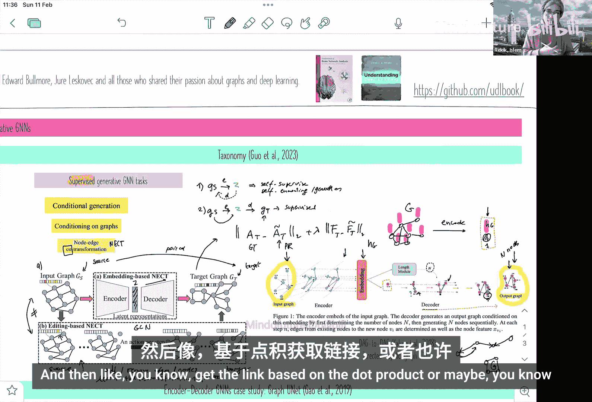

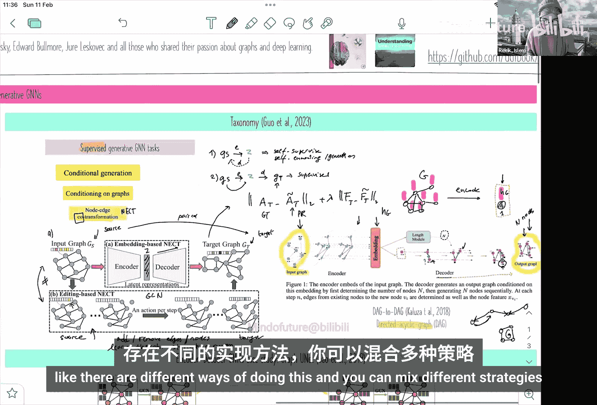

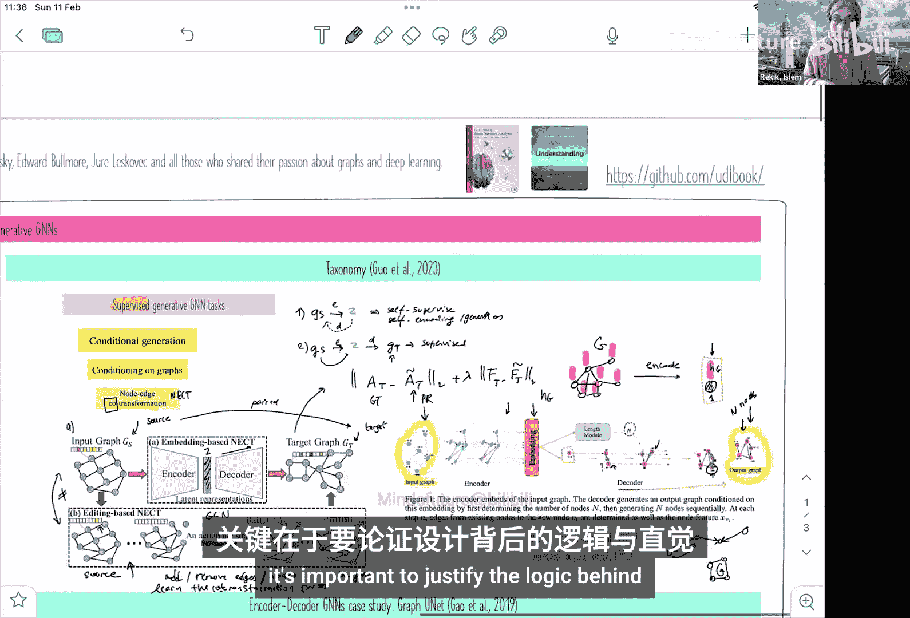

在进入更复杂的论文或实现之前，强烈建议你拿起纸笔思考：如果你来设计一个图条件生成模型，你会如何形式化节点和边的生成顺序？如何利用我们学过的GCN、池化等知识来更新状态并做出预测？这种主动思考将极大地加深你对本课内容的理解。