# 【伦敦帝国学院】深度图学习 ｜ Deep Graph Learning p02 P02_1.2_图矩阵——从拓扑结构到韧性分析 -BV1WZUKBmEQA_p2-

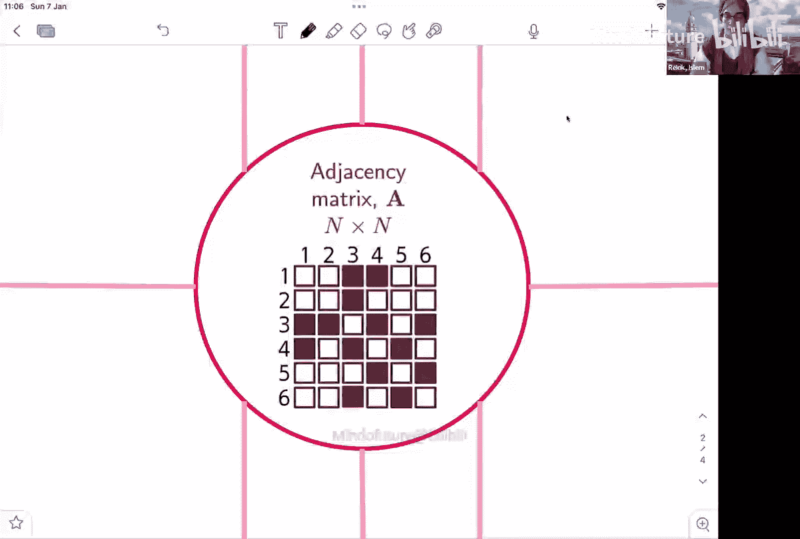

So the adjacency matrix it presents the heart of the graph so here we will discover different properties of the adjac matrix and also try to kind of diagnose it so when does it become kind of you know less resilient text how can we diagnose the adjacency matrix how can we know and extract the properties of an adjacency matrix and let's start with the first simple property which is as I mentioned earlier the first part so we had a directed undirected graphs weighted and binary graphs and here we'll see that a an undirected graph is actually has a symmetric matrix so。

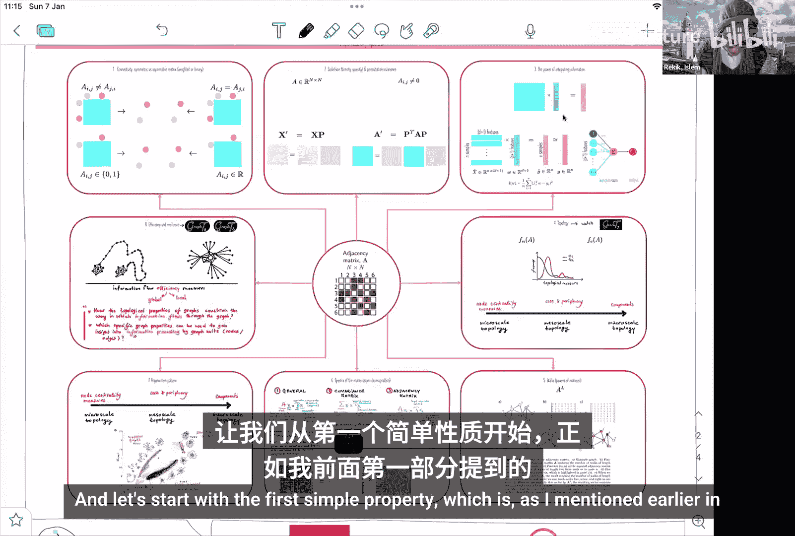

For example， in this case， let's look at。This， you know adjacency matrix a so this is our adjacency matrix and we have。

Two pairs of notes， so this is， you know， note call it I connected to J。And here J to I right。

 so these elements， these two elements are actually symmetric。And you can see that， when we have。

AI J equals a， you know， J I。 It means that our matrix is symmetric。

 which means these two weights are the same， which implies that we have only a single edge here。

 So we have an undirected。Graph and the value inside so we're going to put a value inside so let's put for example。

 for example， I know like 0。1 so we have a 0。1 right here okay so on the other hand we can also have what we call asymmetric matrix so asymmetric matrix so these are the block diagonal or the diagonal elements so the diagonal elements。

 all these if we have selfconn so let me just remove this so if we have selfconn which means the note is connected to itself it will be one it will be for example one if you know we don't have selfconn we don't consider these edges so it will be a zero okay so it depends on whether we consider selfconn or not whether we have you know a simple graph not a single graph but that's just a note on the side now let's go back to our。

Our original problem， which is， you know， is this matrix symmetric or not， so in this case symmetric。

 the matrix is not symmetric。Okay， so A IJ is different from AJI so if we take these two elements right here。

 so the first element we can have 0。1 and the second 0。 for example3 and you can see that from。

This is I， J， so from I。To J。 so if we put this is I and this is J， so the value here is actually 0。

1， so it's this value。And then from J to I， the other way around we have a thicker connection。

 which is of strength or connectivity weight， 0。3 Okay。

 so this graph is directed so in this case we have a directed graph so when whenever we have a matrix that is a symmetric it means our graph is directed。

And when our matrix is actually symmetric it means our graph is undirected and now let's look at how this manifests the problem the second layer or the second question is our matrix weighted or binary our graph weighted or binary so when we have。

 for example a bunch of zeros and one so which means if two nodes are connected we're going to put one so the weight is always set to one whenever they are connected and if they are not connected for example here we can add another node and you can see that these two are not connected。

 the pink and the white so we're going to add the white here it will be zero over there okay so because they are not connected and so this is basically how we define binary matrices so binary matrices have only zero and one and of course the matrix is symmetric when the graph is undirected and。

Asymmetric so here actually when you have so that's another question so let me ask you can we have。

 for example， a binary matrix that is asymmetric so I want to think about that in a bit。

So that's a very important question here so whenever so here。😊。

You can have a sense of directionality so you can have a binary matrix and say my matrix is binary。

 I only have zero and ones， so in this case you can see it's undirected okay。

 but we can add directionality。For sure that's not a problem okay so this is also a generic case so you can have for example I and J so if you say I and J connects in this direction so you're going to have one here and then when you put the J over here and the I the connection between them the opposite direction is missing so that's a zero。

Okay， so here you can have binary symmetric and asymmetric matrices and you can have the same of course when you have weighted weighted matrix it's a more generic it's a generalization of the binary so this is a weighted matrix and this is a binary so in a weighted matrix AIJ can take you know any value okay so here for example we can put negative 5。

1 and here well have our connection。If it's undirected negative 5。

1 and here it should be symmetric negative 5。1 if you put the same elements over there okay so so these two are symmetric with respect。

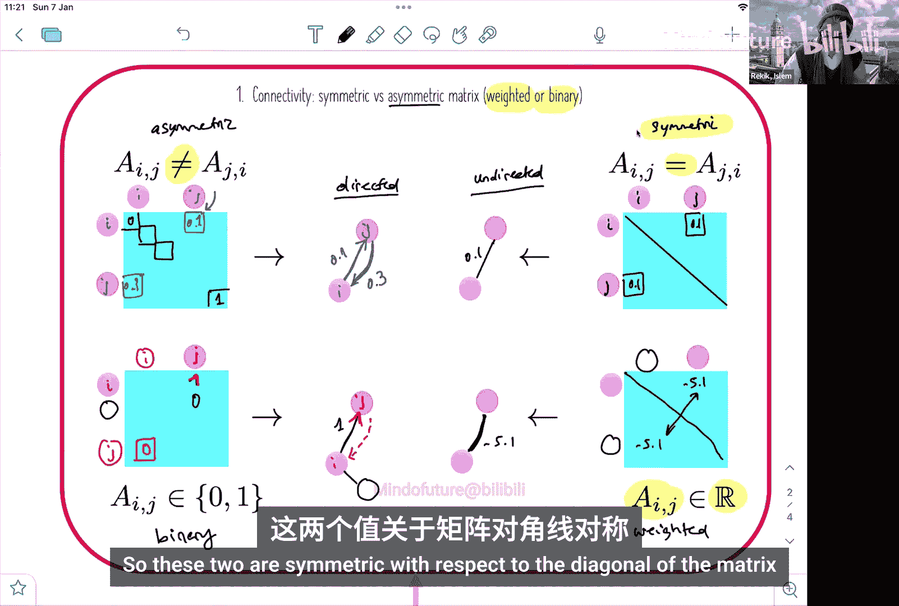

To the diagonal of the matrix， all right so。Now we have seen the first time now let's move to the second you know like。

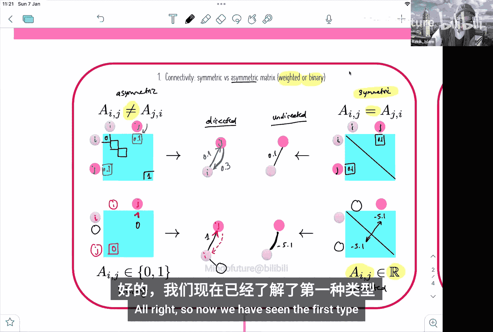

The second property here， so basically this is actually very there are two things I want to。

Present here the first thing is the scale or the size of the graph the concept of density and sparssity and the second concept is permutation and variance which is a very important property of a graph so the scale or the size of you know a graph is encoded in its matrix so when we have a matrix an adjacency matrix like this。

Okay， so there are two things here， there is the number of nodes。which we can denote also as V。

 the cordinality of V and there is what we call the number of edges and we can count is's the nu zero elements in a and you know if we call this E so it's basically that the size of E so so in this case the a defines what we call the scale of the graph。

So the scale of the graph is encoded or is represented by the number of nodes。

 the more node the larger the graph， the more edges。

 the more the denser the graph we can also you know look at how many edges we have so if we have for example if 90% of edges of the edges of E is zero。

 then we call this a sparse matrix more than 90% so more than 90% tell around more than 90% is actually it means that we have loads of zeros。

 lots of zeros in our matrix so our matrix becomes sparse which means we have sparsity we have lots of zeros inside the matrix that's what it means So when the matrix on the other hand we have you know loads of connections we have for example。

You know many dance connections in in in a so it means that here our matrix is dense so we have so this is。

 you know， just in a very naive way so this is how we define it so one is parse and one is dense so the next one is basically when we have you know。

 as I mentioned when we have non zeroro elements， this is the this gives us the。Number of。Edges。

In a okay， so there are two elements here when we look at scale notes okay， so the node size。And。

The edge size。All right。

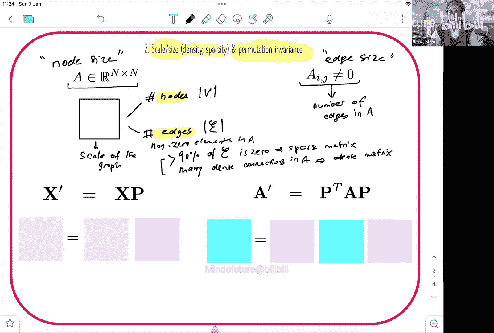

All right so basically the sparsity and the density are very important properties of a graph because you know if you want to examine the connectedness of a graph or the diffusion of information along the graph it's important to kind of quantify the number of question the number the number of edges connections and also examine the number of nodes that we have in the graph okay so as these number increase it means that we have a huge graphs we can have graphs with billions of nodes and edges and computations on those graphs becomes very challenging and we will see that towards also the end of this series so now we will look at an important property of graphs which is what we call permutation invari okay so permutation invaris it means when you have nodes so let's say for example I'm going to draw an example a simple example here for you guys to understand so let's start。

Story with this kind of simple graph， so we're going to start with one node one。

Two and three okay so it's a V graph so maybe I should do it in the other way。

 so let me just do a v graph so we have three nodes here。And let's duplicate these three。 Okay。

 and we're going to create。An adjacency matrix of three by three okay。

 so it's a three by three matrix。And in this case。And this matrix， okay？So we have one，2，3，1，2，3，1。

23 okay and then here we'll see that let's fill this matrix first so this matrix of this graph so we don't care about the diagonal so we're going to look at one to so one is connected to three so we have01 and here it should be some matrix so we have 01 over there and then two is connected to three so that's our adjacency matrix now。

We're going to change the ID or the indices of the nodes so we're going to put32 and one and this is you know321 so basically I change the ID of the nodes and I'm going to put here or maybe I will permute them completely so I keep I'll keep them the same but I will permute them in a row so I'm going do some permutation or switch them so here let's do one23 but I'm permuting here so you can guys you see that I can change the indices here or I can change them there so there are different ways so I can keep you know one to three here and scramble or switch the rows here so permute basically the rows so I'm permuting two with one and keeping three。

So this is you know one possible permutation that I can do to my matrix and what happens when I do that so if I do this permutation here of the indices of the rows and the columns okay so I permuted two with one I switched them so let's look at the topology of the graphs so two here。

2 is connected to3 so we have001 okay and we have here three is connected to 111 so in this case we have the same kind of matrix right here but we can do it also differently so we can you know like switch basically the number because we have symmetry in this graph so that was kind of lucky but you can try different examples。

 the matrix can change if we change basically the connectivity there so if we have complex graph and we change the type the we permute the indices so we use something completely different so three to one and I'm going to do one to3 like this one23 so in this case one is connected to2 and three so one is connected to2 and3 so11 and here one1 and two and three they are not connected00 so what happens here you see that we have completely。

We have a different connectivity matrix， okay， so especially in these highlighted elements right here because we did this kind of permutation all right now。

So we have a symmetry in the graph that's why the first example was very unique we got the same matrix。

 but this is a better example， so here you can see that we had a different adjacency matrix although the adjacency matrix is not the same and has been permed right as the graph remains the same okay so these two adjacency matrixes they encode the same graph so both of them are correct okay so that's why we say that graphs are permutation invariant so graphs。

Or per mutation。Invariant because every time we change the indices we randomly assign these numbers and we get a different matrix。

 we may get a different adjacency matrix， but we will get the same graph so which means these two matrices right here they encode exactly the same topology the same topology okay so here in this example this is called permutation so how do you permute a matrix so it's very simple。

So you take a matrix x and here if you want to permute， so for example， for every single row here。

 if you want to permute， for example， node I and J in this matrix P。

 you need to put one here and the rest。You set it to zero。 Okay， so that's called a permutation。

 So this is。A permutation matrix and this permutation matrix is's a matrix where exactly one entry in each row and column take the value1 and the remaining are set to zero okay which means in each column each row you're allowed to put only one so that's a permutation matrix which means you're permuting or you're switching okay note I with note J after the permutation so here all these guys should be also zero because you're setting only the element ij to one in this case Okay so here we map from one indexing to another。

 So through this multiplication we change。The indexing。Of notes。

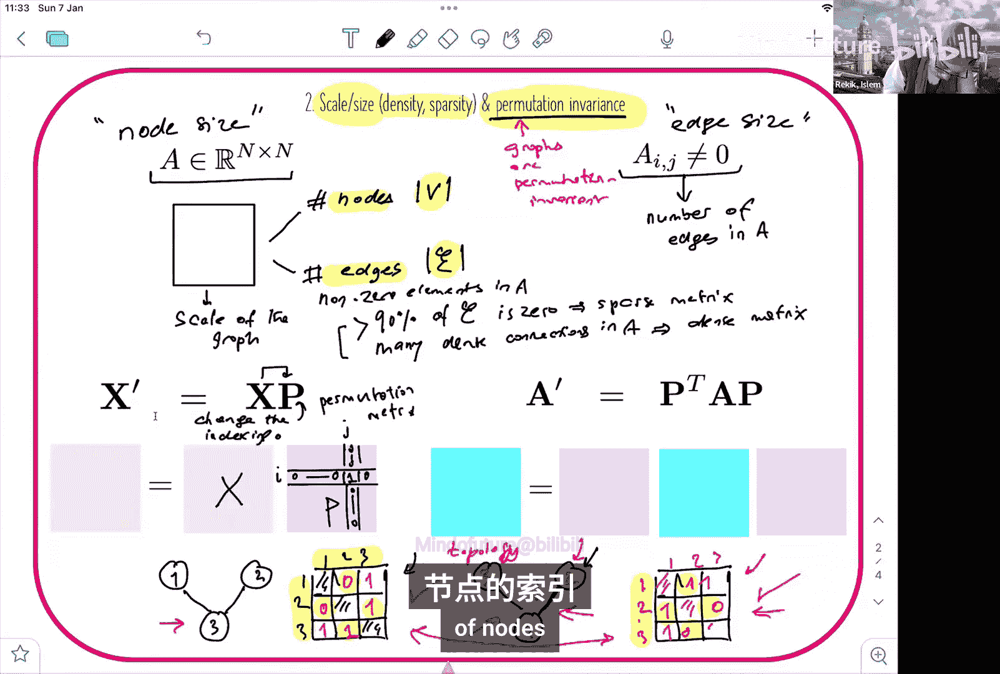

So what it means after this multiplication you get XI you guys can play with it， by the way。

 I strongly recommend that you take you know pen and paper and you draw a small symmetric you know undirected matrix and you create your P and you try to flip your graph so for example if we have a graph like this so this is our graph。

Original graph， okay？And let's say this is my I and this is my J so when I multiply by P this P imagine that everybody is zero everybody else is zero so when I do the flipping here it means I'm permuting only I'm switching only I with J so after the permutation I'm going get x prime and an x prime I will have the new connectivity of course patterns need to change things need to change around but we're getting basically we're flipping you know J will be here and sorry J will be here and I will be there so we need to kind of predefinine the structure based on the topology or the connectedness that we had before okay so after this permutation you will see that x prime will maintain the same topology so we have same topology as x but we have permuted or kind of you know2 rows here which are。

R NJ all right so we're kind of did a permutation of these connectivityivities and rows and also we need to think about the columns I andJ all right so you can also think about this。

 you know we can have。

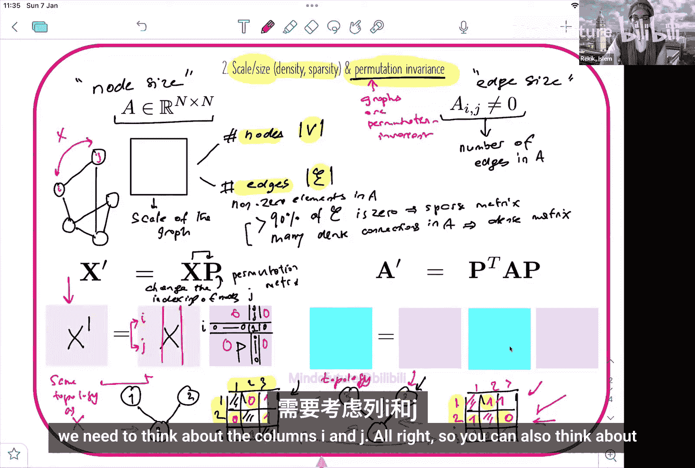

If you have a matrix with different dimension so if your matrix is not necessarily symmetric you can always you know map and map back so here this is getting to get another you know a matrix a prime so this matrix a prime basically allows us to go from the permuted version and then to permute back so we should get actually a similar matrix here so this is P transpose we're transposing the permutation matrix so we're applying it here we're indexing and reinexing back again so with this permutation we should get a prime and this allows us to kind of restore the matrix okay so and now let's move next so next we have a very interesting。

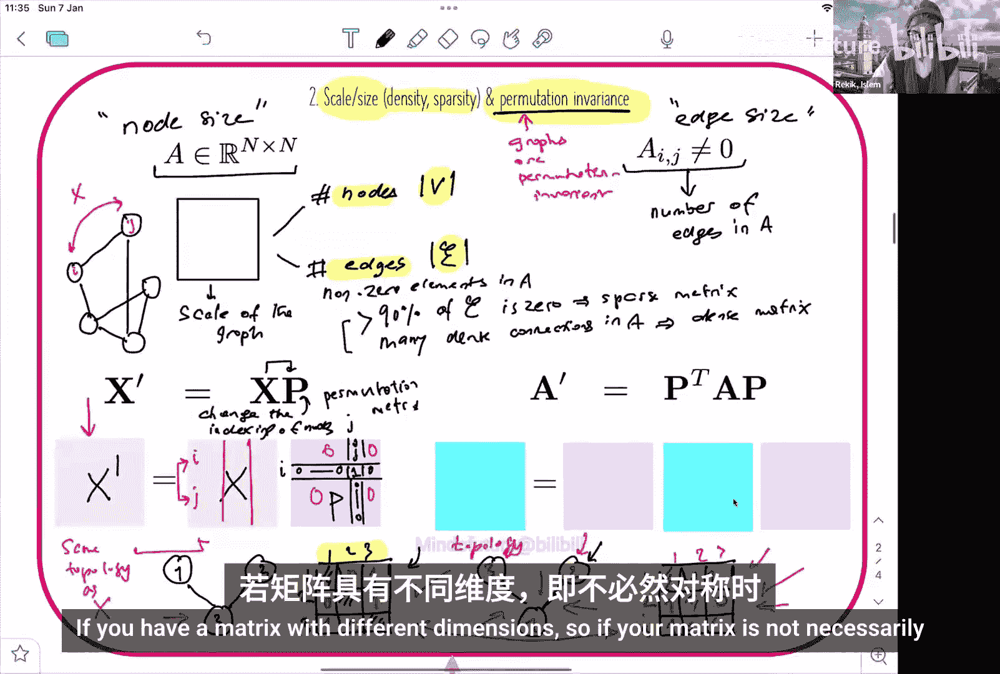

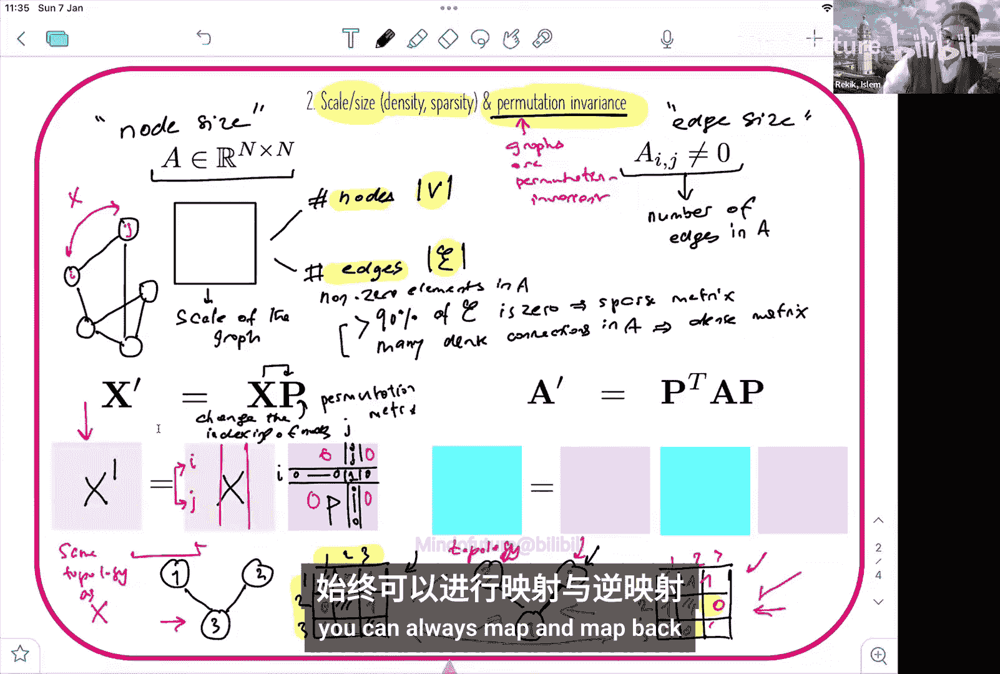

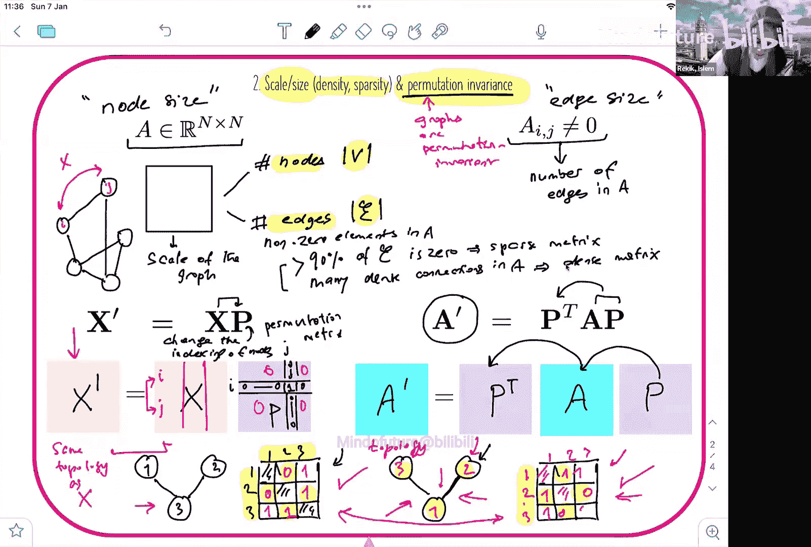

Concept which is the power of integration so so far we have seen two points。

 so we have seen connectivity symmetry weighted and binary matrices。

 the importance of the scale and the size of the matrix nodes and available or existing edges permutation andvari of the graph which is very different from spatial images because if you're working on images we have。

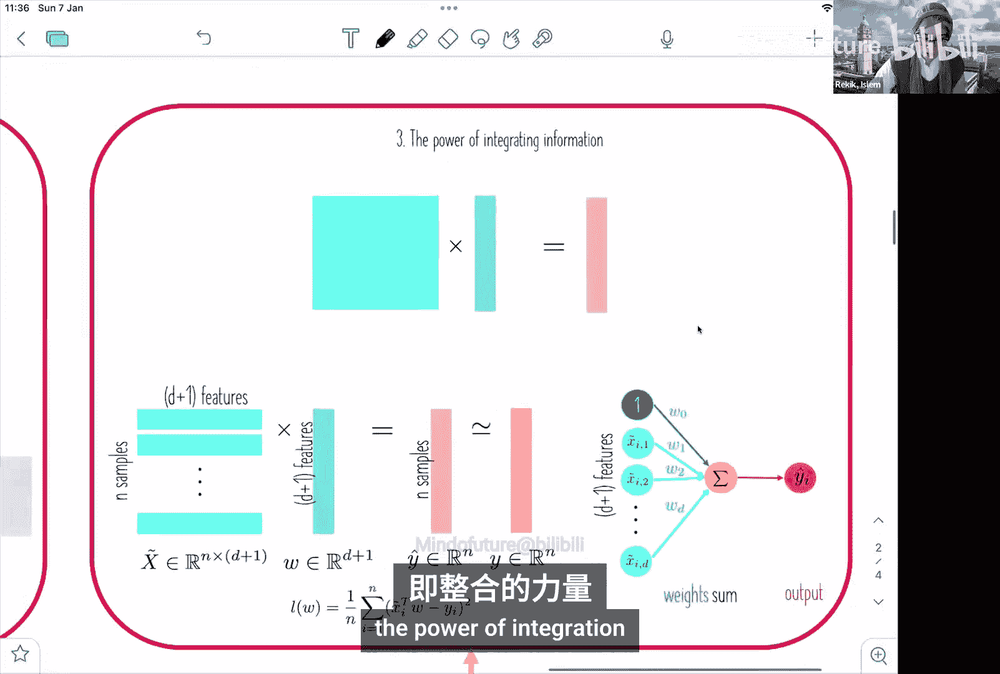

You cannot do permutation of you know you cannot flip or permute these two pixels and still get the same image so if you apply a permutation here you're going to have a puzzle right so you cannot apply this to what we call spatial images permutations do not apply to images but they do apply to graph which is really nice property to have and now we will look at the power of matrixrices so the power particularly of linear algebra and a matrix multiplication by a vector so by multiplying a matrix so let's say here this is our adjacency matrix we will you know multiply it by V and after we multiply it by v we will get an output vector let's call it for example here well for the sake of simplicity let's call it y and。

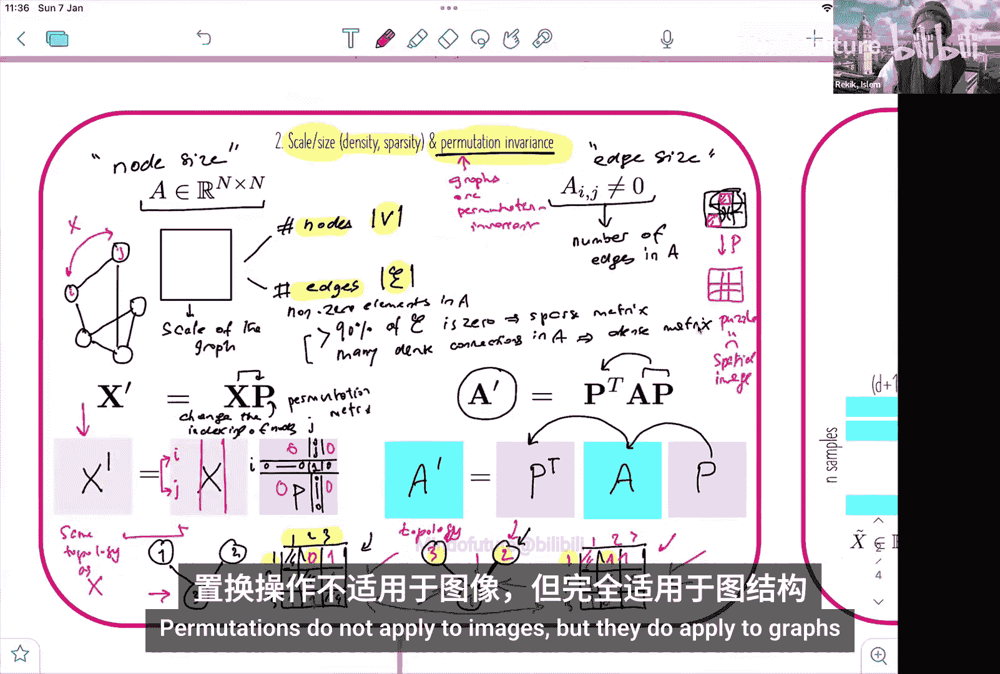

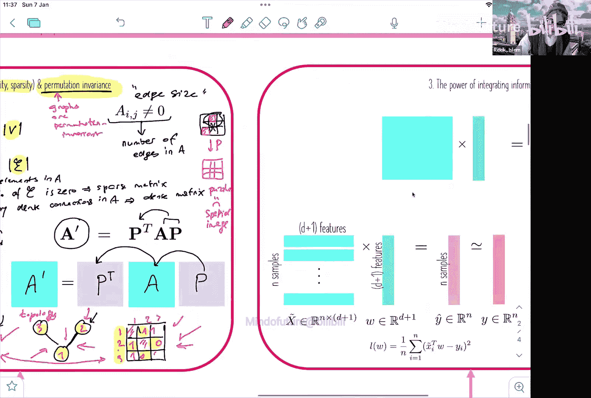

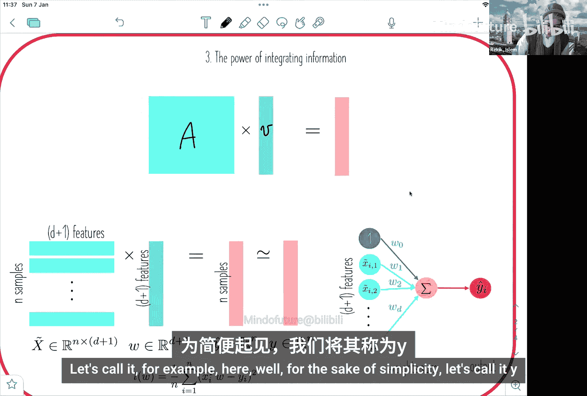

What happens in here is that so I wanted to focus on the top part， we have our n by n matrix。

 we multiply it by n by one vector and we get an n by one app。

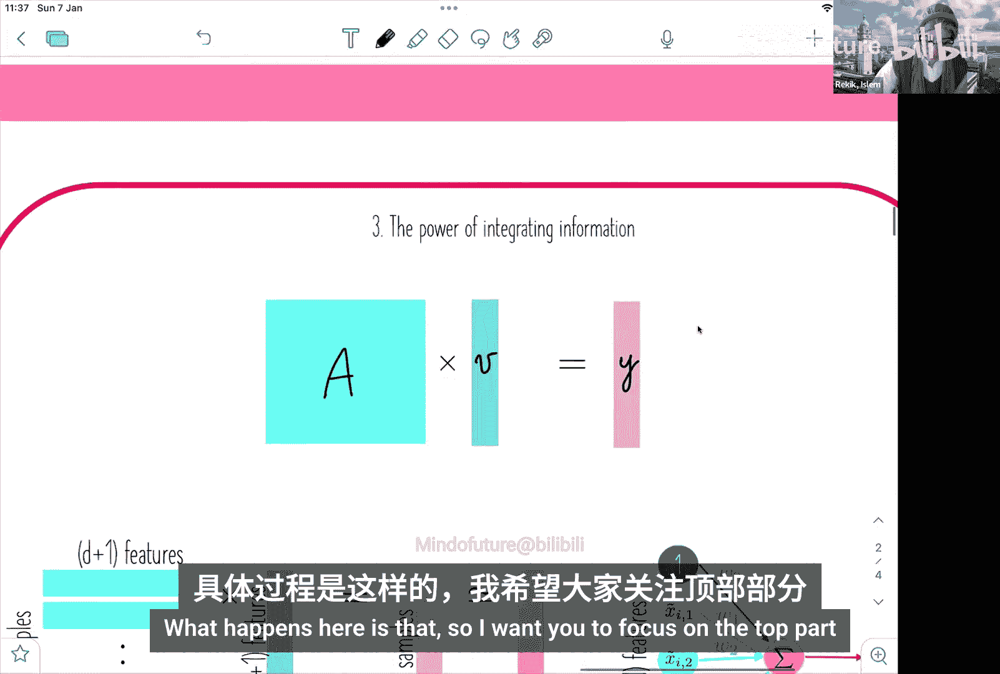

So every time you do a multiplication， we are leveraging what we call the aggregation power of a matrix。

 so this multiplication right here， which is by the adjacency matrix， it allows to aggregate。

And integrate。Information。Along each。Note。And it local neighborhood。Okay。

So let me explain that so every time you take a node， okay， so let's say this is node I okay。

So this is my node I and let's say this node I is connected to only， for example， four nodes。

 all right， so it's connected to only four nodes。Let's say these are the nodes and the rest are zeros and what we do when we do this multiplication I have a vector I have an input vector here so this input vector will basically gets multiplied by this you know the horizontal row right here and what happens is that I'm going to only keep it's a weighted sum I'm going to only keep the value zero so if the rest are zeros right so we have zero0 and bunch of zero so zero and then zero we have I'm going to put one1 so just a bunch of zeros and one so let's replicate that so when you do the multiplication right so all these values right here we' become zero so we don't care we will completely remove these values and do await weighted sum so the way to think about this is that every time you take an element and you multiply it you know by the。

Conectivity weight of this note I somehow I' calculating。Awated。Local。Averaging。Of the。

By n of I which is the neighborhood of I which is very powerful so think about it i'm looking at my vector all these values and i'm calculating a you know i'm trying to get the value here V sorry Y I the output yi so this element is calculated as weighted multiplication elementwise multiplication and sumation of each of these elements in V and each of these elements in my adjacency matrix so somehow I am integrating information along the neighborhood by taking this V vector as as as a weighted vector okay so it's actually a very nice thing to do which means you know every time i'm looking at V i'm looking at with the lenses calculating or。

Computing， the diffusion of V， so diffuse V。Across， you know， AI， okay。

 which is row I and then here we have all other elements， J， so we vary the J。

Number of columns and through this diffusion process I'm gonna to get a value here so this is my output and I do that again and again and again so for example。

 for another node here let's call it node k so node K maybe has only two neighboring node so11 and the rest zero so what's going to happen is that I'm going to multiply this vector by you know by the neighborhood of k and this will filter out all the remaining values so everybody here will get nullified it will be assigned 0 and I only care about these two values so I take these two values for example05 and 03 and here let's say we have two and6 so I do you know two times 05 plus you know six times03 so this is you know the first and the second connection so let's call one2 so12 right so this is the value。

That we're going to get where at the output so what did we do here we did an integration and information awaited information integration for this element here okay and along this vector so it's kind of this multiplication is very very powerful and you will see later how we will leverage it in GCNs and graph convolutional networks and learning how to embed graphs and nodes how to represent graphs how to do diffusion on graphs how to find the shortest pathways how to also do supervise and unsupervised machine learning task and I'm going to draw an analogy here it's a beautiful analogy and this analogy I would like you to look at。

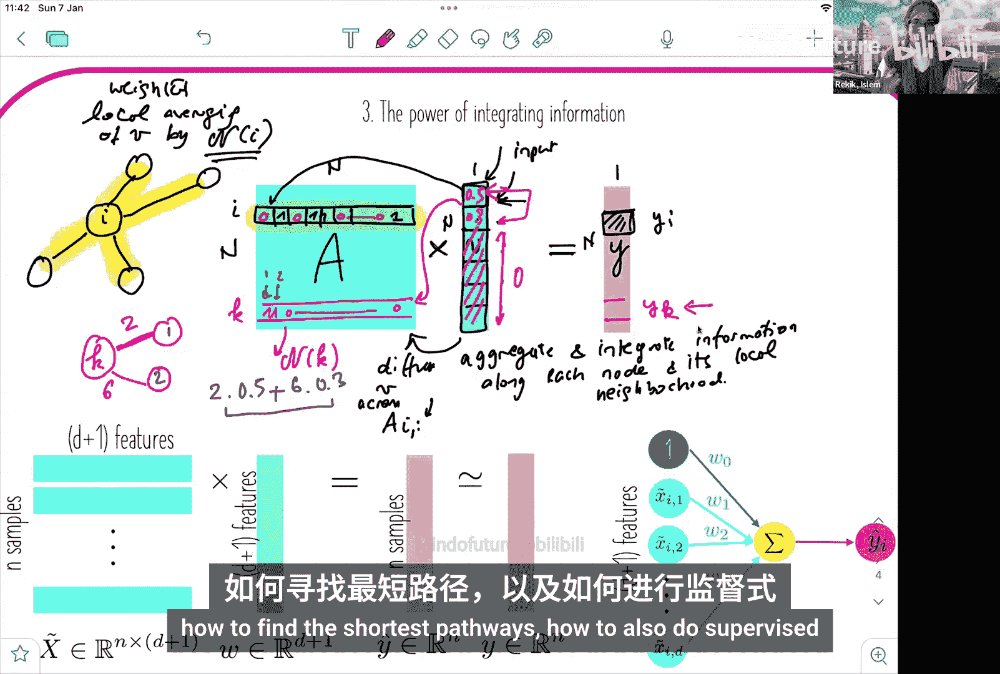

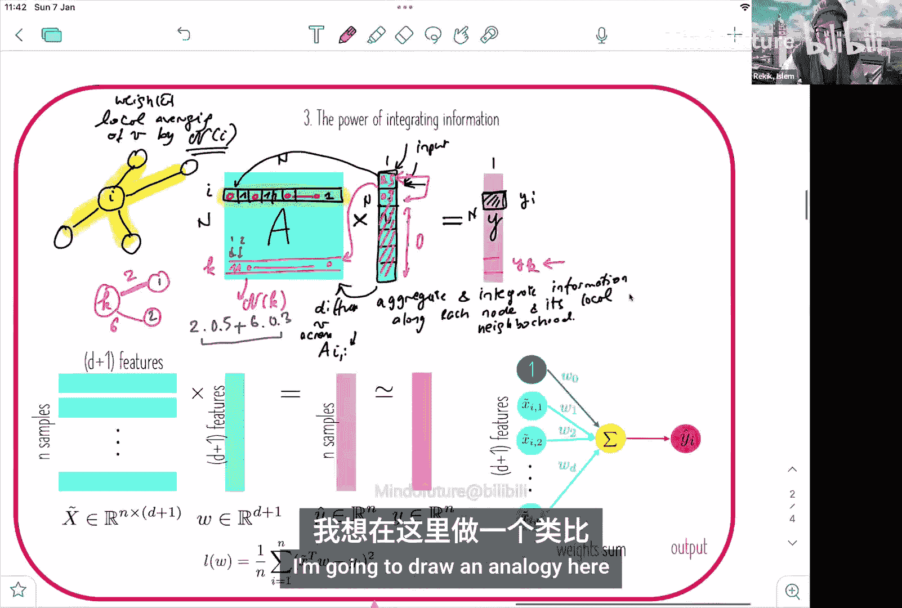

The the bottom part so what we have here is actually a very typical problem so we have a matrix so this is our a matrix okay so this is our matrix and then we multiply the matrix by the vector so we have a sort of an integration and information integration along the topology of this matrix the elements all these you know the rows of this matrix of this input you know vector right and then we're going to get an output and how we formalize all machine learning tasks you know we have seen in the deep learning series is that all machine learning task can be formalized as a matrix vectorization and this is for example。

 a simple linear simple regression model so what we have basically we have our matrix x and when we multiply x by a learned weight so the green vector becomes now the。

The ways that we want to learn。So this is what we want to optimize。

 let's say to optimize okay so we want to estimate this W the x is the input data that we have so that's you know our input it could be the input graph here it's the input training data so we have n samples each sample is represented by D features okay and by mapping the samples via the learned weights so each one at a time through this projection or this mapping this also we call the integration step that we have through this multiplication we're going to get the y tilde and the y tilde is actually the predicted the predicted scores so if we're doing prediction so these are the predicted scores in this regression problem and what we want to have is we want to have these predicted scores very close to the ground truth one which is the ground truth vector so in this case we have ntrain sample。

We want to predict all their values and you guys can see that these two are very similar。

 so what we're doing is that in machine learning we try to learn this mapping W and if we learn it very well we can predict almost the same values here so if we have a class for example。

You know one here we can get a very close value0。8 and this 0。

8 will be very close the class1 so which means we predicted the label of this sample correctly here okay so this is basically also matrix multiplication and you can see that in this case we I summarize it using this computation this simple graph and in this simple graph what do we guys see so we see that first we have all the weights so also we can model this graphically so this can be modeled graphically so here we have our weights okay so we do the summation and we multiply them by the input so this is for every single input so let's say all inputs here have one so the first value is one so we have seen before that this is for actually the bias so if you guys haven't seen this before you can watch the deep learning series just or you know the machine learning also。

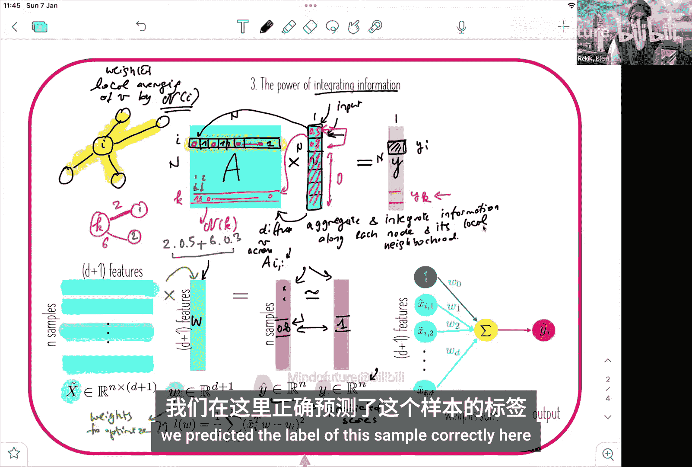

And any introduction to machine learning and linear regression course。

 so we need to have the biases and but what I want you to keep in mind that this vector。

Is actually this one okay it's exactly this one and by multiplying this vector by the weight so we're taking this vector we're multiplying by the way this is what happens here and then we're multiplying and summing so this is the vector matrix multiplication right and then we're going to get exactly this element that I was talking about earlier the Yi so this is our element right here and it is the predicted output of the the score that we want to predict so here this is what we want to kind of predict if we learn a good w our output Y I hat will be very close will be very close to Yi which is the ground truth you know output value okay so yeah so this is basically you know this summarizes everything and it's very important to understand the power of integration and multiplication matrix multiplication by vectors or bymerices。

or tensors by tensors because it's all about you can look at it as a diffusion process。

 as an integration process as a mapping or projection process through you know a learnable basis here a learnable weight W so all these words are the same。

😊，Diffusion。Integration。Projection。Of a onto， you know， for example。

 here we called it V or x projection mapping also。So all of these are。You know。

 they define the same phenomenon， okay？

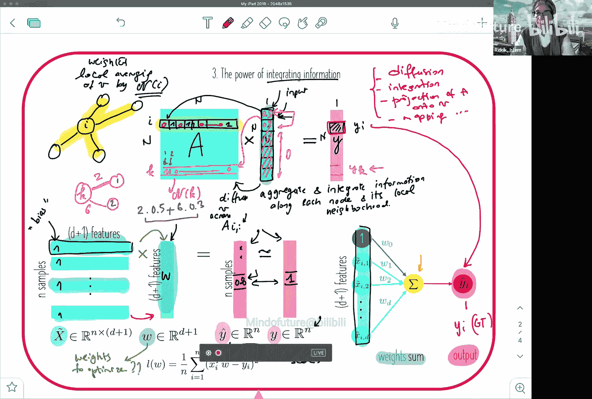

So the next or the fourth property is a very important property so it's topology so the adjacency matrix encodes the topology of the graph and here there is a full lecture lecture two of the graph theory series so I strongly recommend that you guys watch it if you're not familiar with centrality measures and like you know such as between the centrality degrees centrality。

 strength page rank agan vector's centrality so I cover all of these in detail in this lecture but today I just want to give you an overview or of you know like the importance of topology why is it important how we actually define it what is topological about the adjacency matrix so here we have we have actually different measures that we can define to identify or quantify。

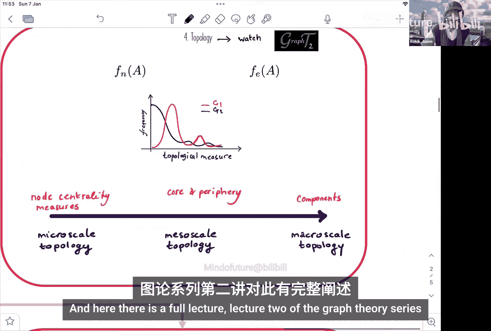

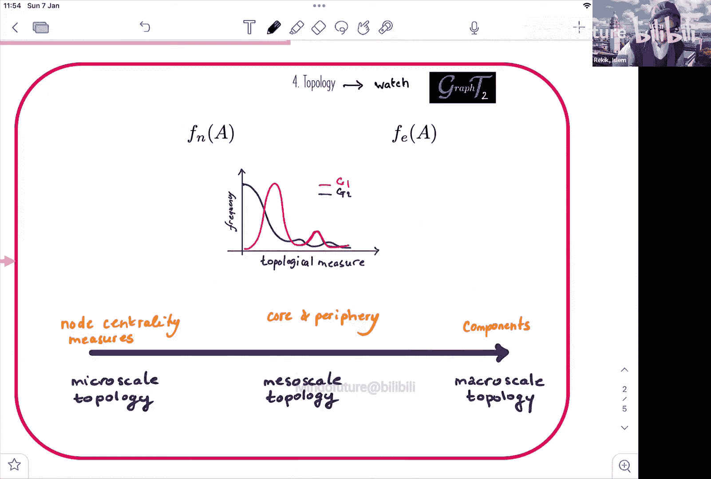

The topology topological importance of a node， so this is a function that quantifies。Okay。

 or measures the topological。Roll。Of a node N。 And on the other hand， we have also a， you know， F E。

 So F E here is a a。Function that allows us to quantify the topological role of an edge。

E okay the input is our matrix and we have lots of we have many centralities and measures that we can use for example。

 here degree centrality so degree centrality is very simple so we use it for binary graphs so you sum you sum the number of connections that we have for so here if we node I so for each you know for J in the neighborhood of I you sum their weights so WIj so here you can see this is the strength of node basically I okay or the degree let's call degree because degree we use it for binary graphs strength for。

For weighted graphs So D in this case， di is equal to three。

 so it's very simple actually so that's the degrees centrality。 so you can see for example。

 in star like graphs like so this is a star like graph the central graph is the most important graph right here So this is the most the central node that is highly or connected in this graph so all of these nodes have a degree of one except of this one has one2。

3，4，5，6，7，8 so it has a degree of8 this node Okay cool so now for the edge is the same thing。

 so let's say you have you know， a graph that looks like this。😊，Okay。

 and you can see that all the other edges， all edges are kind of。

We have a different distribution of edges if we want to identify the most important edge so what is the most important edge here So if you look at the whole topology sorry if you look at the topology of this graph at the patterns of the pathways you will notice that this is the most important edge because if I remove this edge I disconnect I fragment the two clusters or the two modules of the graph okay so this edge has the highest flow of information so to go from a to B I need to traverse this to go from any node in module1 M1 to module2 I must traverse or go through or pass through this edge okay so to visit any node so this is why this edge is a central edge and you can use for example measures such as between centrality for edges to calculate or to get a number actually to get a value that tells you that this has the highest for example。

 central between us。And the rest are you know quite small so these values are very small so once you do that you can somehow read the topology。

 you can read the topology of a graph somehow not read I wouldn't say the word read like you will kind of eavesdrop okay。

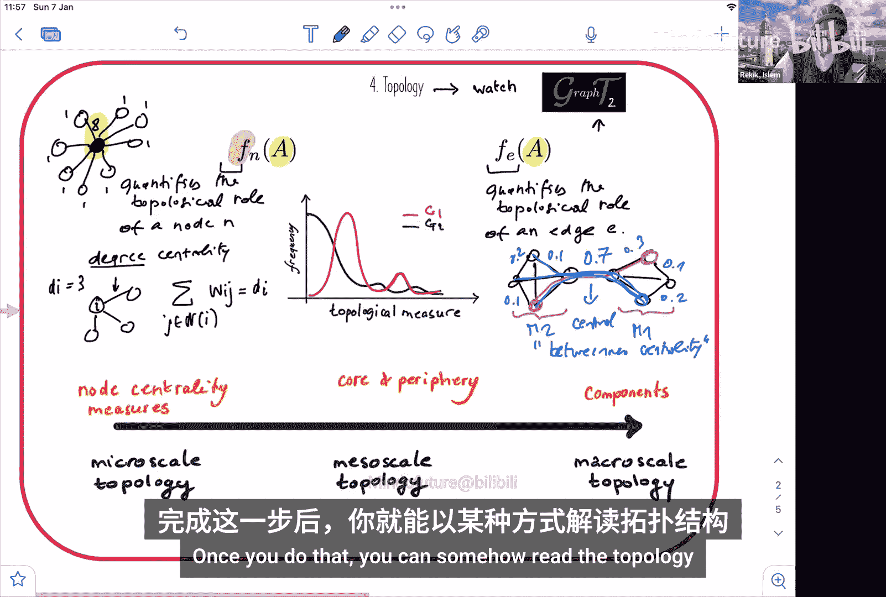

Eaves drop。On the topology。Of a graph。By plotting what we call the topological measure distribution。

 so it's a distribution that we are plotting here and it this distribution it tells you that for example。

Here there are very few nodes so in this distribution so we have the frequency how many how many nodes have this value this topological measure so if you look or how many edges if it's you know if we are plotting the topological distribution of edges okay so here we see that we have low frequency which means very few nodes have very they do have very high centrality measure because we are in this spectrum so very high and in this graph we see that a few a few nodes here so not few sorry many nodes so we have many a high number of nodes having a sort of a medium or low kind of centrality okay or topological measure so centrality is one of the topological measures just you know this is an example of course but what this tells us it tells us that well I have a few hub node。

sHere that are highly connected and the majority of nodes are equally connected and you can imagine the structure of the graph from this plot so for example here if I plot the edge centrality distribution of this graph so I want you to imagine that guys with me so here we have the frequency and you can see that for 0。

7 so 0。1 and 0。2 so you have a lot of edges that have this kind of these values right so you have a peak here but for 0。

7 you have only one edge so this edge turns out so it's only one edge which is this one the central edge this is the outlier this is the most important edge that we don't want to break so somehow this distribution tells me a lot about the potential structure of the graph okay so in terms of topology we looked at two。

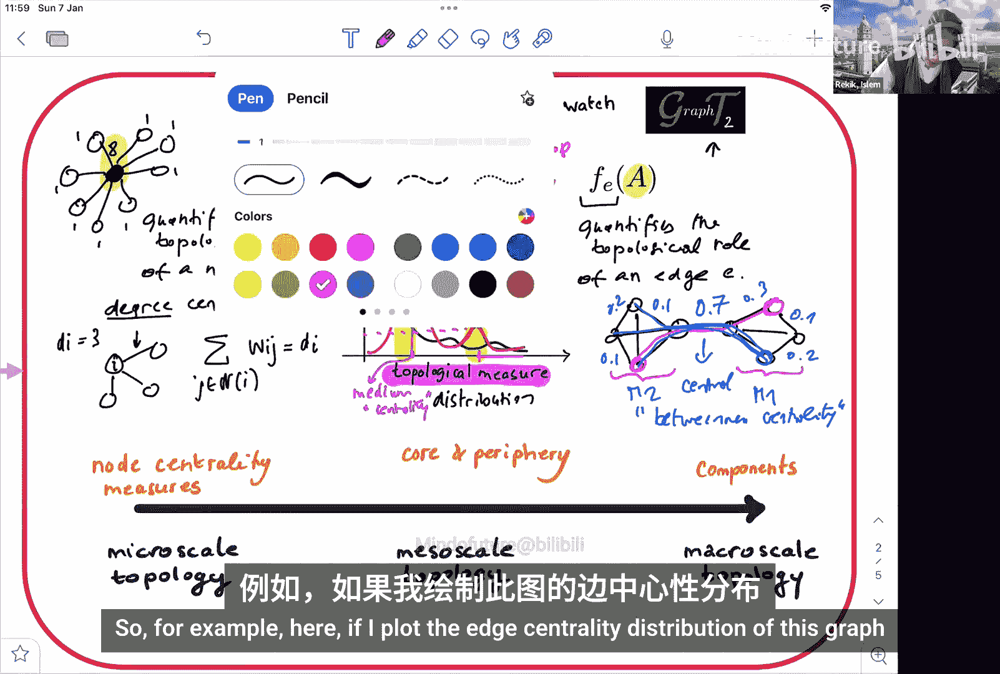

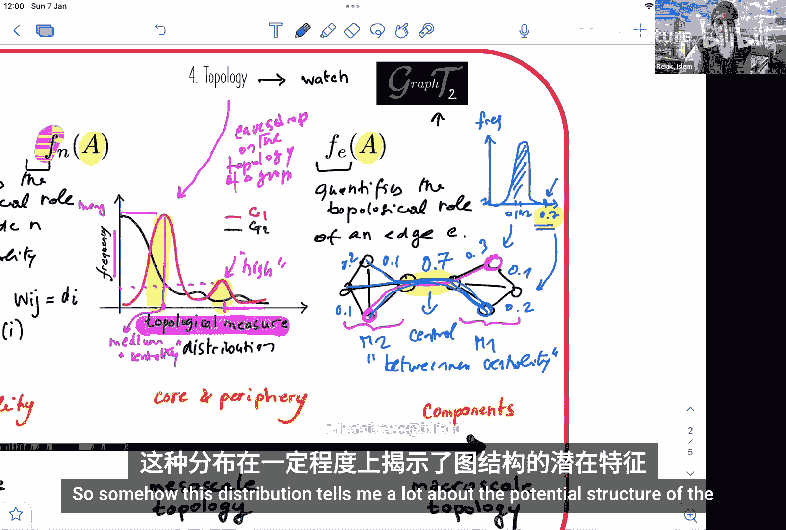

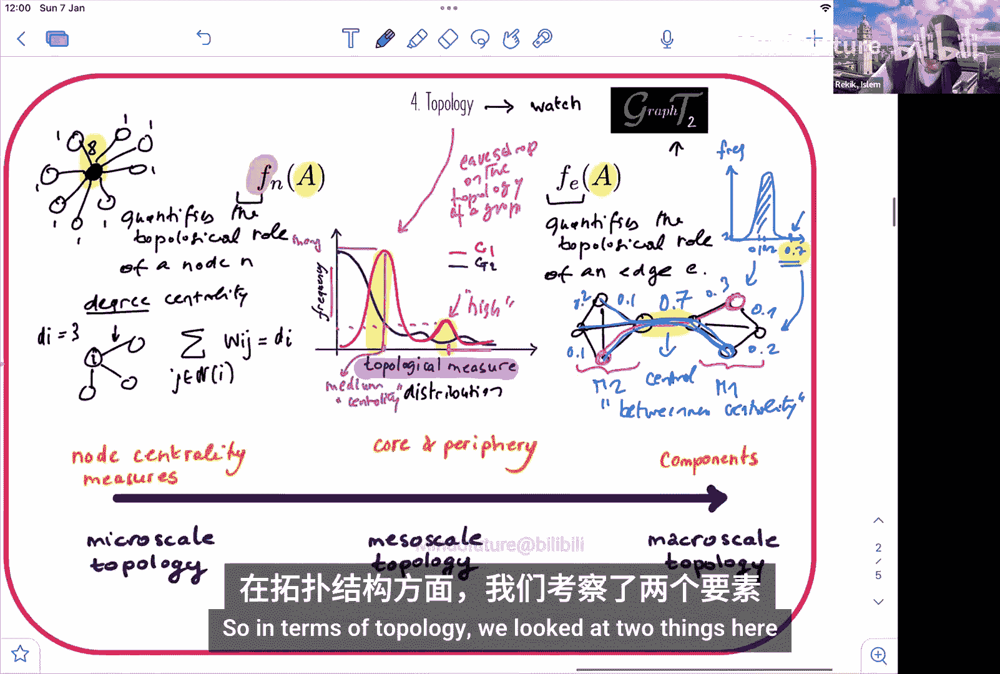

Things here we looked at the nodes and the edges， but this is a very reductionist definition of topology。

 Actually， this is what we call the microscale topology So when you look at the microscale topology。

 you look at both edge and node centrality measures okay but when you when you go you know when you increase the scale we go to the mesoscale now we look at the organization of the graph So this looks at the organization of different structures in the graph So we find。

 for example， a core and periphery structure So we will see this in a bit we also if we go also scale a little bit more so we discover or we the microscale okay so at this scale we look at the big components in the graph it's not just the meso or medium structures that like you know the global。

of the graphSo you can see that there are different measures and different techniques and methodologies to read and understand or pin down the topology of a graph at a micro meso and macro scales。

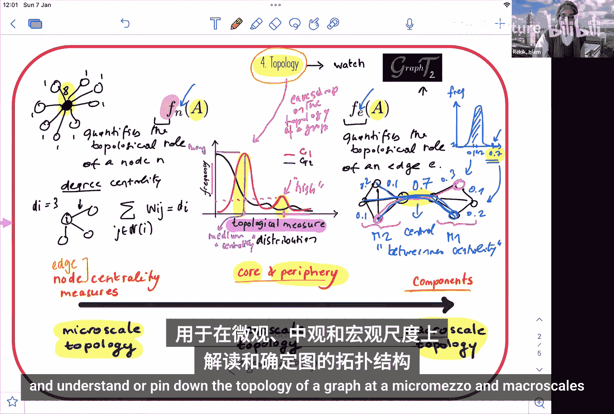

Cool， so next I'd like to cover and find the walks or the powers of matrices。

 so this is actually a very。

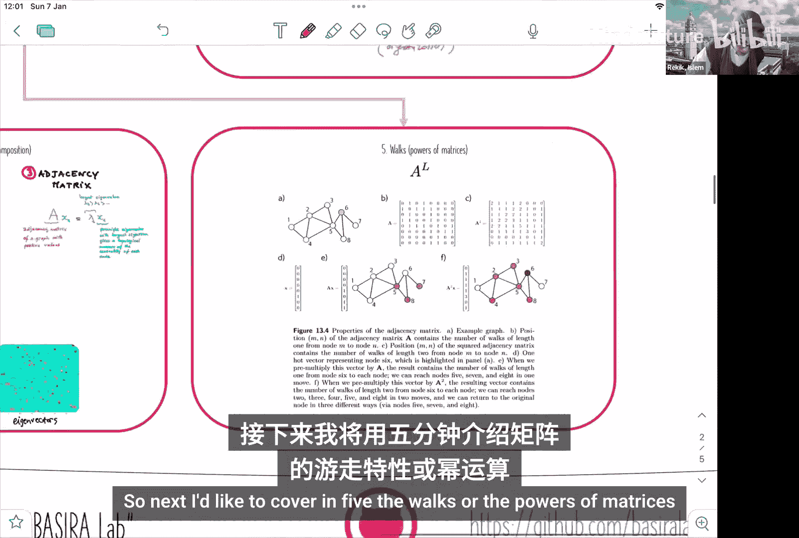

A very powerful you know part or property I would say of the adjacency matrix so so far we have seen that matrices have the power of integrating information we have seen that matrixrices have also they tell us a lot about the topology so if we feed the matrix into a function that measures are quantifies a topological measures we can derive distributions based on those distributions we can understand the structure of the graph and now we look at the power of matrices so when you raise for example this matrix to the power of L so raising this matrix to the power of L what does it tell us about you know the graph itself or edges and nodes in the graph okay so let's start with with a here so in a we have an example graph so this is a simple graph and then in B this represents the。

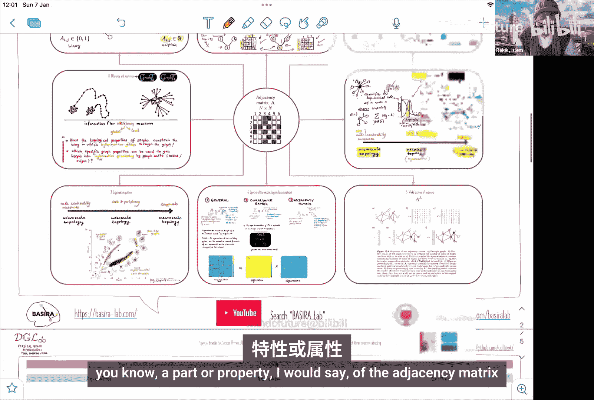

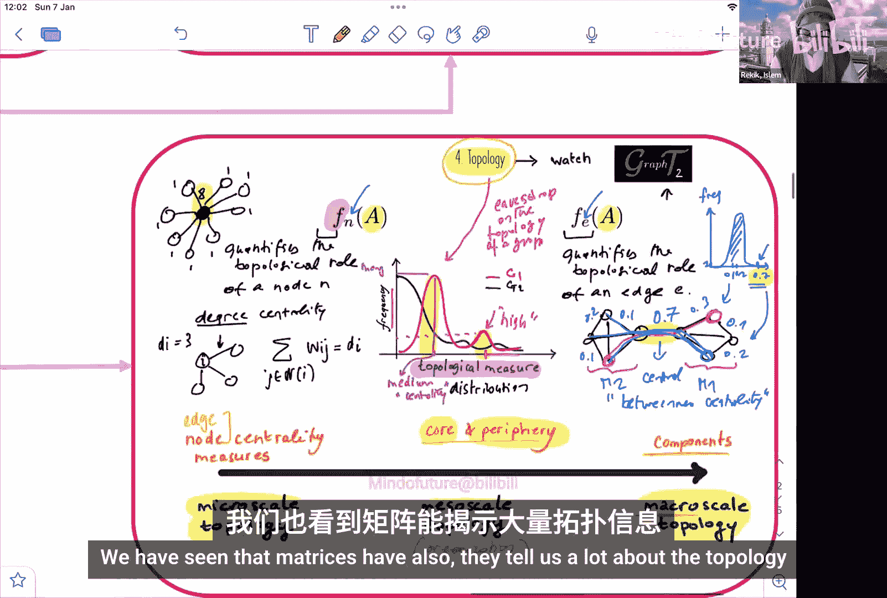

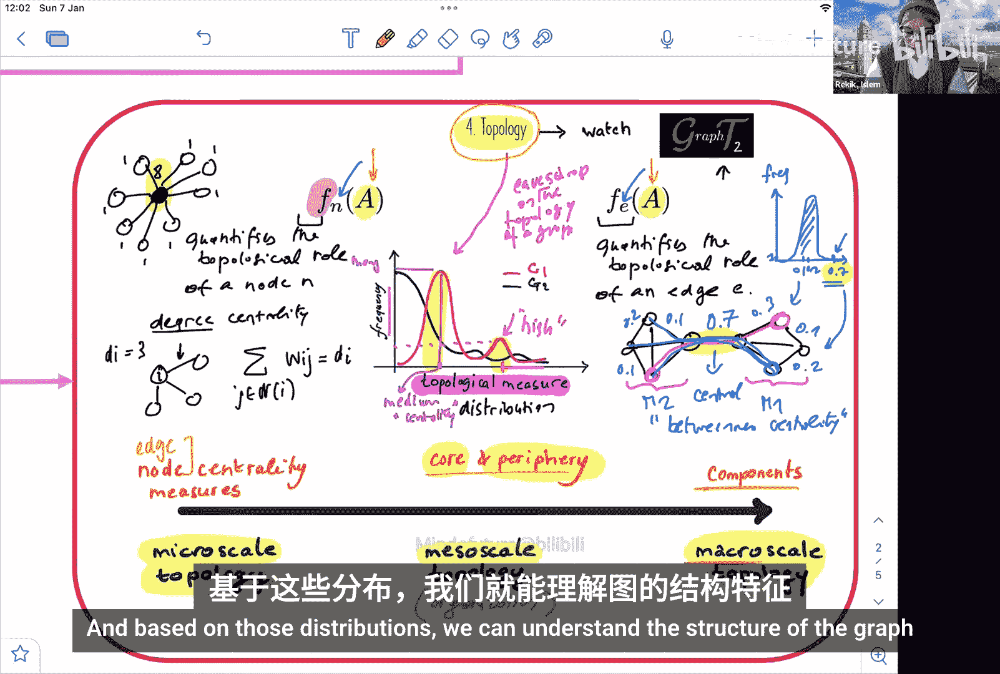

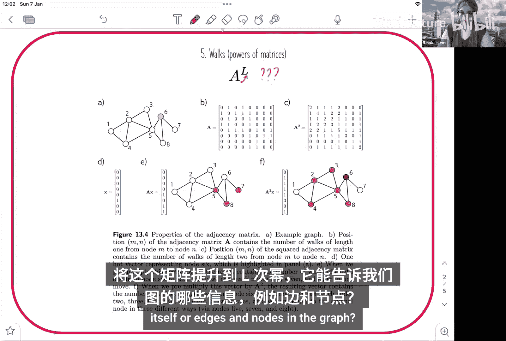

AGency matrix a that contains the number of walks of length one from node M to node n okay。

 so this a is actually。It's our adjacency matrix， this is the regular。

 so let me use a different color。😊，So this is our regular。Adjacency matrix， okay， adjacency。

Matrix so this is what we had before so if you look at this graph so you encode it directly into this matrix it means we're we're only measuring or recording in this matrix the connectivity between for example node you know one and two are connected so these edges right and this is what we call a walk okay of。

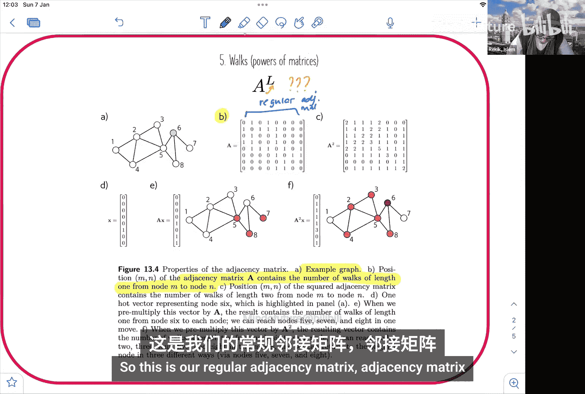

Liength。One okay so you walk from one node to the next node and the length you know to a target node so you walk from a source node to a target node and the length of the walk is one here so this is considered as a trivial matrix so because it contains what we call the number of walks or edges here of length one from pairs between pairs of nodes so now let's look at the third case so here's C so when we raise a to the power of two so we raise a to the power of two you take just you know you do a times a right so that's a squared and you get this matrix so you just calculate this matrix and when you calculate this matrix we have a beautiful property here and you guys can verify it so I also gave a full lecture on this so in the graph theory series but here I'm just covering the basic concept so you remember how we define or or find walks between。

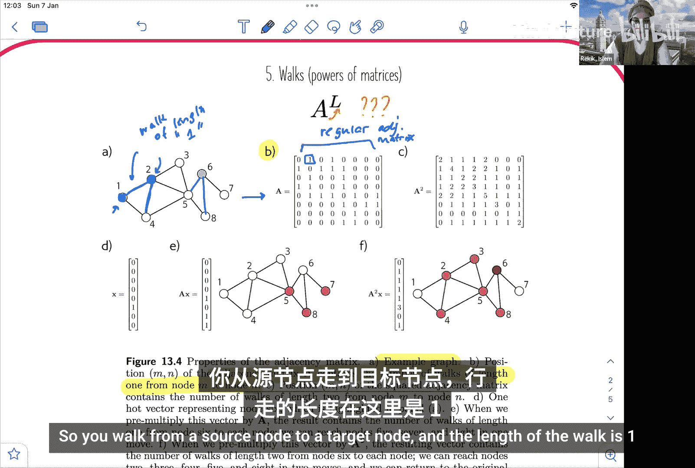

Pairs of nodes using you know the the power of matrices so here in C we have the square adjaency matrix which so let me just use this smaller okay so which contains a number of walks of length to from node n to node end so from from one node to that another so for example。

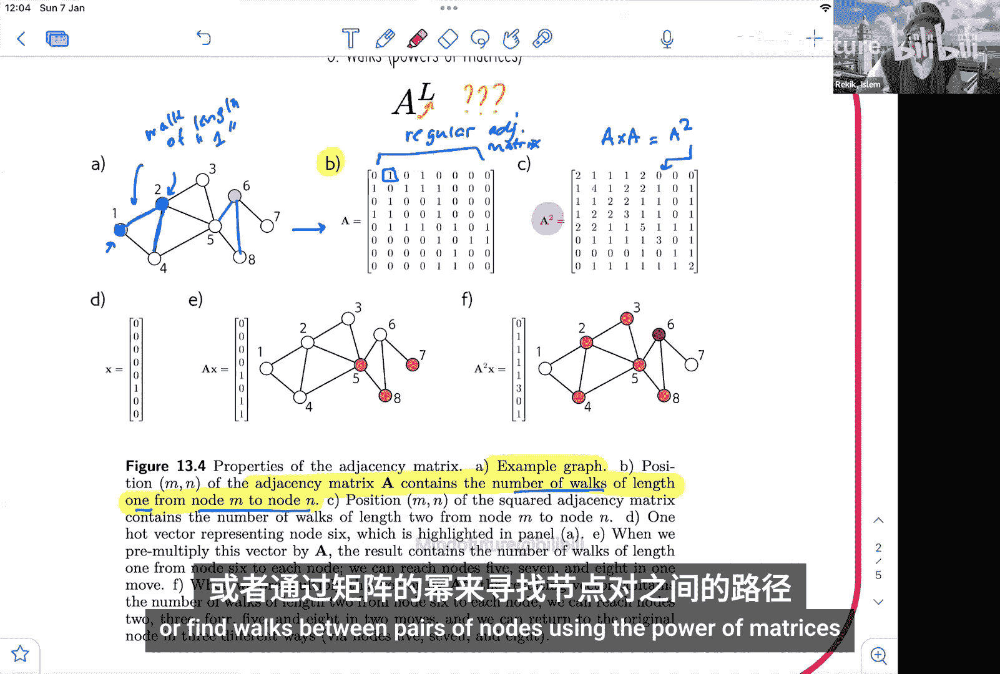

If you take let's say you know， any， so we have one， two， three， four， five， so you take。

 for example， node five okay， and then you take a node one。

Which is one so here five you will see that you have you know the length of the walks。

 the walk between one and five or from one to five is actually of two so you always need to have kind of you know that's the least then the minimum number that you're having here which is two okay so that's the shortest distance so you can get to five by a walk。

Of two。Get to， note 5。From one of course you can make your path longer right you can say oh I can actually walk longer like and get get to five from this path。

 but that's not the point the point here is like we want the shortest walk okay so you can see that amazingly this matrix power tells us that well the walk between one the shortest walk between one and five is of length too and you can see that also you can verify that for different for for other nodes and different pairs of nodes okay so now indeed D。

So we have here let's move to D so in D we have so when we premply this vector by a。

 the result contains the number of walks of length one from node six to each node okay we can reach nodes5。

7 and8 in one move so basically when you multiply this vector by a okay so this gives us the number of nodes this gives us the the connectivity of node six so we're looking at6 so here we are interested in node6 and we're multiplying it by a so a here it means we're interested in a walks of length one okay so this multiplication will give us you know the number of walks that basically it contains the number of walks of length one。

From node six starting from node6 to each node so we can reach， for example nodes5。

7 and8 in one move so these are the three nodes that we can reach so from six we can reach five。

 eight and seven with one hop。Or you know one jump here okay so now when we multiply so on the other hand。

 so let's look at the matrix power so when we multiply pre multiply the same vector this vector okay by a squared the resulting vector contains the number of walks of length two from node six to each node we can reach nodes for example here so if we need two so we can reach you know three54 and8 okay so it gives us basically。

You know all these notes and it returns， you know， the list of notes that are two hops away。

 so this multiplication。呃。Breters。A list of notess。That are two hops or two walks away。

From the anchor node okay so the anchor node is node six here and this is really fantastic so I want you guys to take some time and try to calculate this on you know like just you know take pin and paper and try to play with this it's a very powerful concept because now you can explore neighbors and neighbors of neighbors through by raising a to the power of L so here for example we can find walks you know that have you know L。

Length right so there are they have you know we have L basically hops to get from one particular node to another node and we can identify these nodes we can find them out by raising a to to the power of L。

Okay， as we did here for this particular example。

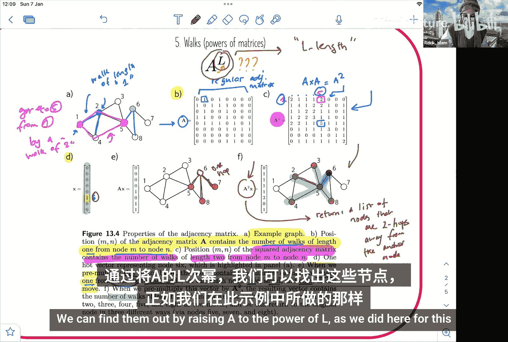

Now let's move to the next point so the next point so before we wrap up so we have three more to cover so number six is actually here we're going to look at the spectra of a matrix okay so the eggen vector or the egg and decomposition of a matrix this is a very powerful concept that permeates machine learning where we define data covariance matrixes and also graph learning or the graphbased learning where we decompose we do the a and decomposition of the adjacency matrix of a graph so let's start first with a definition of the simple definition of an egg and decomposition so here we have an a matrix or a is an n by n matrix it describes a system that affects you know some linear geometric transformation of a vector right。

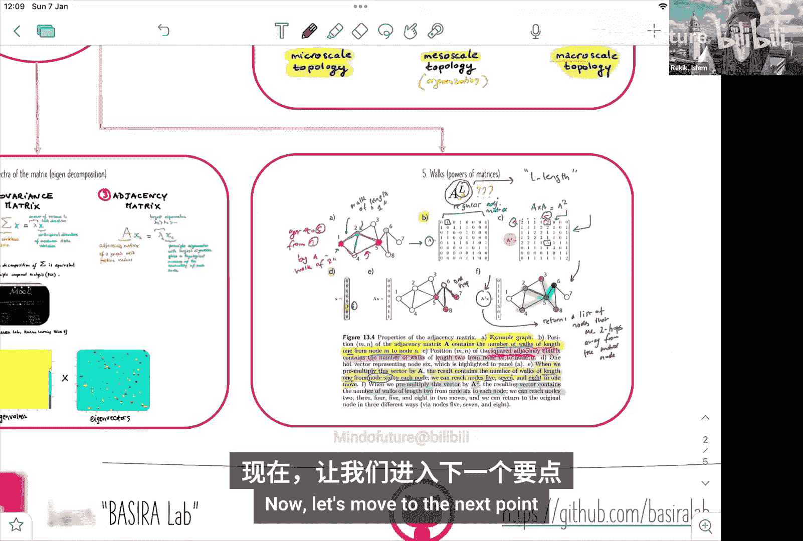

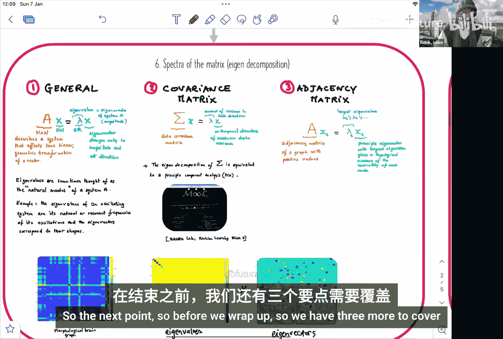

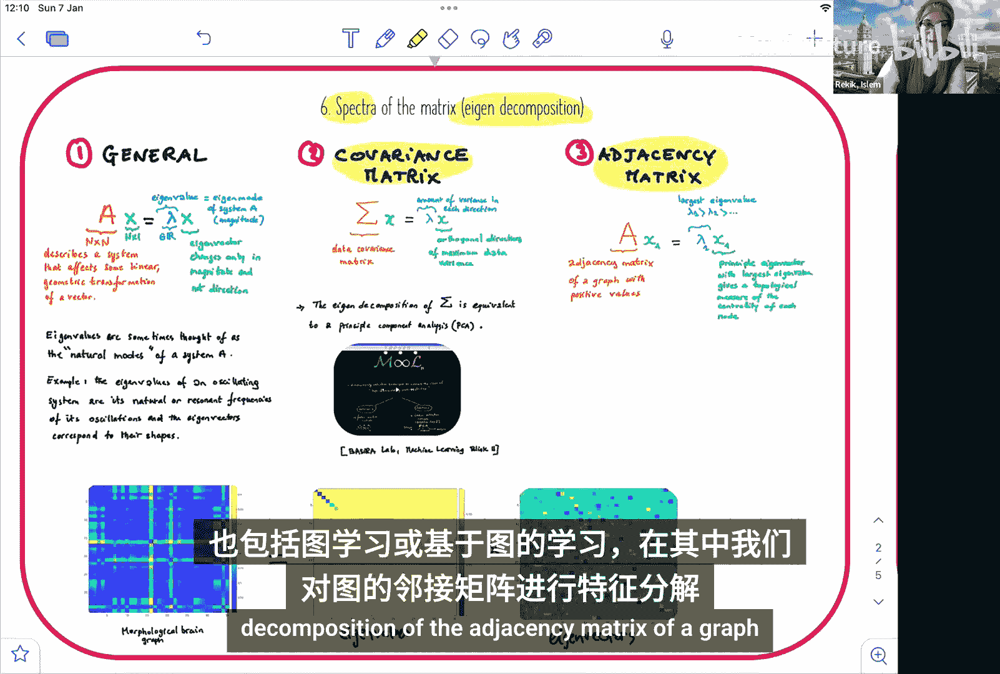

So the linear transformation of a vector so we want to kind of you know affect the x but through this multiplication so I mentioned earlier the power of diffusion integration so a is affecting basically this vector so this is another reading so a is you know applying a linear geometric transformation of this vector so now we are talking about mathematical geometric transformation so this is another power of this or another reading of this multiplication matrix and vector multiplication so if we decompose this so ax is if we when to we do the egg and decomposition we want to rewrite it as a multiplication of a lambda sorry of a。

Of a lambda you know value here which is an aenvalue is scalar。

 so this is called an aen mode of the system a or the magnitude of the system a and the same vector here x we want to identify the same vector and if we identify or get the same vector x right so this will be called an aen vector which changes only in magnitude and not direction okay so this is the aen decomposition you want to you know express mathematically this action of geometric action of the matrix a onto a particular vector x as a multiplication of a scalar onto the same vector and these vectors x are very special because we call them aen vectors and the lambda they are also special because they are assigned to these aen vector so each aigen vector has an aigenvalue assigned to it all right。

So aenvalue are sometimes thought of as the natural modes of a system a we call them the natural modes。

 these are the aenvectors so for example the aenvalue of an oscillating system or it's natural or resonancesonant frequencies of its oscillations and the aenvectors correspond to their shapes okay so this is for in physics for an oscillating system so you can see the aenve decomposition or the egg and decompositions everywhere in physics it's rooted in mathematics but it also it is very powerful in machine learning because we have seen in lecture 11 of the machine learning blinks that the aen decomposition of the covariance matrix of the data covariance matrix if we have training samples and from these training samples we identify or define our covariance matrix we derive it from the training set so it is actually。

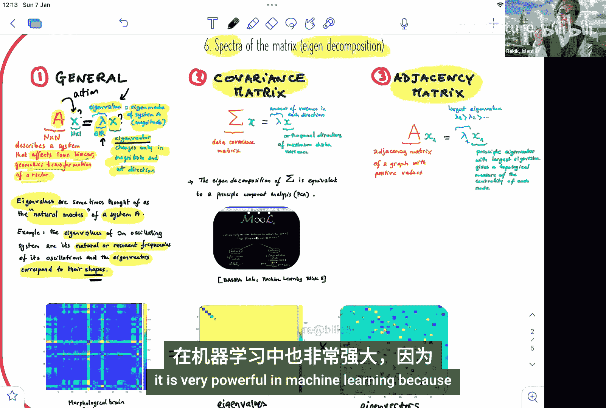

equivalent to a principal component analysis or PCI so when we do an aig and decomposition of our covariance matrix here。

 the sigma we get what we call x so the aigen vectors will be an orthogonal a set of orthogonal vectors or directions of maximum data variance okay so they maximize the data variance and this is what we have seen so if we have a data like this this is a distribution so we'll have PC1 which is the first eggen vector and PC2 and they will be orthogonal and the lambda is actually the variance in each direction so the lambda quantifies the variance of the data so this basically you know lambda one and we have lambda2 okay so that quantifies the variance of the data and now now we will。

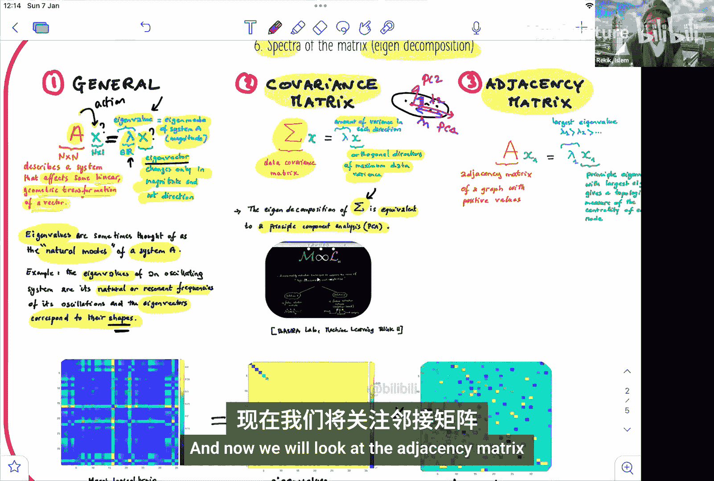

Look at the adjacency matrix。 So the same thing。 So you can see that this egg and decomp measure is very powerful。

 So when we apply it to graphs。 So here we have an adjacency matrix of a graph with。

Positive values so in this case we have positive values so we're going to get what we call the principal aen vector with the largest so here the principal aen vectors with the largest aenvalue they give a topological measure of the centrality of each node and you know the largest aen values here are right here so the aen value here tells us something about the centrality of the node and we do this for each node and this gives us what we call aen vector centrality and you guys can also go back to this lecture lecture you know two of graph theory and watch that so I go over this in detail covering all the mathematical details and intuition behind this so the key idea I wanted to take out of this is that we can use the。

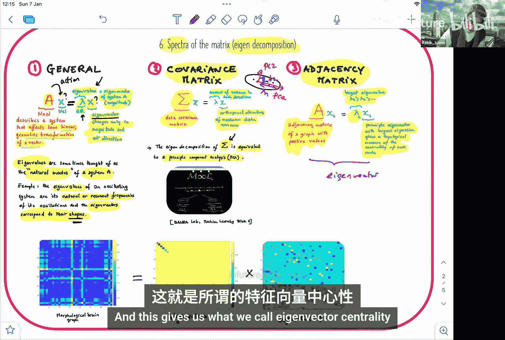

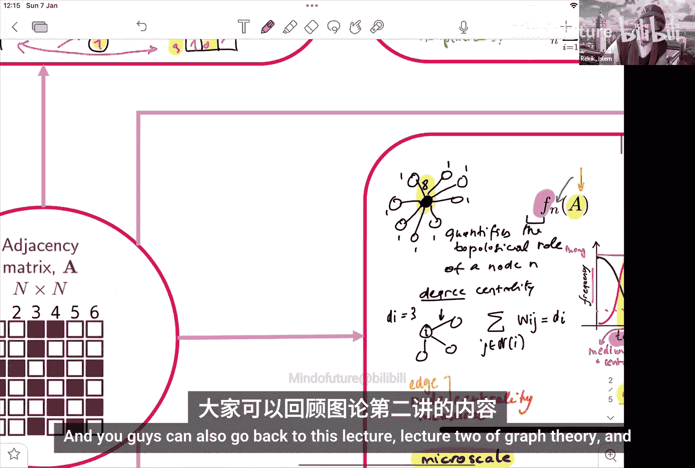

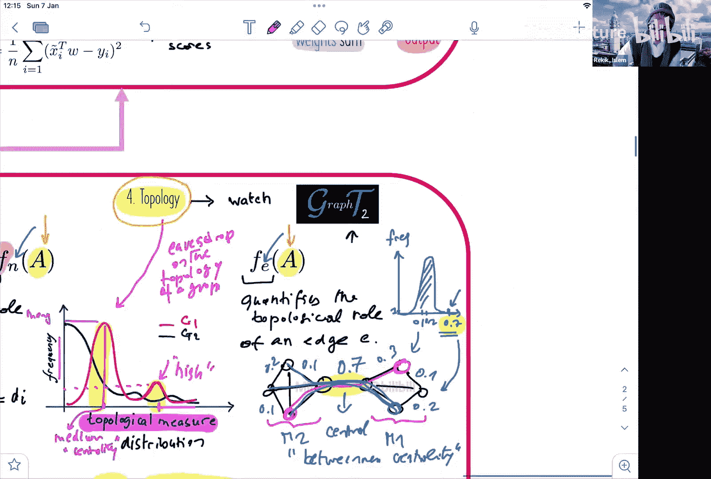

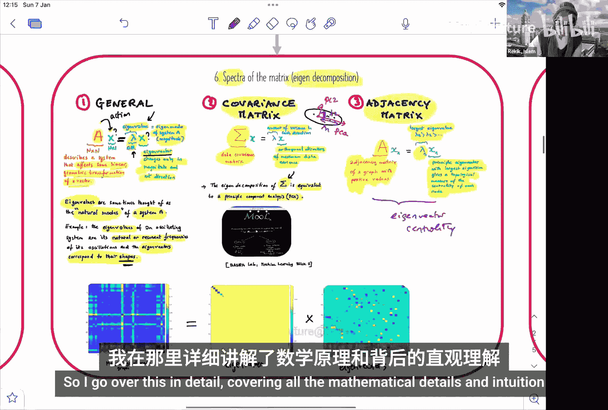

A and decomposition of a graph adjacency matrix。 Okay。

 so this is a graph we do the a and decomposition to get the aenvalue。

 which will quantify the importance of nodes in the graph。 So for example。

 this graph right here it represents a。

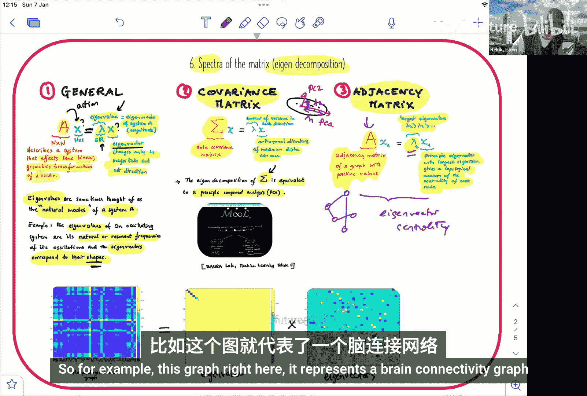

It represents a brain connectivity graph so here we have regions。In the brain。Okay。

 so and it's of course， brain regions it's a symmetric matrix and we decompose it into a set of the lambda times the the aen vectors Okay so this is the aen vectors so I'm going to if I call this big x so it's like big x okay and what happens here is that we're having all these aigenvalue because we're going to take each value right here and multiply by this vectors so it gives us exactly what we want it gives us the x1 and lambda1 and you can see that the values are ordered according by decreasing magnitude so the highest ones are on top and this tells us that this gives us the。

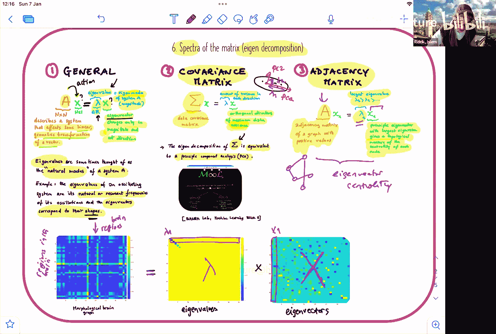

The the lambdas for each you know node in the graph it tells us you know what are the this what is the topological centrality of all nodes in the graph okay so these aenvalue are very important。

All right so that was the spectra of the matrix and this is just you know a sneak peek so spectral analysis of a graph you can have a full course on that for weeks covering so many methods a lot of mathematical notations and a lot of also。

😊。

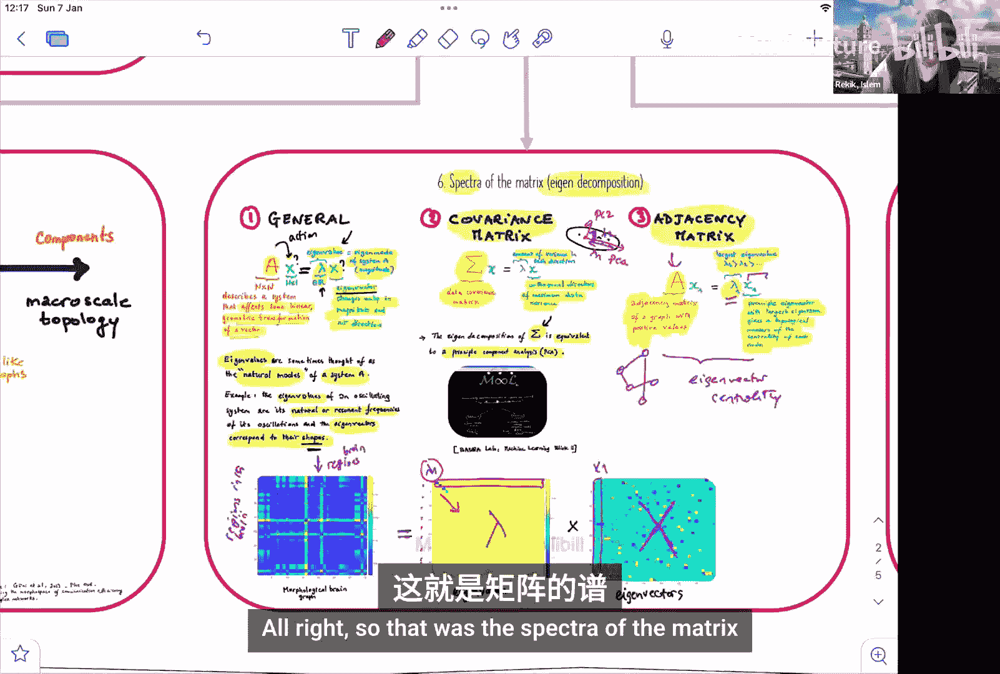

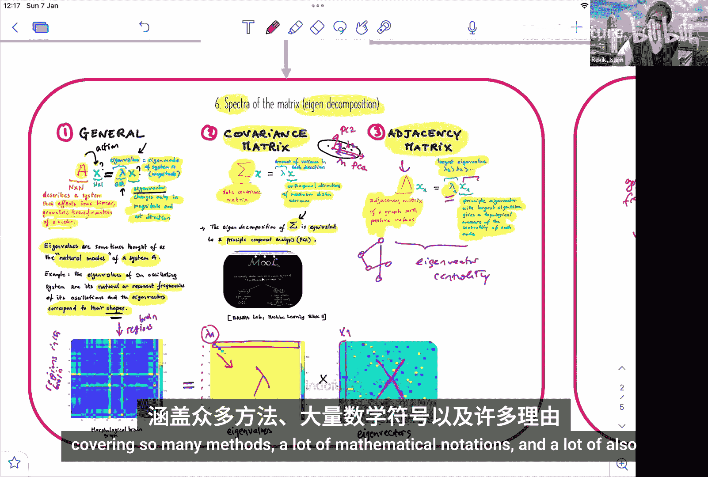

Rationes and principles that we can discover or derive from doing the spectral analysis of graphs。So。

 next。

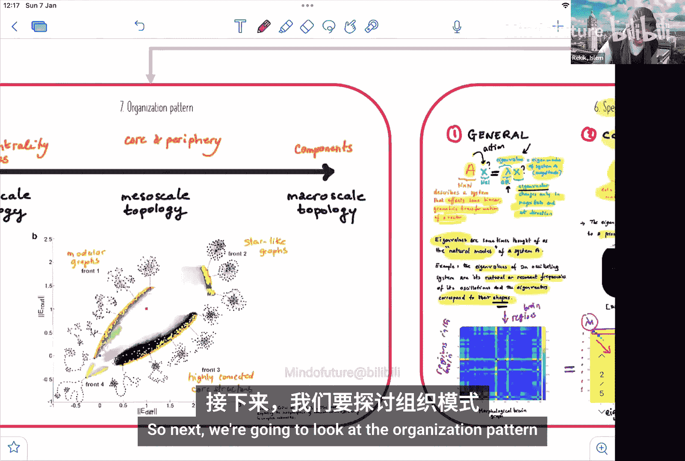

We're gonna we look at the organization pattern so as I mentioned in top the topology point so number four here we said there is what we call microtopology mesotopology and macro topology and if we plot the distribution of particular topological measures we can imagine the structure of the graph okay so we can eavesdrop on the structure and the connectivity of the graph and this is an example here so try we can use different topological measures so we can define graphs with particular organizational patterns or organizational properties so for example and this paper that was published in 2013 in P1 exploring the morphos space of communication efficiency and complex networks so here the X axis denote the efficiency of diffusing a signal along a graph and this is the routing。

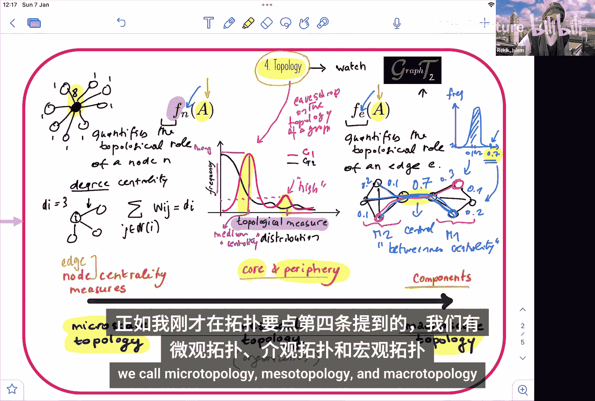

Efffiiciency so these are there's also another lecture where I covered in detail how we calculate these efficiencies。

 how do you calculate the diffusion efficiency of a graph and the routing efficiency of a graph and the graph theory of course but the key idea that I want to share here is that these graphs have different shapes。

 they have different let me write them so graphs have different shapes。

 they have different patterns okay they have different organizational topologies and you can see here for example in terms of efficiency the graphs that have the highest routing efficiency and the highest diffusion efficiency are the starlike graphs so the star like graphs means these graphs that happen to be along this front front two here so these are graphs where you have a central node and a bunch of peripheral。

Perpheral nodes or a central cluster and a bunch of peripheral nodes so you have like you know a sort of a star like graph like maybe a few like densely connected core here sorry a few densely connected。

Nodes within a core and a lot of peripheral nodes around okay so for the second another type we find in front three so on this front we find what we call the core structure node so the core structure node you have a core and you have you know like a sort of a bunch of peripheral nodes emanating from the core so you have different toppologies here you have a huge core and a few you know kind of peripheral nodes so this is what we call you know the core structure also in a graph another structure is found in front one so this front which has kind of low diffusion it has like it depends where you are on this front okay but you can see that graphs that are right here they have low efficiency so they have low efficiency whether you calculate it via diffusion processes on graphs or routing processes on graphs so。

or do different ways of quantifying or measuring efficiency of information circulation propagation through a graph so you can see that these are actually the worst they do not diffuse information very well why because they have these long path so you can see for example to get from a node in this cluster to a node in that cluster you need to traverse all these nodes so you need to spend a lot of energy but for example from here to get to any node to visit you know any parent nodes you just need two hops right so you just need to pass through the center so you need a short walk so this structure is actually very efficient the other structures right here like this one is the worst ever look like just to get from one node here to there you need to traverse all this kind of you know long path of nodes okay so these structures are not efficient in diffusing and conducting information or signal along them so it's important to know。

Graph in terms of organization and patterns it's important to visualize your graph to see how your graph looks like also you know you can display the matrix to see if the matrix is has you know some particular properties such as you know a whole block that is has a lot of connectivity the rest are zero so visualizing your matrix plotting or and also showing or displaying your graph can help if you can if you have the resources of course if you have billions of nodes this becomes。

Maybe a very challenging thing to do Okay so the last point here is efficiency and resilience so as I mentioned earlier。

 so we covered different types of graphs and organize organizational patterns topologies so we can calculate we can look at the matrix。

And identify and measure the efficiency and the resilience of this matrix to attacks so in a matrix you can attack a node。

 you can attack an edge okay so if we do attack a node by randomly blocking it or randomly removing it or deleting it what happens to the whole graph so this tells us a lot in terms of what happens to the whole graph what happens to the information circulation the graph so if you have an airport for example。

 that doesn't that is shut down how would that affect。

 you know flights between different cities or countries right so basically these two words are very important if you guys are interested you can watch also lecture the full lectures5 and6。

 I cover them in detail， like for example I go over the percolation what we call a percolation threshold。

So a percolation threshold is a value at which the graph breaks so if you start for example removing edges here so we want to know that how many what is the proportion what is the ratio of edges that we need to remove for our graph to become fragmented and completely isolated when composed of isolated islands or fragments okay so this also this threshold is important to study and examine the resilience of graphs so also when you look at efficiency you have two different concepts you have global efficiency you have also the local efficiency so you can study the efficiency of a single node in a graph but you can study also the efficiency of the whole graph itself and here you can see that this graph topology is more efficient okay compared to this one。

As I explained earlier， how do we calculate efficiency？😊。

By checking the speed at which the information will go from one region to another from one node to another node。

 so here it takes a long time， but if you want to go from this node to this node you just need to go through this path and pass through what we call the core of the network okay so how so efficiency basically looks at how the topological properties of graphs cantrain the way in which information flows through graph。

Also， which specific graph properties can be used to gain insight into information processing by graph by graph units。

 which are the notes and edges。 So which kind of graph properties we can define or derive from this adjacency matrix to。

Wantify or measure the information processing power and potential of this graph okay so these are very deep and very important questions and these will be revisited in deep graph neural networks and GN models in different ways but the field is still new I would say although it has been there for a few years but there's a whole lot to do and many of these concepts have not been integrated and investigated in in much depth okay so that was the adjacency matrix so we diagnosed it its efficiency resilience topological organization its spectra also how can we raising it to the power of L can give us insights into the walks we need from one node to other nodes in the set of nodes that have that length of ws and yeah so that was a big overview and next work。

Going to look at the third section， the last section in this lecture， which is the learning task。

 so we'll cover that quickly and I'm going to give you examples like just about the different tasks that we can learn using graphs。

Alright。