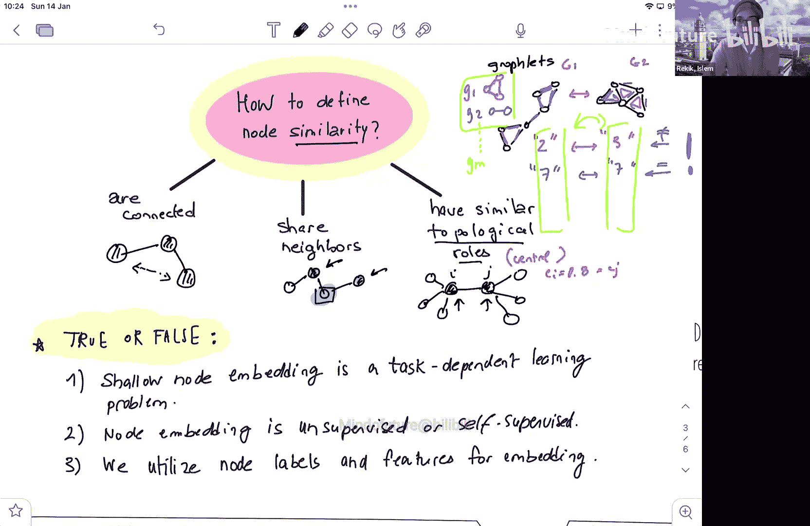
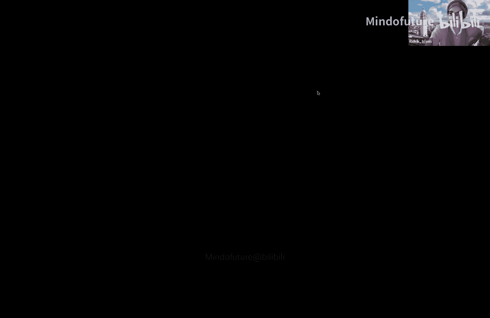
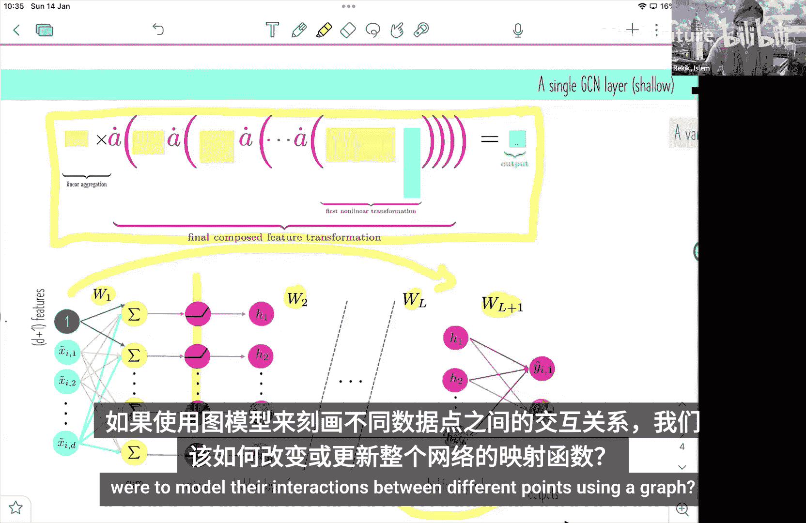

# 【伦敦帝国学院】深度图学习 ｜ Deep Graph Learning p06 P06_2.3_浅层图节点嵌入 -BV1WZUKBmEQA_p6-

So in this section we will cover the classical node embedding methods。

 just an overview about these methods and then we'll go into the single layer GCN and an introduction about how it works so as we have seen in the previous session so basically we introduced machine learning regression problem linearity and linearity and then we explained why these machine and deep learning paradigms。

 they are limited because they basically adopt an individualistic approach in training including even you know like other variants and advanced variants of machine learning where we for example tackle manifold learning we also formalized a deep learning as a sequential manifold learning problem where you're learning different spaces or subspaces。

Ps your data better still even with this nice deep approach we are limited by the independence between different training points okay or training samples so the idea that we introduced at the end of the session was to kind of model or encode the interaction between different samples so we introduced collectivist points which colearn and coinact via a graph structure to learn better into kind of solve downstream tasks such as classification regression or multire problems So all these learning tasks can be theoretically or like I hypothetically at least for now improve through a graphs and then we asked the question okay now that we are encoding the data onto a graph so how can we represent the graph how can we extract the features so we went over basic methods or classical methods for node graph features extractions and these are limited。

They cannot take into account what we call the edge and feature matrix an additional annotation of the graph via feature node features or edge features okay so now it's all about the features so how can we learn to embed or to extract or represent the graphs better get features from the graph so as we guys remember this lecture is about feature embedding and now we're going to talk about these features so how can we learn better features and I want to take a step back and introduce this concept a little bit better so we covered it in the in the first session as I mentioned but here let's formalize it better so first sample embedding so we have a data sample let's call this data sample XI okay so it belongs to RG it has the features so we call sample embedding or latent。

Hidden representation learning， we call it also sample encoding。

 transformation or sample mapping onto a space， a new space， oops。

Onto a new space and this new space will allow us to represent the data better and this space has d prime dimensions and if it's we want to kind of reduce the dimensionality usually so D prime is lower than D or smaller than D okay so for a graph in this case so given a graph G we have a graph G with nodes V and edges E so we want to encode a single node so let's say our goal is to encode this node to learn how to represent it by learning the f mapping so this is quite similar to manifold learning so we're learning how to embed features okay so our goal is to learn this Z U this new latent representation or embedding of node U and this will belong to let's right here I'm going change the notations so this belongs to Rd prime all right so now。

F is called the encoding function， it maps you onto a an embedding ZU a new feature representation and this basically。

It's important because if we learn as I mentioned earlier。

 if we learn how to represent the node better， how to extract a good representation that you know like kind of get rid gets rid of the unimportant features that captures the topology of the manifold better the relationship between the samples better this can boost downstream tasks like such as classification regression also unsupervised learning tasks such as data fusion or integration or generative learning so all of these could be improved potentially or eventually by this embedding so this is so important this you know representation is vital to many learning tasks now。

If you guys can see， so here in this case。The embedding is kind of constrained okay so typically in feature embedding or in shallow data embedding or graph embedding methods so in the literature of graph embedding methods using a matrix the adjacency matrix we hypothesize that neighbors you know notes that are close in the graph they should be also close in the embedding space so this is the reductionist hypothesis that we made also if you guys remember earlier in manifold learning so we want basically neighborhood preservation across the original and embedding spaces and in this case we want you know the notes to be close in the embedding space so which means in this case if my embedding space has the prime dimensions I want these you know two vectors to be close so one way of calculating that is to do the product between them so that you transpose that fees this。

Quantifies the similarity between these vectors and our goal is actually to maintain you know the similarity between U and V so if you know the level。

 the similarity here between U and V is high， then this should be you know close to one if we normalize it okay。

Cool， now so the objective function of graph embedding or node graph embedding to be specific is this function。

 so basically we want to maximize。Over this law so we want to maximize the do product or the similarity between the embeddings or the mapped transformed encoded pairs of nodes and this maximizeization is valid only for pairs that are close or similar in the original a matrix or the graph okay so if two samples are actually similar we want to kind of maximize their similarity in the embedding space so F here whatever F we're gonna learn the learnable F should allow us to maximize the similarity between them so if I have for example Uv very close in the original you know space with the their features and then in the embedding space that you and z I have for example for a first solution I have an F that gives me a 0。

8 and then for the second solution I have an F you know it's called here F 0 this is F。

OneThat gives me 0。5 so maybe this is kind of better because the original similarity is close to 0。

5 Okay so we need a solution that approximates the similarities。

 especially for the those that are very close to one another so this is the hypothesis of neighborhood preservation and if you guys remember in machine learning。

There is this principle， which says states， tell me who your neighbors are。

I'll tell you who you are okay I'll tell you who you are and this is you know the neighborhood preservation because if I know that this node this node for example。

 is close to these two nodes and these two nodes have the same label so I would hypothesize or I would you know think that this node would share the same label okay so this is you know something that is a very important。

 this principle is very important and now let's move next so this is graph simple graph node embedding so basically you take now a node in the graph V and you encode it and you can define Z V here for this particular node and this embedding belongs to you know RRT prime and this is actually the whole embedding matrix that is called Z okay so that's the embedding matrix for all nodes of the graph so。

Here we have。Here are the number of nodes all right so this is the number of nodes and this is the number of it's the embedding size or the the dimension of the embedding okay。

Cool， so now one thing about this。 So you may ask or think。

About the objective and how are we going to learn the f Okay so to learn the F so the F actually is important for us but before we learn the F we need which is basically here so F is let me write it down so it's F you transpose F of V so in order for us to learn the F we need to define the similarity so this similarity measure whatever we're using here we need to predeefine it so because we want to preserve it right so we want to preserve this value and for us to kind of preserve be able to preserve this value we need to define a similarity how to calculate similarities between notes how to calculate the similarity between these two notes each you know pair of notes all right so now the question is how are we going to do that so there are different approaches in the literature using kernel method。

It's using different ways of calculating that。But here in this example。

We need to think about different ways of defining similarities and selecting or identifying the best ways Okay so it depends on the graph it depends on your problem。

 it depends on your learning task， So there isn't a universal way of doing that but you can think about different things when you are defining similarity So one thing is basically taking sorry let's do this so taking into account the connectedness so you can say that okay so if two nodes are connected then they are similar if they are not connected they are not similar so these you know two nodes are not similar because they're not connected so it could be based on connectedness it could be also based on shared patterns for example you know these two nodes they share the same neighbors so depending on the number of shared neighbors we can argue or we can derive the similarity of these notes so it could be based on the local neighborhood or the local。

TheThe shared you know neighborhoods between different points or different node okay so another way is looking at topological rows like for example。

 we have a node right here and these are two nodes and。

These are my two nodes I and J we can say that these two nodes are very important。

 they're very similar because they have an important topological rule they're both central。

 So if I remove this node I'm going to break the graph completely if I remove this node also I'm going break the graph into two parts or two modules so thats these notes are vital and you can consider them as central node so these are central node and because they are centrality measures are very similar I don't know like for example could be 0。

8 for each okay so the centrality of I is equal to the centrality of J so we can say that these are actually similar so you guys can see here that there are different and multiple ways of defining similarity and this constrain the learning and。

You know defines the setup of the whole optimization problem that we have here。

 which is a maximization problem because depending on the way sorry it's kind of blurry。

 but you know。This depends completely on how we're going to define this similarity right here。

 All right， cool， now let's look at。The the the。So we're not going to explore different similarities here because this is also part of graph theory graph theory course you can explore this a bit more so using for example graphlets so let me give you an example so graphlets so what is graphlets so you can use you can count the number of graphlets so you have if you have graphs so you have one graph that looks like this okay and another graph。

Maybe。That looks like this one so here we have graph G1 and G2 and graphlet is a small graph so let's take a pattern of a triangular pattern here so we want to represent this graph and we want to calculate the similarity between these two graphs so we can define that based on the number of graphlets within this graph so here we can find this pattern one and why so we have the value2 here for this graphlet for this mini graphlet that's called G1 okay and then here we have one2 and3 so we have the value 3 so this shows that this structure is a bit different we can have other types of graphlets for example we can have a graphlet G2 which is the number of edges right so it's very simple so you just count the number of edges here so one。

2，3，45，6，7 so you put seven here and here one，2，3，45，6。

7 so here you guys can see these are a bit very problematic。

So one measure tells us that these these you know like these graphs are identical almost and this one tells us that they are actually different okay so this is a bit you know so the similarity here that we're going to use is very important so what you can do is you can stack this up so instead of having one single having your similarity defined by a single graphlet type pattern you stack them up so you define a subset of graphlets so you have so many graphlets G for example M graphlets and then you can extract these and you're gonna have two big vectors and you can calculate the product between these two vectors and maybe that would be a better similarity measure to use to define the similarity between graphs if you want to do a graph embedding all right so these are just a few ideas here。

But yeah， so it's a big topic。 Now let's have a small exercise together。 So a true or false exercise。

 And I would like you guys to take。😊，A minute and think about these statements one by one。

 and you can pause the video and。Assign a false or true to each of those。

So let's look at these statements one by one， so the first one states that shallow node embedding。

A shallow node embedding is a task dependent learning problem so task dependent and means depends on the task that we have。

 for example supervised learning tasks such as regression so this basically means or implies that we are using the target values or the y is the target y to learn the embedding themselves and if you guys look here at this formalization our objective function is to learn an embedding function F and this embedding function doesn't depend at all on the output label right on the we don't have any label data here we don't need actually labels so which means that our embedding is not task dependent so this is actually false okay。

So we can make it you know task dependent， but here in this case， it's fully uns。

Ved so the second one is node embedding is unsupervised or self supervised so I already answered that so it's here it's unsupervised it could be also self supervised if you want to reconstruct the original data so that's true。

Allright and we utilize node labels and features for embedding this is actually false so we don't utilize any node features and labels for embedding so note features here it means our graph here has some labels so we have a label for for either the graph or the node for each node so for node U so we have yu so we don't have any labels and we don't have original features we don't have an X you know u to embed here we're actually trying using the graph you know simply the graph structure。

 the adjacency matrix right here of the graph we're only using this one to get to get you know the embedding Z of a node U so we don't have any feature matrix X where we assigned features to nodes and we don't have any labels so these do not exist okay so' we didn't need that to do the encoding so this is actually very simple problem to solve。

In termsm of， you know， fully unsupervised， it doesn't use any labels or any features and。

That's something you know these are you know these are important kind of remarks because we will see that this is a bit reductionist it's very over simplistic okay this is why we call it a shallow note embedding okay。

So we have seen guys that this shallow note embedding or encoding it doesn't take into account the features potential features that we have on notes so it's very reductionist and it's very simple basically it only relies on the a uses the a to learn the embedding function so that's the only thing that we need to learn the encoding function F okay so this doesn't allow us to work on annotated graphs on graphs with you know features also this is fully unsupervised it's not connected to a downstream task right so this learning task is independent it's and it's kind of you know very simple so if we want to do more exciting things if we want to learn how to classify or regress we need first to extend this to take into account labels in features we need to kind of。

This embedding more kind of representative and correlated with the final outcome that we want so now i'm going to introduce the the popular GCN network。

 which is a graph convolutional network and we'll start with a simple layer so if you guys remember at the very beginning。

We had you know this kind of a big overview just giving the rationale behind deep neural networks so deep neural networks they learn sequential transformations with some nonlinear activation layers and these allow us to transform sequentially original features into a final feature representation in a space where everything becomes simple okay so it becomes in terms of the relationship between for example classes they become more separable linearly separable if it's a regression problem we can fit a linear model or a linear hyperplane onto the data all right so now we're going to look at this and reformize it using graph so let's see how you know turning this individualistic kind of learning into a collectivist learning via a graph structure how can we change or update this kind of。

Mapping function of the whole network if we were to model the interactions between different points。

 between different points using a graph。

