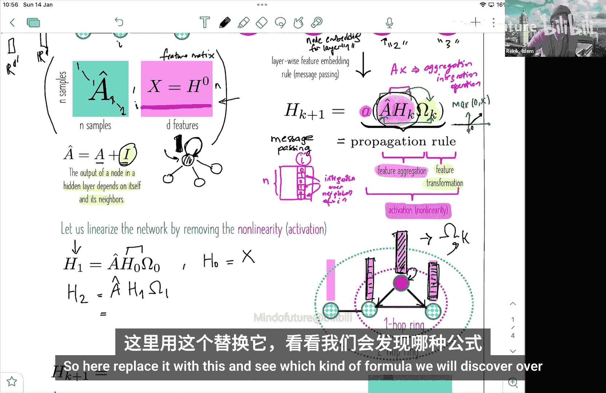
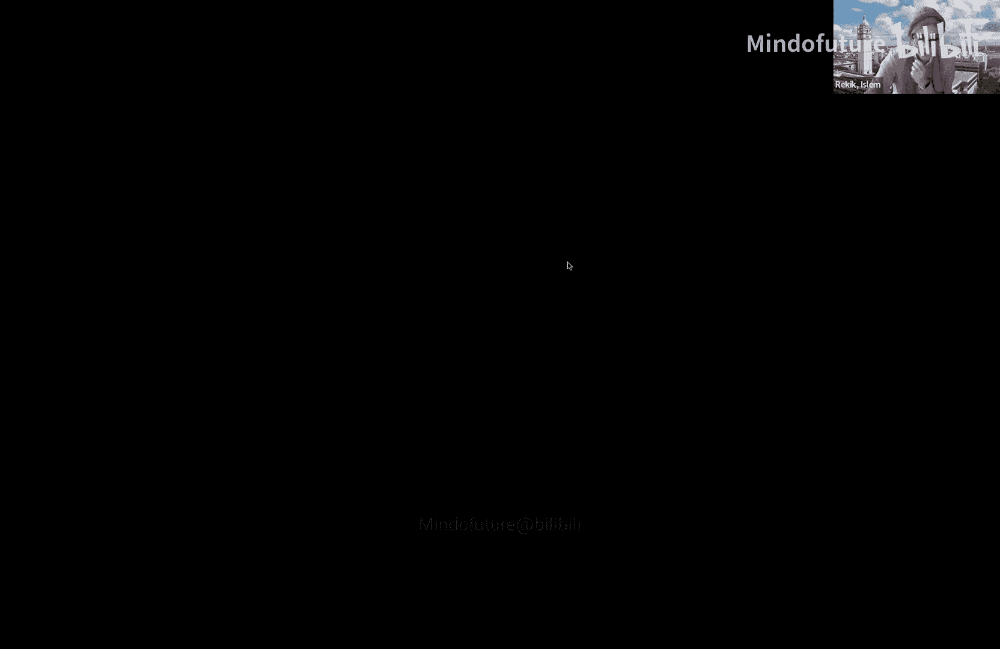
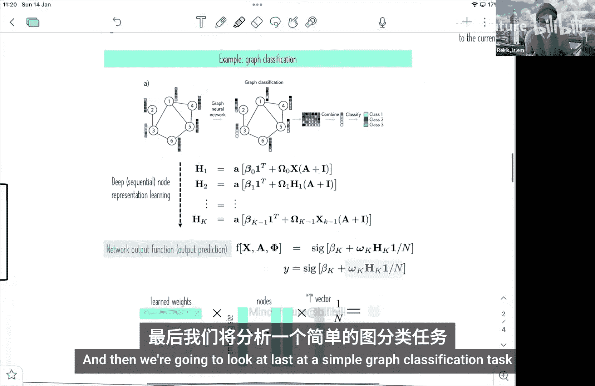

# 【伦敦帝国学院】深度图学习 ｜ Deep Graph Learning p07 P07_2.4_单层图卷积网络分析 -BV1WZUKBmEQA_p7-

So we want to basically minimize， of course， the distance between a predicted that predicted you know output target scores and here for example。

 for a regression， the ground truth one， so we have the same loss but the transformation here would be a bit different so here this is a simple machine learning model and what we want to do is to model or to create a graph that encodes the similarity between different nodes and this will be encoded or represented by the graph the data graph adjacency matrix okay。

Adjacency matrix。So now in this matrix I want you to think about this sample。

 this sample could be any it could be a video， it could be an image okay it could be text so you can have you can have your node denoting you know a particular sample but you can also have your whole graph as a sample and we will discuss we'll go over different examples in the next lecture but here I'm just going I just want to want you guys to keep in mind that your whole graph could be your sample but also a node in graph could be your sample so there these are different representation so for example if you're working on classifying molecules right so you can say or brain graphs so a brain graph which is a mapping of the brain connectivity between different anatomical regions so you encode the whole brain as a graph and what you want to do you want to know if this graph is for example healthy or has a particular disease okay so this is。

This is a problem where we're kind of you know classifying a whole graph so there are different ways of doing this。

 but what I wanted to keep in mind that now we are using a graph and let's go forward so let's move forward so in this example。

We want to learn how to represent each node Okay， so the graph here has an original feature matrix。

 so we do have an annotated graph so we have the a and we have。

The X which is the data feature matrix so the nodes are actually annotated that we have features so this is our x okay we have the adjacency matrix and our goal is to learn a mapping function or a neural network or transformation F that allows us to map to map you know x the input features onto a new representation or to embed them okay by using the graph matrix in some parameters to learn so phi0 is a mapping function that actually will map you know the features from layer zero to layer 1 okay so it will map x onto H1 here Phi 1 is another transformation or mapping that we want to learn that will allow us to map you know H1 onto H2 so。

basically here layer one onto layer two so this is a function that maps you know layers onto one another and you can think about it as the w that we had before here so it's mapping you know one layer onto the other okay so we had also non nonlinearity activation in between but that's a different that's another kind of variation but here simply put the idea is that to we want to learn an embedding of each of these nodes okay but we want to learn them together not individually and to do so we will define a function that takes in the structure which models the interaction between these noise these notes because we need that to do the learning and the modeling of the interactions and we have here the previous the hidden node learns in the previous layer so we feed it into the next one with the adjacency matrix。

The updated parameters okay so here at the end of this deep neural network we are going to get a very powerful representation in layer K so hK of all nodes in the graph so this is a deep sequential node representation learning or embedding okay so this is exactly what we do in conventional neural networks right so we're trying to learn these embeddings so here we have H1 and here we have H in the final you know a layer L right so these two these are the representations that we're learning in our goal is to do the same to learn these representations but instead of learning them independently we are learning them constrained or guided by a graph structure A and if you look at this so let me just。

Remove this a little bit so you guys can see so what is constant here so interesting to note that a。

Doesn't change， right， it is actually fixed。😡，And here these guys。

 I'm going to use a different color， so X is also fixed。These guys right here。And these。

 the mappings are actually。Learnable， so we want to learn。

The representations and we want to learn the transformations all right so this is you know simply put and as we do that as we update you know like as the we train the network you will see that the loss of this network will start off with something you know which is a regression loss so if we have you know the input here。

The number of iterations and we plot L of w and at the beginning you have a very large loss。

 but somehow at some point you're going to kind of stabilize your loss and have a very low loss and this is by you know like training your model okay cool so。

This， you know towards the end， as we iterate after a certain number of iterations or epochs you will see that this final representation is actually very powerful So somehow we're learning how to improve this by optimizing our loss function now if I ask you all right somehow is this supervised so in this case we can we will see an example of classification in a bit。

 but definitely we can learn this in a supervised way。

 which means you know my loss right here will impact the learning of all these you know all these hyperparameters。

 the phis and the Hs al right so yeah so that's a very simple that's the key idea here is to learn how to embed and deeply embed sequentially using a structured matrix so。

Let's look， let's go deeper and try to understand this fundamentally， all right？

So we have a vanilla GCN layer right here， so the vanilla GCN layer will perform。

A very similar operation to a simple deep neural network。

 but let's look at what deep neural network does So we have a simple and input training sample here X okay so X I will be the input and then we're going to pass it we're going to transform it through you know multiple basically transformations that we're going to learn so this this transformation maps this basically X the input onto the next space all right and then we apply activation for introducing nonlinearity if we have any nonlinear relationship or complexity in the data so this allows us to capture nonlinearity okay。

Butture non nonlinearity。And yeah so we continue to repeat that multiple times and then we're going to have WL here transpose and you have WL plus one and this is this is the mapping function of the whole network okay so towards the very end after we calculate all of this and you can see that it's a long calculation and that's why neural networks are heavy because you know this kind of requires the optimization and the calculus of the gradient of the loss with respect to all these hyperparameters all these matrices the W1 to WL plus1 okay and towards the very end after you calculator you're going to get your Yi hat。

 which is the predicted score it could be something I don't know like 0。

12 all right cool now the final layer is a linear aggregation layer so it kind of aggregates the features that we learned so。

You know if you look at this whole block this whole block will get us actually the final HK the final representation so here it's L because it's the final representation in layer L so these are the the node embeddings in layer L and now we're going to aggregate them using this final mapping this that allows us to do the prediction of to map it onto a single value to do the prediction of the score this is done individualistically so which means for each point independently now let's look at the generalization of the simple mapping function or mapping network deep neural network to graphs okay so we're going to draw analogies so in this example here。

We have an input graph G， so this is you know in this second part we'll cover the graph mapping or embedding through a graph neural network in particular a GCN okay。

 a simple GCN。And here we have our graph。Compposed of nodes and set of edges and we have we can also if you want we can sometimes in some notations we add the a here。

 which is the adjacency matrix Okay， so this graph has is a is an annotated graph which means each node all right each node is represented by。

A a feature vector so it's actually this way because these are the number of features so this is actually the feature vector assigned to this node all right so now let's call node I node I so what we have as input to this graph neural network is two things we have the a and we have。

The adjacency matrix of the graph and the feature matrix of the graph。 So this is the feature。Matrix。

So the feature matrix has dimension d times n n is the number of samples and what we do we feed this graph into a graph neural network so that basically takes in the input features and it applies this operation so I'll explain this in a bit so we have first you know this mini operation here which is you know multiplying the x by the a okay。

And then we multiply the output by the transformation that we want to learn。

 which is the omega0 here so the omega0 you can think about it as what we called earlier the W。

 this is the transformation and we apply the same thing we apply an a right here the activation so if you guys look mathematically what's the difference between the top block so thats let me use a bit like this one so what's the difference between this block and this one so this has basically an activation。

 we have an activation and we have the learned mappings here omega and then the x all right the feature matrix the input features right and then we have additionally an a so that's the difference so now we're constraining our aggregation and transformation by the graph structure al right so if we repeat that so will dichotomize this in a bit so we'll go over this。

And' in a bit in detail， but the idea here is that we have， you know， this first。

Transformation that we apply and as we apply， sorry。So as we apply this transformation。

 we're going to get the node embedding， so these are the node。Embbeddings， okay？Of the whole graph。

 so we will update these these are the note embeddings for layer one。

So this is the first layer and then we repeat that again now we take the node embeddings output it here okay so these are the node embeddings of this layer and we feed them into our mapping function and the a is fixed and get we transform through the omega1 so omega is actually what is learnable so we're trying to learn this quantity this transformation and we do that again so we're gonna get the embedding of layer too and then we repeat that until we get for example here we have only three layers so we're repeated that three times so now if you guys know this we have an a hat here so what is a hat actually aha is the original matrix a plus identity and this is we added identity here so we wanted to kind of make sure that the output of a node and a hidden layer will depend on itself and its neighbor so if if the node is not self-conn so if we have。

node like this， and it's connected to many other nodes。If the node is not self connected。

 we cannot update its embedding okay its own embedding so we need to take into account the node selfconn to be able to update its embedding right here so to do that we need to make sure that the adjacency matrix has once on on the diagonal it has some you know selfconn there okay so that's why we call it a hat and a hat is a plus identity it allows us to do the update you know of the node embedding based on its self connectivityn all right so that's important now let's look at this so it's actually going on here what is this you know vanilla network doing so first。

We call this the propagation rule of the network， we call it also the message passing rule between from a node to other node in the network okay so it's a message passing rule so in this rule first we do what we call a。

Aggregation， so multiplying basically multiplying the embedding by the a remember， guys。

 when we looked at when we had the first lecture， we talked about a multiplication by a vector x as。

And aggregation or integration。Operation okay so basically what happens is that if you take the a matrix right here and this a you take the node I and you have let's say this type of connectivity so this connectivity pattern with all of its neighboring nodes here and nodes and if you multiply this by H okay so let's say the embedding of node I by a particular so yeah so the embedding of I for example okay so what we're going do we're going to update the embedding of I based on its neighbors so we're going to only integrate information or take information from these neighbors so this is actually an integration process So here。

Integrate over neighborhood integration。Over neighbors。

Of I note I so in this case here the first one is what we call a feature aggregation or integration so this allows us to aggregate the features from all neighboring nodes and after you do that the second part right here after you aggregate the features you transform them so the second part is a feature transformation through the learned weights so now we're mapping onto a new space so we're taking okay so we can do this way we're taking this and we're passing it through the omega to get a new representation or a new embedding and this is transforming from one space to another or one representation of another or to another and the final part here a is actually the nonlinearity and this is where we introduce the you know the nonlinear activation function so we apply this to this whole output to this whole block right here to every single element we apply the activation that we have for example。

 if you use a relo this is max zero。X it's a function that looks like this。

 so it's an activation function where you have zero any positive value， so let me do it this way。

 so any positive value will be kept okay and if you have negative values you'll be set to as zero so this is max zero x is one type of the activation neural activation functions。

So now what happens is that you can see that through this a。

 we're doing aggregation through neighborhood， which means。Every time， okay。

 so let's look at this together a little bit， so every time I'm taking this embedding， right？

I'm going to update it based on my neighbors so I will aggregate these embeddings right here so the first aggregation is kind of summing them up so I'll add them up through this first blocks first block okay and also take into account the selfcon right here the self embedding and after we sum them up so after we add them up somehow like we were we will get we get to transform them through omega K okay so you imagine that you're taking the average of these guys all right and then're you're mapping them through omega K and then you're taking the selfconn also end mapping mapping the self connectivity of or the embedding of this node all right through self-conn so now。

Let's try to look at this in a very simple way。Let if we remove the nonlinearity so here we have the nonlinearity okay so the a here if we try to remove the a what happens so let's look at that so here i'm going to remove all this so we have our nice you know mapping network。

And we're going to write the equation， so let's take a minute。

To write this recursive update of the network embeddings from layer to layer so here we start with layer H1 H1 takes h0 you know guys that H0 is actually initialized as X the original features that are on our graph so right here so these are the original features okay and then we will see how are we going to embed them so we want to project this feature node X I towards the space you know where we go from Rd to same thing R d prime but now when learning this embedding when encoding these features we want to take into account the。

The structure of the graph， Okay， so let's take a minute。

And try to kind of write this down update rule。 and I want you to substitute every time you're going to kind of。

Write these replace you know H the value， so for example， let me start here。H2 is equal。To a hat。H1。

 let me go one， and then you're going to。Substitute so here replace it with this and see which kind of formula we will discover over there。

 all right。

So if we propagate this forward， you will see that we will discover a very nice formula here。

 so basically H2 is equal to a hat squared and then you have。

We have H0， which is x so i'm going to replace it with x okay and omega zero omega 1 so these are two composed composed transformations okay。

 so if we propagate that。Transforms， so let's try to。

Write down the generalized formula so we're going to have。H K plus one， so here。

Put it down here is not greater so it's going to be。A hat。Race to the power of k plus one。Times x。

Times omega0， the transformation。Omega 1。Until we get to omega K。

The mapping from layer K to K plus one。 So here， if we write this down， this is， you know。Mapping。

From K to。Okay plus one。And here's 0 to 1，1 to 2， et cetera。 And this is the。Final。Impposed。

Transformation。Okay， so we can call this actually omega total。Okay。

 so this is the final transformation that we want to apply。

 So we as you guys can see the final if we're going get the to the final layer。

 it depends on multiple operations multiplications we put in the input feature the original feature matrix X so this is our input feature matrix right and then we take the adjacency matrix and we raise it to the power of plus one and this defines the embedding of the nodes the node embeddings for you know each node in the graph so the embeddings of each node in the graph okay so what does that mean so now we have seen the。

Two things here so we have seen before the power of matrix multiplication to integrate information and we see information integration here from the local neighbors right and and we have seen also。

So this is the integration the first part okay and then we have seen the transformation and as the network gets deeper then we compose transformation we kind of concatenate or stack these transformations and we raise a to the power of k plus one so what is a to the power of k plus one so let's look at that together so this is a reminder from the previous lecture so if you take a matrix a and you raise it to the power of k or K plus one here so it means that。

For each node I， this matrix will store the total number of walks。

Of length k plus one from node I to node j in the graph Okay so it gives us the number of walks from a to j in the graph so in this example。

 so let me have here。Number of walks。And if we have。A。Graph like this。

So it tells us that actually how many walks of length， for example。

 two we have from this node from node for each node I it stores the total number of walks from node I to J okay。

 so this is node I， this is node J， this is I and here let's put this is J。

And if we do a to the power of two， so the number of walks of length two from I to J。

I toj is actually zero， we don't have any walks， but if we do a to the power of three。

 we have one here okay。And we have another one here， one， two three， so we have two ws actually。

 all right， so that's what it means So we're going basically from。

It tells us that I can reach if I start from I I can reach J within two hops， so the power here。

 this power matrix， it actually explores the neighbors that are K plus one hops away from the original node。

 so which means that this is a very important observation because if we take H1。

 so so if we take you know the first let's say。Here the first rank of neighborhood。

 so to get H1 and the first layer of the network， we are exploring the one。

One hop ring neighborhood so we're exploring the immediate neighbors al right and then when we get to the second layer because we're raising it to the power of two right so we have a2 in the second layer for calculating H2 right so it depends on a to the power of two etc etc so this means that we need to do two hops right so in this case we're exploring further neighbors so a neighbor of a neighbor a neighbor that is two hop white so we're exploring this green two hop neighborhood so this green ring right here so if I use maybe different color and let's see if we can do that better。

Allright， so this actually this neighborhood right here okay so in this case you guys notice that this matrix。

 this formula， this update formula tells us nicely what is happening in a GCN layer so as you go deeper you're actually exploring a neighbor of a neighbor of a neighbor until you get to the cave you know layer where you're getting you know to the k ring all right so every time you apply a neural network here you're actually moving you know from a neighbor to a neighbor and you're exploring further away I would say further away points or node from each node in the graph so you're expanding the neighborhood so here deeper means neighborhood expansion okay。

Using a graph。And we can see that actually so here。In this example。

 this defineies what we call the receptive field of a graph so the receptive field it means how many how many you know notes will influence the learning of my embedding at a particular you know my final emdding my final embedding and in this case。

We have you know the K plus one here it means that the K plus one ring will actually influence the final you know embeddings that we're going to get so the receptive field of my graphph neural network is the maximum information i'm getting by you know traversing the the graph from a particular node and basically that's the final layer and the final k hop ring okay so here is the K plus one hop ring the ring of neighborhood is defines the receptive field of the graph convolutional network all right cool so as you guys see with this very beautiful mathematical operation。

If we think about it for a minute， so the deeper we go。

 it means the further we expand the neighborhood。Okay， and the larger my receptive field becomes。

And of course we have more computational load because we need to calculate powers of matrices and multiplication of matrices。

 but that allows us to kind of get representation of this node as a function not only of its in immediate neighbors but as a function of its neighbors of neighbors of neighbors across several neighborhood rings and this is why you know this is how we get deep neural in a graph neural network okay and this is a meaning also of the layers so now。

There is one important thing so we talked about this now you can see the difference between a simple neural network operation like an MLP multilayer perceptron or a simple fully connected network and the graph mapping through a graph neural network so this is a vanilla GCN and we saw the case where we removed the linearity so actually here we have linearized。

We linearized the network by removing the nonlinearity and we discovered that it actually this depends on you know like powers of matrices and walks on graphs all right cool now I have a question here。

 which is important so。Can we map any note with any neighborhood size？

So can we map any note can we create an embedding of any node of any neighborhood size and you can look at this example。

 so in this example this。Note has two neighbors all right。

 so it has two neighbors and this note has only one neighbor all right still something really exciting and that we will see also in the next lecture about graph neural networks is that。

Yes， we can We can you know， learn a universal transformation， okay。

 that allows us to update the embedding。Of any node in the network and of any kind of neighborhood size so this kind of transformation or layer update it does not depend on the number of neighbors you have because and this is thanks to the aggregation rule is thanks to this you know operation that we're doing because first if you have you know three neighbors you're going to aggregate these three neighbors into one and then take the embedding here and you add them up and then you transform if you have for example you know two neighbors you're going do the same so you will take you know these two embeddings add them up。

 get an average and then add that to the embedding of this node and in this way you get the final embedding so you get the final updated embedding for this particular node okay so nicely this does not depend on the number of neighbors and this is something really powerful about。

Graph neural networks because it generalizes across different neighborhoods。

 which means I'm learning an embedding function omega total here that allows me to kind of。

 you know that works on any node in the graph independently of its you know， local topology。

 all right。Cool， now one thing that is one last point in this session， so is that。

I want to cover the importance of the layer wise normalization and propagation rule。

 so here this is the generalized propagation rule that we discovered so this is basically we want to learn an f mapping the f will be parameterized by for example omega let's say here K all right so in this case we have。

We have a set the transformation to learn。These are the transformation parameters。Parrameterters。

 okay， two。Learn。And we have here the input， previousdding the embedding learned from the previous layer。

And the adjacency matrix， which is fixed。 Okay， so this is our general propagation rule。

 and one thing important about this， you may is that。The a is fixed。 Alright， so a。Is fixed。

 which means I'm hypothesizing that my network is robust and reliable from the beginning。

 But let's say。These two notes actually should be connected。

 but because of my you know like the way I constructed the graph they were disconnected。

 so somehow you know my results depend on the reliability。

Of a if a is not you know it doesn't has noise or it has outliers or it has mistakes。

 then this will mess up the whole propagation rule it will mess up the whole propagation process okay so one thing you may consider is that well maybe we need to kind of learn how to fix the a or maybe we should not you know fix it during the learning process maybe we can make it learnable so there are maybe there are a few papers on this like recent papers but the original GCN models they assume that a is fixed and we kind of diffuse information you know from neighboring notes or diffuse embeddings from neighboring notes to the current node and that's how you know like we're doing the aggregation along a fixed structure so in the next round or in the next iteration we will not have a change of topology the topology will be preserved all right so this is a strong。

To make and it's a questionable assumption that we can of course you know revisit but yeah。

 so this is a generalized propagation rule now let's talk about the layer wise normalization so now。

In this formula， we have updated the A hat， so the A hat is multiplied by D hat。

 the inverse of D hat。All right， so Dhad is actually the degree。Of the the no degree of。

All node that we have in a hat Okay， so you calculate the node degree of each node and here let's say we have here the D hat and then you。

Create the inverse。Do you have minus one。 So if you have， for example， here two。

 you're going to have half here， Okay， so for。by four etctera。

 so you're inverting the the degree matrix and this matrix tells us that it has zeros okay of diagonal and on the diagonal it tell it。

Quantifies the strength or the degree of each node so if you have a node which has two neighbors then the degree is two if it has four neighbors then the degree is four etc。

 so each node will have a particular degree and we want to store the strength of each node here so this is the strength of each node so the goal of normalization that we when we want to do information diffusion we want to be careful because look if this node has so many neighbors we will aggregate so many values but we will not divide by the number of nodes which is here you know five we will not normal so this will be skewed or kind of biased towards the nodes that have many many neighbors Oply to a node that has only one you know neighbor right so this node has one neighbor so in this case you know the aggregation here the aggregation of information will be。

Bs towards the node of。The highest with the highest number of neighbors so why this is a problem because when you have the final embedding here of the note。

 you look at the embedding of this is called Zed strong node strong and this is Z week okay so when you compare。

The Z strong okay with the Z we what happens when you pass them through the activation okay so the activation function will will look at the distribution of these and will keep the highest values the problem is that this vector has so many high values and this one has smaller values so when you activate these this signal this node right here will not count anymore more in the activation so it will be kind of repressed okay so it will be replaced the values will be small so it will be negligible it it will have an negligible you know kind of embedding right so which is something we don't want to have because this node may be actually very important and we still do want maybe to classify it if we do node based classification so we need to normalize with respect to the size of the neighborhood so we need to divide by the size of the neighborhood and this is what we're doing here so we're dividing by the size of。

Neighborhood will taking the a will divide in each element of the a by these， you know。

By the strength of each node， the overall the average strength of each node quantified here by the degree and that allows us to normalize and to get you know to learn embeddings that are not skewed or bias towards you know well connecteded node right so then we can compare easily and we can learn coherently and this normalization is vital so you guys can also try this you can try to train a GCN using the simple propagation rule without normalization so you remove the D right and then you look at your results if you're doing classification if you're investigating or examining accuracy sensitivity specificity and then you can add the D back you can normalize and see whether you get better results so this is what we call in normalized propagation rule and it has fixed the problem that we had earlier without normalization so it actually controls the embedding variance。

Between also layers so so this is also very important because it allows us to suppress the gradient explosion and vanishing phenomenon what does that mean it means that when we go from layer K。

To k plus one from neighborhood K to neighborhood K plus one right so in this case you have the distribution of this matrix Okay。

 so maybe it looks like this so if you don't normalize the distribution will be very will be will very a lot between two consecutive layers so you may end up with completely different distributions and this is you know something that you you don't want to have because of lack of normalization all right because when you have large variance okay when you're when your network jumps it goes for example from。

A distribution like this of node embeddings， if you plot the histogram of this matrix and the histogram of this matrix and you have something like this。

 right？So this is not good because the network will struggle to learn。

 remember the goal of neural network is to learn this kind of you know manifold that I lost track so to learn a manifold that goes from you know that that creates smoother spaces subspaces through this these mappings or consecutive sequential mappings right so if you're making jumps it's not good because you're not smoothly somehow creating a nice space you're creating these jumps in your learning from space to space and that will not allow you to learn well that consistently at least across samples so you need to kind of control the variance of the embeddings between layers and this is a very important problem even in deep learning so how to make sure that the distribution of your hidden embeddings or the latent representation in layer K K plus1 are not very different of course you want them to be different enough to not learn。

Exactly the same thing but you don't want them to be you know shifted away right so this embedding normalization and maintains the scale of the output feature vectors and it's something kind of good to have al right cool good so this was a brief introduction into A vanilla GCN layer and now in the last part next we're going to look at final examples introducing the biases and you know more nonlinear linearity and rewriting that properly with all these beautiful matrix multiplications and using linear algebra and then we're going to look at last at a simple graph classification task and that will wrap up this。

